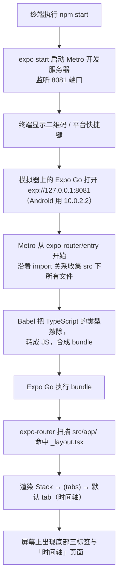

# 01 · 工程基线：Expo 工程是怎么跑起来的

## 1. 本次完成了什么

**用户现在可以做什么**

在 `/Users/wind/workspace/coding/LifeTrack` 里执行 `npm install` 和 `npm start`，就能启动 Expo 开发服务器；
用手机上的 Expo Go 扫码，或者在 iOS 模拟器 / Android 模拟器上用 Expo Go 打开，就能看到 LifeTrack：
底部三个标签（时间轴 / 事件 / 设置），其中设置页会显示本地数据库的状态。

**解决了什么问题**

在本次之前，仓库里只有 `.git`，没有任何代码。现在有了一个**可以在 iOS 和 Android 上真实运行、可以打包、可以跑静态检查和测试**的工程骨架。

**在整个 LifeTrack 中处于什么位置**

它是地基。第二阶段所有业务功能（事件定义、记录、周期、统计、导入导出）都会长在这一次搭好的这几层上：
路由层 → 组件层 → 数据库层 → 仓储层 → 领域层。这些层的边界在本文最后一节说明。

**本次范围内明确没有实现什么**

- 没有任何业务功能：不能记录事件、不能建事件定义、没有周期、没有统计、没有导入导出。
- 没有账号、没有后端、没有云数据库、没有多设备同步（这是整个首版的明确排除项）。
- 没有 Web 端、没有局域网 HTTP 服务。
- 没有深色主题（`app.json` 里 `userInterfaceStyle` 固定为 `light`）。
- 没有原生工程目录（没有 `ios/`、`android/`），运行方式是 Expo Go，而不是自己编译的原生壳。

## 2. 修改了哪些文件

| 文件路径 | 文件的职责 | 本次具体修改 | 与其他文件的关系 |
| --- | --- | --- | --- |
| `package.json` | 声明依赖、依赖版本、可执行命令 | 用 `create-expo-app` 生成后，新增 `expo-router`、`expo-sqlite`、`expo-crypto` 等依赖；新增 `typecheck` / `lint` / `format` / `test` / `verify` / `doctor` 脚本；把 `main` 从模板的 `index.ts` 改成 `expo-router/entry` | 所有文件的「入口配置」；`main` 指向 expo-router，决定了 `src/app/` 成为路由目录 |
| `app.json` | Expo 应用配置（名称、图标、插件、实验特性） | 设置 `name` / `slug` / `version` / `scheme: "lifetrack"` / `ios.bundleIdentifier` / `android.package`；`plugins` 加入 `expo-router`、`expo-sqlite`、`expo-splash-screen`、`expo-font`；开启 `experiments.typedRoutes` | 被 Expo 工具链读取；`plugins` 里的 `expo-sqlite` 是数据库能在设备上工作的前提 |
| `tsconfig.json` | TypeScript 编译与检查配置 | 继承 `expo/tsconfig.base`，开启 `strict`、`noUncheckedIndexedAccess`、`noImplicitOverride`；声明 `types: ["jest","node","react"]`；声明路径别名 `@/* → ./src/*` | 决定 `tsc --noEmit` 怎么检查全部 `src/`；`@/*` 别名由它定义 |
| `eslint.config.js` | 代码规范检查配置 | 使用 Expo 官方 flat config，并在最后叠加 `eslint-config-prettier`（关掉与 Prettier 冲突的格式规则） | 被 `npm run lint` 使用；与 `.prettierrc.json` 配合，避免两套工具互相打架 |
| `.prettierrc.json` | 代码格式化规则 | 使用 Prettier 默认风格 | 被 `npm run format` / `format:check` 使用 |
| `jest.config.js` | 单元测试配置 | `preset: 'jest-expo'`；`testMatch` 限定为 `src/**/__tests__/**/*-test.ts?(x)` | 决定了测试文件的命名与位置约定 |
| `expo-env.d.ts` | Expo 生成的类型声明入口 | 由 Expo 生成，内容是 `/// <reference types="expo/types" />`，不要手改 | 让 TypeScript 认识 Expo 注入的全局类型 |
| `src/app/_layout.tsx` | 根布局（所有页面最外层的组件） | 新建：注入 `DatabaseProvider`、`StatusBar`、`DatabaseGate`，并用 `Stack` 承载 `(tabs)` | 是路由层最外层，连接了数据库层（`DatabaseProvider`）和界面层（`DatabaseGate`、`Stack`） |
| `README.md` | 项目说明与操作手册 | 新增：环境要求、快速开始、命令表、目录结构、领域规则、数据安全约定、测试策略、第一阶段验收记录 | 面向使用者的入口文档；本套学习文档是它的补充 |
| `AGENTS.md` | 给 AI 协作者的工程约定 | 记录 Expo 版本敏感、必须查对应版本文档、lint 与 typecheck 必须跑等规则 | 约束后续开发行为，不影响运行时 |

删除了模板自带的 `App.tsx` 和 `index.ts`：因为 `main` 已改为 `expo-router/entry`，路由由 `src/app/` 决定，这两个文件不再被引用。

## 3. 涉及哪些技术概念

### 3.1 npm、`package.json`、依赖版本号

**是什么**：npm 是 Node 的包管理器。`package.json` 是项目的「清单」：项目叫什么、依赖哪些别人的代码、能执行哪些命令。`npm install` 会读取它（和 `package-lock.json`）把依赖装到 `node_modules/`。

**为什么本项目需要**：React Native、Expo、SQLite 驱动这些都不是我们自己写的，而是社区/官方发布的包。没有包管理，就得手工下载几十个库并处理版本匹配，几乎不可维护。

**用在哪个真实文件**：`package.json`。例如这一段决定「怎么运行项目」：

```json
"main": "expo-router/entry",
"scripts": {
  "start": "expo start",
  "typecheck": "tsc --noEmit",
  "verify": "npm run typecheck && npm run lint && npm run test"
}
```

**不用会怎样**：没有 `package.json`，Node 不知道去哪里找 Expo，`npm start` 无从执行。

**版本号里的 `~` 和 `^`**：这是「允许的升级范围」。

- `"react": "19.3.0"` —— 精确锁定。React 与 React Native 的版本必须严格配套，锁死最安全。
- `"expo-sqlite": "~58.0.13"` —— **波浪号**：允许最后一位（修订号）自动升，即允许 `58.0.14`，不允许 `58.1.0`。
- `"@expo/vector-icons": "^15.0.2"` —— **插入号**：允许第二位（次版本号）升，即允许 `15.1.0`，不允许 `16.0.0`。

生活化的例子：`^` 像是「同一个系列里可以换新款」，`~` 像是「只能修修补补，不能换新款」，精确版本是「就要这一个」。

**容易误解的地方**：`node_modules/` 不进版本库（见 `.gitignore`），真正被提交的是 `package.json` 和 `package-lock.json`。`package-lock.json` 记录了「这次安装实际装到了哪些精确版本」，保证别人和你装出一样的结果。

### 3.2 Expo、Expo Go、Metro

**是什么**：

- **Expo** 是一套围绕 React Native 的工具与运行时，帮你处理打包、原生模块、配置。
- **Metro** 是 React Native 的打包器（bundler）：把分散的 JS/TS 文件合并成设备能执行的 bundle。
- **Expo Go** 是一个已经预先装好一批原生模块的 App。你的 JS 代码通过它运行，于是**不必自己编译原生工程**。

**为什么本项目需要**：本项目的目标是「写一个本地优先的记录 App，不引入不必要的构建复杂度」。用 Expo Go 可以直接在自己的代码上迭代，不用每次改动都等 Xcode 编译。

**用在哪个真实文件**：`package.json` 的 `"start": "expo start"`；`app.json` 的 `plugins` 列表。`app.json` 里的 `expo-sqlite` 插件保证了 Expo Go 里的 SQLite 原生模块被正确关联。

**不用会怎样**：

- 没有 Metro，设备拿到的是几百个散文件，无法加载。
- 不用 Expo Go 而手工编译原生壳，第一阶段就要处理 Xcode/Gradle 配置，迭代速度会慢很多。

**重要限制（必须记住）**：Expo Go **只包含它自己内置的原生模块**。如果我们以后加了一个不在内置列表里的原生库，Expo Go 就不认识它，必须改成「开发构建」（`npx expo run:ios` / `npx expo run:android`，或用 EAS 云端构建）。目前 `expo-sqlite`、`expo-crypto`、`@expo/vector-icons` 都在 Expo Go 内置范围内，所以第一阶段全程用 Expo Go。

### 3.3 Config Plugin 与 CNG（不手写 `ios/`、`android/` 目录）

**是什么**：`app.json` 的 `plugins` 数组。Expo 会在生成原生工程时，按插件把需要的原生配置（权限、链接库、启动屏等）写进 `ios/` 和 `android/`。

**为什么本项目需要**：仓库里**故意不提交** `ios/` 和 `android/` 目录（这种方式叫 CNG，Continuous Native Generation）。好处是：仓库干净、不出现「有人手改了原生工程导致别人构建失败」的问题，配置只在一个地方（`app.json`）。

**用在哪个真实文件**：`app.json`：

```json
"plugins": ["expo-router", "expo-sqlite", ["expo-splash-screen", { ... }], "expo-font"]
```

**不用会怎样**：手工维护 `ios/` / `android/`，一旦有人改了原生文件，别人拉下来就报错，而且改完还要同时改两个平台。

**规则**：**永远不要手写 `ios/` 和 `android/` 目录**。要改原生行为，就改 `app.json` 或加 config plugin。

### 3.4 TypeScript 的「编译期检查」与「运行时擦除」

这是最容易误解的一点，务必分清。

**是什么**：TypeScript 是「带类型标注的 JavaScript」。类型信息**只用于检查**，不会变成运行时代的代码。

**为什么本项目需要**：LifeTrack 的数据模型（事件定义、记录、快照）有明确的规则，用类型可以在写代码时就发现「把数量当成计数用」这类错误，而不是等用户点了按钮才崩。

**用在哪个真实文件**：`tsconfig.json` 决定检查的严格程度；`src/domain/models.ts` 是被检查的对象。

**核心结论**：

```bash
npm run typecheck   # = tsc --noEmit：只检查，不产出任何文件
```

`tsc --noEmit` 里的 `--noEmit` 就是「不要输出 JS」。因为设备上跑的不是 `tsc` 编出来的产物，而是 Metro/Babel 把 TS **直接擦掉类型**后得到的 JS。

**不用会怎样**：类型错误不会被任何工具发现，只有真正运行到那一行才可能出错。

**具体例子（对应下面第 4 节）**：`src/domain/id.ts` 里写了 `bytes[0] ?? 0`。这不是「多此一举」，而是在 `noUncheckedIndexedAccess` 开启时，TypeScript 会认为「从数组里取下标 0 可能取不到，结果可能是 `undefined`」，所以必须先兜底。这是**编译期**的压力；而在**运行时**，`bytes` 是我们自己 `new Uint8Array(16)` 造出来的，下标 0 一定存在。两者不矛盾——类型检查只是保守地说「可能没有」。

### 3.5 路径别名 `@/*`

**是什么**：在 `tsconfig.json` 里声明：

```json
"paths": { "@/*": ["./src/*"] }
```

于是 `import { palette } from '@/theme'` 等于 `import { palette } from '../../../theme'`（相对路径随文件深度变化，别名不变）。

**为什么本项目需要**：页面文件在 `src/app/(tabs)/` 里，如果写相对路径，就会到处出现 `../../../components`，一旦移动文件就全部报错。

**用在哪个真实文件**：几乎每个源文件都在用，例如 `src/components/Card.tsx` 的 `import { palette, radius, spacing } from '@/theme';`。

**不用会怎样**：路径又长又脆，重构困难。

**注意（容易踩坑）**：`tsconfig.json` 里的 `paths` **只管 TypeScript 检查**。要让打包器（Metro）也认这个别名，还需要打包侧支持。本项目**已经能用**——证据是 iOS 和 Android 上都真实跑起来了，而代码里大量使用了 `@/`。Expo 的默认 Metro 配置会读取 `tsconfig.json` 的 `paths`，所以不需要额外安装 `babel-plugin-module-resolver`。

## 4. 关键代码逐段解释

### 4.1 `package.json` 的两处关键配置

```json
"main": "expo-router/entry",
```

这一行决定「应用的第一个 JS 文件是谁」。`expo-router/entry` 是 expo-router 提供的入口：它去扫描 `src/app/` 目录，把里面的文件变成路由。**这也是为什么删掉模板的 `App.tsx` 和 `index.ts` 不会出问题**——它们已经不在引用链上了。

```json
"verify": "npm run typecheck && npm run lint && npm run test"
```

`&&` 表示「前一个成功才跑下一个」。所以 `npm run verify` 会依次执行静态检查、代码规范检查、单元测试；任何一步失败就中断。这是提交前的一把梭命令。

### 4.2 `tsconfig.json`：三个严格开关

```json
{
  "extends": "expo/tsconfig.base",
  "compilerOptions": {
    "strict": true,
    "noUncheckedIndexedAccess": true,
    "noImplicitOverride": true,
    "types": ["jest", "node", "react"],
    "paths": { "@/*": ["./src/*"] }
  }
}
```

- `extends`：继承 Expo 的基础配置，避免从零写一堆编译目标、模块解析规则。
- `strict`：打开一整套严格检查（`strictNullChecks` 等）。**代价**是要多写一些兜底代码；**收益**是空值错误在编译期就被抓住。
- `noUncheckedIndexedAccess`：数组/对象按下标取值时，类型里自动带上 `undefined`。这就是为什么 `id.ts` 要写 `bytes[0] ?? 0`。
- `noImplicitOverride`：子类重写父类方法必须显式写 `override`。本项目里 `AppError` 的子类**没有**重写方法，只调用构造函数，所以不受影响。
- `types`：显式声明全局类型来源。测试用的 `jest` 全局（`describe` / `it` / `expect`）就是靠这里的 `"jest"` 才被认识的。

**初学容易误解的地方**：如果你写 `expect(...)` 时编辑器报「找不到 expect」，先看的不是测试代码，而是 `types` 有没有配上。

### 4.3 `app.json`：三个值得注意的字段

```json
"scheme": "lifetrack",
"experiments": { "typedRoutes": true },
"android": { "predictiveBackGestureEnabled": false }
```

- `scheme`：给应用分配一个 URL 协议头。目前没有业务用途，但它是深链接（从别处跳到应用某个页面）的前提。
- `typedRoutes`：开启后，Expo 会生成 `.expo/types/router.d.ts`，让 `href` 之类的路由参数也参与类型检查——打错路径名会在 `tsc` 阶段报错，而不是运行时空白。
- `predictiveBackGestureEnabled: false`：关掉 Android 的预测式返回手势动画。属于默认值调整，不影响功能。

## 5. 一次完整操作的数据流

以「第一次启动开发服务器 → 在模拟器上看到应用」为例：



逐步解释：

1. `npm start` 只是转发到 `expo start`，真正干活的是 Metro。
2. Metro 从 `package.json` 的 `main`（`expo-router/entry`）出发，顺着 `import` 语句把用到的文件全都收集进来。
3. 这些文件里写的 TypeScript 类型（例如 `interface CardProps`）在这一步被**擦除**，不会留在产物里。
4. 产物是一串 JS。Expo Go 内置了 React、React Native 的运行时和 `expo-sqlite` 等原生能力，所以能执行它。
5. `expo-router` 读取 `src/app/` 目录结构，命中根布局 `_layout.tsx`，再逐层渲染。
6. 最终屏幕上的东西，是 React Native 把这棵组件树翻译成 iOS/Android 原生视图的结果。

**注意**：这条链路是「打包 + 渲染」。数据库那条完全不同的链路在 [04](./04-sqlite-and-repository.md) 和 [05](./05-business-logic-and-data-flow.md) 里讲。

## 6. 如何验证

### 关键命令

```bash
npm install          # 安装依赖（首次或 package.json 变化后）
npm run typecheck    # tsc --noEmit：类型检查，不产出文件
npm run lint         # ESLint
npm test             # Jest 单元测试
npm run doctor       # expo-doctor：依赖版本与配置体检
npm start            # 启动开发服务器
```

### 正常应该看到什么

- `npm run typecheck`：没有任何输出（TypeScript 只在报错时说话）。
- `npm run lint`：没有 error / warning。
- `npm test`：第一阶段实际输出是

  ```
  Test Suites: 4 passed, 4 total
  Tests:       32 passed, 32 total
  ```

- `npm run doctor`：第一阶段实际结果 20/20 通过。
- `npm start`：终端出现二维码和 `› Press i │ open iOS simulator`、`› Press a │ open Android emulator` 之类的提示。

### 手动验证

1. 先 `npm start`，让它保持运行。
2. iOS：另开终端执行

   ```bash
   xcrun simctl terminate booted host.exp.Exponent
   xcrun simctl openurl booted "exp://127.0.0.1:8081"
   ```

   注意：**必须先 terminate 再 openurl**，否则 Expo Go 会忽略新的 URL。iOS 模拟器第一次会弹一个系统确认框，需要手动点掉，这一步无法自动化。

3. Android：

   ```bash
   ADB=/Users/wind/Library/Android/sdk/platform-tools/adb
   $ADB shell am force-stop host.exp.exponent
   $ADB shell am start -a android.intent.action.VIEW -d "exp://10.0.2.2:8081" host.exp.exponent
   ```

   Android 模拟器访问宿主机要用 `10.0.2.2`（模拟器内的特殊地址），不是 `127.0.0.1`。

4. 成功的证据：底部出现「时间轴 / 事件 / 设置」三个标签，切到「设置」能看到数据库信息卡片。

### 如何查看失败信息

- `tsc` 报错会带 `文件路径:行:列` 和错误类型（例如 `TS2532: Object is possibly 'undefined'`）。
- Jest 失败会打印失败用例名、期望值（`Expected`）与实际值（`Received`），以及调用栈。
- Metro/Expo 的报错会同时出现在**终端**和**设备屏幕**上的红色错误屏。

### 测试覆盖了什么、没覆盖什么

- 覆盖：领域类型里的错误体系、UUID 生成规则、迁移机制、`MetaRepository` 的读写。
- 没覆盖：`src/app/` 下的任何屏幕（`jest.config.js` 的 `collectCoverageFrom` 明确排除了 `src/app/**`），以及 `src/components/` 下组件的渲染。也就是说，**「界面能不能正常显示」目前完全靠模拟器手动验证**。

### 哪些验证真实执行过

第一阶段真实执行过：`npm run typecheck`、`npm run lint`、`npm test`（4/32 通过）、`npm run doctor`（20/20）、
`npx expo export --platform ios --platform android`（两端都产出 Hermes bundle）、iOS Simulator 运行、Android 模拟器运行。

**没有执行过**：真机（iPhone / Android 实体设备）运行；`npm run web` 的浏览器验证。

## 7. 常见问题与排查

### 问题：设备上报 `Cannot find native module 'ExpoSQLite'`

**原因**：这是第一阶段真实遇到过的坑，**不是代码问题，而是 Metro 的转换缓存过期**导致的假故障。缓存的旧转换结果里没有正确关联原生模块。

**排查顺序**：

1. 先确认这不是「真的没这个模块」。证据是：同一个 Expo Go 里，别的 Expo 项目能正常用 SQLite；在设备上探查 `globalThis.expo.modules.ExpoSQLite` 也存在。
2. 用 `npx expo start --clear` 重启开发服务器清理缓存。
3. 再重新打开应用。

**结论**：**改动依赖后一律用 `--clear` 启动**，否则 Android 端容易误报。这个排障经过已经写进根 `README.md`。

### 问题：`npm start` 报端口被占用

**原因**：8081 被另一个 Metro（可能是上一个没关干净的项目）占用。

**排查顺序**：`lsof -i :8081` 找到进程 → 关闭它，或者 `npx expo start --port 8082` 换端口（注意设备端 URL 也要跟着换端口）。

### 问题：终端里 `node` / `npm` 版本不对

**原因**：本机 Node 由 `fnm` 管理，默认 shell 里可能没启用。

**排查顺序**：用 `fnm exec --using=24 -- npm start`，或者先 `eval "$(fnm env --use-on-cd)"`。

### 问题：装新依赖后版本冲突，`npm install` 报 `ERESOLVE`

**原因**：手工把某个包升到了与 Expo SDK 不匹配的版本。

**排查顺序**：**不要**用 `npm install --force` 硬压。正确做法是用 `npx expo install <包名>`，它会挑选与当前 SDK 兼容的版本；或者 `npx expo install --fix` 自动纠正。

### 问题：改了代码，设备上是旧的

**原因**：可能是 Metro 缓存，也可能是设备侧没重新加载。

**排查顺序**：先看终端有没有「Fast refresh」日志 → 在 Expo Go 里手动下拉刷新 → 仍然不对就 `npx expo start --clear`。

## 8. 本阶段学习总结

**掌握的核心概念**

- 一套 Expo 工程的启动链路：`npm start` → Metro → bundle → Expo Go → expo-router → 渲染。
- 「配置驱动」的思路：`app.json` 管原生能力，`tsconfig.json` 管类型检查，`eslint.config.js` 管规范，`jest.config.js` 管测试。
- **编译期 vs 运行时**：`tsc --noEmit` 只检查，类型在打包时被擦除。
- 路径别名 `@/*` 减少相对路径的脆弱性。
- 依赖版本号 `~` / `^` / 精确锁定的含义。

**需要理解的关键文件**

`package.json`（入口与命令）、`app.json`（原生配置与插件）、`tsconfig.json`（严格度与别名）。

**建议亲自尝试的小练习**

1. 打开 `package.json`，找出 `start`、`typecheck`、`verify` 三个脚本，用自己的话写下它们各自做了什么。
2. 把 `app.json` 里的 `"version": "0.1.0"` 改成 `"0.1.1"`，重启开发服务器，然后在应用的「设置 → 应用信息 → 应用版本」里确认它变了。
3. 运行 `npm run doctor`，观察它检查了哪些项目。

**预期结果与验证方法**

- 练习 2 的预期结果：设置页「应用版本」显示 `0.1.1`。这一步只是改配置、读配置，**不涉及数据库，安全**。如果没变化，先确认改的是 `app.json` 而不是 `package.json`，并确认开发服务器重启过。
- 练习 3 的预期结果：输出若干项检查，第一阶段基线是 20/20 通过。

**下一阶段会用到哪些已学知识**

- 第二阶段新增依赖时，要用 `npx expo install`（本文 3.1、7 讲过）而不是 `npm install`。
- 第二阶段新增的页面文件会放进 `src/app/`（本文 3.5 讲的 `main` 决定），并用 `@/` 别名导入共享代码。
- 第二阶段会给数据库加 v2 迁移（见 [04](./04-sqlite-and-repository.md)），改动前要先跑 `npm run verify` 确认基线是绿的。