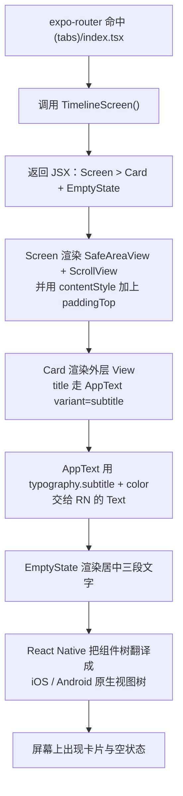

# 02 · React Native 界面：屏幕上的东西是怎么画出来的

## 1. 本次完成了什么

**用户现在可以做什么**

打开应用能看到一个有设计的界面，而不是一堆裸文字：

- 三个标签页各自的页面（时间轴 / 事件 / 设置）都能渲染。
- 页面由「卡片（Card）」组织信息，卡片里可以放标题、副标题、说明文字。
- 有按钮（Button，支持按下变淡的反馈）、徽章（Badge，用于显示状态，例如「已连接」「schema v1」）、空状态提示（EmptyState）。
- 统一的浅色主题：背景色、卡片色、文字色、强调色、间距、圆角、字号全部来自一处。

**解决了什么问题**

解决了「界面没有共同语言」的问题。如果每个页面各自写颜色和字号，很快就会五花八门，而且以后想换配色要改几十处。
现在把「设计令牌」集中到 `src/theme/index.ts`，页面只负责搭结构。

**在整个 LifeTrack 中处于什么位置**

这是**界面层**（视图层）。它只负责「把数据画出来」和「把用户的操作转成事件」。
它**不包含任何业务规则，也不写任何 SQL**——这两件事分别属于领域层和仓储层。

**本次范围内明确没有实现什么**

- 没有数据列表：时间轴和事件页现在显示的是 `EmptyState`（空状态），因为还没有业务数据。
- 没有表单：没有输入框、没有开关，`TextInput` 一次都没用到。
- 没有图片/图标组件（除了底部标签栏用的 Ionicons 图标）。
- 没有列表虚拟化（`FlatList`）。现在的页面用 `ScrollView` + `map` 就够了，第二阶段数据多了要改用 `FlatList`。
- 没有深色模式。`theme/index.ts` 里预留了 `useTheme()`，但**组件目前都直接引用 `palette`**，这个预留接口还没有真正接上（详见第 4.5 节的既有问题说明）。

## 2. 修改了哪些文件

| 文件路径 | 文件的职责 | 本次具体修改 | 与其他文件的关系 |
| --- | --- | --- | --- |
| `src/theme/index.ts` | 设计令牌（颜色 / 间距 / 圆角 / 字体） | 新建：导出 `palette`、`spacing`、`radius`、`typography`，以及 `theme`、`Theme` 类型、`useTheme()` | 被**所有**界面文件引用；是界面的「唯一配色来源」 |
| `src/components/AppText.tsx` | 统一文字组件 | 新建：在 RN 的 `Text` 上包一层，按 `variant` 从 `typography` 取字号，按 `color` 取颜色 | 被 `Button` / `Badge` / `Card` / `EmptyState` / `Screen` 之外的页面全部使用；是「文字样式统一」的落点 |
| `src/components/Screen.tsx` | 页面容器 | 新建：处理安全区（刘海/状态栏）、水平内边距、以及「要不要可滚动」 | 每个屏幕组件的最外层都用它包裹 |
| `src/components/Card.tsx` | 信息分组容器 | 新建：可选标题、可选副标题、`children` 放内容 | 被三个页面用来分组显示信息 |
| `src/components/Button.tsx` | 按钮 | 新建：三种色调（primary / secondary / danger），按下与禁用状态 | 目前只被「设置」页的错误重试按钮使用 |
| `src/components/Badge.tsx` | 状态徽章 | 新建：五种色调（neutral / primary / success / warning / danger） | 被设置页用来显示「已连接」「schema v1」 |
| `src/components/EmptyState.tsx` | 空状态提示 | 新建：标题 + 说明 + 脚注三段文字，居中显示 | 被时间轴页与事件页使用 |
| `src/components/index.ts` | 组件统一出口 | 新建：把六个组件集中 re-export | 让页面写 `import { Card, Screen } from '@/components'`，一次拿到多个组件 |
| `src/app/(tabs)/index.tsx` | 时间轴页面 | 新建：一段说明卡片 + `EmptyState` | 使用 `@/components` 与 `@/theme` |
| `src/app/(tabs)/definitions.tsx` | 事件页面 | 新建：说明卡片 + `EmptyState` | 同上 |
| `src/app/(tabs)/settings.tsx` | 设置页面 | 新建：应用信息 / 本地数据库 / `app_meta` 内容 / 数据安全约定 四张卡片 | 既用组件层，也用数据库层（见 [05](./05-business-logic-and-data-flow.md)） |

## 3. 涉及哪些技术概念

### 3.1 JSX

**是什么**：在 JavaScript/TypeScript 里写「看起来像 HTML 的界面描述」的语法。例如：

```tsx
<Card title="时间轴">
  <AppText>这里将按时间倒序展示所有事件记录。</AppText>
</Card>
```

`<Card ...>` 不是 HTML 标签，而是**调用 `Card` 这个函数**；两个标签之间的内容会作为参数 `children` 传进去。

**为什么本项目需要**：界面本质上是「树」——容器里套容器、容器里放文字。JSX 用嵌套的写法直接表达这棵树，比手工调用函数清晰得多。

**用在哪个真实文件**：所有 `.tsx` 文件。核心例子是 `src/app/(tabs)/settings.tsx`。

**不用会怎样**：得写 `React.createElement(Card, { title: '时间轴' }, ...)`，嵌套多层后可读性急剧下降。

**容易误解的地方**：JSX 里花括号 `{}` 表示「这里放 JavaScript 表达式」。`title="时间轴"` 传的是字符串；`title={name}` 传的是变量。

### 3.2 React 组件与 props

**是什么**：

- **组件（Component）**：一个返回界面的函数，名字必须大写开头。例如 `export function Card(...) { return (...) }`。
- **props**：组件从外部接收的参数，是只读的。`Card` 的 props 是 `{ title, subtitle, children, style }`。

**为什么本项目需要**：把「卡片」写一次，三个页面复用。如果每个页面自己写一遍边框和圆角，改一次样式要改三处，而且很容易不一致。

**用在哪个真实文件**：`src/components/Card.tsx` 定义 props，`src/app/(tabs)/index.tsx` 使用。

**不用会怎样**：界面代码大量重复，样式漂移。

**容易误解的地方（重要）**：**props 是只读的**。组件想改自己的数据，不能用 props，要用 state（见 [05](./05-business-logic-and-data-flow.md)）。

### 3.3 `children` 与 `ReactNode`

**是什么**：`children` 是 JSX 嵌套时自动传入的特殊 prop。它的类型我们写成 `ReactNode`。

**为什么本项目需要**：`Card` 与 `Screen` 都不知道自己里面会放什么，只能声明「我接受一段界面内容」。

**用在哪个真实文件**：`src/components/Card.tsx` 的 `children?: ReactNode`；`src/components/Screen.tsx` 的 `children: ReactNode`。

**注意区别**：

- `Screen` 的 `children` 是**必填**（`children: ReactNode`）——一个空屏幕没有意义。
- `Card` 的 `children` 是**可选**（`children?: ReactNode`）——可以有「只有标题的卡片」。
- `ReactNode` 比 `ReactElement` 宽：可以是元素、字符串、数字、数组，甚至 `null`。所以 `Card` 里可以先判断 `children ? ... : null`。

### 3.4 React Native 的核心组件：`View` / `Text` / `Pressable` / `ScrollView` / `ActivityIndicator`

**是什么**：React Native 没有 HTML 的 `div`、`span`、`button`。取而代之的是一批「跨平台组件」，它们在 iOS 上对应 iOS 的原生视图，在 Android 上对应 Android 的原生视图。

| 组件 | 对应什么 | 本项目在哪里用 |
| --- | --- | --- |
| `View` | 盒子/容器（类似 `div`） | `Card` 的外层、`Screen` 的内层 |
| `Text` | 文字（**必须**用它才能显示文字） | `AppText` 里唯一用到 `Text` 的地方 |
| `Pressable` | 可点击区域（比老的 `TouchableOpacity` 更现代） | `Button` |
| `ScrollView` | 可滚动容器 | `Screen` 的 `scroll` 分支 |
| `ActivityIndicator` | 转圈加载指示器 | `DatabaseGate` 的「正在准备本地数据库…」 |

**为什么本项目需要**：这是 RN 里最小可用的界面原语，没有它们连一行文字都显示不出来。

**不用会怎样**：**在 RN 里把文字直接放在 `View` 里会直接报错**（这是从 Web 转过来最容易踩的坑：Web 的 `div` 可以直接放文字，RN 不行）。

**容易误解的地方**：`Text` 的样式不会像 Web 那样被父容器继承得那么自然，所以本项目干脆做了 `AppText`，让所有文字都从同一张字号表里取样式。

### 3.5 `StyleSheet.create` 与「样式数组」

**是什么**：RN 的样式是 JavaScript 对象，不是 CSS 文件。

```tsx
const styles = StyleSheet.create({
  card: { backgroundColor: palette.surface, borderRadius: radius.lg, ... },
});
```

使用时的写法是**数组**：

```tsx
<View style={[styles.card, style]}>
```

**为什么本项目需要**：数组形式让「基础样式 + 外部覆盖 + 动态值」能叠起来，顺序决定优先级。

**用在哪个真实文件**：`src/components/AppText.tsx` 是最清楚的例子：

```tsx
<Text {...rest} style={[typography[variant], { color }, style]} />
```

**不用会怎样**：如果只写 `style={styles.card}`，外部就没法给 `Card` 传自定义样式；如果只写外部样式，组件的基础样式就丢了。

**容易误解的地方（一定要记住）**：**数组里越靠后优先级越高**。上面那行依次是：先套字号表 → 再用 `color` 覆盖颜色 → 最后调用方传的 `style` 覆盖前面所有。所以调用方可以覆盖颜色和字号。如果顺序反了，调用方的样式就会被吃掉。

另外 `StyleSheet.hairlineWidth` 是一个比 1 像素更细的常量，用来画「发丝般细」的边框，在高分屏上比硬写 `1` 更好看（`Card` 和 `Button` 都在用）。

### 3.6 flex 布局

**是什么**：RN 的布局默认就是 flex，而且**默认方向是竖着排（`flexDirection: 'column'`）**，这与 Web 的默认值相反。

**为什么本项目需要**：摆脱了「写死像素坐标」的脆弱做法，界面能自适应不同屏幕。

**用在哪个真实文件**：`src/components/Button.tsx` 的 `base` 样式用 `alignItems: 'center'` + `justifyContent: 'center'` 把文字居中；`src/components/Screen.tsx` 用 `flex: 1` 让容器撑满屏幕。

**不用会怎样**：得手工计算每个元素的位置，换一台设备就错位。

**容易误解的地方**：`flex: 1` 的含义是「占满剩余空间」，不是「占满整个屏幕」。它必须放在一个已经有确定尺寸的父容器里才有意义。

### 3.7 `Platform.select`

**是什么**：按平台选不同的值。

**为什么本项目需要**：等宽字体在两个平台上的名字不一样。

**用在哪个真实文件**：`src/theme/index.ts` 的 `typography.mono`：

```tsx
fontFamily: Platform.select({ ios: 'Menlo', android: 'monospace', default: 'monospace' }),
```

**不用会怎样**：写死 `'Menlo'` 在 Android 上不生效，静默回退，代码里看不出为什么。

**本项目中它用在哪**：设置页里的「文件路径」用 `mono` 变体显示，方便肉眼比对。

### 3.8 `SafeAreaView` 与 `edges`

**是什么**：`react-native-safe-area-context` 提供的 `SafeAreaView`，能把内容避开刘海、圆角、状态栏和底部横条。

**为什么本项目需要**：iPhone 有刘海和底部指示条，Android 有状态栏。不处理的话，标题会被状态栏盖住。

**用在哪个真实文件**：`src/components/Screen.tsx`：

```tsx
<SafeAreaView style={styles.safeArea} edges={['top', 'left', 'right']}>
```

**不用会怎样**：文字顶到状态栏里，或者内容被刘海遮挡。

**容易误解的地方**：这里 `edges` **故意不包含 `'bottom'`**。因为底部已经被标签栏占据，如果再加底部安全区，页面内容和标签栏之间会多出一段空白。

## 4. 关键代码逐段解释

### 4.1 `AppText`：把字号表套在 `Text` 上

```tsx
export type TextVariant = keyof typeof typography;

export interface AppTextProps extends TextProps {
  variant?: TextVariant;
  color?: string;
}

export function AppText({ variant = 'body', color = palette.text, style, ...rest }: AppTextProps) {
  return <Text {...rest} style={[typography[variant], { color }, style]} />;
}
```

逐段看：

- `keyof typeof typography`：`typography` 是 `display/title/subtitle/body/label/caption/mono` 七个键的对象，`keyof` 取出这七个键组成的**联合类型**。所以 `variant` 只能是这七个字符串之一——**打错字会在编译期报错**。
- `interface AppTextProps extends TextProps`：继承 `Text` 原本支持的所有 prop（`numberOfLines`、`selectable`、`onPress` 等），再加上我们自己的 `variant` 和 `color`。这样 `AppText` 就**能替代 `Text`，而不是只能显示纯文字**。
- 参数解构里的 `variant = 'body'`：默认值。不传就是 `body`。
- `...rest`：把剩下的所有 prop 原样传给 `Text`（展开了）。设置页里 `selectable`（让用户能长按复制数据库路径）就是通过 `rest` 传下去的。
- `[typography[variant], { color }, style]`：样式依次叠加，后面的覆盖前面的。

**为什么这样实现，而不是直接写 `<Text style={{fontSize: 15}}>`**：字号散落在各页面，改一次要全局搜索。集中到 `typography` 后，只改一处就能全局生效。

**编译期 vs 运行时**：`variant` 类型错误在 `tsc` 阶段就被拦下；但如果有人用 `variant={'body' as TextVariant}` 硬转类型，运行时 `typography[variant]` 会拿到 `undefined`，样式直接丢失——这就是「类型可以被骗过去」的典型例子。

**容易误解的地方**：`{ color }` 是 `{ color: color }` 的简写。这里写成一个独立对象而不是放进 `typography`，是因为 `typography` 只放「不随调用方变化的排版」，颜色是每次调用都可能不同的。

### 4.2 `Screen`：一个组件管两种布局

```tsx
export function Screen({ children, scroll = false, padded = true, contentStyle }: ScreenProps) {
  const paddingStyle = padded ? styles.padded : undefined;

  if (scroll) {
    return (
      <SafeAreaView style={styles.safeArea} edges={['top', 'left', 'right']}>
        <ScrollView
          style={styles.flex}
          contentContainerStyle={[styles.scrollContent, paddingStyle, contentStyle]}
          keyboardShouldPersistTaps="handled"
        >
          {children}
        </ScrollView>
      </SafeAreaView>
    );
  }

  return (
    <SafeAreaView style={styles.safeArea} edges={['top', 'left', 'right']}>
      <View style={[styles.flex, paddingStyle, contentStyle]}>{children}</View>
    </SafeAreaView>
  );
}
```

- `scroll` 决定内容溢出屏幕时能不能滚动：设置页内容很长，必须能滚；加载中的页面只有一行字，不需要。
- `padded` 只做一件事：要不要给左右加内边距。
- `contentStyle` 是「逃生舱」：调用方可以再追加样式。三个页面都传了 `{ paddingTop: spacing.lg }`，因为它们的标题是卡片而不是导航栏标题，需要和状态栏拉开一点距离。
- `keyboardShouldPersistTaps="handled"`：键盘弹出时点击按钮第一次不会被吞掉。现在还没有输入框，这是为第二阶段表单预留的。

**为什么不用两个组件（`ScrollScreen` / `StaticScreen`）**：那会让调用方在「传不传 `scroll`」和「用哪个组件」之间做冗余选择，而且两者 95% 的结构相同。一个 `scroll` 布尔值更简单。

**注意（容易误解）**：`ScrollView` 的 `style` 和 `contentContainerStyle` 是**两个不同东西**：前者是滚动容器本身，后者是里面那层内容。如果内边距写在 `style` 上，滚动条的位置会受影响；写在 `contentContainerStyle` 上才是对的。本项目把它写在 `contentContainerStyle` 里。

### 4.3 `Button`：用「色调表 + 状态函数」代替分支

```tsx
const TONES: Record<ButtonTone, { background: string; text: string; border: string }> = {
  primary: { background: palette.primary, text: '#FFFFFF', border: palette.primary },
  secondary: { background: palette.surface, text: palette.text, border: palette.border },
  danger: { background: palette.dangerSoft, text: palette.danger, border: palette.danger },
};

export function Button({ label, onPress, tone = 'primary', disabled = false, testID, style }: ButtonProps) {
  const colors = TONES[tone];

  return (
    <Pressable
      accessibilityRole="button"
      accessibilityState={{ disabled }}
      disabled={disabled}
      onPress={onPress}
      testID={testID}
      style={({ pressed }) => [
        styles.base,
        {
          backgroundColor: colors.background,
          borderColor: colors.border,
          opacity: disabled ? 0.45 : pressed ? 0.75 : 1,
        },
        style,
      ]}
    >
      <AppText style={[styles.label, { color: colors.text }]}>{label}</AppText>
    </Pressable>
  );
}
```

- `Record<ButtonTone, {...}>`：声明「每个色调都必然有这三种颜色」。这是 `Record` 的用法，好处是**漏写一个色调，`tsc` 会报错**。
- `const colors = TONES[tone]`：先查表，后面就不用写 `if (tone === 'primary')` 这样的分支了。加第四种色调时，只改表，不改渲染逻辑。
- `style={({ pressed }) => [...]}`：注意这里传的是**一个函数**，不是对象。`Pressable` 会把「当前是否被按住」告诉你（`pressed`），你据此返回样式。这是 RN 里处理按压反馈的标准做法。
- `opacity: disabled ? 0.45 : pressed ? 0.75 : 1`：三级优先级，禁用最优先。
- `accessibilityRole="button"` / `accessibilityState={{ disabled }}`：给读屏软件（VoiceOver / TalkBack）提供语义。**这是必须的**，否则视障用户只知道「有个能点的东西」。
- `testID`：给自动化测试定位元素用的标识。目前没有 UI 测试，所以它是为将来准备的。

**容易误解的地方**：`pressed ? ... : ...` 这种嵌套三元表达式优先级容易看错，建议按上面的写法先判断 `disabled`。

**为什么用 `Pressable` 而不是 `Button`**：RN 自带的 `Button` 组件在 iOS 和 Android 上外观差别很大，而且几乎不能自定义样式。`Pressable` 只给交互行为，外观完全自己控制。

### 4.4 `Card`：可选的标题、副标题、内容

```tsx
export function Card({ title, subtitle, children, style }: CardProps) {
  return (
    <View style={[styles.card, style]}>
      {title ? <AppText variant="subtitle">{title}</AppText> : null}
      {subtitle ? (
        <AppText variant="caption" color={palette.textMuted} style={styles.subtitle}>
          {subtitle}
        </AppText>
      ) : null}
      {children ? <View style={title || subtitle ? styles.body : undefined}>{children}</View> : null}
    </View>
  );
}
```

- `{title ? <...> : null}`：**条件渲染**。`null` 表示「这里什么都不画」。RN 里这是标准写法。
- 最后一个条件里用了 `title || subtitle ? styles.body : undefined`：只有在**确实有标题或副标题**时，才给内容加上边距；否则内容上就不会多出一段空白。`undefined` 表示「不加这个样式」，和 `null` 在样式数组里的效果类似。
- 直接写 `{children}` 而不判断 `children && ...`，是因为 `children` 可能是数字 `0`，而 `0 && x` 会渲染出 `0` 本身。本项目用 `children ? ... : null` 规避了这个问题。

**容易误解的地方**：`{someNumber && <X/>}` 在 `someNumber` 为 `0` 时会**把 0 显示到屏幕上**。这是 RN 的经典坑。要么用三元表达式，要么先转成布尔值。

### 4.5 既有问题：`useTheme()` 和三处不一致的注释（诚实记录）

`src/theme/index.ts` 顶部的注释写的是：

> 但所有界面都通过 useTheme() 取色与尺寸，将来加深色主题不需要改组件。

**这句话与现状不符**。实际情况是：

- `useTheme()` 定义了，但**全仓库没有任何地方调用它**（可以自己搜 `useTheme` 验证）。
- 所有组件和页面都直接 `import { palette, spacing } from '@/theme'`，用的是模块级常量。

**影响**：

- 功能上没问题，现在能跑。
- 但注释给了错误的心智模型，将来加**深色主题**时，直接引用 `palette` 的 14 个文件全都得改——正好是注释声称"不需要改组件"的那个场景。也就是说，这个预留接口目前是**失效的**。

**改进方案（第二阶段或之后做）**：让组件通过 `useTheme()` 取色，例如把 `AppText` 的默认颜色改成 `useTheme().palette.text`；或者更彻底地用 Context 提供主题，并让 `palette` 成为「浅色主题的具体值」。在这之前，**注释应该改成描述现状**，避免误导。

这个例子想说明的是：**注释也会过期**。读代码时要交叉验证，不要只信注释。

## 5. 一次完整操作的数据流

以「打开应用后看到时间轴页面」为例：



每一步的文字解释：

1. 路由层决定渲染哪个组件（详见 [06](./06-navigation-and-state.md)）。
2. `TimelineScreen` 是纯函数，输入是 props（这里没有），输出是 JSX 描述。
3. `Screen` 负责「外壳」：安全区、滚动、内边距。
4. `Card` 负责「分组」：背景、圆角、边框，以及标题/副标题/内容的层级。
5. `AppText` 负责「排版」：从 `typography` 表里取字号。
6. RN 把 `View` / `Text` / `ScrollView` 映射成真正的原生视图。这一步之后就是平台原生代码在工作了。
7. 页面里**没有任何数据库操作，也没有任何业务判断**——这正是界面层该有的样子。

对照一下设置页（`settings.tsx`）的区别：它多了一步「从数据库读数据」，那条链路在 [05](./05-business-logic-and-data-flow.md) 里完整讲解。

## 6. 如何验证

### 关键命令

```bash
npm run typecheck   # 检查 props、variant、样式对象的类型
npm run lint        # 检查未使用变量、Hook 规则等
npm start           # 肉眼验证渲染
```

### 正常应该看到什么

- `npm run typecheck`：无输出。
- `npm run lint`：0 error / 0 warning。
- 应用里：底部三个标签；「时间轴」页有标题为「时间轴」的卡片和「还没有任何记录」的空状态；「设置」页有四张卡片（应用信息 / 本地数据库 / app_meta 表内容 / 数据安全约定）。

### 手动验证

1. `npm start`，在模拟器上打开应用。
2. 依次点三个标签，确认页面切换正常、内容互不串。
3. 在「设置」页往下滑，确认能滚动到底部的「数据安全约定」卡片。
4. 长按「文件路径」的值，确认能选中复制（这是 `AppText` 把 `selectable` 透传给 `Text` 的证据）。
5. 在 `DatabaseGate` 报错分支里可以看到 `Button` 的实际样式（正常路径下看不到，因为这个按钮只在数据库初始化失败时出现）。

### 如何查看失败信息

- 类型错误：`tsc` 输出 `文件:行:列 - error TSxxxx`，例如给 `Card` 传了不存在的 prop 会提示「对象字面量只能指定已知属性」。
- 渲染期错误：RN 会在设备上显示**红色错误屏**，同时终端也会打印。最常见的是「Text strings must be rendered within a `<Text>` component」（文字没放进 `Text`）。

### 测试覆盖了什么、没覆盖什么

- **没覆盖**：`src/components/` 下的组件**没有任何单元测试**，`jest.config.js` 也排除了 `src/app/**`。
  也就是说，组件能否正确渲染，目前**只靠模拟器肉眼验证**。
- 这是第一阶段的取舍：先把数据层（迁移、Repository、错误、UUID）用真实 SQLite 测严实，界面层暂缓。
- **缺口与建议**：第二阶段开始做列表和表单后，界面逻辑会变复杂（条件渲染、禁用状态、点击行为），那时应该引入 `@testing-library/react-native`，至少为 `Button` 的禁用态、`Card` 的条件渲染补测试。

### 哪些验证真实执行过

第一阶段真实执行过：`npm run typecheck`（通过）、`npm run lint`（0/0）、以及在 **iOS Simulator 与 Android 模拟器**上肉眼确认「三个标签页都能渲染、设置页四张卡片正常」。

**没有执行过**：真机运行；任何自动化的界面截图对比测试。

## 7. 常见问题与排查

### 问题：文字不显示，或者报 `Text strings must be rendered within a <Text> component`

**原因**：把裸字符串直接放进了 `View`。

**排查顺序**：检查那个字符串有没有被 `AppText`（或 `Text`）包起来。本项目约定：**所有文字都走 `AppText`**。

### 问题：样式写了但没生效

**可能原因与排查顺序**：

1. **样式数组顺序错了**——写在数组前面的会被后面的覆盖。检查 `[基础样式, 覆盖样式]` 的顺序。
2. **两个组件传了同名字段**：例如调用方传了 `style={{ padding: 0 }}`，把 `Card` 自己的 `padding` 覆盖掉了。
3. **改了 `styles` 但没重新渲染**：检查是否有 Fast Refresh 失效，必要时 `npx expo start --clear`。

### 问题：颜色改了，但只有一部分变了

**原因**：某处没有用 `palette`，而是硬写了颜色值。例如 `Button.tsx` 里的 `primary` 色调用了 `'#FFFFFF'`（白色文字），这是**有意的**（它不该跟着主题色变），但如果你新增的颜色也是硬写的，就会出现「部分变色」。

**排查顺序**：`grep -rn "#" src/` 找硬编码颜色，逐个判断该不该改成 `palette`。

### 问题：iPhone 上标题被刘海/状态栏挡住

**原因**：某个屏幕没有用 `Screen` 包裹，或者自己写了 `edges` 覆盖。

**排查顺序**：确认页面最外层是 `Screen`；确认没有把 `edges` 里的 `'top'` 去掉。

### 问题：Android 和 iOS 显示不一致（间距、字体、阴影）

**原因**：两个平台的默认值不同，例如默认字体、`elevation` 与 `shadow`。

**排查顺序**：

1. 本项目目前**没有用阴影**（只用边框），就是为了避免两平台差异。
2. 字体差异由 `Platform.select` 处理（只有 `mono` 用了）。
3. 如果发现间距差异，优先怀疑是文字本身的字体度量不同，而不是 `spacing` 写错。

### 问题：安卓上长按「文件路径」复制不了

**原因**：`selectable` 在 Android 上的交互和 iOS 不同，且日志输出在 Android Expo Go 上不方便。

**排查顺序**：在设置页直接看路径是否显示为等宽字体（`mono` 变体的证据）；复制行为本身不是本阶段验收项。

## 8. 本阶段学习总结

**掌握的核心概念**

- JSX 是「描述界面树」的语法，本质是函数调用。
- 组件 + props（只读）+ `children`（嵌套内容）是 React 复用界面单元的方式。
- RN 用 `View` / `Text` / `Pressable` 等组件替代 HTML 标签，**文字必须在 `Text` 里**。
- RN 的样式是 JS 对象；**样式数组越靠后优先级越高**。
- `StyleSheet.create` 让样式可被外部追加覆盖。
- flex 布局在 RN 里默认是竖排，`flex: 1` 表示占满剩余空间。
- 设计令牌（`palette` / `spacing` / `radius` / `typography`）统一视觉语言。
- 职责分离：**界面层不写 SQL、不做业务判断**。

**需要理解的关键文件**

`src/theme/index.ts`（视觉真相来源）、`src/components/AppText.tsx`（样式叠加的最佳范例）、
`src/components/Screen.tsx`（页面外壳）、`src/components/Button.tsx`（查表 + 状态反馈）。

**建议亲自尝试的小练习**

1. **改主题色**：把 `src/theme/index.ts` 里 `palette.primary` 从 `'#3B6EF6'` 改成 `'#7C4DFF'`，保存。预期结果：底部「时间轴」标签的选中色、`Badge` 的 primary 色调、`Button` 的 primary 色调全部变化，且**你不需要改任何一个组件文件**。这直接验证了设计令牌的价值。
2. **加一个徽章色调**：给 `Badge.tsx` 的 `TONES` 加一个 `info`，然后在设置页的「已连接」旁边加一个 `<Badge label="测试" tone="info" />`。预期结果：先看到 `tsc` 因为 `BadgeTone` 联合类型没包含 `info` 而报错（**编译期拦截**），把类型也补上后就正常渲染。这个练习能让你亲身体会「联合类型怎么帮你防错」。
3. **给空状态加图标**：给 `EmptyState` 加一个可选的 `icon` prop，用 `@expo/vector-icons/Ionicons` 渲染。预期结果：时间轴页的空状态上方出现一个图标；`npm run typecheck` 与 `npm run lint` 都通过。

以上三个练习都**只改展示层，不碰数据库、不碰业务数据**，可以放心做。

**下一阶段会用到哪些已学知识**

- 第二阶段第 1 项要做的「事件定义列表」会复用 `Card` / `EmptyState` / `Button`，并**首次**引入 `TextInput`（表单）与 `FlatList`（长列表）。
- 「归档」按钮会用 `Button` 的 `tone` 区分语义（例如 `secondary`），「永久删除」会用 `danger` + 二次确认。
- 列表中的数据来源是仓储层（见 [04](./04-sqlite-and-repository.md)），界面层依旧不写 SQL。