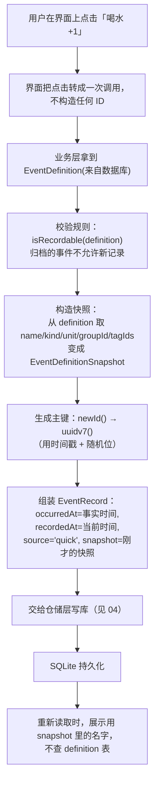

# 03 · TypeScript 领域模型：把业务规则写进类型里

> ⚠️ **v6 起有几个类型变了**（本文写作之后）：`EventDefinitionKind` 收敛为 `'counter' | 'cycle'`
> （**没有 `quantity` 了**）、`EventDefinition.attributes: string[]` 取代 `unit?: string`、
> `EventRecord.attributes: string[]`、`QuickOption = { attribute?, value, sortOrder }`（没有 `label`）、
> **`CycleDefinition` 这个域类型被删掉了**（周期定义就是 `kind = 'cycle'` 的 `EventDefinition`）。
> 但**记录**那侧仍保留 `RecordKind = 'counter' | 'quantity'`（老记录不能改）。
> 本文下面凡是写 `'counter' | 'quantity'` 的地方，都请按这条注记理解：类型收敛发生在 v6，
> 走读见 [08 事件定义](./08-event-definitions.md) 第 9 节与 [11 周期事件](./11-cycle-tracking.md) 的 4.13 节。

## 1. 本次完成了什么

**用户现在可以做什么**

这一篇没有新增「能点的按钮」，它完成的是**代码层面的地基**：

- 定义了 LifeTrack 全部业务概念的 TypeScript 类型：事件定义、事件记录、定义快照、周期定义、周期实例、周期内记录、分组、标签、快捷选项。
- 定义了**统一错误类型** `AppError` 及六种具体错误（校验、找不到、冲突、存储、迁移、导入）。
- 实现了 **UUID v7 主键方案**，用于给未来的事件记录生成有序、不重复的 ID。

**解决了什么问题**

1. **规则靠约定、容易违反**：例如「改事件定义不能改写历史记录」这条规则，如果只写在文档里，任何人一次疏忽就会破坏它。现在它体现在 `EventDefinitionSnapshot` 这个类型的存在上——记录**必须**带上当时快照。
2. **错误处理五花八门**：以前是抛啥的都有（字符串、原生 `Error`、SQLite 错误码）。现在上层只需要判断一个字段 `error.code`。
3. **主键方案没有定**：随机 UUID v4 做主键在本地库里排序不友好。改用 v7 后，ID 本身按时间递增。

**在整个 LifeTrack 中处于什么位置**

这是**领域层**（最内层）。它最干净：**不 import React，也不 import 数据库**。因此它可以被任何人依赖，而它不依赖任何人。
界面层、仓储层都会引用这里的类型；反过来它不会引用它们。

**本次范围内明确没有实现什么**

- 没有校验函数的完整实现：`models.ts` 里只有两个规则函数（`isVisibleRecord`、`isRecordable`），其余校验（名称不能为空、数量必须为正等）要等第二阶段写业务时补。
- 没有数据库表：类型只是「形状描述」，建表 SQL 在 [04](./04-sqlite-and-repository.md) 讲的迁移里，而业务表要等第二阶段。
- 没有类型与数据库行之间的「映射代码」（`Row → 领域对象`），这也是第二阶段的事。
- 类型别名 `IsoDateTime = string` **不做运行时校验**，这一点在第 4.4 节专门说明。

## 2. 修改了哪些文件

| 文件路径 | 文件的职责 | 本次具体修改 | 与其他文件的关系 |
| --- | --- | --- | --- |
| `src/domain/models.ts` | 领域模型：所有业务实体的类型与规则 | 新建：`IsoDateTime` / `IsoDate` 别名、`EventDefinitionKind` 联合类型、`QuickOption`、`EventGroup`、`Tag`、`EventDefinition`、`EventDefinitionSnapshot`、`EventRecord`、`CycleDefinition`、`CycleInstance`、`CycleEntry`，以及 `isVisibleRecord` / `isRecordable` | 被仓储层（未来的 `EventRepository`）与界面层引用；`src/repositories/metaRepository.ts` 就引用了这里的 `IsoDateTime` |
| `src/domain/errors.ts` | 统一错误体系 | 新建：`AppErrorCode` 联合类型、`AppError` 基类、六个子类、`isAppError`、`toAppError` | 被 `db/guard.ts`、`db/client.ts`、`db/migrations.ts`、`db/DatabaseProvider.tsx` 使用 |
| `src/domain/id.ts` | 主键生成与校验 | 新建：`uuidv7`、`newId`、`isUuidV7`、`assertUuidV7` | 依赖 `expo-crypto` 取随机数、依赖 `errors.ts` 抛 `ValidationError` |
| `src/domain/index.ts` | 领域层统一出口 | 新建：re-export 上面三个文件 | 让外部写 `import { AppError } from '@/domain'` |
| `src/domain/__tests__/id-test.ts` | UUID v7 的单元测试 | 新建：格式、单调递增、不重复、非法输入共 7 个用例 | 直接验证 `id.ts` |
| `src/domain/__tests__/errors-test.ts` | 错误体系的单元测试 | 新建：子类 `code` / `name`、`cause` 与 `details`、`isAppError`、`toAppError` 共 6 个用例 | 直接验证 `errors.ts` |

> **后续新增（不在本文范围内）**：`src/domain/dates.ts`（纯日历日期运算）与
> `src/domain/cycles.ts`（周期规则：越界日期、区间重叠、预测）是**周期事件**落地时加进来的；
> `validation.ts` 也不止第一阶段的规模了（含 `requireNotFuture`、周期输入类型等）。
> 这两篇的走读见 [11 周期事件](./11-cycle-tracking.md)。

## 3. 涉及哪些技术概念

### 3.1 `type` 与 `interface`

**是什么**：两者都能描述「一个对象长什么样」。

```ts
export interface EventGroup {   // interface
  id: string;
  name: string;
}

export type IsoDateTime = string;   // type：给一个已有类型起别名
```

**为什么本项目需要**：领域模型的对象用 `interface`（将来可能被扩展、也能和别的 interface 合并）；「别名」和「联合类型」只能用 `type`。

**用在哪个真实文件**：`src/domain/models.ts` 两者都有——`EventGroup` 等实体是 `interface`，`IsoDateTime`、`IsoDate`、`EventDefinitionKind`、`RecordSource`、`CyclePhase` 是 `type`。

**不用会怎样**：全用 `any`，业务概念完全失去约束。

**本项目里的选择标准**：**描述「一个东西的结构」→ `interface`；「某个值是几个固定选项之一」或「给类型起别名」→ `type`。**

### 3.2 字面量联合类型：把「允许的取值」写进类型

**是什么**：

```ts
export type EventDefinitionKind = 'counter' | 'quantity';
```

意思是：这个类型的变量**只能**是 `'counter'` 或 `'quantity'` 这两个字符串之一，不能是别的。

**为什么本项目需要**：事件只有「计数」和「数量」两种，数据库里也只会存这两个值。用联合类型后，如果第二阶段不小心写了 `kind === 'count'`，`tsc` 立刻报错。

**用在哪个真实文件**：`models.ts` 的 `EventDefinitionKind`、`RecordSource`（`'manual' | 'quick' | 'backfill'`）、`errors.ts` 的 `AppErrorCode`（七种错误码）。

**不用会怎样**：用 `string` 的话，任何拼写错误都要等到运行时才发现，而且数据库里可能出现脏值。

**容易误解的地方**：联合类型是**编译期**约束。从数据库读回来的 `string` 需要有人把它「确认」成联合类型——这就是下面 3.3 的守卫函数要做的事。

### 3.3 类型守卫与类型谓词

**是什么**：

```ts
export function isEventDefinitionKind(value: unknown): value is EventDefinitionKind {
  return value === 'counter' || value === 'quantity';
}
```

返回值写成 `value is EventDefinitionKind` 就是**类型谓词**：它告诉 TypeScript「如果这个函数返回 true，那么参数 `value` 就一定是 `EventDefinitionKind`」。

**为什么本项目需要**：外部来的数据（数据库行、以后导入的 JSON 文件）在类型上都是不可信的。守卫函数是**唯一安全的入口**：先检查，再让类型系统接受它。

**用在哪个真实文件**：`models.ts` 的 `isEventDefinitionKind`；另外 `errors.ts` 的 `isAppError` 用的是同样的思路（`error is AppError`）。

**不用会怎样**：只能写 `const kind = row.kind as EventDefinitionKind`——这是**强制断言**，编译器被你说服了，但运行时该错还是错。这是本项目要极力避免的写法。

**容易误解的地方**：守卫函数返回 `false` 时，TypeScript 会在 `else` 分支里把类型收窄（排除掉那个类型）。这个"收窄"是编译器帮你做的推理，运行时没有任何开销。

### 3.4 可选属性 `?`

**是什么**：

```ts
export interface EventDefinition {
  unit?: string;       // 可能没有
  groupId?: string;    // 可能不属于任何分组
}
```

**为什么本项目需要**：很多字段天然可能缺失。计数型事件没有单位；未归档的事件没有归档时间；未结束的周期实例没有结束日期。

**用在哪个真实文件**：`models.ts` 里大量使用，例如 `CycleInstance.endDate` 的注释就写着「未结束时为空」。

**不用会怎样**：要么用 `null` 并到处判空，要么用空字符串当「没有」，后者会导致 `unit === ''` 这种语义模糊的判断。

**容易误解的地方（重要）**：`unit?: string` 表示「这个属性**可以不存在**」，它和 `unit: string | undefined` 有一点区别：后者要求这个 key **必须存在**，只是值可以是 `undefined`。
本项目的 `tsconfig.json` 没有开启 `exactOptionalPropertyTypes`，所以这两个写法目前**行为一致**。如果以后要严格区分「没这个字段」和「字段存在但值为 undefined」，就要开这个开关——代价是代码要写得更啰嗦。

**另一个容易误解的地方**：可选属性在读的时候必须判空，`event.unit.length` 会报 `Object is possibly 'undefined'`。但**构造对象时可以省略**它：

```ts
const counter: EventDefinition = { id, name: '喝水', kind: 'counter', quickOptions: [], tagIds: [], isArchived: false, sortOrder: 0, createdAt, updatedAt };
// 不用写 unit、groupId、color、icon
```

这是「加字段不会破坏既有构造代码」的原因，练习 3 会让你亲手验证这一点。

### 3.5 `as const` 与 `readonly`

**是什么**：

```ts
export const EVENT_DEFINITION_KINDS: readonly EventDefinitionKind[] = ['counter', 'quantity'];
export const META_KEYS = { installedAt: 'app.installed_at', launchCount: 'app.launch_count' } as const;
```

- `readonly X[]`：声明这是「只读数组」，不允许 `push`。
- `as const`：告诉 TypeScript「不要把这些值的类型放宽」，`META_KEYS.installedAt` 的类型所以是精确的 `'app.installed_at'`。

**为什么本项目需要**：联合类型在运行时也需要一个「全部取值列表」（例如将来渲染下拉框、校验导入数据）。`as const` 则保证常量值不会被误写成 `string`。

**用在哪个真实文件**：`models.ts` 的 `EVENT_DEFINITION_KINDS`、`RECORD_SOURCES`；`src/db/schema.ts` 的 `META_KEYS`；`src/theme/index.ts` 的 `palette` / `spacing` / `radius` / `typography`。

**不用会怎样**：用 `as const` 的地方若写成普通对象，类型会变成 `string`，丢掉「值必须是这个字面量」的信息，`META_KEYS` 就丧失了「防拼错」的能力。

### 3.6 类继承、`instanceof`、`new.target.name`

**是什么**：

```ts
export class AppError extends Error {
  readonly code: AppErrorCode;
  readonly details?: Record<string, unknown>;

  constructor(code: AppErrorCode, message: string, options: AppErrorOptions = {}) {
    super(message, { cause: options.cause });
    this.name = new.target.name;
    this.code = code;
    this.details = options.details;
  }
}

export class ValidationError extends AppError {
  constructor(message: string, options: AppErrorOptions = {}) {
    super('VALIDATION', message, options);
  }
}
```

- `extends Error`：继承 JS 内置的 `Error`，于是它天然有 `message`、`stack`。
- `super(message, { cause })`：调用父类构造函数。`{ cause }` 是 ES2022 的标准能力，能把「原始错误」挂在 `error.cause` 上，便于排查。
- `new.target.name`：**关键技巧**。`new.target` 是「真正被 `new` 的那个类」。所以 `new ValidationError(...)` 时它等于 `ValidationError`，`name` 自动变成 `'ValidationError'`，**不用在每个子类里手写 `this.name = 'ValidationError'`**。
- `readonly code`：声明后**不允许再赋值**，防止错误码被中途改掉。
- 子类**只传一个固定的 code** 给父类：`ValidationError` 永远携带 `'VALIDATION'`。调用方不需要记 code 和类的对应关系。

**为什么本项目需要**：让上层代码只处理一种错误类型。`DatabaseGate` 只需要 `error?.code` 就能决定怎么提示，不必解析错误文本。

**用在哪个真实文件**：`src/domain/errors.ts`；使用方是 `src/db/guard.ts`（把底层异常收敛成 `StorageError`）、`src/db/migrations.ts`（抛 `MigrationError`）、`src/db/client.ts`（抛 `StorageError`）。

**不用会怎样**：每个模块抛自己的错误形态，UI 层要写一堆字符串匹配，改一句错误文案就可能让分支失效。

**容易误解的地方（重要）**：`instanceof` 跨「打包边界」可能失效（例如同一个类被两份 bundle 各自定义一次）。本项目用 `toAppError` 做兜底，就是为了不依赖 `instanceof` 也能正常工作：

```ts
export function toAppError(error: unknown, fallbackMessage = '发生未知错误'): AppError {
  if (isAppError(error)) return error;
  if (error instanceof Error) return new AppError('UNKNOWN', error.message, { cause: error });
  return new AppError('UNKNOWN', fallbackMessage, { cause: error });
}
```

注意它最后那一行：**连 `42` 这种非 Error 的值也能被归一化**（`errors-test.ts` 里就有这个用例）。这是 `unknown` 类型带来的安全感——JS 里 `throw` 什么都可以。

### 3.7 泛型 `<T>`

**是什么**：让函数/接口「对类型参数化」。

```ts
async getFirstAsync<T>(source: string, ...params: SqlParam[]): Promise<T | null>;
```

**为什么本项目需要**：仓储层不希望为每个查询写一个专门的类型。用泛型，调用方自己指定「我要的行长什么样」：

```ts
const row = await this.db.getFirstAsync<{ value: string }>('SELECT value FROM app_meta WHERE key = ?', key);
```

**用在哪个真实文件**：`src/db/types.ts` 的 `SqlExecutor`（泛型方法）、`src/db/migrations.ts` 的 `MigrationDatabase`、`src/repositories/metaRepository.ts` 的调用处。

**不用会怎样**：查询结果只能返回 `any`，等于放弃类型保护。

**容易误解的地方**：泛型 `T` **完全是编译期的**，运行时不会检查「数据库里回来的真的是 `{ value: string }` 吗」。写错泛型是静默的：`getFirstAsync<{ nmae: string }>` 不会报错，只是你在运行时拿到 `undefined`。所以**读回来的数据仍需要校验**（这就是 3.3 守卫函数的用途）。

### 3.8 `async` / `await` / `Promise`

**是什么**：`Promise` 表示「一个将来才会有结果的操作」。`async` 函数总是返回 Promise；`await` 表示「等它完成，把结果取出来」。

**为什么本项目需要**：`expo-crypto` 取随机数是异步的，SQLite 的读写全都是异步的。

**用在哪个真实文件**：`src/domain/id.ts`（虽然 `uuidv7` 本身用同步的 `getRandomValues`，但它是被 `expo-crypto` 提供的）、`src/repositories/metaRepository.ts` 的每个方法、`src/db/migrations.ts` 的 `runMigrations`。

**不用会怎样**：用回调或 `.then()` 链，嵌套几层后可读性崩掉。

**容易误解的地方（重要）**：**`await` 只处理「等待」，不处理「失败」**。异步函数里抛出的错误，必须靠 `try/catch` 或 `.catch()` 接住，否则就是「未处理的 Promise 拒绝」，在 RN 里可能只打印一行警告，然后界面永远停在加载中。本项目在 `guard.ts` 里统一用 `try/catch`，在 `client.ts` 里也包了 `try/catch`，就是为了不漏。

## 4. 关键代码逐段解释

### 4.1 为什么必须有 `EventDefinitionSnapshot`

先看两个类型：

```ts
/** 事件定义：用户「可以记录什么」 */
export interface EventDefinition {
  id: string;
  name: string;
  kind: EventDefinitionKind;
  unit?: string;
  groupId?: string;
  // ...
  isArchived: boolean;
}

/** 记录时刻的事件定义快照 */
export interface EventDefinitionSnapshot {
  definitionId: string;
  name: string;
  kind: EventDefinitionKind;
  unit?: string;
  groupId?: string;
  tagIds: string[];
}
```

再看记录：

```ts
export interface EventRecord {
  id: string;
  definitionId: string;
  kind: EventDefinitionKind;
  value: number;
  occurredAt: IsoDateTime;
  recordedAt: IsoDateTime;
  snapshot: EventDefinitionSnapshot;   // ← 关键
  deletedAt?: IsoDateTime;
}
```

**这是本项目最重要的一条领域规则的类型化表达**：

- `EventDefinition` 是**可变配置**：用户可以改名、换单位、换分组、归档、甚至删除。
- `EventRecord` 是**已经发生的事实**：它**不能再被配置变化影响**。
- 所以 `EventRecord` 里**同时**有两个东西：`definitionId`（指向定义，用于「查看这个事件的全部记录」）和 `snapshot`（当时的名字、单位、标签，用于**展示**）。

**如果没有 `snapshot` 会怎样**：用户把「喝水」改名成「喝水（含茶）」，那么三个月前那条历史记录在时间轴里也会跟着变成新名字——事实被篡改了。更糟的是用户**删除**定义后，历史记录连名字都查不到。

**为什么 `snapshot` 里还带 `kind`**：因为将来可能允许「把计数型改成数量型」。历史记录必须知道自己当时是哪种，否则数值语义（增量 vs 数量）会混乱。

**为什么 `snapshot.definitionId` 和 `EventRecord.definitionId` 重复**：一个用于「关联查询」，一个用于「历史自证完整」。冗余在这里是**有意的**——快照要能独立存在。

**容易误解的地方**：`snapshot` 会让存储量变大（每条记录多存几个字段）。这是**刻意的取舍**：本地数据库不缺这点空间，但历史不可篡改是不可退让的。相比之下，用「JOIN 定义表」来省空间的做法会让删除定义变成一件危险的事。

### 4.2 把业务规则写成函数，而不是散落的注释

```ts
/** 只有未软删除的记录参与展示与统计 */
export function isVisibleRecord(record: EventRecord): boolean {
  return record.deletedAt === undefined;
}

/** 归档不影响历史，只影响「能否新建记录」的入口 */
export function isRecordable(definition: EventDefinition): boolean {
  return !definition.isArchived;
}
```

- `isVisibleRecord`：把「软删除的记录不算数」这条规则**放在一个地方**。将来统计、时间轴、导出全都调它。
- 注意它判断的是 `=== undefined` 而不是 `!record.deletedAt`。为什么？因为 `deletedAt` 是**时间字符串**，如果写 `!record.deletedAt`，空字符串 `''` 也会被当成「已删除」，产生意料之外的语义。
- `isRecordable`：归档（archive）与删除（delete）是**两种完全不同的操作**。归档只是「不再出现在记录入口」，历史一条不少。把它写成函数，命名本身就说明了区别。

**为什么这两个函数放在领域层而不是仓储层**：它们是**纯函数**（不碰数据库、不碰 React），所以能被任何地方复用，也最容易测试。

**现在的不足（诚实记录）**：这两个函数在第二阶段第 2 项之前**没有单元测试**。`domain/__tests__/` 当时只有 `id-test.ts` 和 `errors-test.ts`。
**（现状：已补上 —— 见 `domain/__tests__/models-test.ts`，为 `isVisibleRecord` 覆盖了 `deletedAt === undefined` / 有值两个分支，也为
`isRecordable` 与 `toDefinitionSnapshot` 补了用例。做「撤销」时顺手补的，因为那时 `deletedAt` 才第一次真的被写。）**

### 4.3 `uuidv7`：为什么不用 v4，以及「顺序」是怎么保证的

```ts
const UUID_V7_PATTERN = /^[0-9a-f]{8}-[0-9a-f]{4}-7[0-9a-f]{3}-[89ab][0-9a-f]{3}-[0-9a-f]{12}$/;
const MAX_SEQUENCE = 0x0fff;

let lastTimestamp = -1;
let sequence = 0;

function nextStamp(timestampMs: number): { timestampMs: number; sequence: number } {
  if (timestampMs > lastTimestamp) {
    lastTimestamp = timestampMs;
    sequence = 0;
  } else if (timestampMs === lastTimestamp) {
    if (sequence >= MAX_SEQUENCE) {
      lastTimestamp += 1;   // 同一毫秒超量：时间戳推进 1ms，保证严格递增
      sequence = 0;
    } else {
      sequence += 1;
    }
  } else {
    // 传入比上次更早的时间（补录场景）：沿用递增序列，绝不回退
    if (sequence >= MAX_SEQUENCE) {
      lastTimestamp += 1;
      sequence = 0;
    } else {
      sequence += 1;
    }
  }
  return { timestampMs: lastTimestamp, sequence };
}
```

**背景**：UUID 是一串 128 位（16 字节）的标识符。v4 是「128 位全随机」，v7 的布局是「前 48 位放毫秒时间戳，后面放随机位」。

**为什么不用 v4**：

1. **排序**：v7 的字符串比较结果等于时间先后。想按创建时间排序，直接 `ORDER BY id` 即可，不必额外建 `created_at` 索引。
2. **本地数据库写入更集中**：SQLite 的主键是 B-Tree。随机主键会到处插，页面分裂多；有序主键总是追加在右边，写入更快、碎片更少。
3. **调试友好**：一眼能看出 ID 大概是什么时候生成的。

**`nextStamp` 要解决三个情况**：

| 情况 | 处理 | 原因 |
| --- | --- | --- |
| 时间往前走了 | 更新 `lastTimestamp`，序列归零 | 正常情况 |
| **同一毫秒内连续生成** | 序列 +1 | 保证不重复 |
| 同一毫秒内超过 4096 个 | 时间戳人为 +1ms | 宁可在编码时间上「向前挪一点」，也不能回绕成更小的 ID |

`MAX_SEQUENCE = 0x0fff` 是因为 v7 留给 `rand_a` 的只有 12 位，最多 4096 个值。

**第三个分支（补录）是本项目特有的考虑，也是这里最容易被误解的地方**：

注释写着「传入比上次更早的时间（补录场景）：沿用递增序列，绝不回退」。
它的含义是：即使你传入一个「过去」的时间戳，生成出来的 ID **仍然比上一个 ID 大**。

代价是：**这个 ID 里编码的时间戳不一定等于你传入的时间**（它会是上一次的 `lastTimestamp`）。
这是**有意的**取舍——ID 在这里的职责只有两个：唯一、且随插入顺序递增。**业务时间的唯一真相是 `EventRecord.occurredAt` / `recordedAt`，不是 ID**。

**如果你把 ID 当成时间来源，就会出 bug**：比如「用 ID 反推这条记录是几点记录的」。正确做法永远是读 `occurredAt`。

**随机位怎么来**：

```ts
const bytes = new Uint8Array(16);
Crypto.getRandomValues(bytes);
```

`getRandomValues` 是**密码学安全的**随机源（不是 `Math.random`）。用它是因为 ID 需要不可预测，避免两个设备以后做导入合并时撞 ID。

**位拼装**：

```ts
bytes[6] = ((stamp.sequence >> 8) & 0x0f) | 0x70;   // 高 4 位是版本号 7，低 4 位是序列高位
bytes[7] = stamp.sequence & 0xff;                    // 序列低 8 位
bytes[8] = ((bytes[8] ?? 0) & 0x3f) | 0x80;          // 高 2 位固定为 10（RFC 4122 变体）
```

- `>>` 右移、`&` 按位与、`|` 按位或，都是在往字节里「塞位」。`0x70` = `0111 0000`，把版本位设成 `7`。
- `0x80` = `1000 0000`，把变体位设成 `10`，低 6 位保留随机的原值（先 `& 0x3f` 清掉高 2 位）。
- 48 位时间戳那一段用了一个循环：

```ts
let remaining = stamp.timestampMs;
for (let i = 5; i >= 0; i -= 1) {
  bytes[i] = remaining % 256;
  remaining = Math.floor(remaining / 256);
}
```

这是「从低位往高位」拆字节的写法，**大端序**（高位在前）。逐个取模 256 就是取最低 8 位。

**注意 `bytes[0] ?? 0` 里的 `?? 0`**：这是 `noUncheckedIndexedAccess` 带来的（见 [01](./01-project-bootstrap.md) 3.4）。TypeScript 认为 `bytes[0]` 可能是 `undefined`，所以必须先兜底才能交给 `hex()`。

**编译期 vs 运行时**：这些 `?? 0` 只是让编译器满意，运行时永远走不到 `?? 0` 那一支——因为 `Uint8Array(16)` 保证下标 0..15 都存在。这正是「类型检查保守」的体现。

### 4.4 `IsoDateTime = string`：别名不做校验（重要提醒）

```ts
export type IsoDateTime = string;
export type IsoDate = string;
```

**这是类型别名，不是校验**。`IsoDateTime` 和 `string` 在 TypeScript 眼里**完全等价**，可以互相赋值：

```ts
const a: IsoDateTime = '随便什么字符串都可以';
const b: string = a;              // 合法
const c: IsoDateTime = b;         // 也合法
```

**为什么这么设计**：

1. 「带品牌的类型」（branded type，例如 `string & { __brand: 'iso' }`）能让编译器区分它们，但会让每一处的赋值都需要转换，对这个规模的应用是过度设计。
2. 真正的把关应该在**边界**：从数据库读出来的、从导入文件读进来的（第二阶段的 `IMPORT`），要做运行时校验。
3. 别名的价值在于**可读性和自文档**：看到 `occurredAt: IsoDateTime` 就知道该填什么格式，看到 `startDate: IsoDate` 就知道不该填时间。

**约定**：时间戳存 ISO-8601 带时区（`2026-10-19T07:30:00.000Z`），日期存 `YYYY-MM-DD`。这条约定写在 `src/db/schema.ts` 的注释里，**靠人遵守，编译器不帮忙**。

**容易误解的地方**：`IsoDate = string` 意味着 `'abc'` 也是合法的 `IsoDate`。所以第二阶段补录功能里，用户输入日期时必须**显式校验格式**，不能因为类型是 `IsoDate` 就以为安全了。

### 4.5 `EventRecord` 里两个时间的区别

```ts
/** 事实发生时间（补录时可能早于 recordedAt） */
occurredAt: IsoDateTime;
/** 录入时间 */
recordedAt: IsoDateTime;
```

- `occurredAt`：**事实什么时候发生的**。补录昨天的记录，它就是昨天。
- `recordedAt`：**用户什么时候把它录进来的**。永远是「现在」。

**为什么必须分开**：

1. 「补录」功能的核心就是这两者不一致。**（现状：已实现，见 [10 补录与撤销](./10-backfill-and-undo.md)；补录时 `occurredAt` 可以早于 `recordedAt`，但不能晚于它。）**
2. 统计要按 `occurredAt` 算（「上周喝了多少水」）；而「这条数据是谁什么时候填的」要看 `recordedAt`。
3. 将来做导入合并时，同一件事实被两台设备各录一次，靠 `occurredAt` 才能判断是不是重复。

**容易误解的地方**：用 `recordedAt` 排序会让补录的记录跑到时间轴顶部，用户会觉得「时间轴乱序了」。所以时间轴必须按 `occurredAt` 排序、按 `recordedAt` 显示「补录于」标记。**（现状：两点都已落地，见 [10](./10-backfill-and-undo.md)。）**

## 5. 一次完整操作的数据流

以「用户记录了一次喝水（第二阶段会实现的场景）」为例，看领域层在这条链路上的位置：



关键点解释：

1. **ID 由领域层生成，不由数据库自增**。这样在导入/合并时，可以带着 ID 一起搬，不会冲突。
2. **快照在「记录的这一刻」生成一次**，之后永不更新。这是 `EventDefinitionSnapshot` 存在的全部意义。
3. **规则检查（`isRecordable`）发生在写库之前**。如果已经归档，要在业务层就拒绝，而不是写进去再后悔。
4. **展示时读 `snapshot`**，不 JOIN 定义表——这正是「历史不可篡改」的实现方式。

注意这是**第二阶段**的流程。**（现状：第 2 项已实现，见 [09](./09-event-recording.md)；第一阶段当时真实存在的是 [05](./05-business-logic-and-data-flow.md) 里的「启动次数」闭环。）**

## 6. 如何验证

### 关键命令

```bash
npm run typecheck                    # 检查整个 src 的类型
npm test -- src/domain               # 只跑领域层测试
npm test                             # 全部测试
```

### 正常应该看到什么

- `npm run typecheck`：无输出。
- `npm test -- src/domain`：2 个套件通过，共 13 个用例（`id-test.ts` 7 个 + `errors-test.ts` 6 个）。

### 测试覆盖了什么（`id-test.ts`）

| 用例 | 验证了 |
| --- | --- |
| 格式符合 UUID v7（版本位 7、变体位 8/9/a/b） | 位拼装是对的：`id.charAt(14) === '7'`、`'89ab'.includes(id.charAt(19))` |
| 按生成顺序严格递增（即使传入更早的时间戳） | 包括补录场景的不回退 |
| 时间越晚的 id 越大 | ID 可以当排序键 |
| 批量生成 5000 个不重复 | 单调性 + 随机位 |
| 非法时间戳抛 `ValidationError` | `-1` / `NaN` / `Infinity` |
| `assertUuidV7` 通过合法 id、拒绝非法值并带上字段名 | 该函数会被第二阶段的导入功能用到 |

### 测试覆盖了什么（`errors-test.ts`）

- 子类的 `code` 与 `name` 正确（`new.target.name` 生效）。
- `cause` 与 `details` 被保留。
- `isAppError` 只认自家类型（普通 `Error`、字符串都返回 `false`）。
- `toAppError` 对「已是 AppError」「普通 Error」「非 Error 值」三种输入的处理。

### 没覆盖什么（诚实记录）

- `models.ts` 的 `isVisibleRecord` / `isRecordable` **当时没有测试**。
  **（现状：已由 `domain/__tests__/models-test.ts` 直接覆盖，两个分支都测了；做「撤销」时补的。）**
- `models.ts` 里所有 `interface` 的「形状」也没有测试。类型本身由 `tsc` 保证，不需要测试，但**基于这些类型的规则函数需要**。
- 没有测试「从数据库读回来的 `kind` 经过 `isEventDefinitionKind` 校验」这条链——因为读库代码还不存在。

### 哪些验证真实执行过

第一阶段真实执行过：`npm run typecheck`（通过）、`npm test`（4 套件 / 32 用例全部通过，其中领域层占 2 套件 / 13 用例）。

**没有执行过**：真机运行（领域层是纯逻辑，与平台无关，但仍然如实记录）。

## 7. 常见问题与排查

### 问题：`Object is possibly 'undefined'`

**原因**：读了可选属性，或者用 `noUncheckedIndexedAccess` 开了下标访问检查。

**排查顺序**：

1. 确认这个字段在类型上是不是 `?`。是的话，先判空。
2. 是数组下标的话，想想「取不到是不是真的可能」。真的不可能就加 `?? 默认值`（像 `id.ts` 那样），并把理由写在旁边。

### 问题：联合类型判断不收敛，`tsc` 报「此比较似乎是无意的」

**原因**：例如你写了 `if (kind === 'count')`，但 `kind` 的类型是 `'counter' | 'quantity'`，两个类型完全没有交集，编译器判定这是笔误。

**排查顺序**：检查拼写。这正是联合类型在帮你抓错——**不要**用 `as string` 绕过它，那会把保护拆掉。

### 问题：数据库读回来的值被当成 `any` / 需要强转

**原因**：泛型 `T` 是你自己指定的，`SqlExecutor` 不做校验。

**排查顺序**：先写一个守卫函数（像 `isEventDefinitionKind` 那样），用「先检查再使用」代替 `as` cast。第二阶段的仓储层要把外部数据过一遍守卫，这是硬要求。

### 问题：`instanceof ValidationError` 偶尔失效

**原因**：极少数情况下同一个类被打包了两份，两个 `ValidationError` 不是同一个函数对象。

**排查顺序**：不要依赖 `instanceof` 做跨层判断，改用 `isAppError(error) && error.code === 'VALIDATION'`。`code` 是字符串，天然跨边界安全。

### 问题：`uuidv7` 生成出来的 ID 看起来时间不对

**原因**：这正是 4.3 讲的「补录分支」——传入更早的时间戳时，ID 仍沿用 `lastTimestamp`。

**排查顺序**：先确认是否传了自定义时间戳。**不要把 ID 当时间用**，要读 `occurredAt`。如果确实需要「按事实时间排序」，就 `ORDER BY occurred_at`，而不是 `ORDER BY id`。

## 8. 本阶段学习总结

**掌握的核心概念**

- `interface` 描述结构，`type` 描述别名与联合类型。
- 字面量联合类型把「允许的取值」变成编译期约束。
- 类型守卫（`value is T`）是「先检查、后使用」的安全模式，能替代危险的 `as`。
- 可选属性 `?` 与「构造时可省略、读取时必须判空」。
- 类继承 + `new.target.name` 让错误子类不必重复写 `name`；`cause` 保留原始错误。
- 泛型只在编译期生效，**运行时不校验**。
- 领域层不依赖 React、也不依赖数据库——这决定了它最容易被复用和测试。
- 快照（snapshot）是把「历史不可篡改」这条领域规则变成代码结构的手段。

**需要理解的关键文件**

`src/domain/models.ts`（业务概念与规则）、`src/domain/errors.ts`（错误如何统一）、`src/domain/id.ts`（主键方案）。

**建议亲自尝试的小练习**

1. **观察联合类型的保护作用**：在 `src/domain/id.ts` 里临时把 `uuidv7` 的某处改成 `isEventDefinitionKind` 不认识的写法（更简单的方式：在 `models.ts` 里把 `EVENT_DEFINITION_KINDS` 改成 `['counter', 'count']`），跑 `npm run typecheck`。
   **预期结果**：`tsc` 报错说 `'count'` 不能赋给 `EventDefinitionKind`。改回来后应当无输出。这一步只动一个常量的字面量，**不碰数据库**。
2. **加一条类型层测试**：在 `src/domain/__tests__/id-test.ts` 里新增一个用例，断言 `uuidv7(1000) < uuidv7(2000)`。跑 `npm test -- src/domain`。
   **预期结果**：多一个通过的用例。
3. **验证「加可选字段不破坏既有代码」**：在 `models.ts` 的 `EventRecord` 里加一行 `location?: string;`，跑 `npm run typecheck`。
   **预期结果**：**不报错**。因为它是可选的，所有既有的对象字面量都不需要改。然后把它删掉，再次 `npm run typecheck` 确认仍然不报错。这个练习让你体会「可选属性让结构演进是安全的」。
4. **体验守卫函数**：在 `node` 里或用一个小测试，尝试把 `'Count'`（大写 C）传给一个接受 `EventDefinitionKind` 的位置。
   **预期结果**：编译期就报错。对比一下：如果类型是 `string`，这个错误会一直到运行时才暴露。

以上练习都不涉及数据库结构修改、不产生真实用户数据，可以放心做。

**下一阶段会用到哪些已学知识**

- 第二阶段第 1 项要给 `event_definitions`、`event_groups`、`tags`、`quick_options` 建表，并写「数据库行 → 领域对象」的映射。映射时必须用**守卫函数**校验 `kind`，不能用 `as`（见 4.4、7）。
  **（现状：已完成，`kind` 的读回守卫见 `src/repositories/eventDefinitionRepository.ts` 的 `toKind`）**
- 第 2、3 项生成记录主键时直接用 `newId()`；要记住 ID 不是时间来源，排序和统计一律用 `occurredAt`。
- 第 4 项「撤销删除」直接靠 `deletedAt` + `isVisibleRecord`。
- 第 8 项「导入合并」在边界处会大量用到 `assertUuidV7` 和 `toAppError`，所以 `IMPORT` 这个错误码现在就已经留好了。