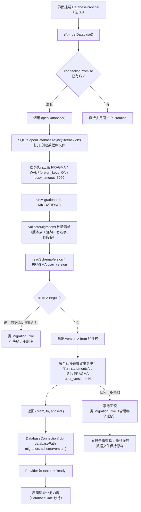

# 04 · SQLite 与 Repository：数据怎么存下来

## 1. 本次完成了什么

**用户现在可以做什么**

应用能真正把数据存到设备本地，并且**关掉重开会话后数据还在**。具体表现是：设置页里能看到「应用信息」「本地数据库」「app_meta 表内容」三张卡片，
其中「app_meta 表内容」会列出真实存在磁盘上的键值对（例如 `app.launch_count`）。

**解决了什么问题**

1. **数据库怎么开、开在哪、用哪些参数**：以前不存在，现在集中在 `src/db/client.ts` 一个入口，避免各处各开一个连接。
2. **表结构以后怎么演进**：用**版本化迁移**机制解决。现在 schema 是 v1，第二阶段加业务表时追加 v2，已经装过应用的用户数据不会被清掉。
3. **数据安全**：迁移失败或数据库版本比应用新时**拒绝启动**，绝不删除重建数据库文件。
4. **测试怎么测真实 SQL**：抽出 `SqlExecutor` 接口，让同一套 SQL 既能在设备上跑（`expo-sqlite`），也能在单元测试里跑（Node 内置的 `node:sqlite`），**真的执行 SQL**而不是打桩。

**在整个 LifeTrack 中处于什么位置**

它是**数据基础设施层 + 仓储层**：

- `src/db/`（client / migrations / schema / types / guard）是基础设施：连接、PRAGMA、迁移、错误归一。
- `src/repositories/` 是仓储层：**全应用唯一写 SQL 的地方**，对外只暴露业务语义方法（例如 `incrementLaunchCount()`）。

**本次范围内明确没有实现什么**

- **没有业务表**：v1 只建了 `app_meta` 一张表。事件定义、记录、周期这些表都在第二阶段以 v2 追加。
- 没有 ORM（见 4.6 的取舍说明）。
- 没有多连接/连接池（RN 里没必要）。
- 没有数据导出/导入（第二阶段第 7 项）。
- 没有加密数据库（SQLCipher 之类）——目前数据库文件是明文的，这一点在「未验证/未覆盖」里如实标注。

## 2. 修改了哪些文件

| 文件路径 | 文件的职责 | 本次具体修改 | 与其他文件的关系 |
| --- | --- | --- | --- |
| `src/db/client.ts` | **数据库连接的唯一入口** | 新建：`DATABASE_NAME`、`CONNECTION_PRAGMAS`、`DatabaseConnection` 类型、`openDatabase`、`getDatabase`（进程内单例）、`closeDatabase`、`__resetDatabaseCacheForTests` | 依赖 `expo-sqlite`；调用 `migrations.ts` 的 `runMigrations` 和 `schema.ts` 的 `MIGRATIONS`；被 `DatabaseProvider` 与设置页使用 |
| `src/db/migrations.ts` | 版本化迁移执行器 | 新建：`SqlValue`、`MigrationDatabase` 接口、`Migration` / `MigrationResult` 类型、`validateMigrations`、`readSchemaVersion`、`runMigrations` | 被 `client.ts` 调用；被 `migrations-test.ts` 直接测试（用内存 SQLite） |
| `src/db/schema.ts` | schema 与迁移清单 | 新建：`META_KEYS`、`MIGRATION_V1_BASELINE`（建 `app_meta`）、`MIGRATIONS`、`LATEST_SCHEMA_VERSION` | 被 `client.ts`（取迁移清单）、`metaRepository.ts`（取键名常量）、设置页（取版本号）使用 |
| `src/db/types.ts` | SQL 执行器抽象 | 新建：`SqlParam`、`SqlRunResult`、`SqlExecutor` 接口 | 是「设备用 expo-sqlite、测试用 node:sqlite」能互换的关键；被 `metaRepository.ts` 与测试适配器实现 |
| `src/db/guard.ts` | 异常归一 | 新建：`guard<T>()` 把底层异常收敛为 `StorageError` | 被 `metaRepository.ts` 每个方法包裹使用 |
| `src/db/testing/nodeSqliteAdapter.ts` | 测试用真实 SQLite | 新建：`createTestDatabase(filename?)`、`TestDatabase` 类型（含 `rawExec` / `rawGet` / `rawAll` / `transactionDepth` / `close`） | 实现 `SqlExecutor` 接口；**只在测试里用**，不进应用包 |
| `src/db/index.ts` | 数据库层统一出口 | 新建：re-export 上述模块并导出 `DatabaseProvider` 系列 | 让外部写 `import { readSchemaVersion, useReadyDatabase } from '@/db'` |
| `src/repositories/metaRepository.ts` | `app_meta` 表的仓储 | 新建：`MetaEntry` 类型、`MetaRepository` 类（`get` / `set` / `getAll` / `incrementLaunchCount` / `ensureInstalledAt`） | 只依赖 `SqlExecutor` 与 `guard`；被 `DatabaseGate` 和设置页使用 |
| `src/repositories/index.ts` | 仓储层统一出口 | 新建：re-export `metaRepository` | 让外部写 `import { MetaRepository } from '@/repositories'` |
| `src/db/__tests__/migrations-test.ts` | 迁移机制测试 | 新建：8 个用例（清单校验、全新库迁移、幂等、拒绝降级、事务回滚、多步迁移、中途续迁） | 在真实内存 SQLite 上执行 |
| `src/repositories/__tests__/metaRepository-test.ts` | 仓储测试 | 新建：7 个 CRUD 用例 + 1 个「同文件关闭重开」持久化用例 | 用临时文件 SQLite 验证真实落盘 |

## 3. 涉及哪些技术概念

### 3.1 SQLite 是什么，为什么本地优先的应用适合它

**是什么**：SQLite 是一个**不需要服务器的数据库**——整个数据库就是磁盘上的一个文件（本项目是 `lifetrack.db`），你的代码直接在进程里读写它。对比 MySQL/PostgreSQL，那些需要一个独立的数据库服务进程，通过网络连接。

**为什么本项目需要**：LifeTrack 的明确约束是「数据全部存在设备本地，无后端、无云数据库」。SQLite 是移动端本地存储的标准答案：iOS 和 Android 系统本身就自带 SQLite。

**用在哪个真实文件**：`src/db/client.ts` 的 `SQLite.openDatabaseAsync(DATABASE_NAME)`。

**不用会怎样**：要么自己往文件里写 JSON（查询、索引、事务都要自己实现，很快会失控），要么引入云数据库（直接违反产品约束）。

**表、行、列、主键**：

- **表（table）**：一类数据的容器，例如 `app_meta`。
- **行（row）**：一条记录，例如 `key='app.launch_count', value='3'`。
- **列（column）**：字段，例如 `key` / `value` / `updated_at`。
- **主键（PRIMARY KEY）**：唯一标识一行的列，不能重复。

本项目 v1 建的表（`src/db/schema.ts` 的 `MIGRATION_V1_BASELINE`）：

```sql
CREATE TABLE app_meta (
  key        TEXT    PRIMARY KEY NOT NULL,
  value      TEXT    NOT NULL,
  updated_at TEXT    NOT NULL
);
```

`key` 是主键，所以同一个键只能有一行。`NOT NULL` 表示不允许为空。注意这里**不需要** `id` 列——键值表的主键就是 `key` 本身。

### 3.2 `PRAGMA`：SQLite 的开关

**是什么**：`PRAGMA` 是 SQLite 特有的指令，用来查询或设置数据库的内部参数。

**为什么本项目需要**：三个参数必须显式设置，否则会踩坑。

**用在哪个真实文件**：`src/db/client.ts` 的 `CONNECTION_PRAGMAS`：

```ts
const CONNECTION_PRAGMAS = [
  'PRAGMA journal_mode = WAL;',
  'PRAGMA foreign_keys = ON;',
  'PRAGMA busy_timeout = 5000;',
];
```

逐个解释：

| PRAGMA | 作用 | 不设置会怎样 |
| --- | --- | --- |
| `journal_mode = WAL` | 用「预写日志」模式。读写可以并发；应用异常退出后能从日志恢复 | 用默认的 rollback journal，写入时会阻塞读，异常退出后恢复能力弱 |
| `foreign_keys = ON` | 打开外键约束 | **SQLite 默认是关闭的**！这是最容易忘的一条。不开的话，`FOREIGN KEY` 写了也不生效，第二阶段可能出现「记录指向一个已被删掉的事件定义」这种脏数据 |
| `busy_timeout = 5000` | 遇到锁时最多等 5 秒再报错 | 立刻抛 `SQLITE_BUSY`，用户会遇到偶发的莫名其妙失败 |

它们是在 `openDatabase()` 里逐个 `execAsync` 执行的，**连接期间一直有效**。

### 3.3 事务与原子性

**是什么**：事务是一组「要么全做、要么全不做」的操作。

```sql
BEGIN IMMEDIATE;   -- 开始（并立刻申请写锁）
  ... 若干条 SQL ...
COMMIT;            -- 全部生效
-- 或者
ROLLBACK;          -- 全部撤销
```

**为什么本项目需要**：迁移里「建表」和「把版本号从 0 改成 1」必须一起成功。如果建完表、改版本号前崩溃，下次启动会以为没迁移过，再建一次表 → 报「表已存在」，应用就卡死了。

**用在哪个真实文件**：`src/db/migrations.ts` 的 `runMigrations`：

```ts
await db.withExclusiveTransactionAsync(async (txn) => {
  for (const statement of migration.statements ?? []) {
    await txn.execAsync(statement);
  }
  if (migration.up) {
    await migration.up(txn);
  }
  await txn.execAsync(`${USER_VERSION_SQL} = ${migration.version}`);
});
```

- `withExclusiveTransactionAsync` 是 `expo-sqlite` 提供的 API：开**独占**事务（`BEGIN IMMEDIATE`）。在这个回调里执行的所有语句都在同一个事务内，并且回调内必须使用 `txn` 而不是外层的 `db`，否则语句会跑到事务外面去——**这是很容易犯的错误**。
- 循环里执行迁移的 SQL 语句。
- `migration.up` 是「需要搬数据时」的回调（比如把一列拆成两列的复杂转换）。第二阶段的 v2 只需要建表，用不到它，但机制留好了。
- 最后才写 `PRAGMA user_version = N`，与前面的 SQL 在同一个事务里。

**不用会怎样**：迁移变成「半成功」状态——表和版本号不一致，之后每次启动都失败。

**容易误解的地方**：`PRAGMA user_version = 1` 这句话是在 `execAsync` 里拼字符串拼出来的（`${USER_VERSION_SQL} = ${migration.version}`）。这里能拼字符串是因为 `migration.version` 是我们自己代码里的数字常量，不是外部输入。**任何来自用户/文件的字符串都绝不能这样拼**，必须用参数化查询（见 3.6）。

### 3.4 数据库迁移与 `PRAGMA user_version`

**是什么**：迁移（migration）是「把数据库从旧结构升级到新结构」的一段有编号的操作。`PRAGMA user_version` 是 SQLite 自带的一个整数抽屉，专门留给应用记录自己的 schema 版本。

**为什么本项目需要**：用户装过一次应用后，`lifetrack.db` 就一直在设备上。以后我们加字段、加表，必须能**在不丢数据的前提下**升级。

**用在哪个真实文件**：`src/db/migrations.ts` 全篇；`src/db/schema.ts` 的 `MIGRATIONS`。

**为什么把版本号存 `user_version` 而不自己建一张 `schema_version` 表**：

- `user_version` 不需要建表就能读（`readSchemaVersion` 只有一句 `PRAGMA user_version`），**没有「鸡生蛋」问题**：要读版本表，得先知道版本表存不存在。
- 它是原子的，跟着事务一起提交。
- 代价：只有一个整数，存不了「每个迁移的应用时间」这类信息。本项目不需要。

**三条硬规矩**（写在 `schema.ts` 的注释里）：

1. **只追加，不改已发布的迁移**。如果改了，早先升过级的设备版本号已经是 1，永远跑不到你改的那段代码，而新设备跑的是新代码——两台设备的表结构就不一样了。
2. 版本号从 1 开始、**连续递增**（`validateMigrations` 强制检查）。
3. 每个迁移必须有名字（便于报错定位）。

### 3.5 幂等

**是什么**：同一个操作执行一次和执行多次，结果一样。

**为什么本项目需要**：应用每次启动都会调用 `runMigrations`。已经升到 v1 的设备再次启动，什么也不该做。

**用在哪个真实文件**：`runMigrations` 里的这一句：

```ts
const pending = migrations.filter((migration) => migration.version > from);
```

只挑出版本号大于当前版本的迁移。`migrations-test.ts` 里「重复执行是幂等的，不会重复应用」这个用例断言第二次执行结果是 `{ from: 1, to: 1, applied: [] }`——`applied` 是空数组，说明一条都没重跑。

**不用会怎样**：第二次启动会尝试重新建表，报「table app_meta already exists」，应用无法启动。

### 3.6 参数化查询与 UPSERT

**是什么**：

```ts
await this.db.runAsync(
  `INSERT INTO app_meta (key, value, updated_at)
   VALUES (?, ?, ?)
   ON CONFLICT(key) DO UPDATE SET value = excluded.value, updated_at = excluded.updated_at`,
  key,
  value,
  now,
);
```

- **`?` 占位符 + 后面传参数**：这叫参数化查询。
- **`ON CONFLICT(key) DO UPDATE SET ...`**：这叫 UPSERT（update or insert）。当 `key` 已存在时，改为更新而不是报错。`excluded.xxx` 表示「本次想插入的那一行里的值」。

**为什么本项目需要**：

- 参数化是为了**防 SQL 注入**：如果把用户输入直接拼进 SQL 字符串，输入里带个 `'; DROP TABLE ...` 就能毁库。用 `?` 后，SQLite 会把参数当**值**处理，永远不会当代码。本项目虽然有 `guard` 兜底，但注入是**无法靠 try/catch 挽回**的，必须在源头杜绝。
- UPSERT 让「设置一个键值」这一个操作同时覆盖新增和更新两种情况，调用方不用先查再决定。

**用在哪个真实文件**：`src/repositories/metaRepository.ts` 的 `set`。

**不用会怎样**：

- 不用参数化：安全漏洞。
- 不用 UPSERT：得先 `SELECT` 判断存在性再分支，多一次往返，而且两步之间可能被别的操作插队。

### 3.7 Repository 模式

**是什么**：一个类，把「某个数据集合的读写」封装成业务语义的方法。

**为什么本项目需要**：

1. **SQL 只出现在一个地方**。`metaRepository.ts` 里能找到所有跟 `app_meta` 相关的 SQL。界面层完全不出现 SQL 字符串。
2. **业务语义代替技术细节**。调用方写 `repository.incrementLaunchCount()`，不需要知道底层的 UPSERT。
3. **可测试**。仓储只依赖 `SqlExecutor` 接口，测试时换成内存实现即可。

**用在哪个真实文件**：`src/repositories/metaRepository.ts`。

**不用会怎样**：SQL 散落在各个页面里，同一个查询被抄成五种略有差异的版本，改表结构时找不到所有需要改的地方。

### 3.8 依赖倒置：为什么要抽出 `SqlExecutor`

**是什么**：

```ts
export interface SqlExecutor {
  execAsync(source: string): Promise<void>;
  runAsync(source: string, ...params: SqlParam[]): Promise<SqlRunResult>;
  getFirstAsync<T>(source: string, ...params: SqlParam[]): Promise<T | null>;
  getAllAsync<T>(source: string, ...params: SqlParam[]): Promise<T[]>;
  withExclusiveTransactionAsync(task: (txn: SqlExecutor) => Promise<void>): Promise<void>;
}
```

仓储与迁移**都不依赖 `expo-sqlite` 的具体类型**，只依赖这个接口。

**为什么本项目需要**：这是本项目测试策略的地基。设备上 `expo-sqlite` 满足这个接口；测试里 `createTestDatabase()`（基于 Node 内置的 `node:sqlite`）也满足它。于是**同一套 SQL 在测试里真的被执行**，语法错误、约束冲突都能被测出来。

**用在哪个真实文件**：`types.ts` 定义；`metaRepository.ts` 的构造函数接收它；`nodeSqliteAdapter.ts` 实现它；`expo-sqlite` 的 `SQLiteDatabase` 天然满足它。

**不用会怎样**：仓储直接 `import * as SQLite from 'expo-sqlite'`，那在 Jest 里就完全跑不起来（Jest 里没有原生模块），测试只能靠 mock——而 mock 永远无法发现 SQL 写错了。

**代价（要诚实说明）**：`node:sqlite` 和 `expo-sqlite` 内置的 SQLite 版本可能略有差异，SQL 方言细节不一定完全一致。所以**测试通过不等于设备上一定没问题**，端到端结论仍以模拟器/真机运行为准。这句话写在 `nodeSqliteAdapter.ts` 的文件头注释里。

### 3.9 `async` / `await` 与「异常归一」

**是什么**：见 [03](./03-typescript-domain-model.md) 3.8。这里补充的是**在本层的用法**：所有数据库操作都可能失败（文件损坏、约束冲突、锁超时），必须有人把各种底层错误统一成一种类型。

**用在哪个真实文件**：`src/db/guard.ts`：

```ts
export async function guard<T>(operation: string, task: () => Promise<T>): Promise<T> {
  try {
    return await task();
  } catch (error) {
    if (isAppError(error)) {
      throw error;
    }
    throw new StorageError(`${operation}失败：${error instanceof Error ? error.message : String(error)}`, {
      cause: error,
      details: { operation },
    });
  }
}
```

- `guard<T>`：泛型，保证包装后**返回值类型不变**。`guard('读取应用元信息', async () => {...})` 里返回 `string | null`，外面拿到的还是 `string | null`。
- `operation` 参数会写进错误消息和 `details`，方便定位是哪个操作失败。
- **`isAppError` 时原样抛出**：不要把已经归类好的错误（比如一个真正的 `ValidationError`）再包一层成 `StorageError`，否则语义就丢了。
- 其他一律变 `StorageError`。

**不用会怎样**：上层要处理 `expo-sqlite` 的原始错误对象、可能还有 JS 的 `TypeError`，写一堆防御代码。

## 4. 关键代码逐段解释

### 4.1 `openDatabase`：失败时「绝不删库」

```ts
export async function openDatabase(): Promise<DatabaseConnection> {
  let db: SQLite.SQLiteDatabase | null = null;
  try {
    db = await SQLite.openDatabaseAsync(DATABASE_NAME);

    for (const pragma of CONNECTION_PRAGMAS) {
      await db.execAsync(pragma);
    }

    const migration = await runMigrations(db, MIGRATIONS);

    return {
      db,
      databasePath: db.databasePath,
      migration,
      schemaVersion: migration.to,
    };
  } catch (error) {
    if (db) {
      await db.closeAsync().catch(() => undefined);
    }
    if (isAppError(error)) {
      throw error;
    }
    throw new StorageError(`数据库初始化失败：${...}`, { cause: error, details: { database: DATABASE_NAME } });
  }
}
```

逐段：

- `let db: SQLite.SQLiteDatabase | null = null;`：在 try 外面声明，是为了在 catch 里还能访问到它（如果它已经开出来了）。
- `await db.execAsync(pragma)`：串行执行三条 PRAGMA。必须串行，因为它们改变连接状态。
- `runMigrations(db, MIGRATIONS)`：迁移失败会抛 `MigrationError`。
- `return` 的对象里 `databasePath` 来自 `db.databasePath`，设置页会把路径显示出来当作诊断信息。
- **catch 分支是这段代码的灵魂**：
  - `await db.closeAsync().catch(() => undefined)`：关掉半开的连接。注意 `.catch(() => undefined)`——**关闭本身失败也不能掩盖原始错误**。
  - `if (isAppError(error)) throw error`：如果是我们自己的 `MigrationError`，原样往上抛，保留错误码（这样 UI 能显示 `MIGRATION`）。
  - 否则包成 `StorageError`。
  - **注意这里没有 `deleteDatabaseAsync`，也没有 `rm`**。这是「不得静默创建空库覆盖用户数据」的落点：**宁可启动失败并提示用户，也不能把用户几个月的记录抹掉换成一个能跑的空库**。

**哪种做法是错的**（对照一下，避免以后写反）：常见反面写法是

```ts
// ❌ 绝对不要这样写
try {
  db = await SQLite.openDatabaseAsync(DATABASE_NAME);
  await runMigrations(db, MIGRATIONS);
} catch {
  await SQLite.deleteDatabaseAsync(DATABASE_NAME);   // 把用户数据删了
  db = await SQLite.openDatabaseAsync(DATABASE_NAME); // 建一个空的
}
```

这样「应用能启动了」，但用户的数据没了，而且**没有任何提示**。本项目的明确要求就是禁止这种写法。

### 4.2 `getDatabase`：单例 + 失败不缓存

```ts
let connectionPromise: Promise<DatabaseConnection> | null = null;

export function getDatabase(): Promise<DatabaseConnection> {
  if (!connectionPromise) {
    const pending = openDatabase();
    pending.catch(() => {
      if (connectionPromise === pending) {
        connectionPromise = null;
      }
    });
    connectionPromise = pending;
  }
  return connectionPromise;
}
```

- **缓存的是 Promise 而不是结果**：这样在数据库还没开好时，多个调用方同时调 `getDatabase()` 也只会真正打开一次（它们拿到同一个 Promise），避免了竞态。
- `pending.catch(...)` 里**清空缓存**：如果打开失败，下一次调用会重新尝试。这就是设置页「重试」按钮能生效的原因。
- `if (connectionPromise === pending)` 这个判断是防止「并发重试」时把新一次尝试的缓存误删掉。
- `__resetDatabaseCacheForTests()`：只给测试用，重置这个模块级变量。

**为什么需要单例**：SQLite 连接有一定开销，多个连接同时写同一文件会互相加锁（虽然我们已经设了 `busy_timeout`，但没必要自找麻烦）。

### 4.3 `runMigrations` 的三个「拒绝」与一个「保证」

```ts
export async function runMigrations(db: MigrationDatabase, migrations: readonly Migration[]): Promise<MigrationResult> {
  validateMigrations(migrations);

  const from = await readSchemaVersion(db);
  const target = migrations.length === 0 ? 0 : (migrations[migrations.length - 1]?.version ?? 0);

  if (from > target) {
    throw new MigrationError(
      `数据库版本（${from}）高于当前应用支持的版本（${target}）。` +
        `请升级应用；本应用不会自动降级，也不会删除或重建数据库文件。`,
      { details: { databaseVersion: from, appVersion: target } },
    );
  }

  const pending = migrations.filter((migration) => migration.version > from);
  const applied: number[] = [];

  for (const migration of pending) {
    try {
      await db.withExclusiveTransactionAsync(async (txn) => { /* 见 3.3 */ });
      applied.push(migration.version);
    } catch (error) {
      if (isAppError(error) && error.code === 'MIGRATION') throw error;
      throw new MigrationError(
        `迁移 v${migration.version} (${migration.name}) 执行失败：${describe(error)}`,
        { cause: error, details: { migration: migration.name, version: migration.version, from } },
      );
    }
  }

  return { from, to: target, applied };
}
```

逐个「拒绝」：

1. **拒绝坏清单**：`validateMigrations` 检查版本从 1 连续、有名字、有内容。这是防**开发期错误**——一个有问题的迁移不该上线。
2. **拒绝降级**：`from > target` 时抛错。
   场景举例：你的设备升级到了数据库 v3（来自新版本应用），然后你为了测试**回滚安装了旧版应用**（只支持到 v1）。旧应用看到 v3 会拒绝启动，而不是「假装 v1 就是最新」继续跑——因为那样它会在一个自己看不懂的结构上写数据。
3. **拒绝半成品**：任何语句失败都会让整个事务回滚，并把「是哪个迁移的哪一步」写进错误。

一个「保证」：**返回值 `applied` 精确记录了本次真正执行了哪些版本**。设置页的「本次迁移」就是显示它——`applied: []` 时显示「无（已是最新 v1）」。这是把内部机制**暴露给用户当诊断证据**，而不是只写日志。

**注意 `const target = migrations.length === 0 ? 0 : (migrations[migrations.length - 1]?.version ?? 0)`**：`?.` 和 `??` 是 `noUncheckedIndexedAccess` 逼出来的（见 [01](./01-project-bootstrap.md) 3.4）。同时它也处理了「迁移清单为空」这个边界，避免对 `undefined` 取 `.version`。

**容易误解的地方**：`to: target` 表示的是「应用支持的最高版本」，不是「实际迁移到的版本」。如果 `from === target`，`applied` 是空的，`to` 依然等于 `target`。设置页的文案正是按这个语义写的。

### 4.4 `readSchemaVersion`：严格校验取出值

```ts
export async function readSchemaVersion(db: MigrationDatabase): Promise<number> {
  const row = await db.getFirstAsync<{ user_version: number }>(USER_VERSION_SQL);
  const value = row?.user_version ?? 0;
  if (typeof value !== 'number' || !Number.isInteger(value) || value < 0) {
    throw new MigrationError(`无法解析数据库版本号：${String(value)}`);
  }
  return value;
}
```

- `row?.user_version ?? 0`：读不到（全新数据库没有 user_version，返回 0）时当作 0。
- **然后还要再检查一次**：必须是数字、必须是整数、必须非负。这是因为 `getFirstAsync<{ user_version: number }>` 里的 `number` 是**我们自己声明的，不是数据库保证的**（见 [03](./03-typescript-domain-model.md) 3.7：泛型运行时不校验）。
- 如果拿到的是 `NaN` 或负数，宁可抛出 `MigrationError` 也不能继续——继续下去会出现「版本号是 NaN，所以所有迁移都重跑」的灾难。

**这一段是「类型声明不是运行时校验」的最佳实例**，建议反复对照。

### 4.5 仓储的实际写法：以 `set` 与 `incrementLaunchCount` 为例

```ts
async get(key: string): Promise<string | null> {
  return guard('读取应用元信息', async () => {
    const row = await this.db.getFirstAsync<{ value: string }>(
      'SELECT value FROM app_meta WHERE key = ?',
      key,
    );
    return row?.value ?? null;
  });
}
```

- 每个方法都用 `guard` 包起来，第一个参数是**给人看的中文操作名**。
- SQL 是参数化的（`?` + `key`）。
- 返回 `string | null`：**「没有这个键」是一种正常结果，不是错误**。用 `null` 表示，不要抛异常。

```ts
async incrementLaunchCount(now: IsoDateTime = new Date().toISOString()): Promise<number> {
  return guard('更新启动次数', async () => {
    const current = await this.get(META_KEYS.launchCount);
    const parsed = current === null ? 0 : Number.parseInt(current, 10);
    const next = (Number.isFinite(parsed) ? parsed : 0) + 1;
    await this.set(META_KEYS.launchCount, String(next), now);
    return next;
  });
}
```

- `now: IsoDateTime = new Date().toISOString()`：**时间作为参数并带默认值**，这样测试可以传一个固定时间去断言（`metaRepository-test.ts` 就是这么做的）。这是「可测试性优先」的小设计。
- `Number.parseInt(current, 10)` 之后还要 `Number.isFinite(parsed)` 再兜底一次：数据库中如果有脏值（比如 `'abc'`），计数器不该崩，而该从 0 重新开始。
- 注意 `app_meta.value` 的类型是 `TEXT`，所以数字要转成字符串存（`String(next)`）。**SQLite 是动态类型的**，列的声明类型更像「建议」，它不会强制你把 `'3'` 拒绝掉——所以在这里转换是必须的。

### 4.6 既有问题：「读-改-写」不是原子的（诚实记录）

`incrementLaunchCount` 的写法是「读出来 → 加一 → 写回去」。这**不是原子操作**。

**问题**：如果两个调用并发执行，可能出现：

| 时刻 | 调用 A | 调用 B | 数据库里的值 |
| --- | --- | --- | --- |
| 1 | 读到 1 | | 1 |
| 2 | | 读到 1 | 1 |
| 3 | 写入 2 | | 2 |
| 4 | | 写入 2 | 2 ← **少了一次** |

**影响**：本项目的调用点只有一处（`DatabaseGate` 启动时），而且 `launch_count` 只是「持久化证据」而非业务数据，所以现在**不会造成实际损失**。但它是一个**会传染的坏范例**：第二阶段如果照这个模式写「库存减一」「计数累加」，就会真的丢数据。

**改进方案**（第二阶段写真正的计数逻辑时必须改）：

1. 用 SQL 自己完成自增，例如
   `INSERT INTO app_meta (key, value, updated_at) VALUES (?, '1', ?) ON CONFLICT(key) DO UPDATE SET value = CAST(value AS INTEGER) + 1, updated_at = excluded.updated_at RETURNING value`
   这样「读」和「写」在同一条语句里完成，天然原子。
2. 或者用 `withExclusiveTransactionAsync` 把「读 + 写」包成一个事务（`SqlExecutor` 已经提供了这个方法）。

**为什么现在不改**：改它需要确认 `expo-sqlite` 与 `node:sqlite` 对 `RETURNING` 的支持一致，属于超出第一阶段范围的工作；而且现在改会牵动设置页的展示。**先记录，第二阶段做计数器时一并处理**——这也符合「不为了教学/洁癖而在基线阶段乱动已验收代码」的原则。

### 4.7 `nodeSqliteAdapter`：测试里怎么「真的执行 SQL」

```ts
export function createTestDatabase(filename = ':memory:'): TestDatabase {
  const native = new DatabaseSync(filename);
  let depth = 0;

  const executor: SqlExecutor = {
    async execAsync(source: string): Promise<void> { native.exec(source); },
    async runAsync(source: string, ...params: SqlParam[]): Promise<SqlRunResult> {
      const result = native.prepare(source).run(...params);
      return { lastInsertRowId: Number(result.lastInsertRowid), changes: Number(result.changes) };
    },
    async getFirstAsync<T>(source: string, ...params: SqlParam[]): Promise<T | null> { /* ... */ },
    async getAllAsync<T>(source: string, ...params: SqlParam[]): Promise<T[]> { /* ... */ },
    async withExclusiveTransactionAsync(task) {
      depth += 1;
      native.exec('BEGIN IMMEDIATE');
      try {
        await task(executor);
        native.exec('COMMIT');
      } catch (error) {
        try { native.exec('ROLLBACK'); } catch { /* 回滚失败时保留原始错误 */ }
        throw error;
      } finally {
        depth -= 1;
      }
    },
  };
  // ...
}
```

- `new DatabaseSync(':memory:')`：**内存数据库**，进程结束就没了，测试之间互不干扰。默认参数是 `':memory:'`，也可以传文件路径（`metaRepository-test.ts` 的持久化用例就传了临时文件）。
- `native.prepare(source).run(...params)`：`node:sqlite` 的 API，`prepare` 编译 SQL，`run` 执行。返回的 `lastInsertRowid` / `changes` 是 BigInt，用 `Number()` 转成普通数字（RN 环境里习惯用 number）。
- `BEGIN IMMEDIATE` / `COMMIT` / `ROLLBACK`：**手工实现事务**，因为 `node:sqlite` 没有和 `expo-sqlite` 一模一样的 `withExclusiveTransactionAsync` 方法。这段代码模拟了它的**语义**：成功提交、失败回滚、并且回调内传入同一个 `executor`。
- `depth` 与 `transactionDepth()`：记录事务嵌套深度，让测试能断言「事务真的开过」。这是把「内部状态暴露给测试以便验证」的一种做法。
- 关键点：**它不是 mock**。`native.exec` 执行的是真正的 SQL，所以 `THIS IS NOT SQL` 这种语法错误会真的抛出来。`migrations-test.ts` 里「迁移失败时整体回滚」这个用例就是靠它验证的：先 `CREATE TABLE probe_a`，再一句非法 SQL，最后断言 `probe_a` 不存在、版本号还是 0。

**为什么值得这么做（而不是 mock）**：mock 只能验证「函数被调用过、参数对不对」，**永远发现不了「SQL 写错了」「约束没生效」「PRAGMA 没起作用」**。要验证这些，必须真的执行。

## 5. 一次完整操作的数据流

应用启动时，从「没有连接」到「拿到可用连接」：



逐步解释：

1. 界面层不直接开数据库，它通过 `DatabaseProvider` 触发。
2. `getDatabase()` 的缓存让「同时有多个地方要用数据库」时只真正打开一次。
3. `openDatabase()` 是唯一接触 `expo-sqlite` 的地方。
4. PRAGMA 在迁移**之前**设置——这一点很重要：如果迁移里用到外键，`foreign_keys` 必须已经开着。
5. 迁移是幂等的，所以每次启动都调用它是安全的。
6. 迁移成功后才把连接交给界面；失败则界面停在错误页，**数据库文件原封不动**。
7. 之后每次读写都走仓储层（`MetaRepository`），它只认 `SqlExecutor` 接口。

## 6. 如何验证

### 关键命令

```bash
npm test -- src/db                # 迁移机制测试
npm test -- src/repositories      # 仓储 + 持久化测试
npm test                          # 全部（4 套件 / 32 用例）
```

### 正常应该看到什么

`npm test` 的实测输出：

```
Test Suites: 4 passed, 4 total
Tests:       32 passed, 32 total
```

其中 `migrations-test.ts` 8 个用例、`metaRepository-test.ts` 8 个用例。

### 测试覆盖了什么

**`migrations-test.ts`**：

| 用例 | 验证了 |
| --- | --- |
| 版本号必须从 1 连续递增 | `validateMigrations` 能挡住断号 |
| 缺少可执行内容要报错 | 空迁移被拒绝 |
| 当前仓库的迁移清单是合法的 | `MIGRATIONS` 合法，且 `LATEST_SCHEMA_VERSION === 1` |
| 全新数据库：建表并提升 user_version | 结果是 `{ from: 0, to: 1, applied: [1] }`，`app_meta` 存在 |
| `app_meta` 结构符合预期（主键约束生效）| 列名与顺序是 `key/value/updated_at`，`key` 是主键，重复 key 会抛错 |
| 重复执行是幂等的 | 第二次 `applied: []` |
| 数据库版本高于应用支持版本时拒绝启动，且不破坏数据 | **这是数据安全的核心用例**：先写入 `keep='me'`，把 `user_version` 改成 99，再断言抛错后 `keep` 还在、版本号仍是 99 |
| 迁移失败时整体回滚 | 第一句建的表被回滚，版本号仍是 0 |
| 失败信息里带上是哪个迁移 | 错误消息里含迁移名 `boom` |
| 多步迁移按顺序执行 | `applied: [1,2,3]`，`statements` 与 `up` 两种形式都能用 |
| 从中途版本继续执行剩余迁移 | 只补跑缺的那一个 |

**`metaRepository-test.ts`**：不存在键返回 `null`、写入后可读回、重复写入是 UPSERT（不产生重复行且 `updatedAt` 更新）、`getAll` 按 key 排序、启动次数逐次累加、安装时间只写一次、底层异常被收敛为 `StorageError`（`code === 'STORAGE'`）、**以及「关闭连接后重新打开同一文件，数据仍在且迁移不重复执行」**。

最后这个「同文件重开」用例（`describe('持久化（同一文件重新打开）')`）用 `mkdtempSync` 建临时目录，第一段连接写入数据后 `close()`，第二段重新打开同一路径断言数据还在、`applied` 为空、启动次数能继续累加到 2。**它是最接近「应用重启」的自动化证据**。

### 没覆盖什么（诚实记录）

- **设备的真实 SQLite**：测试跑在 `node:sqlite` 上，与 `expo-sqlite` 内置版本可能有差异。`expo-sqlite` 那一侧只能靠模拟器/真机验证。
- **PRAGMA 的生效**：`CONNECTION_PRAGMAS`（WAL / foreign_keys / busy_timeout）在 `client.ts` 里执行，但 `client.ts` 依赖 `expo-sqlite`，**没有单元测试**。它们靠模拟器上读设备文件验证过（见下）。
- **加密**：数据库文件是明文的，没有做任何加密。任何人都能拿走设备文件直接读。**这是已知的、尚未处理的问题**，如果以后要处理，需要引入 SQLCipher 之类的方案（那属于「不在 Expo Go 内置列表里的原生模块」，会强制改用开发构建）。
- 没有测试「数据库文件被外部损坏」的场景。

### 手动验证（第一阶段真实执行过）

在 **Android 模拟器**上，因为 `adb root` 可用：

```bash
ADB=/Users/wind/Library/Android/sdk/platform-tools/adb
$ADB shell sqlite3 /data/data/host.exp.exponent/files/SQLite/lifetrack.db "PRAGMA user_version;"
$ADB shell sqlite3 /data/data/host.exp.exponent/files/SQLite/lifetrack.db "PRAGMA journal_mode;"
$ADB shell sqlite3 /data/data/host.exp.exponent/files/SQLite/lifetrack.db "SELECT key, value FROM app_meta;"
```

实测结果：`user_version` 为 1，`journal_mode` 为 `wal`，`app_meta` 里有真实的键值。
这直接证明了 **PRAGMA 生效、迁移真的写了版本号、数据真的落到了文件里**——这些是单元测试覆盖不到的部分。

在 **iOS Simulator** 上，数据库文件位于应用沙盒内（路径在阶段报告里记录），同样读取到 `user_version=1`。

### 如何查看失败信息

- 迁移失败：错误消息形如 `迁移 v1 (baseline_app_meta) 执行失败：<原始错误>`，并且 `error.details` 里有 `{ migration, version, from }`。
- 在设备上，错误会显示在 `DatabaseGate` 的错误页：上面有**错误码**，下面有可选中复制的错误消息原文。

### 哪些验证真实执行过

`npm test`（含本节 16 个用例）、Android 模拟器与 iOS Simulator 上读取真实数据库文件、`DatabaseGate` 错误分支的文案在代码层人工核对。

**没有执行过**：真机验证；故意破坏数据库文件后的恢复验证。

## 7. 常见问题与排查

### 问题：迁移失败，应用卡在「本地数据库初始化失败」

**可能原因与排查顺序**：

1. **看错误码**。界面显示 `MIGRATION` 就是迁移本身失败。照着错误消息里的迁移名和版本号去找 `schema.ts` 里对应的 `Migration`。
2. **看 SQL**。最常见的是 SQL 语法错误，或者 SQLite 不支持某个语法。用 `migrations-test.ts` 的写法（`createTestDatabase()` + `runMigrations`）在 Node 里先复现一遍，能快速定位。
3. **检查是不是重复建表**。如果是「table already exists」，说明某个迁移被重复应用了——检查是不是**改了已发布迁移的内容**（违反 3.4 的规矩 1）。
4. **点「重试」**。如果只是偶发（比如磁盘暂时不可用），重试即可。

### 问题：应用提示「数据库版本高于当前应用支持的版本」

**原因**：设备上的 `lifetrack.db` 是更新版本应用创建的，而现在装的是旧版。

**排查顺序**：

1. 装回新版应用即可（数据完好）。
2. 如果只是开发期想图省事，**不要**去删数据库文件——那会丢掉测试中积累的数据。正确做法是开发时避开「升降级应用版本」这种操作。

### 问题：`SQLITE_BUSY`（数据库被锁）

**原因**：同时有多个写操作，或者上一个连接没关。

**排查顺序**：

1. 已设 `busy_timeout = 5000`，正常的短暂竞争会自动等待，所以这个错通常意味着**真的有长事务或死锁**。
2. 检查是不是有地方绕过了 `client.ts` 自己 `openDatabaseAsync` 开了第二个连接（**不要这样做**）。
3. 检查有没有在事务里做耗时很长的异步操作（比如网络请求——本项目没有网络，所以基本不会）。

### 问题：写了数据，重启后没了

**可能原因与排查顺序**：

1. **是不是没走仓储层、直接在某处 `execAsync` 了个临时的内存库？**检查有没有新的 `openDatabaseAsync` 调用点。
2. **是不是只改了界面状态（`useState`）而没写库？**状态只活在内存里，重启就没了。要做到「重启还在」必须落盘。
3. **验证方法**：直接在设备上读数据库文件（见本节「手动验证」），眼见为实；或者跑 `metaRepository-test.ts` 里的「同文件重开」用例。

### 问题：iOS 和 Android 上数据库路径不一样，不知道去哪找

**原因**：两个系统的沙盒机制不同，Expo Go 里数据都放在各自的应用私有目录下。

**排查顺序**：**不要靠记忆找路径**。应用自己知道：打开「设置」页，「本地数据库 → 文件路径」就是当前平台的真实路径，而且可以长按复制。

### 问题：`node:sqlite` 报找不到模块

**原因**：`node:sqlite` 是 Node 22.5+ 才内置的。如果 shell 里是旧 Node，测试会失败。

**排查顺序**：用 `fnm exec --using=24 -- npm test`，或先 `eval "$(fnm env --use-on-cd)"`。

## 8. 本阶段学习总结

**掌握的核心概念**

- SQLite 是「一个文件就是数据库」，适合本地优先应用。
- `PRAGMA` 是 SQLite 的开关；**`foreign_keys` 默认是关的**，必须显式打开。
- 事务保证「建表 + 改版本号」的原子性。
- 版本化迁移 + `PRAGMA user_version` + 幂等 + 只追加不改旧迁移。
- 数据安全的硬约束：迁移失败/版本过高时**拒绝启动，不删库不重建**。
- 参数化查询防注入；UPSERT 一条语句搞定「插入或更新」。
- Repository 把 SQL 收拢在一处，对外暴露业务语义。
- 依赖倒置（`SqlExecutor`）让同一套 SQL 能在真实内存 SQLite 上被测。
- **泛型不校验运行时**：`readSchemaVersion` 里那三重检查就是活生生的例子。

**需要理解的关键文件**

`src/db/client.ts`（唯一入口 + 不删库约束）、`src/db/migrations.ts`（迁移与拒绝降级）、
`src/db/schema.ts`（v1 迁移与 `META_KEYS`）、`src/db/types.ts`（`SqlExecutor`）、
`src/repositories/metaRepository.ts`（仓储写法范例）。

**建议亲自尝试的小练习**

1. **观察幂等**：跑 `npm test -- src/db`，重点读「重复执行是幂等的」这个用例的断言，说出 `applied` 为什么是空数组。
2. **加一个只读断言**：在 `src/db/__tests__/migrations-test.ts` 里新增一个用例，断言「全新数据库调用 `readSchemaVersion` 返回 0」。跑 `npm test -- src/db`。
   **预期结果**：新增用例通过。这是一个纯读操作，安全。
3. **验证参数化的必要性（只观察，不要真跑危险的 SQL）**：在 `createTestDatabase()` 上试执行

   ```ts
   const db = createTestDatabase();
   db.rawExec("CREATE TABLE t (v TEXT)");
   db.rawExec("INSERT INTO t (v) VALUES ('a')");
   db.rawGet("SELECT v FROM t WHERE v = ?", 'a');   // 参数化，能查到
   ```

   **预期结果**：能查回 `{ v: 'a' }`。然后想象一下：如果把 `'a'` 换成 `"a' OR '1'='1"` 并用**字符串拼接**的方式写进 SQL，会发生什么。这个练习的目的是理解「参数化不是风格偏好，是安全边界」。
4. **理解「拒绝降级」**：读 `migrations-test.ts` 里「数据库版本高于应用支持版本时拒绝启动，且不破坏数据」的用例，特别看最后那两行断言（`keep` 的值还在、版本号还是 99）。说出：如果代码改成「自动降级」会有什么后果。

以上练习都不需要改 `schema.ts`，不会影响应用的真实数据结构。

**下一阶段会用到哪些已学知识**

- 第二阶段第 1 项要**追加 v2 迁移**，给 `event_groups` / `tags` / `event_definitions` / `quick_options` 建表。必须遵守本文 3.4 的三条规矩：只追加、版本连续、必须有名字，并同步更新 `LATEST_SCHEMA_VERSION` 的推导（它从 `MIGRATIONS` 自动算出，不用手改）。
- 新的仓储（`EventRepository` 等）要照 `metaRepository.ts` 的样板写：只依赖 `SqlExecutor`、SQL 参数化、每个方法用 `guard` 包起来、时间作为带默认值的参数。
- 「归档」是 `UPDATE ... SET is_archived = 1`，**不删任何行**；「软删除」是写 `deleted_at`，配合 [03](./03-typescript-domain-model.md) 的 `isVisibleRecord`。
- **写计数/累加类逻辑时不要再抄 `incrementLaunchCount` 的读-改-写**（见 4.6），要用一条原子 SQL 或事务。
- 第 8 项要写「迁移/损坏/一致性」测试时，`createTestDatabase()` 与「同文件重开」的模式（`mkdtempSync` + `close` + 重开）可以直接复用。