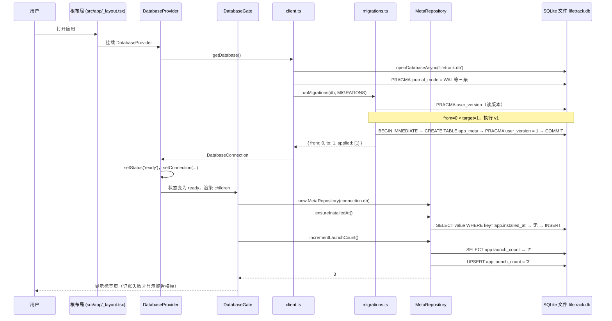
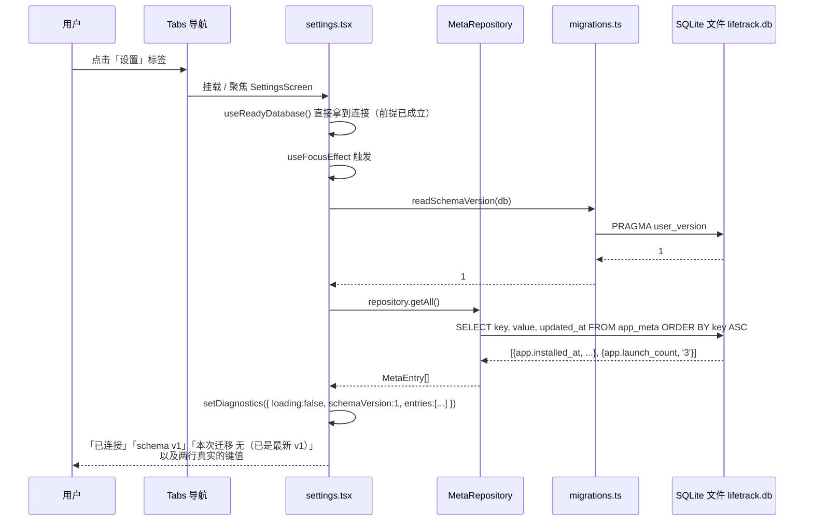

# 05 · 业务逻辑与数据流：走一遍最小的持久化闭环

## 1. 本次完成了什么

**用户现在可以做什么**

有一个**可以亲眼验证的真实业务闭环**：

1. 打开应用 → 应用自动把「启动次数」加一，写进数据库。
2. 切到「设置」页 → 能看到 `app_meta` 表里的真实内容，例如 `app.launch_count = 3`。
3. 完全关掉应用再打开 → 数字继续增加（`4`、`5`…），而 `app.installed_at` 永远不变。

**解决了什么问题**

它证明了整条链路是通的，而且是**真的落盘**而不是只存在内存里：

界面动作 → React 状态/副作用 → 仓储方法 → SQL → SQLite 文件 → 重新读取 → 界面更新。

第一阶段没有业务功能，如果只交付「一个能跑的空壳」，就无法证明架构是成立的。这个「启动次数」是**刻意选的最小业务**：它足够简单（一个键值对），但完整走过了所有层，而且重启后可见——**不可能靠内存状态伪装过去**。

**在整个 LifeTrack 中处于什么位置**

这是**纵向切片**：从最外层的 `_layout.tsx` 一直到最底层的 SQLite 文件。它横跨了 [02](./02-react-native-ui.md)（界面）、[03](./03-typescript-domain-model.md)（领域）、[04](./04-sqlite-and-repository.md)（数据库）三篇的内容，是把它们串起来的那条线。

**本次范围内明确没有实现什么**

- 没有任何「业务意义」的数据：没有事件、没有记录、没有周期。`app_meta` 是应用元信息表，不是业务表。
- 没有用户主动触发的写入：`launch_count` 是应用启动时**自动**写的，用户不能手动修改它。
- 没有数据列表、没有分页、没有筛选。设置页读的是**全表**（`getAll()`），因为这张表只有两行。
- 没有「撤销」「删除」这类需要确认的操作。
- **没有界面层的自动化测试**：这条闭环目前**只靠手动在模拟器上验证**（诚实说明见第 6 节）。

## 2. 修改了哪些文件

| 文件路径 | 文件的职责 | 本次具体修改 | 它与其他文件的关系 |
| --- | --- | --- | --- |
| `src/app/_layout.tsx` | 根布局，决定「谁包着谁」 | 新建：`<DatabaseProvider>` → `<StatusBar>` + `<DatabaseGate>` → `<Stack>` | 是整条链路的**起点**：Provider 提供数据库，Gate 挡住未就绪的界面 |
| `src/db/DatabaseProvider.tsx` | 数据库的「状态提供者」 | 新建：`DatabaseStatus` 联合类型、`DatabaseContextValue` 接口、`DatabaseProvider` 组件、`useDatabase()`、`useReadyDatabase()` | 依赖 `client.ts` 的 `getDatabase`；被根布局使用，被 `DatabaseGate` 与设置页读取 |
| `src/components/DatabaseGate.tsx` | 数据库门禁 + 启动初始化 | 新建：三态渲染（加载中 / 出错 / 放行）；`useEffect` 里调用 `MetaRepository` 的 `ensureInstalledAt()` 与 `incrementLaunchCount()`，以及 `seedStarterDefinitions()`（新库才写一条内置事件） | 依赖 `useDatabase()`、`MetaRepository` 与 `seedStarterDefinitions()`；**它是唯一一个既碰界面又碰数据库的组件** |
| `src/app/(tabs)/settings.tsx` | 设置页（诊断面板） | 新建：四张卡片；`useFocusEffect` 里用 `Promise.all` 并发读取 `readSchemaVersion(db)` 与 `repository.getAll()` | 依赖 `useReadyDatabase()`（取连接）与 `MetaRepository`；是本闭环的**读取端** |
| `src/repositories/metaRepository.ts` | `app_meta` 仓储 | 提供 `ensureInstalledAt()`（只写一次）与 `incrementLaunchCount()`（每次 +1） | 见 [04](./04-sqlite-and-repository.md) |
| `src/db/client.ts` | 连接入口 | 提供 `getDatabase()` 单例 | 见 [04](./04-sqlite-and-repository.md) |

**值得注意的分工**：

- `DatabaseProvider` 只负责「把连接准备好」，**它自己不做任何业务写入**。
- `DatabaseGate` 负责「等就绪」和「启动时该做的记账」。
- 设置页只负责「读出来展示」。
- 写入与读取都通过 `MetaRepository`，**没有任何一处直接写 SQL**。

## 3. 涉及哪些技术概念

### 3.1 React Context：跨层传递数据

**是什么**：Context（上下文）是 React 提供的「跨组件传值」机制。父组件用 `<MyContext.Provider value={...}>` 把值放进去，任意深度的后代用 `useContext(MyContext)` 取出来。

**为什么本项目需要**：数据库连接只能在应用启动时打开一次，但**很多页面都要用它**。如果靠 props 一层层往下传：

```
RootLayout → Stack → (tabs) → SettingsScreen → ...
```

每一层都得加一个 `db` prop，而 `Stack`、`(tabs)` 这些是 expo-router 提供的组件，我们**根本没法给它们传自定义 prop**。Context 正好解决这个问题。

**用在哪个真实文件**：`src/db/DatabaseProvider.tsx`。

**不用会怎样**：要么用模块级全局变量（无法触发界面更新、测试困难），要么在每个页面里各自开数据库（违反「唯一连接入口」的约束，见 [04](./04-sqlite-and-repository.md) 7）。

**容易误解的地方**：Context 的 `value` 变化会**导致所有消费它的组件重新渲染**。所以本项目用 `useMemo` 把 value 包起来，避免每次渲染都造一个新对象（见 4.2）。

### 3.2 Provider 与「自定义 Hook」封装

**是什么**：

```tsx
const DatabaseContext = createContext<DatabaseContextValue | null>(null);

export function DatabaseProvider({ children }: { children: ReactNode }) {
  // ...
  return <DatabaseContext.Provider value={value}>{children}</DatabaseContext.Provider>;
}

export function useDatabase(): DatabaseContextValue {
  const context = useContext(DatabaseContext);
  if (!context) {
    throw new Error('useDatabase 必须在 <DatabaseProvider> 内部使用');
  }
  return context;
}
```

- `createContext<DatabaseContextValue | null>(null)`：默认值是 `null`，用来表示「没人提供过」。
- `useDatabase()` 把 `useContext` 包起来，并**在拿不到时报错**。

**为什么本项目需要**：不封装的话，每个使用点都要写 `const ctx = useContext(DatabaseContext); if (!ctx) throw ...`，而且 `ctx` 的类型总是 `DatabaseContextValue | null`，到处要判空。

**用在哪个真实文件**：`DatabaseProvider.tsx`；使用方是 `DatabaseGate.tsx` 和 `settings.tsx`。

**不用会怎样**：忘记把组件放进 `<DatabaseProvider>` 时，会拿到 `null`，然后在很久之后、在一个完全无关的地方报「Cannot read property 'status' of null」——**错误信息离原因很远**。有了这个抛错，错误位置就是使用位置。

**容易误解的地方**：`createContext` 的默认值 `null` **不代表业务上的「没数据」**，只代表「没有 Provider」。这两个 null 混在一起是常见的混淆源，所以本项目专门写了 `useReadyDatabase()`：

```tsx
export function useReadyDatabase(): DatabaseConnection {
  const { status, connection } = useDatabase();
  if (status !== 'ready' || !connection) {
    throw new Error('数据库尚未就绪，请先判断 useDatabase().status');
  }
  return connection;
}
```

它把「数据库一定就绪」这个前提**变成类型上的事实**：拿到 `DatabaseConnection`（不是 `| null`），后续代码就不用判空了。设置页第一行就是 `const { db, databasePath, migration } = useReadyDatabase();`。

### 3.3 把异步过程建模成「状态机」

**是什么**：

```ts
export type DatabaseStatus = 'opening' | 'ready' | 'error';
```

数据库不可能「一下子就绪」，它有三个**互斥**状态：正在打开、已就绪、出错。

**为什么本项目需要**：如果用布尔值（比如 `isLoading` + `hasError`），就有 4 种组合，其中 `isLoading && hasError` 这种「不可能状态」需要额外处理。用联合类型则**编译期就排除了不可能状态**。

**用在哪个真实文件**：`DatabaseProvider.tsx` 的 `DatabaseStatus`；消费方是 `DatabaseGate.tsx` 的三分支渲染。

**不用会怎样**：出现「加载中」和「出错了」同时为真的情况，界面显示什么就变成了运气。

**容易误解的地方**：联合类型只约束「变量能取哪几个值」，**不保证状态转换是合法的**。代码里仍然可能出现「从 `error` 直接跳到 `ready`」（这里其实就会，重试成功后就是这么走的）。类型系统管不了「状态迁移图」，那是开发者自己的责任。

### 3.4 `useState`：组件自己会变的数据

**是什么**：`const [status, setStatus] = useState<DatabaseStatus>('opening')` —— 解构出「当前值」和「修改它的函数」。调用 `setStatus('ready')` 会让组件重新渲染。

**为什么本项目需要**：数据库打开是异步的，结果要能驱动界面变化。

**用在哪个真实文件**：`DatabaseProvider` 里有四个：`status`、`connection`、`error`、`attempt`。

**不用会怎样**：用普通变量 `let status = 'opening'`，改了它界面**不会重新渲染**——这是 React 初学者最常见的困惑：「我明明改了变量，为什么画面没变？」

**容易误解的地方（重要）**：

- `setStatus(...)` 是**异步**的，本行之后读 `status` 拿到的还是旧值。
- **不要直接修改 state 对象**（`state.value = 1`），必须用 setter 传一个新值。React 靠「引用是否变化」判断要不要重新渲染。

其中 `attempt` 是一个**小技巧**：

```tsx
const [attempt, setAttempt] = useState(0);

useEffect(() => {
  // ... getDatabase() ...
}, [attempt]);

const retry = useCallback(() => {
  setStatus('opening');
  setConnection(null);
  setError(null);
  setAttempt((value) => value + 1);
}, []);
```

`attempt` 不参与渲染，它唯一的作用是**当作 `useEffect` 的依赖**：每点一次「重试」，`attempt` 加一，依赖变化，effect 重新执行一次。

`setAttempt((value) => value + 1)` 用的是**函数式更新**：当新值依赖旧值时，必须用这种写法，否则在快速连续更新时可能丢失（`value` 是 React 保证的最新值，而不是闭包里捕获的旧值）。

### 3.5 `useEffect`：副作用与依赖数组

**是什么**：

```tsx
useEffect(() => {
  let cancelled = false;

  getDatabase()
    .then((opened) => {
      if (cancelled) return;
      setConnection(opened);
      setStatus('ready');
    })
    .catch((cause: unknown) => {
      if (cancelled) return;
      setError(toAppError(cause, '数据库初始化失败'));
      setStatus('error');
    });

  return () => {
    cancelled = true;
  };
}, [attempt]);
```

`useEffect(函数, 依赖数组)` 的含义：**在组件渲染完成后**执行这个函数；依赖数组里的值变化时重新执行。返回的那个函数是**清理函数**，在「下次执行前」或「组件卸载时」被调用。

**为什么本项目需要**：打开数据库是一个**副作用**（它会影响组件之外的东西——文件系统）。渲染函数本身必须是纯粹的，**不能在渲染过程中发起副作用**，否则每次重渲染都会重新打开一次数据库。

**用在哪个真实文件**：`DatabaseProvider.tsx`（打开数据库）、`DatabaseGate.tsx`（启动初始化：记账 + 内置模板事件）。

**不用会怎样**：直接在函数体里 `getDatabase().then(...)`，会在每次渲染时重复触发，形成请求风暴或无限循环。

**依赖数组必须写对（最容易出错的地方）**：

| 写法 | 效果 |
| --- | --- |
| `useEffect(fn)` （省略数组） | **每次渲染后都执行**——本项目会变成无限循环（因为 effect 里会 setState，触发渲染，再触发 effect） |
| `useEffect(fn, [])` | 只在挂载后执行一次 |
| `useEffect(fn, [attempt])` | 挂载后执行一次，且 `attempt` 变化时再执行 |

本项目用 `[attempt]` 而不是 `[]`，就是为了让「重试」能生效。

**`cancelled` 标志是干什么的**：异步操作可能在组件已经卸载（或者 effect 已经重新执行）之后才完成。那时再 `setStatus` 是无意义的，React 会警告「在已卸载组件上更新状态」。

```tsx
return () => { cancelled = true; };
```

清理函数把标志置为 `true`，于是回调里的 `if (cancelled) return;` 会拦住过期的结果。**这是处理异步副作用的必备模式**。

**容易误解的地方**：`cancelled` 只是「不再更新状态」，**并没有取消底层的异步操作**。数据库依然会被打开（这其实是我们想要的——下次调用 `getDatabase()` 会直接命中缓存）。真正的取消需要 `AbortController` 之类，`expo-sqlite` 的打开操作也不支持取消。

### 3.6 `useCallback` 与 `useMemo`：避免无谓的重建

**是什么**：

```tsx
const retry = useCallback(() => { /* ... */ }, []);
const value = useMemo<DatabaseContextValue>(() => ({ status, connection, error, retry }), [status, connection, error, retry]);
```

- `useCallback(fn, deps)`：把函数缓存起来，依赖不变就返回同一个函数引用。
- `useMemo(factory, deps)`：把**计算结果**缓存起来。

**为什么本项目需要**：

- `retry` 会被放进 Context 的 value。如果不缓存，每次渲染都是新函数 → value 每次都是新对象 → 所有消费 Context 的组件全部重渲染。
- `useMemo` 让 Context 的 value **只在真正变化时**才换新对象。

**用在哪个真实文件**：`DatabaseProvider.tsx`。

**不用会怎样**：功能上通常还能跑，但会出现**不必要的重渲染**。在这个规模下不是性能问题，但它也是「依赖数组写对了」的一种体现——如果 `useMemo` 的依赖漏了 `error`，界面就会显示旧错误。

**容易误解的地方**：`useMemo` **不是缓存数据**，它只在**同一次组件存活期间**有效，重新挂载就没了。真正的数据缓存要考虑 `client.ts` 里的 `connectionPromise` 那种做法。

### 3.7 `useFocusEffect`：页面每次被聚焦时刷新

**是什么**：expo-router 提供的 Hook，效果类似 `useEffect`，但触发时机是「页面获得焦点」。

**为什么本项目需要**：设置页要显示当前的 `launch_count`。如果你在应用启动后**先看时间轴页，再切到设置页**，用 `useEffect(..., [])` 可能已经错过了数据变化。用 `useFocusEffect` 就保证「每次切到这一页都读一遍最新的」。

**用在哪个真实文件**：`settings.tsx`：

```tsx
useFocusEffect(
  useCallback(() => {
    let cancelled = false;
    // ...
    return () => { cancelled = true; };
  }, [db, databasePath, migration]),
);
```

**不用会怎样**：页面显示的是第一次渲染时的旧快照。用户会觉得「数据没刷新」——这是移动端最常见的 bug 类型之一。

**容易误解的地方（重要）**：`useFocusEffect` **要求传入 `useCallback` 包起来的函数**，否则每次渲染都会创建一个新函数，导致 effect 反复执行（甚至死循环）。这不是风格问题，是**必须**的。

### 3.8 `Promise.all`：并发等待多个异步操作

**是什么**：

```tsx
Promise.all([readSchemaVersion(db), repository.getAll()]).then(([version, entries]) => { /* ... */ });
```

同时发起两个异步操作，等**两个都完成**后拿到结果数组。任何一个失败，整体就失败。

**为什么本项目需要**：设置页要「数据库版本」和「`app_meta` 全部内容」两份数据。它们互不依赖，串行执行会白等一倍时间。

**用在哪个真实文件**：`settings.tsx`。

**不用会怎样**：写两个嵌套的 `.then`，还要自己处理「先完成的是哪个」，代码变复杂。

**容易误解的地方**：`Promise.all` 的**失败是「快速失败」**——只要有一个 reject，整体立刻 reject，但**其他操作并不会被取消**，它们仍在后台跑完。本项目的两个操作都只是读，所以无所谓；如果涉及写入，就要考虑「一半成功」的问题（这也是第二阶段要专门处理事务一致性的原因）。

### 3.9 单向数据流

**是什么**：数据从上层流向下层（props、Context），事件从下层流向上层（回调）。**不允许下层直接改上层的数据**。

**为什么本项目需要**：数据库连接的所有者是 `DatabaseProvider`，只有它能改变 `status` / `connection` / `error`。`DatabaseGate` 和设置页只能**读**，不能写。它们想换数据，只能通过调用仓储方法（这会去改**数据库**，而不是改 Provider 的状态）。

**用在哪个真实文件**：整个链路。

**不用会怎样**：任何组件都能改全局状态，出 bug 时找不到是谁改的。

## 4. 关键代码逐段解释

### 4.1 根布局：三个组件的嵌套顺序不是随便排的

```tsx
export default function RootLayout() {
  return (
    <DatabaseProvider>
      <StatusBar style="dark" />
      <DatabaseGate>
        <Stack screenOptions={{ headerShown: false, contentStyle: { backgroundColor: palette.background } }}>
          <Stack.Screen name="(tabs)" />
        </Stack>
      </DatabaseGate>
    </DatabaseProvider>
  );
}
```

- **`DatabaseProvider` 必须在最外层**：它提供 Context，里面的组件（`DatabaseGate`、所有页面）才能 `useDatabase()`。
- **`DatabaseGate` 必须在 `Stack` 外面**：这样才能让**整个应用**（而不是某一页）显示「正在准备本地数据库…」或者「初始化失败」。反过来如果把 Gate 放在 `Stack` 里，用户会先看到标签栏，再看到错误页，体验很怪。
- `headerShown: false`：关掉 Stack 自带的大标题栏，因为每个页面自己用 `Card` 做了标题（见 [02](./02-react-native-ui.md)）。

**顺序错了会怎样**：`DatabaseGate` 写在 `DatabaseProvider` 外面，`useDatabase()` 会抛「必须在 `<DatabaseProvider>` 内部使用」——错误信息是准确的，但如果你不了解 Context，会看不懂为什么。

### 4.2 `DatabaseProvider`：把异步过程装进状态机

```tsx
export function DatabaseProvider({ children }: { children: ReactNode }) {
  const [status, setStatus] = useState<DatabaseStatus>('opening');
  const [connection, setConnection] = useState<DatabaseConnection | null>(null);
  const [error, setError] = useState<AppError | null>(null);
  const [attempt, setAttempt] = useState(0);

  useEffect(() => {
    let cancelled = false;
    getDatabase()
      .then((opened) => {
        if (cancelled) return;
        setConnection(opened);
        setStatus('ready');
      })
      .catch((cause: unknown) => {
        if (cancelled) return;
        setError(toAppError(cause, '数据库初始化失败'));
        setStatus('error');
      });
    return () => { cancelled = true; };
  }, [attempt]);

  const retry = useCallback(() => {
    setStatus('opening');
    setConnection(null);
    setError(null);
    setAttempt((value) => value + 1);
  }, []);

  const value = useMemo<DatabaseContextValue>(() => ({ status, connection, error, retry }), [status, connection, error, retry]);

  return <DatabaseContext.Provider value={value}>{children}</DatabaseContext.Provider>;
}
```

几个值得注意的设计决定：

1. **`error` 的类型是 `AppError` 而不是 `string`**。这直接受益于 [03](./03-typescript-domain-model.md) 的统一错误体系：界面可以按 `error.code` 分支显示，不用解析文本。
2. **用了 `toAppError` 做兜底**。`getDatabase()` 理论上只抛 `AppError`，但 `.catch` 的 `cause` 类型是 `unknown`。用 `toAppError` 把「万一不是」的情况也归一化，界面上就永远有一个可显示的 `code` 和 `message`。
3. **`retry()` 里重置状态，而不是在 effect 体内重置**。注释写得很清楚：「状态重置放在事件回调里，而不是 effect 体内（避免级联渲染）」。
   如果写成 effect 一开始就 `setStatus('opening')`，那么每次 effect 执行都会触发一次渲染，effect 里有 setState → 可能形成额外渲染循环。放进事件回调（用户点按钮）里就干净了。
4. **`attempt` 不传给 `getDatabase()`**。它是纯粹的「触发器」。真正让重试有意义的是 `client.ts` 里「失败后清空 `connectionPromise` 缓存」的逻辑（见 [04](./04-sqlite-and-repository.md) 4.2）。
5. `useMemo` 的依赖列表就是 value 里的四个字段。**漏写会导致消费方拿到过期值**。

### 4.3 `DatabaseGate`：三态渲染 + 启动时该做的两件事

```tsx
export function DatabaseGate({ children }: { children: ReactNode }) {
  const { status, connection, error, retry } = useDatabase();
  const [bootWarning, setBootWarning] = useState<string | null>(null);

  useEffect(() => {
    if (status !== 'ready' || !connection) return;
    let cancelled = false;
    const repository = new MetaRepository(connection.db);
    repository
      .ensureInstalledAt()
      .then(() => repository.incrementLaunchCount())
      .then(() =>
        seedStarterDefinitions(connection.db, { freshDatabase: connection.migration.from === 0 }),
      )
      .catch((cause: unknown) => {
        if (!cancelled) {
          setBootWarning(cause instanceof Error ? cause.message : String(cause));
        }
      });
    return () => { cancelled = true; };
  }, [status, connection]);

  if (status === 'opening') { /* 转圈 + 「正在准备本地数据库…」 */ }
  if (status === 'error' || !connection) { /* 错误码 + 消息 + 重试按钮 */ }

  return (<>{bootWarning ? <View style={styles.warning}>…</View> : null}{children}</>);
}
```

**这是全项目唯一一个「既做界面又做数据写入」的组件**。它的职责有两块：

**A. 门禁**：`status === 'opening'` 时显示加载指示器；`status === 'error'` 时显示错误页和重试按钮；只有 `ready` 才渲染 `children`。
注意错误分支的条件是 `status === 'error' || !connection`——**两个条件都要判**，因为 `status` 是 `'ready'` 但连接为 `null` 在类型上是可能的（虽然运行时不会），加个 `||` 让 `tsc` 也能确认 `connection` 非空。

**B. 启动时该做的两件事**：

1. **记账**：`ensureInstalledAt()` 先执行，`incrementLaunchCount()` 后执行（`.then` 串联）。顺序**有意义的**：先记录「首次安装时间」，再记启动次数。虽然这两个操作互相独立，但保持这个顺序让「第一次启动时两行一起出现」变得确定。
2. **内置参考模板事件**：`seedStarterDefinitions()`（`src/features/definitions/starterDefinitions.ts`）写一条「喝水」定义——**只在数据库是这一次新建出来的时候**（`connection.migration.from === 0`）。
   为什么用这个判断而不是「app_meta 里有没有标记」：用户把内置事件删了之后，下次升级不该让它复活；`from === 0` 只在建库那一次成立，此后每次打开都读不到 0。
   `DatabaseGate` 是**唯一**适合做这件事的地方——它拿得到 `connection.migration`（别的组件拿不到「迁移前版本」），又已经在做启动写入。
   「没有任何记录」的时间轴空状态此时只写 `还没有任何记录` 一句：新用户可以照这条内置事件点一下，不必先读一段说明。
   （内置事件是**异步**写的，与门禁放行同时发生；只在「冷启动后立刻切到事件页」这种极端情况下第一帧可能还看不到它，切走再回来就有。）

- `new MetaRepository(connection.db)` 每次 effect 执行时新建一个仓储实例。仓储本身无状态（只是持有连接），所以新建很便宜、也不用缓存。
- 依赖数组是 `[status, connection]`。因为只有 `ready` 时才真正干活（前面有 `if (status !== 'ready' || !connection) return;`）。
- **`bootWarning` 的处理方式很关键**：它**不阻止应用启动**，只在顶部显示一条黄色警告横幅「启动初始化未完成（不影响使用）：…」。
  为什么这样设计：记账或内置模板失败（比如磁盘满）不应该让用户**完全无法使用**应用。而数据库迁移失败则必须阻止启动，因为那时表结构不可信。**两类失败的处理态度不同**——这是刻意的产品判断。
  两件事共用一个警告位（只显示最后一条失败）：它们都属于「便利」，不需要用户分别处理。

**容易误解的地方**：

- `useEffect` 里三条 `.then` 只在末尾 `.catch` 里处理错误。这意味着**中间步骤失败**也会被同一个 `.catch` 捕获，后面的步骤不会执行。这在语义上是合理的：安装时间写不进去，就别急着累加计数、也别写内置数据。
- `cancelled` 在这个 effect 里的作用：防止组件卸载后 setState（横幅不再显示）。注意写入本身**不会被取消**，它还是会写进数据库——这是正确的，我们不想到手的初始化半途而废。

### 4.4 设置页：读回来的数据怎么变成界面

```tsx
export default function SettingsScreen() {
  const { db, databasePath, migration } = useReadyDatabase();
  const [diagnostics, setDiagnostics] = useState<Diagnostics>({
    loading: true, error: null, schemaVersion: null, migration, databasePath, entries: [],
  });

  useFocusEffect(
    useCallback(() => {
      let cancelled = false;
      const repository = new MetaRepository(db);

      Promise.all([readSchemaVersion(db), repository.getAll()])
        .then(([version, entries]) => {
          if (cancelled) return;
          setDiagnostics({ loading: false, error: null, schemaVersion: version, migration, databasePath, entries });
        })
        .catch((cause: unknown) => {
          if (cancelled) return;
          setDiagnostics((previous) => ({ ...previous, loading: false, error: cause instanceof Error ? cause.message : String(cause) }));
        });

      return () => { cancelled = true; };
    }, [db, databasePath, migration]),
  );
```

- `useReadyDatabase()` 这一行是「这条链路一定已经就绪」的声明。设置页能这么写，是因为它**一定渲染在 `DatabaseGate` 的 `children` 里**——而 children 只在 `ready` 时才渲染。这就是 3.2 里说的「把前提变成类型事实」。
- `diagnostics` 是一个**聚合的 state 对象**：`loading` / `error` / `schemaVersion` / `migration` / `databasePath` / `entries` 六项一起更新。
  为什么不用 6 个 `useState`：它们来自**同一次读取**，必须一致。用 6 个独立 state 会出现「版本号更新了、列表还是旧的」这种中间态。
- 初始 state 里 `migration` 和 `databasePath` 直接来自 `useReadyDatabase()`，因为它们**在数据库打开时就确定了**，不需要等 `useFocusEffect`。这样即使读取失败，这两项仍然能显示。
- **失败时的更新用了函数式写法**：`setDiagnostics((previous) => ({ ...previous, loading: false, error: ... }))`。这样保留了之前的 `entries` 等字段，只改这两项。
- `cancelled` 同理：页面切换后不再 setState。

渲染部分：

```tsx
const migrationSummary =
  diagnostics.migration.applied.length === 0
    ? `无（已是最新 v${diagnostics.migration.to}）`
    : `${diagnostics.migration.from} → ${diagnostics.migration.to}（应用 v${diagnostics.migration.applied.join(', v')}）`;
```

这一小段把 [04](./04-sqlite-and-repository.md) 里 `MigrationResult` 的 `from` / `to` / `applied` 三个字段**变成了人能看懂的诊断文字**：

- `applied` 为空 → 数据库本来就是最新的，显示「无（已是最新 v1）」。
- 非空 → 显示「0 → 1（应用 v1）」，表示这次启动真的执行了迁移。

```tsx
{diagnostics.entries.length === 0 ? (
  <AppText color={palette.textMuted}>暂无数据</AppText>
) : (
  diagnostics.entries.map((entry) => <Row key={entry.key} label={entry.key} value={entry.value} />)
)}
```

- 用 `.map` 把数组渲染成多个元素，**每个都必须有 `key`**。`key` 帮助 React 识别「哪个元素对应哪条数据」，用于高效更新。用数组下标当 key 是常见的坏做法（列表顺序变化时会错位），这里用 `entry.key`（本身就是唯一的数据库主键）最合适。
- `Row` 是**这个文件内的局部组件**（没有放到 `src/components/`）。理由：它只在设置页用，抽出去反而增加导航成本。**「先就地实现，出现第二个使用方再抽取」** 是一个务实的判断标准。

### 4.5 为什么这条链路能证明「真的落盘了」

回顾一下证据链：

1. 第一次启动时 `ensureInstalledAt()` 写入 `app.installed_at`。
2. 每次启动 `incrementLaunchCount()` 把 `app.launch_count` 加一。
3. 设置页显示的是**从数据库 `SELECT` 出来的值**，不是内存变量。
4. 因此：**如果数据只存在内存里，重启后数字必然从 1 重新开始**。

第一阶段在 Android 模拟器上实测得到 `2 → 3 → 4`，其中一次跨越了**模拟器冷启动**；iOS 模拟器上得到 `1 → 2 → 3`。同时 `app.installed_at` 始终不变。
更进一步，用 `adb shell sqlite3` 直接读设备上的 `lifetrack.db` 文件，也看到了这些键值——**这排除了「界面上显示的和数据库里存的不一致」的可能**。

**这是本项目「验证要做到底」的标准**：不满足于「界面上数字变了」，而是直接读文件。

## 5. 一次完整操作的数据流

### 5.1 启动时的写入链路



**逐段文字说明**：

1. 用户打开应用 → 根布局渲染 → `DatabaseProvider` 挂载。
2. Provider 通过 `getDatabase()` 打开数据库（单例，见 [04](./04-sqlite-and-repository.md)），并**先设置 PRAGMA 再迁移**。
3. 迁移是幂等的：全新库会走 `0 → 1`，已升级过的库 `applied` 为空。
4. 只有 `status` 变成 `ready` 后，`DatabaseGate` 才会渲染业务界面。
5. Gate 在渲染放行后（其实是在 effect 里，与渲染并行）执行启动初始化：先补安装时间，再累加启动次数，最后**如果是刚新建的库**写一条内置模板事件（「喝水」）。
6. 初始化失败**不阻断使用**，只在顶部显示一条警告。
7. 至此，数据库里已经有了这次启动留下的痕迹；新用户打开「事件」页就能看到那条可删的模板事件。

### 5.2 打开设置页的读取链路



**逐段文字说明**：

1. 用户点「设置」标签，expo-router 聚焦对应的屏幕（见 [06](./06-navigation-and-state.md)）。
2. 屏幕通过 `useReadyDatabase()` **同步**拿到连接——不需要再判断状态。
3. `useFocusEffect` 保证每次进入这一页都重新读一遍，所以刚启动时增加的计数会立刻体现出来。
4. 两个读取用 `Promise.all` 并发执行：一个是查 schema 版本（走 `migrations.ts`），一个是查表内容（走 `MetaRepository`）。
5. 结果一次性写进 `diagnostics`，界面整体刷新。
6. 用户在屏幕上看到的是**数据库里的真实内容**。

**注意这里的层级关系**：设置页里查 schema 版本用的是 `readSchemaVersion`（基础设施层），查元信息用的是 `MetaRepository.getAll()`（仓储层）。**两者都是读，都没有写 SQL 字符串到界面里**。

## 6. 如何验证

### 关键命令

```bash
npm test                          # 单元测试（持久化部分在 repositories 套件里）
npm start                         # 手动端到端验证
```

### 正常应该看到什么

**自动化部分**：`metaRepository-test.ts` 里 `describe('持久化（同一文件重新打开）')` 这个用例模拟了「应用重启」：
用 `mkdtempSync` 建临时目录 → 打开文件库 → 迁移 → 累加计数 → `close()` → **重新打开同一路径** → 断言数据还在、`applied` 为空、计数继续累加到 2。
跑 `npm test -- src/repositories` 应该全部通过。

**手动部分**：在模拟器上，设置页应显示。

```
应用信息
  应用版本   0.1.0                        ← app.json 的 version
  Expo SDK   58.x                          ← Constants.expoConfig?.sdkVersion
  运行环境   storeClient（iOS）/ bare（Android）  ← Constants.executionEnvironment

本地数据库  SQLite（expo-sqlite）
  [已连接] [schema v1]
  文件路径   /data/data/host.exp.exponent/files/SQLite/lifetrack.db （Android）
  本次迁移   0 → 1（应用 v1）        ← 仅首次启动是这样
  本次迁移   无（已是最新 v1）        ← 之后每次启动

app_meta 表内容   启动次数用于验证跨重启持久化
  app.installed_at   2026-10-19T...
  app.launch_count   3
```

### 手动验证步骤（第一阶段真实执行过）

1. `npm start`，在模拟器上打开应用。
2. 切到「设置」，记下 `app.launch_count` 的值（假设是 1）和 `app.installed_at`。
3. **完全关掉应用**（Android 用 `adb shell am force-stop host.exp.exponent`；iOS 用 `xcrun simctl terminate booted host.exp.Exponent`），再重新打开。
4. 再看「设置」：`app.launch_count` 应该是 2，`app.installed_at` **不变**。
5. 重复一次，得到 3。
6. **最强证据**：直接在设备上读文件：

   ```bash
   ADB=/Users/wind/Library/Android/sdk/platform-tools/adb
   $ADB shell sqlite3 /data/data/host.exp.exponent/files/SQLite/lifetrack.db \
     "SELECT key, value, updated_at FROM app_meta;"
   ```

   看到的应该和界面上一致。

### 如何查看失败信息

- **数据库打开/迁移失败**：界面显示「数据库不可用」徽章 + 错误码 + 可复制的错误消息 + 重试按钮。
- **记账或内置模板事件失败**：界面顶部黄色横幅「启动初始化未完成（不影响使用）：<原因>」。**应用仍然可用**。
- **读取失败（设置页）**：`本地数据库` 卡片里多出一行「读取错误」。

### 测试覆盖了什么、没覆盖什么

| 环节 | 覆盖情况 |
| --- | --- |
| `MetaRepository` 的读写、UPSERT、排序、累加、安装时间幂等 | ✅ 有单测 |
| 「关闭后重开同一文件，数据还在」 | ✅ 有单测（`mkdtempSync` + 重开） |
| `DatabaseProvider` 的状态机（opening → ready / error）与 `retry` | ❌ **无测试** |
| `DatabaseGate` 的三态渲染与启动记账 | ❌ **无测试** |
| `seedStarterDefinitions`（内置模板事件）的「新库才写、旧库不写、删了不复活」 | ✅ 有单测（`features/definitions/__tests__/starterDefinitions-test.ts`，用真实内存 SQLite） |
| 设置页的读取与渲染 | ❌ **无测试**（`jest.config.js` 明确排除 `src/app/**`） |

**这个缺口值得说清楚后果**：目前「Provider 会不会卡在 opening」「重试按钮是否真的能恢复」「Gate 在 error 时是否真的挡住了界面」这些问题，**都只靠人工在模拟器上看一眼**。
第二阶段开始做表单和列表后，界面状态会明显变复杂。**建议在第二阶段早期引入 `@testing-library/react-native`**，至少覆盖：Provider 的三种状态、Gate 的错误分支、`retry` 能触发重新打开。

### 哪些验证真实执行过

- `npm test`：4 套件 / 32 用例通过（含持久化用例）。
- **iOS Simulator**（iPhone 17 Pro / iOS 26.3 / Expo Go 58.0.4）：三标签渲染正常；设置页显示 `已连接` / `schema v1` / `本次迁移 0 → 1（应用 v1）`；连续重启观察到 `launch_count` `1 → 2 → 3`，`installed_at` 不变。
- **Android 模拟器**（Pixel 9 / API 36 / Expo Go 58.0.4）：路径显示为 `/data/data/host.exp.exponent/files/SQLite/lifetrack.db`；在设备上用 `sqlite3` 读到 `user_version=1`；`launch_count` `2 → 3 → 4`，其中跨越了一次**模拟器冷启动**（最强的持久化证据），`installed_at` 不变。

**没有执行过**：真机；应用被系统杀进程 / 设备重启后的验证；数据库文件被人为损坏后的恢复。

## 7. 常见问题与排查

### 问题：切到设置页，数字还是旧的

**可能原因与排查顺序**：

1. **是不是把 `useFocusEffect` 写成了 `useEffect(..., [])`**？那样只在挂载时读一次。本项目已经用 `useFocusEffect` 规避。
2. **`useFocusEffect` 里的函数有没有用 `useCallback` 包**？没包的话依赖行为会不对。
3. **`useCallback` 的依赖数组是否漏了 `db`**？依赖不全时 `useCallback` 会返回旧函数，读到旧连接。
4. 设备端确认数据本身有没有变（直接读数据库文件），以区分「数据没写」还是「界面没刷新」。

### 问题：数据库打开很慢，一直停在「正在准备本地数据库…」

**可能原因与排查顺序**：

1. **首次启动会执行迁移**（建表），比后续启动慢一点，这是正常的。
2. 如果**一直**不停，说明 `getDatabase()` 的 Promise 既没 resolve 也没 reject。检查是否有地方**又开了一个连接**导致锁竞争（`busy_timeout` 是 5 秒，超过会抛错而不是永久等待，所以更可能是代码逻辑问题）。
3. 看终端有没有红色报错；也可以临时在 `.catch` 里加一行日志确认错误被接住了。

### 问题：点「重试」没反应

**可能原因与排查顺序**：

1. `retry()` 里做了三件事：重置状态、`setAttempt(+1)`。如果 `setAttempt` 没生效，effect 不会重跑。
2. 检查 `client.ts` 里 `getDatabase()` **失败后是否清空了缓存**。如果没清，第二次调用会返回**同一个失败的 Promise**，`retry` 看起来就「没反应」。（本项目已经处理：`pending.catch(() => { connectionPromise = null; })`。）
3. 如果原来的失败原因是持续性的（比如磁盘满），重试当然还是会失败——这不是 bug，界面会继续显示错误。

### 问题：控制台警告「Can't perform a React state update on an unmounted component」

**原因**：异步操作完成后对已卸载的组件调用了 setState。

**排查顺序**：检查那个异步调用**有没有 `let cancelled = false` 和清理函数**。本项目 `DatabaseProvider`、`DatabaseGate`、`settings.tsx` 三处都有。新增异步逻辑时必须照抄这个模式。

### 问题：计数在某些启动里没增加

**可能原因与排查顺序**：

1. **记账失败但被当成警告忽略了**。看顶部有没有黄色横幅。
2. `DatabaseGate` 的 effect 依赖 `[status, connection]`。如果某种路径下 `connection` 没变、`status` 也没从非 ready 变成 ready，effect 就不会执行。正常情况下每次冷启动都会走一遍。
3. **在开发环境里 Fast Refresh 会重新挂载组件**，可能导致计数比预期多——这是开发期的正常现象，不是 bug。要准确验证请用**完整重启**（force-stop / terminate）。

### 问题：iOS 上「运行环境」显示 `storeClient`，Android 上显示 `bare`

**原因**：这是 `Constants.executionEnvironment` 的取值差异，在两个平台上的 Expo Go 里报告得不一致。

**影响**：**无功能影响**，纯展示。这是已知的平台差异，不是代码问题。如果要修，就换成别的判断依据（例如 `Constants.appOwnership`），但目前没有必要。

### 问题：`promise` 拒绝没有被处理（Unhandled promise rejection）

**原因**：某个异步调用既没有 `await` 也没有 `.catch()`。

**排查顺序**：搜新增代码里的 `getDatabase(`、`repository.` 调用，确认每一个都有错误处理路径。本项目在 `client.ts` / `guard.ts` / 各组件里都做了处理。

## 8. 本阶段学习总结

**掌握的核心概念**

- **Context + Provider + 自定义 Hook** 是跨层共享「应用级资源」（这里是数据库连接）的标准做法。
- 用**联合类型建模异步状态机**（`opening | ready | error`），避免不可能状态。
- `useState` 是唯一能让界面重新渲染的数据来源；setter 是异步的；依赖旧值时用函数式更新。
- `useEffect` 的**依赖数组**决定执行时机；**清理函数 + `cancelled` 标志**防止过期异步结果污染状态。
- 「用 `attempt` 计数器作为 effect 依赖」实现重试。
- `useFocusEffect` 必须配 `useCallback`，用于「每次进页面都刷新」。
- `Promise.all` 并发等待；**失败是快速失败，但其他操作不会取消**。
- **两类失败的区别对待**：迁移失败必须挡住应用；记账失败只提示、不阻断。
- 单向数据流：Provider 拥有状态，其他人只读。

**需要理解的关键文件**

`src/app/_layout.tsx`（嵌套顺序）、`src/db/DatabaseProvider.tsx`（状态机与 Context）、
`src/components/DatabaseGate.tsx`（门禁 + 启动初始化「记账 + 内置模板事件」+ 两类失败的处理差异）、`src/app/(tabs)/settings.tsx`（读取与渲染）。

**建议亲自尝试的小练习**

1. **加一行只读诊断信息**：在 `settings.tsx` 的「应用信息」卡片里新增一行

   ```tsx
   <Row label="屏幕方向" value={Constants.expoConfig?.orientation ?? '未知'} />
   ```

   然后 `npm run typecheck`，并在模拟器上确认这一行出现了。
   **预期结果**：显示 `portrait`。这是**纯读**，不涉及任何写入，安全。
2. **观察 `useFocusEffect` 的作用**：把 `useFocusEffect(useCallback(...))` 临时改成 `useEffect(..., [])`（**只改这一处，测完立刻改回来**），重启应用 → 切到设置页看计数 → 切回时间轴 → 再切到设置。
   **预期结果**：改成 `useEffect` 后，你会更容易观察到「不重新读取」的差异；改回 `useFocusEffect` 后，每次进入都读到最新值。**注意**：这个练习只影响读时机，不影响数据。
3. **读代码回答一个问题**：`DatabaseGate` 里为什么记账失败只显示警告横幅，而迁移失败要整页挡住？用一句话写下你的答案，再对照本文 4.3 的说明。
4. **手动验证持久化（核心练习）**：按第 6 节的步骤，重启应用 3 次，记录 `app.launch_count` 和 `app.installed_at` 的变化；然后用 `adb shell sqlite3` 或读取 iOS 沙盒里的文件，确认界面与文件内容一致。
   **预期结果**：计数每次 +1，安装时间不变，文件内容与界面一致。**这是理解「持久化」的最直接方式**。

练习 1 与 3、4 都不需要修改数据库结构；练习 2 请务必改回来。

**下一阶段会用到哪些已学知识**

- 第二阶段第 1 项「事件定义」的列表页会**复用这套读取模式**（`useFocusEffect` + `Promise.all` + 聚合 state），但数据量变大后要从「一次读全表」改成**分页/按需查询**，并考虑用 `FlatList`。
  **（现状：已复用该模式；分页与 `FlatList` 仍待后续）**
- 「新增/编辑事件定义」会引入**写操作**，需要新的模式：写完后**重新读取并刷新界面**（或乐观更新）。本阶段的写入是「自动的、无需反馈的」，下一阶段要处理「用户点击后要有明确反馈」。
- 「归档」按钮会复用 `Button` + `Card`，并需要在写完后刷新当前页面。
- 第二阶段第 8 项的「一致性测试」会大量复用本阶段验证持久化的手法：**直接读数据库文件做断言**，而不是只信任界面。