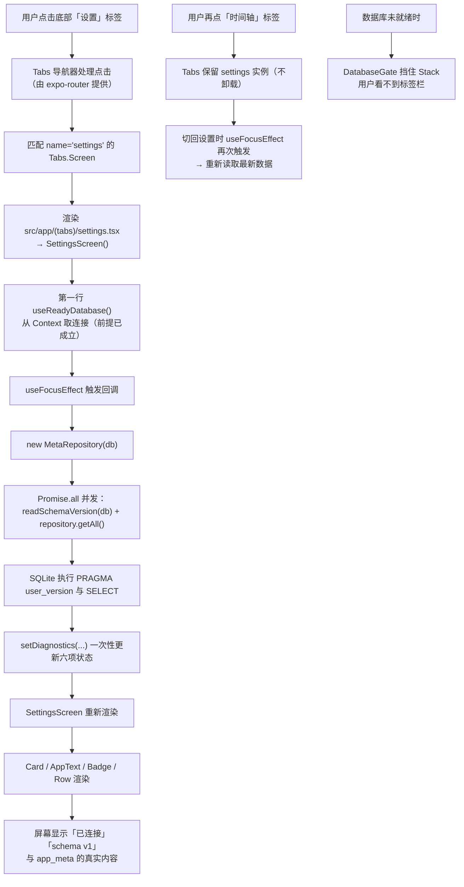

# 06 · 导航与状态：页面之间怎么连，状态怎么流

> 这一篇讲两件相关的事：**页面之间怎么跳**（导航），以及**数据在组件之间怎么传递**（状态）。
> 状态管理的核心实现（Context、`useState`、`useEffect`）在第 [05](./05-business-logic-and-data-flow.md) 篇里已经用真实代码详细讲过；
> 这一篇重点讲**路由**，以及为什么第一阶段的导航和状态是这样分工的。

## 1. 本次完成了什么

**用户现在可以做什么**

- 应用底部有三个标签页：**时间轴**、**事件**、**设置**，点击即可切换。
  **（现状：已增至四个——多了「统计」；曾有一段时间还有「周期」，v6 起周期并进「事件」页又去掉了，
  见 [11](./11-cycle-tracking.md) 的 4.13 节）**
- 每个标签页有自己的标题栏（标题分别是「时间轴」「事件」「设置」）。
- 选中的标签会变色并显示**实心图标**，未选中显示**描边图标**。
- 应用启动时先出现数据库准备界面，就绪后才显示标签栏（数据库没就绪时**看不到**导航，见 [05](./05-business-logic-and-data-flow.md)）。

**解决了什么问题**

1. **页面与文件一一对应**：不用手工维护「路径 → 组件」的映射表，新增一个页面就是新增一个文件。
2. **导航结构可视化**：看目录树就知道应用有哪些页面、怎么分层。
3. **类型安全的路由**：开启了 `typedRoutes` 后，写错的路径名会在 `tsc` 阶段报错。
4. **全局状态有唯一归属**：数据库连接由根布局的 `DatabaseProvider` 提供，页面只读不写。

**在整个 LifeTrack 中处于什么位置**

这是**路由层（导航骨架）**。它决定「应用由哪些页面组成、谁包含谁」。
它位于最外层：根布局包住所有页面，标签布局包住三个标签页。**（现状：标签页为四个——
时间轴 / 统计 / 事件 / 设置；Stack 里也多了
`cycles/`、`cycle-instances/` 两组二级页面，路由总览见 [11](./11-cycle-tracking.md) 3.7 节）**

**本次范围内明确没有实现什么（第一阶段当时的状态）**

> 说明：本文写于第一阶段。第二阶段第 1 项已补齐下面大部分缺口（见 [08](./08-event-definitions.md)）；
> 每条后括注「现状」。

- **没有页面间的参数传递**。三个阶段的所有页面都是独立页面，没有「从列表点进详情」这种带参数的跳转
  （第二阶段会加，例如 `events/[id]`）。**（现状：已实现，见 `src/app/events/[id].tsx`）**
- **没有 Stack 内的多级页面**。现在的 `Stack` 里只有一个 `(tabs)`。第二阶段会出现「列表 → 详情 → 编辑」这种栈式导航。
  **（现状：已实现，`/events/new`、`/events/[id]`、`/groups`、`/tags` 作为 Stack 里的二级页面）**
- **没有深链接（deep link）的实际用途**。`app.json` 里配了 `"scheme": "lifetrack"`，但没有任何业务代码用它。
- **没有未匹配路由的处理**。没有 `+not-found.tsx`，所以跳到不存在的路径会显示 expo-router 的默认提示页。
  **（现状：已新增 `src/app/+not-found.tsx`）**
- **没有全局状态库**（Redux / Zustand 等）。第一阶段只有「数据库连接」这一个需要共享的东西，用 Context 足够。
  **（现状：仍然只用 Context）**

## 2. 修改了哪些文件

| 文件路径 | 文件的职责 | 本次具体修改 | 它与其他文件的关系 |
| --- | --- | --- | --- |
| `package.json` | 应用入口 | `"main": "expo-router/entry"` | **这一行是路由能工作的前提**：它让 expo-router 接管入口，去扫描 `src/app/` |
| `app.json` | 应用配置 | `"scheme": "lifetrack"`、`"plugins": ["expo-router", ...]`、`"experiments": { "typedRoutes": true }` | 提供深链接协议、注册路由插件、开启路由类型生成 |
| `src/app/_layout.tsx` | **根布局**：最外层的导航器 | 新建：`DatabaseProvider` → `DatabaseGate` → `Stack` | 决定「Stack 里有什么」，是路由树的根 |
| `src/app/(tabs)/_layout.tsx` | **标签布局**：定义底部三个标签 | 新建：`iconName()` 辅助函数、`Tabs` + 三个 `Tabs.Screen`、统一的 `screenOptions` | 被根 Stack 作为 `(tabs)` 这一屏渲染；**现状：四个 `Tabs.Screen`（多了「周期」）** |
| `src/app/(tabs)/index.tsx` | 时间轴页面 | 新建：`TimelineScreen`（说明卡片 + 空状态） | 对应标签「时间轴」（默认标签） |
| `src/app/(tabs)/definitions.tsx` | 事件页面 | 新建：`DefinitionsScreen`（说明卡片 + 空状态） | 对应标签「事件」 |
| `src/app/(tabs)/settings.tsx` | 设置页面 | 新建：`SettingsScreen`（四张卡片，读数据库诊断） | 对应标签「设置」；既属于路由层，也用 [05](./05-business-logic-and-data-flow.md) 的状态模式 |
| `.expo/types/router.d.ts` | 自动生成的路由类型 | 由 `typedRoutes` 生成（**不进版本库**） | 让路由相关的字符串参与类型检查 |

**这一阶段只引入了「文件即路由」需要的两个布局文件**（`_layout.tsx`），没有引入 react-navigation 的任何手写配置。
导航器（`Stack` / `Tabs`）是 expo-router 从 `expo-router` 包直接导出的组件。

## 3. 涉及哪些技术概念

### 3.1 文件即路由（file-based routing）

**是什么**：`src/app/` 目录下的**每个文件就是一个页面**（叫「路由」route）。文件路径决定 URL 路径。

| 文件 | 对应的路径 | 说明 |
| --- | --- | --- |
| `src/app/(tabs)/index.tsx` | `/` | `index` 表示「这个层级的默认页」 |
| `src/app/(tabs)/definitions.tsx` | `/definitions` | |
| `src/app/(tabs)/settings.tsx` | `/settings` | |
| `src/app/_layout.tsx` | —— | 不是页面，是「布局」：定义它下面的页面怎么被包起来 |

**为什么本项目需要**：不用写路由表。第二阶段要加「事件详情」页，就是新建 `src/app/events/[id].tsx`，路径自动是 `/events/<id>`。

**用在哪个真实文件**：`package.json` 的 `main` 决定入口 → `src/app/` 整个目录。

**不用会怎样**：要手写一个 `routes` 数组或一堆 `<Stack.Screen name="..." component={...} />`，新增页面时容易漏配、拼错组件名，而且路径和文件不再有对应关系。

**容易误解的地方（重要）**：`src/app/` 下的**每个文件都会被当成路由**。所以**不要把工具函数、常量、组件放到 `src/app/` 里**——它们会莫名其妙地变成可访问的页面。
本项目的约定（写在 `AGENTS.md` 里）：**非路由代码一律放在 `src/app/` 外面**，也就是 `src/components/`、`src/db/`、`src/domain/`、`src/repositories/`、`src/theme/`。

### 3.2 `_layout.tsx` 与「布局（layout）」

**是什么**：`_layout.tsx` 是一个特殊文件，它**不产出自己的界面**，而是定义「同一个目录下的页面要怎么被包裹」。它的 `children`（在 expo-router 里通过导航器组件隐式使用）就是那些页面。

**为什么本项目需要**：两件必须做的事：

1. **根布局**要包住整个应用，以便注入数据库 Provider、状态栏、以及数据库门禁。
2. **标签布局**要定义底部标签栏。

**用在哪个真实文件**：`src/app/_layout.tsx`、`src/app/(tabs)/_layout.tsx`。

**不用会怎样**：每个页面都得自己包一遍 Provider，或者干脆无法提供底部标签栏。

**嵌套关系**（这个层级很重要，看目录树就能看出来）：

```
src/app/_layout.tsx            ← 根布局：Provider + Gate + Stack
   └── src/app/(tabs)/_layout.tsx   ← 标签布局：Tabs + 三个标签
          ├── index.tsx              ← 时间轴
          ├── definitions.tsx        ← 事件
          └── settings.tsx           ← 设置
```

**容易误解的地方**：`_layout.tsx` 里的组件**必须用导航器**（`Stack`、`Tabs` 等）来渲染子路由。它不是普通的「包装 div」——它是在声明导航结构。本项目根布局里还额外包了 `DatabaseProvider` 和 `DatabaseGate`，这是允许的，因为 Provider/Gate 只是普通组件，**最里层仍然是 `Stack`**。

### 3.3 `(tabs)` 括号的含义：分组，不进 URL

**是什么**：目录名用圆括号包起来（`(tabs)`）表示这是一个**路由分组**：它只用来「组织文件」，**不参与 URL 路径**。

**为什么本项目需要**：三个标签页都希望是「应用的最顶层路径」（`/`、`/definitions`、`/settings`），而不是 `/tabs/settings`。同时我们希望它们共享同一个标签栏布局。

**用在哪个真实文件**：`src/app/(tabs)/` 这个目录名本身。

**不用会怎样**：

- 如果叫 `src/app/tabs/settings.tsx`，路径就变成 `/tabs/settings`，而且根 Stack 里会出现一层多余的 `tabs`。
- 如果不分组、把三个文件直接放在 `src/app/` 下，就没法给它们单独套一个「标签布局」（`_layout.tsx` 会作用到**整个** `src/app/` 的所有页面）。

**验证方法**：在根布局里 `<Stack.Screen name="(tabs)" />`——注意 `name` 写的是 `(tabs)` 而不是 `tabs`，因为 expo-router 用目录名（含括号）来标识这个分组。

### 3.4 `Stack` 与 `Tabs`

**是什么**：两种「导航器」。它们决定页面之间怎么切换。

| 导航器 | 交互 | 本项目用在哪 |
| --- | --- | --- |
| `Stack` | 页面像卡片一样叠起来，可以「压栈/出栈」，有返回手势 | 根布局里的 `Stack`（现在只有一个成员） |
| `Tabs` | 底部标签栏，平级切换、各自保留自己的滚动位置 | `(tabs)/_layout.tsx` |

**为什么本项目需要**：

- 三个标签是**平级**关系，用 `Tabs`。
- 但整个应用需要在最外层有一层 `Stack`，原因有两个：一是将来「从时间轴点进一条记录的详情」需要栈式导航；二是 `DatabaseGate`、`StatusBar` 需要有一个统一的最外层容器。

**用在哪个真实文件**：`src/app/_layout.tsx`（Stack）、`src/app/(tabs)/_layout.tsx`（Tabs）。

**不用会怎样**：只有 `Tabs` 的话，第二阶段做「详情页」时就没有栈可以压入，只能把所有东西塞进标签里。

**容易误解的地方**：`Tabs` 里的每个标签页**各自独立**。切到另一个标签再切回来，页面**不会重新挂载**（它被保留了）。所以「每次回到这一页都要刷新」必须靠 `useFocusEffect`（见 [05](./05-business-logic-and-data-flow.md) 3.7），而不是依赖重新渲染。

### 3.5 `screenOptions` 与 `options`：配置放哪一级

**是什么**：

```tsx
<Tabs
  screenOptions={{
    tabBarActiveTintColor: ACTIVE_COLOR,
    tabBarInactiveTintColor: INACTIVE_COLOR,
    // ...
  }}
>
  <Tabs.Screen name="index" options={{ title: '时间轴', tabBarIcon: ... }} />
```

- `screenOptions`：**所有**屏幕共享的默认配置。
- `options`：**某一个**屏幕的配置，会覆盖共享配置。

**为什么本项目需要**：标签栏的颜色、字号是三个标签一样的 → 放 `screenOptions`；标题和图标每个不同 → 放各自的 `options`。

**用在哪个真实文件**：`src/app/(tabs)/_layout.tsx`。

**不用会怎样**：每个 `Tabs.Screen` 都重复写一遍颜色配置；改配色时要改三处，容易漏。

**容易误解的地方**：`title` 这一个选项**同时**决定「标签栏上的文字」和「顶部标题栏的文字」。本项目没另设 `tabBarLabel` 和 `headerTitle`，所以三个标签的名字在标签栏和标题栏里是一致的。

### 3.6 `Tabs.Screen` 的 `name` 必须与文件名一致

**是什么**：

```tsx
<Tabs.Screen name="index" ... />
<Tabs.Screen name="definitions" ... />
<Tabs.Screen name="settings" ... />
```

`name` 是**文件名去掉扩展名**。`index` 对应 `index.tsx`。

**为什么本项目需要**：`_layout.tsx` 只负责配置「已经存在的路由文件」。配置的 `name` 和实际文件对不上时，那一条配置就没生效——**标签栏里会出现一个没有图标/标题的标签，或者某个页面不出现**。

**用在哪个真实文件**：`src/app/(tabs)/_layout.tsx`。

**不用会怎样**：标签顺序和配置都不受控。在 `Tabs` 里，**`Tabs.Screen` 的书写顺序决定标签栏顺序**——所以三行配置的顺序就是「时间轴 / 事件 / 设置」这个从左到右的顺序。

**容易误解的地方**：新增了一个路由文件但**没有**在 `_layout.tsx` 里写 `Tabs.Screen`，它**仍然会被当作路由**（可以通过 URL 访问），但不会出现在标签栏里。所以在标签布局里「漏写一行」的表现是「页面好像不见了」，而不是报错。

### 3.7 类型化路由（`typedRoutes`）

**是什么**：`app.json` 里开启的实验特性。Expo 会扫描 `src/app/`，生成 `.expo/types/router.d.ts`，把「合法的路由路径」变成一个联合类型。

**为什么本项目需要**：让路径字符串也参与类型检查。

```tsx
import { router } from 'expo-router';
router.push('/settings');    // ✅ 合法
router.push('/setting');     // ❌ tsc 报错：不在合法路径联合类型里
```

**用在哪个真实文件**：`app.json` 的 `experiments.typedRoutes`；生成物在 `.expo/types/router.d.ts`（**不进版本库**，`.gitignore` 已排除 `.expo`）。

**不用会怎样**：路径写错不会报错，运行时跳到空白页或默认的未匹配页面，排查起来很费劲。

**容易误解的地方**：

- `.expo/types/router.d.ts` 是**自动生成的**，别手改，也别提交。
- 新增路由文件后，类型**需要重新生成**（开发服务器跑起来时会做）。所以「刚加的文件路径在 `tsc` 里报类型错误」时，先确认开发服务器是否在跑、必要时重启。
- 目前项目里**已经用上了 `router.push` / `useLocalSearchParams`**（列表 → 编辑带参跳转，见 `src/app/(tabs)/definitions.tsx` 与 `src/app/events/[id].tsx`）；`<Link>` 组件仍未使用。

### 3.8 `ComponentProps` 提取第三方组件的 prop 类型

**是什么**：

```tsx
import Ionicons from '@expo/vector-icons/Ionicons';
import type { ComponentProps } from 'react';

type IoniconName = ComponentProps<typeof Ionicons>['name'];
```

- `ComponentProps<typeof Ionicons>` 取出「渲染 `Ionicons` 时能接受的全部 props」这个类型。
- 后面的 `['name']` 从中取出 `name` 这个 prop 的类型（它本身是一个包含几千个图标名的巨大联合类型）。

**为什么本项目需要**：图标名字必须是**真实存在**的图标。手工写一个 `type IoniconName = string` 就等于放弃了检查，会把「图标名字拼错」变成运行时静默不显示。

**用在哪个真实文件**：`src/app/(tabs)/_layout.tsx`。

**不用会怎样**：`name="time-outlin"`（少个 e）不会报错，只是图标**不显示**，而且没有任何提示。

**容易误解的地方**：`typeof Ionicons` 里的 `typeof` 是 **TypeScript 的「取值的类型」操作符**，不是 JavaScript 运行时的 `typeof` 运算符。它们在写法上一样，含义完全不同——这是 TS 初学者常混淆的点。

### 3.9 状态管理：第一阶段为什么只用 Context

**是什么**：应用运行中会变的数据叫「状态」。状态可以放在：

| 位置 | 适用范围 | 本项目示例 |
| --- | --- | --- |
| 组件内的 `useState` | 只有这个组件关心 | 设置页的 `diagnostics` |
| **Context** | 多个组件共享 | 数据库连接（`DatabaseProvider`） |
| 外部状态库（Redux/Zustand…）| 复杂、跨模块、需要时间旅行调试 | **本项目不用** |

**为什么本项目需要 Context**：数据库连接只能打开一次，但**多个页面**都要用。这是「跨层共享一个资源」的典型场景，Context 刚好够用。

**用在哪个真实文件**：`src/db/DatabaseProvider.tsx`（实现）、`src/app/_layout.tsx`（注入）、`settings.tsx` 与 `DatabaseGate.tsx`（消费）。

**不用会怎样**：用全局变量无法触发界面更新；用 props 传递又因为中间隔了 expo-router 的 `Stack`/`Tabs` 而**根本传不进去**（见 [05](./05-business-logic-and-data-flow.md) 3.1）。

**为什么现在**不**引入 Redux / Zustand**：第一阶段需要共享的只有「数据库连接」一项，而且它是**只读为主**的（页面不修改它，只读取）。引入状态库属于「为未来可能的复杂性提前付出代价」，与项目要求（优先保证正确、可运行、可测试，避免过度设计）相冲突。
**什么时候该重新评估**：当出现「多个页面都要修改、并且要立刻互相看到」的状态时（例如第二阶段的「当前选中的事件定义」「撤销栈」），再评估是否引入。届时优先考虑仍然用 Context + `useReducer`，而不是直接上第三方库。

## 4. 关键代码逐段解释

### 4.1 根布局：为什么先 Provider 后 Gate 再 Stack

```tsx
export default function RootLayout() {
  return (
    <DatabaseProvider>
      <StatusBar style="dark" />
      <DatabaseGate>
        <Stack screenOptions={{ headerShown: false, contentStyle: { backgroundColor: palette.background } }}>
          <Stack.Screen name="(tabs)" />
        </Stack>
      </DatabaseGate>
    </DatabaseProvider>
  );
}
```

从外到内逐个解释：

1. **`DatabaseProvider`**：提供 Context。它必须在最外层——里面的 `DatabaseGate` 和所有页面都要用它。
2. **`StatusBar`**：设置状态栏文字为深色（因为背景是浅色的 `#F5F6FA`）。放在这里而不是每个页面里，是因为它只需要设置一次。
3. **`DatabaseGate`**：**在 Stack 外面**。这样数据库没就绪时，整个应用（包括标签栏）都被替换成加载页或错误页。
   如果放在 Stack 里面，用户会先看到标签栏再看到错误——这就是「错误的层级会导致错误的行为」。
4. **`Stack`**：最里层的导航器。`screenOptions` 里：
   - `headerShown: false`：关掉 Stack 自带的标题栏。**注意**：标签页自己的标题栏是 `Tabs` 提供的（在 `(tabs)/_layout.tsx` 里配的），与这里无关。如果开着，会出现**两层标题栏**。
   - `contentStyle`：给页面容器设背景色，避免切换时露出白底。
5. **`<Stack.Screen name="(tabs)" />`**：声明这一屏。这里没有传 `options`，所以它只是「确认这一屏存在并参与排序」。
   在 expo-router 里，**路由文件不需要手动声明**就能访问；写 `Stack.Screen` 的目的是**配置或排序**。这里只有一屏，写不写效果一样，但保留它能让「Stack 里有什么」一眼可见。

**容易误解的地方**：

- `RootLayout` 必须**默认导出**（`export default function RootLayout()`）。expo-router 靠默认导出找到组件。写成具名导出会得到一个「找不到默认导出」的错误。
- 根布局**不应该**自己渲染页面内容（除了 Gate 的加载/错误态）。页面由 `Stack` 负责。

### 4.2 标签布局：图标名的「实心/描边」技巧

```tsx
type IoniconName = ComponentProps<typeof Ionicons>['name'];

const ACTIVE_COLOR = palette.primary;
const INACTIVE_COLOR = palette.textMuted;

/** 选中用实心图标，未选中用描边图标 */
function iconName(base: 'time' | 'albums' | 'settings', focused: boolean): IoniconName {
  return (focused ? base : `${base}-outline`) as IoniconName;
}

export default function TabsLayout() {
  return (
    <Tabs
      screenOptions={{
        headerStyle: { backgroundColor: palette.background },
        headerShadowVisible: false,
        headerTitleStyle: { fontSize: 17, fontWeight: '600', color: palette.text },
        tabBarActiveTintColor: ACTIVE_COLOR,
        tabBarInactiveTintColor: INACTIVE_COLOR,
        tabBarStyle: { backgroundColor: palette.surface, borderTopColor: palette.border },
        tabBarLabelStyle: { fontSize: 11, fontWeight: '600' },
      }}
    >
      <Tabs.Screen
        name="index"
        options={{
          title: '时间轴',
          tabBarIcon: ({ size, focused }) => (
            <Ionicons name={iconName('time', focused)} color={focused ? ACTIVE_COLOR : INACTIVE_COLOR} size={size} />
          ),
        }}
      />
      {/* definitions、settings 同理 */}
    </Tabs>
  );
}
```

**`iconName` 这个辅助函数值得细看**：

- 参数 `base` 的类型是 `'time' | 'albums' | 'settings'`——**只允许这三个**。这就是「用类型限制参数取值」的实际用途。
- `focused` 为真时返回 `base`（例如 `'time'`，Ionicons 里是实心时钟）；为假时返回 `` `${base}-outline` ``（例如 `'time-outline'`，描边时钟）。
- **`as IoniconName` 这个断言必须解释清楚**：`` `${base}-outline` `` 在 TypeScript 里会被推断成普通的 `string`（模板字符串的类型推断能力有限），所以需要显式断言。
  但这里**是安全的**，原因有两条：(a) `base` 已经被类型限制成三个确定的字符串；(b) Ionicons 确实提供了这三个名字的 `-outline` 变体（three 个名字都是）。**换句话说，这个 `as` 是"我知道模板字符串的结果一定合法"，而不是"我不在乎类型"**。
  对比一下：如果你在别处随便写 `'whatever' as IoniconName`，那就是真的在骗编译器了。

**`tabBarIcon` 是一个「渲染函数」**：它接收 `{ size, focused }` 并返回一个 React 元素，而不是直接传一个元素。这样导航器才能把「当前尺寸」和「是否聚焦」告诉图标。

**`options` 里的 `title`**：同时作为标签文字和标题栏文字。三个 `Tabs.Screen` 的顺序就是标签栏的顺序。

**`headerShadowVisible: false`**：去掉标题栏下方的分割线，与「用卡片分组」的视觉风格保持一致。
注意它在 `screenOptions`（Tabs 的），所以标签页的标题栏都受影响；而根 Stack 的 `headerShown: false` 让它自己的标题栏根本不出现。

### 4.3 页面组件：必须默认导出，且「只描述界面」

> 下面引用的是**第一阶段**的 `definitions.tsx`（占位版）。第二阶段第 1 项已把它替换成真实列表页，
> 现版本见 `src/app/(tabs)/definitions.tsx` 与 [08](./08-event-definitions.md)。此处的要点（默认导出、命名约定）依然成立。

```tsx
export default function DefinitionsScreen() {
  return (
    <Screen scroll contentStyle={{ paddingTop: spacing.lg }}>
      <Card title="事件定义" subtitle="第二阶段第一项">
        <AppText>计划支持：分组、标签、快捷选项，以及事件的归档管理。</AppText>
        <AppText color={palette.textMuted} style={{ marginTop: spacing.sm }}>
          归档只影响「能否继续记录」，不会删除任何历史记录。
        </AppText>
      </Card>

      <EmptyState
        title="尚未创建事件定义"
        description="事件定义的增删改查将在第二阶段实现；数据库 schema 会在那时以 v2 迁移追加。"
      />
    </Screen>
  );
}
```

- **`export default`** 是硬要求（见 4.1 的说明）。
- 组件名叫 `DefinitionsScreen`，与文件名 `definitions.tsx` 对应但不强求一致。**约定**：页面组件统一以 `Screen` 结尾，便于和 `src/components/` 里的通用组件区分。
- 页面**没有 props**：expo-router 渲染它时不传参数；要接收参数得用 `useLocalSearchParams()`。
  **（现状：`src/app/events/[id].tsx` 已用它读取 `id`）**
- 这一屏里**没有任何数据读取**，是纯静态内容——所以即使数据库出问题（Gate 挡在前面），它也永远不会在错误状态下被渲染。
  **（现状：现版本的 `definitions.tsx` 会读数据，因此它也依赖 Gate 先放行）**

### 4.4 状态与导航的交互：为什么「切标签不会重新加载数据」

这是本阶段最需要建立的一个直觉。

**现象**：切到「设置」→ 看 `launch_count` → 切到「时间轴」→ 再切回「设置」，你会希望看到**重新读取**的值。

**原因**：`Tabs` 会**保留**每个标签的组件实例。切走不卸载，切回来不重新挂载。

- 如果用 `useEffect(..., [])`：它只在**挂载**时执行一次。第一次进设置页读到了数据，之后切来切去都不会再读。
- 如果用 `useFocusEffect`：它在**每次获得焦点**时执行。所以切回来会重新读。

本项目用的正是 `useFocusEffect`（代码见 [05](./05-business-logic-and-data-flow.md) 4.4）。
`useFocusEffect` 由 expo-router 提供，**它和导航器是一体的**——这正是「导航」与「状态」在这一篇里被放在一起讲的原因。

**容易误解的地方**：`useFocusEffect` 不能单独用在「不在导航器里」的组件上。它对页面组件才有意义。

### 4.5 既有问题：没有 `+not-found` 与「路由文件里的非路由代码」（诚实记录）

**问题 1：没有未匹配路由页面**（**现状：已在第二阶段第 1 项修复**）。跳到不存在的路径时，用户会看到 expo-router 的**英文默认提示**，与应用的视觉风格和语言都不一致。

**影响**：现在没有 `router.push`，所以用户几乎不会走到这里。但第二阶段的「导入数据后跳转」「从通知打开」都可能产生意外路径。

**改进方案**：加一个 `src/app/+not-found.tsx`，用 `Screen` + `EmptyState` 渲染中文提示并提供「回到时间轴」的按钮。
**（现状：已按此方案实现 `src/app/+not-found.tsx`）**

**问题 2：`src/app/(tabs)/_layout.tsx` 里的 `iconName` 辅助函数**。它目前是**布局文件里的局部函数**。严格说，它是「非路由代码」放在路由目录里。虽然文件名以 `_` 开头不会被当成路由（`_layout.tsx` 本身就是特殊文件），所以**不影响功能**。
但如果以后要在别处复用「实心/描边图标」逻辑，就应该把它提到 `src/components/` 或一个 `src/navigation/` 目录下。**现在只有一处使用，就地实现是更务实的选择**——记录在这里是为了说明「什么时候该抽取」的判断标准，而不是说现在写错了。

**问题 3：`.expo/types/router.d.ts` 需要重新生成**。新增路由文件后，如果开发服务器没在跑，类型文件可能是旧的，导致 `router.push('/新路径')` 报类型错误。这不是 bug，但会让人困惑。**排查时先重启开发服务器**。

## 5. 一次完整操作的数据流

以「用户从时间轴切到设置页」为例：



**文字说明每一步**：

1. 点击由 `Tabs` 导航器处理，**不是我们写的代码**。这体现了「导航器封装了交互细节」。
2. 导航器按 `name` 找到对应的路由文件并渲染它的默认导出。
3. 设置页第一件事是**同步**拿到数据库连接（`useReadyDatabase()`）。能这么写是因为它一定在 `DatabaseGate` 的 `children` 里。
4. `useFocusEffect` 触发读取——**「获得焦点」是导航事件**，读取是「副作用」，两者在这里交汇。
5. 两个读取并发执行，一次更新整个 `diagnostics` 状态对象，界面整体刷新。
6. 切走时，**组件实例被保留**（不卸载），所以 `useState` 里的旧值还在；切回来时 `useFocusEffect` 重新执行，覆盖成最新值。
7. 如果数据库没就绪，`DatabaseGate` 会把整个 `Stack`（含标签栏）替换掉——**用户看不到导航**，这正是「门禁放在 Stack 外面」效果。

## 6. 如何验证

### 关键命令

```bash
npm run typecheck    # 含路由类型（依赖 .expo/types/router.d.ts）
npm run lint         # 检查 Hook 规则（例如 useCallback 依赖）
npm start            # 肉眼验证导航
```

### 正常应该看到什么

- `npm run typecheck`：无输出。
- 应用里：底部三个标签「时间轴 / 事件 / 设置」；点击切换正常；选中的标签文字为蓝色（`palette.primary`）且图标是实心；未选中是灰色描边。
- 每个标签页顶部有一个标题栏，标题与标签名一致。

### 手动验证

1. `npm start`，在模拟器打开应用。
2. 依次点三个标签，确认页面内容对应正确（时间轴页有「时间轴」卡片，事件页有「事件定义」卡片，设置页有四张卡片）。
3. 确认选中标签变蓝、图标变为实心（这是 `iconName()` 生效的证据）。
4. 在设置页向下滑动到「数据安全约定」卡片——验证标签页**保留了自己的滚动位置**：切走再切回来，位置还在（这是 `Tabs` 不卸载页面的直接体现）。
5. 观察启动瞬间：先看到「正在准备本地数据库…」（`DatabaseGate`），然后才出现标签栏——验证「Gate 在 Stack 外面」。

### 如何查看失败信息

- **路由找不到**：设备上出现 expo-router 的未匹配页面提示（因为**没有** `+not-found.tsx`）。
- **路由组件没导出 default**：终端/设备报「Route ... is missing the required default export」之类的错误。
- **`_layout.tsx` 里 `name` 写错**：通常不报错，只表现为「某个标签的图标/标题不对」或「某个页面不出现在标签栏」。

### 测试覆盖了什么、没覆盖什么

- **路由完全没有任何自动化测试**。`jest.config.js` 的 `collectCoverageFrom` 明确排除 `src/app/**`。
- 也就是说：「三个标签能否正常渲染」「点击能否切换」「Gate 是否真的挡住了导航」这些问题，**只靠手动在模拟器上验证**。
- 这是第一阶段的取舍（见 [07](./07-testing-and-debugging.md)）。**建议**：路由本身用 expo-router 官方推荐的测试方式比较重，可以先把「页面内部的逻辑」抽成可测的函数，把路由文件保持得尽量薄——现在的 `settings.tsx` 已经有点厚（读取 + 渲染混在一起），第二阶段可以考虑把读取逻辑抽成一个 `useMetaDiagnostics()` 自定义 Hook，那样就能直接测 Hook。

### 哪些验证真实执行过

- **iOS Simulator**（iPhone 17 Pro / iOS 26.3 / Expo Go 58.0.4）：三个标签渲染正常、可切换；设置页显示数据库诊断。
- **Android 模拟器**（Pixel 9 / API 36 / Expo Go 58.0.4）：三个标签渲染正常；数据库路径正确显示为应用私有目录。

**没有执行过**：真机；深链接（`lifetrack://...`）验证；未匹配路由的界面（因为还没实现 `+not-found`）。

## 7. 常见问题与排查

### 问题：新增了页面文件，但标签栏里没有它

**可能原因与排查顺序**：

1. **忘了在 `(tabs)/_layout.tsx` 里加 `<Tabs.Screen name="..." />`**。没有配置的页面仍可通过 URL 访问，但不会出现在标签栏。
2. **文件名与 `name` 不一致**。`name="about"` 必须对应 `about.tsx`。
3. **Metro 缓存**。`npx expo start --clear` 后重试。

### 问题：页面能跳过去，但是白屏

**可能原因与排查顺序**：

1. **组件没有默认导出**（写成 `export function Xxx()` 而不是 `export default function Xxx()`）。
2. **组件里抛了异常**。看设备上的红色错误屏与终端输出。
3. **路由文件里用了需要 Provider 的 Hook 但不在 Provider 内**：例如在 `src/app/_layout.tsx` 的 `DatabaseProvider` **外面**调用 `useReadyDatabase()`，会抛「数据库尚未就绪」或「必须在 Provider 内部使用」。

### 问题：出现了两层标题栏

**原因**：根 Stack 的 `headerShown` 没有设为 `false`，而 `Tabs` 自己也有标题栏。

**排查顺序**：确认 `src/app/_layout.tsx` 的 `Stack screenOptions` 里有 `headerShown: false`。

### 问题：图标不显示（一个空白位置）

**原因**：图标名字拼错了。虽然 `iconName()` 依赖 `IoniconName` 类型，但那个 `as IoniconName` 断言会**掩盖**一部分错误——如果 `base` 传的不是那三个之一（例如 `'tim'`），断言就会把一个不存在的名字放过去。

**排查顺序**：确认 `iconName()` 的第一个参数只传 `'time'` / `'albums'` / `'settings'`；去 Ionicons 图标库里核对名字是否存在。

### 问题：切回标签页数据是旧的

**原因与排查顺序**见 [05](./05-business-logic-and-data-flow.md) 7 的第一条：确认用的是 `useFocusEffect` 而不是 `useEffect(..., [])`。

### 问题：`router.push` 报类型错误，路径明明是对的

**原因**：`.expo/types/router.d.ts` 是旧的。

**排查顺序**：让开发服务器跑起来（它会重新生成类型），或重启一次；仍然不对就 `npx expo start --clear`。

### 问题：iOS 和 Android 上标签栏高度/字体不一样

**原因**：两个平台原生标签栏的实现不同（iOS 是 UITabBar，Android 是自定义视图）。

**排查顺序**：本项目只统一了颜色、字号、背景（`screenOptions`），**没有**强行统一高度和间距——那是平台原生行为，强行覆盖容易引入更多问题。**这是有意的选择，不是遗漏**。

## 8. 本阶段学习总结

**掌握的核心概念**

- 文件即路由：`src/app/` 下的文件与路径一一对应；`_layout.tsx` 定义包裹关系。
- `(tabs)` 这种**括号分组不参与 URL**，只用来组织文件与套用布局。
- `Stack`（栈式，可压栈）与 `Tabs`（平级，保留状态）的区别与适用场景。
- `screenOptions`（共享）与 `options`（单个屏幕）的层级关系。
- `Tabs.Screen` 的 `name` 必须与文件名一致，且**书写顺序决定标签顺序**。
- `typedRoutes` 让路径字符串也受类型检查；生成物是 `.expo/types/router.d.ts`。
- `ComponentProps<typeof Component>['prop']` 提取第三方组件的 prop 类型；`typeof` 在 TS 里是「取值的类型」。
- **非路由代码不能放在 `src/app/` 里**。
- 导航与状态的关系：切换标签**不卸载**页面，所以「每次进页面都刷新」必须用 `useFocusEffect`。
- 什么时候该上状态库：**现在不需要**，出现「多页面共享且要互相修改」时再评估。

**需要理解的关键文件**

`src/app/_layout.tsx`（根布局与嵌套顺序）、`src/app/(tabs)/_layout.tsx`（标签栏配置与图标技巧）、
`app.json`（`scheme`、`plugins`、`experiments.typedRoutes`）。

**建议亲自尝试的小练习**

1. **加第四个标签页「关于」**（纯静态页面，安全）：
   新建 `src/app/(tabs)/about.tsx`，导出一个默认组件，内容用 `Screen` + `Card` 说明这是练习页面；
   然后在 `src/app/(tabs)/_layout.tsx` 里加一个 `<Tabs.Screen name="about" options={{ title: '关于', tabBarIcon: ... }} />`（图标可以用 `iconName('information-circle', focused)`，**记得同时把 `iconName` 的参数联合类型里加上这个新名字**，否则 `tsc` 会报错——这本身就是一次很好的类型练习）。
   **预期结果**：底部出现第四个标签，点击可切换；`npm run typecheck` 通过。
2. **验证「标签不卸载」**：在练习 1 的新页面里加一个 `useState` 计数器和一个按钮（点一次 +1）。点几次后切到别的标签，再切回来。
   **预期结果**：计数**保持不变**——证明页面没有被卸载。这能让你直观理解为什么需要 `useFocusEffect`。
3. **观察类型化路由**：把 `.expo/types/router.d.ts` 找出来读一读（**不要修改它**），看看「合法路径」是怎么被表达成一个联合类型的。
4. **验证框架顺序**：把根布局里 `<DatabaseGate>` 和 `<Stack>` 的顺序对调（**只改一次，观察完立刻改回**），重启应用。
   **预期结果**：数据库没就绪时会先看到标签栏再看到加载/错误页；改回来后加载页会盖住整个界面。**这个练习只需一次就能建立"层级顺序决定行为"的直觉**，但请务必改回来。

练习 1、2 都只涉及界面与导航，**不碰数据库**；练习 4 请务必还原。

**下一阶段会用到哪些已学知识**

> 下面几条在**第二阶段第 1 项已经落地**（详见 [08](./08-event-definitions.md)），保留原文以便对照「计划 → 实现」。

- 第二阶段第 1 项会在标签页里做「事件定义列表」，从列表点进「编辑」需要**栈式导航**：会在 `src/app/` 下新增非标签的路由（例如 `events/new.tsx`、`events/[id].tsx`），并开始使用 `Link` / `router.push` 与 `useLocalSearchParams`。
  **（现状：已实现 `events/new.tsx`、`events/[id].tsx`，用 `router.push` + `useLocalSearchParams`；`Link` 未用）**
- 那时需要**新增一个 `+not-found.tsx`**（见 4.5），并重新生成路由类型。**（现状：已新增）**
- 「编辑完返回上一页并刷新」会用到 `useFocusEffect` 或返回参数，这是导航与状态真正的交汇点。
  **（现状：列表页用 `useFocusEffect` 在返回时刷新）**
- 如果「当前编辑中的事件定义」需要被多个页面共享，就要按 3.9 的标准评估：优先 `Context + useReducer`，而不是直接引入第三方状态库。
  **（现状：暂不需要，编辑状态只在单个页面内）**