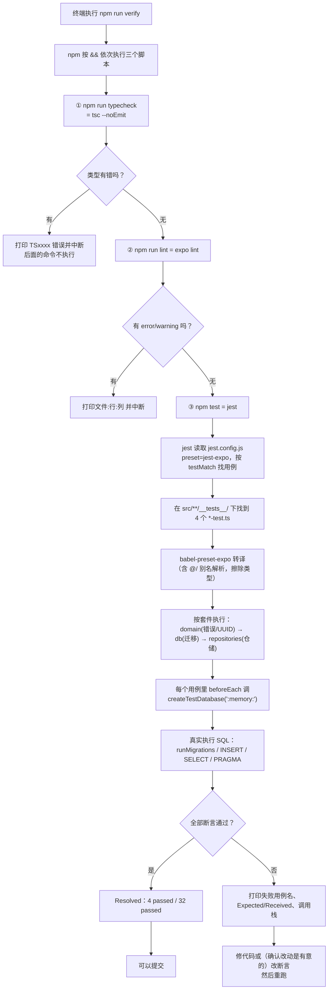

# 07 · 测试与调试：怎么证明代码是对的

## 1. 本次完成了什么

**用户现在可以做什么**

- 一条命令就能跑完「类型检查 + 代码规范 + 单元测试」：`npm run verify`。
- 能有针对性地只跑某一层：`npm test -- src/db`、`npm test -- src/domain`。
- 有一套**真的在内存 SQLite 上执行 SQL** 的测试（不是打桩），共 **4 个测试套件 / 32 个用例**。
- 有一套可复现的排障记录（本文第 7 节的「ExpoSQLite 找不到原生模块」是真实发生过的）。

**解决了什么问题**

1. **「跑起来看着没问题」不等于「是对的」**。数据库这种地方出错往往是**静默的**（写丢了、约束没生效、迁移半成功），必须靠测试兜住。
2. **手工回归不现实**。以后每加一个功能都手工点一遍所有功能，迟早会漏。有了测试，改完代码跑一条命令就知道有没有破坏原有行为（这叫**回归测试**）。
3. **数据安全约束需要被证明**，不能只写在 README 里。「迁移失败不覆盖数据」这条硬约束，有专门的用例守着它。
4. **区分了「检查」和「测试」**：类型检查（`tsc`）、规范检查（ESLint）、格式检查（Prettier）、行为测试（Jest）四件事各管一段，合起来才是完整的验证。

**在整个 LifeTrack 中处于什么位置**

它是**横切的**：不属于某一层，而是盯着所有层。第一阶段的测试重点刻意放在**数据层**（迁移、仓储、错误、UUID），因为：

- 这些是最容易静默出错、且出错代价最大的地方；
- 它们**不依赖界面**，可以用真实 SQLite 直接测；
- 界面层（`src/app/`、`src/components/`）**目前完全没有测试**，靠模拟器手动验证（这是有意的取舍，见第 6 节）。

**本次范围内明确没有实现什么**

- **没有界面测试**：没有引入 `@testing-library/react-native`，没有任何组件渲染测试。
- **没有端到端（E2E）测试**：没有 Detox / Maestro 之类的自动化，模拟器验证全靠手工操作。
- **没有拦截覆盖率门槛**：配置了 `collectCoverageFrom`，但 `npm test` 默认**不采集覆盖率**，也没有设置"低于 X% 就失败"。
- **没有 UI 快照测试**。
- **没有 CI**：所有检查都是本地手动运行的。

## 2. 修改了哪些文件

| 文件路径 | 文件的职责 | 本次具体修改 | 它与其他文件的关系 |
| --- | --- | --- | --- |
| `jest.config.js` | Jest 配置 | 新建：`preset: 'jest-expo'`、`testMatch`（**只认 `__tests__/**/*-test.ts?(x)`**）、`clearMocks: true`、`collectCoverageFrom` | 决定测试文件的命名与位置；`testMatch` 是「为什么测试文件不叫 `.test.ts`」的原因 |
| `package.json` | 测试命令 | `test`（`jest`）、`test:watch`、`verify`（typecheck + lint + test） | `verify` 是提交前的总闸门 |
| `src/db/testing/nodeSqliteAdapter.ts` | **测试专用**的真实 SQLite 适配器 | 新建：`createTestDatabase(filename?)`、`TestDatabase`（含 `rawExec` / `rawGet` / `rawAll` / `transactionDepth` / `close`） | 实现 `SqlExecutor` 接口，让迁移与仓储能在测试里跑真实 SQL；**不进应用包**（`collectCoverageFrom` 里也排除了 `src/**/testing/**`） |
| `src/domain/__tests__/errors-test.ts` | 错误体系测试 | 新建：6 个用例 | 测 `src/domain/errors.ts` |
| `src/domain/__tests__/id-test.ts` | UUID v7 测试 | 新建：7 个用例 | 测 `src/domain/id.ts` |
| `src/db/__tests__/migrations-test.ts` | 迁移机制测试 | 新建：8 个用例 | 测 `src/db/migrations.ts` + `schema.ts`，用真实内存 SQLite |
| `src/repositories/__tests__/metaRepository-test.ts` | 仓储测试 | 新建：7 个 CRUD 用例 + 1 个「同文件重开」持久化用例 | 测 `src/repositories/metaRepository.ts` |
| `eslint.config.js` | 规范检查配置 | 使用 Expo 官方 flat config + `eslint-config-prettier`（放在最后，关掉与 Prettier 冲突的规则） | 与 `.prettierrc.json` 配合，避免两套工具互相打架 |
| `.prettierrc.json` / `.prettierignore` | 格式化规则与忽略清单 | 使用 Prettier 默认风格；忽略生成物 | 被 `npm run format` / `format:check` 使用 |

## 3. 涉及哪些技术概念

### 3.1 单元测试、集成测试、端到端测试

**是什么**：按「测试覆盖的范围」划分的三类：

| 类型 | 测什么 | 速度 | 本项目现状 |
| --- | --- | --- | --- |
| **单元测试** | 一个函数/一个类的行为 | 极快（毫秒） | `errors-test.ts`、`id-test.ts` 属于这类 |
| **集成测试** | 多个模块真实协作（例如「迁移 + 真实 SQLite」） | 快（几十毫秒） | `migrations-test.ts`、`metaRepository-test.ts` 属于这类 |
| **端到端测试** | 从用户操作到底层存储的完整链路 | 慢（秒/分钟） | **没有自动化**，目前是手工在模拟器上操作 |

**为什么本项目需要区分**：如果所有测试都做成端到端，跑一次要几分钟，开发时就不会愿意跑；如果只做单元测试，又发现不了「SQL 写错」这种跨模块问题。第一阶段的策略是：**数据层用集成测试（真实 SQLite）扎扎实实覆盖，界面层暂时靠手工**。

**用在哪个真实文件**：`src/db/__tests__/migrations-test.ts` 的注释直接写了这件事：

> 这些用例在**真实的内存 SQLite**（node:sqlite）上执行第一阶段的迁移 SQL，因此能验证 SQL 语法、约束与 PRAGMA 行为，而不只是断言函数被调用过。

**不用会怎样**：要么慢到不愿意跑，要么因为全是 mock 而漏掉真实错误。

**容易误解的地方**：`migrations-test.ts` 虽然叫 `migrations-test`，但它其实是**集成测试**——因为真实的 SQLite 引擎参与了。名字里有 `unit` 不叫 unit test，**看的是「有没有真实依赖参与」**。

### 3.2 Jest 的基本结构：`describe` / `it` / `expect`

**是什么**：

```ts
describe('runMigrations', () => {          // 「一组测试」
  let db: TestDatabase;

  beforeEach(() => {                        // 每个用例前执行
    db = createTestDatabase();
  });

  afterEach(() => {                         // 每个用例后执行
    db.close();
  });

  it('全新数据库：建表并提升 user_version', async () => {   // 「一个用例」
    const result = await runMigrations(db, MIGRATIONS);
    expect(result).toEqual({ from: 0, to: 1, applied: [1] });   // 「断言」
  });
});
```

- `describe`：给一组相关的用例起个名字，**它只是分组，不影响执行**。
- `it`（也可以写 `test`）：一个用例。第一个参数是**「应该怎样」的句子**——好的用例名读起来就像一句断言。
- `expect(...)`：断言入口，后面接匹配器（见 3.3）。
- `beforeEach` / `afterEach`：夹具（fixture）的建立与清理。

**为什么本项目需要**：

- `beforeEach` 里 `createTestDatabase()`（默认 `:memory:`）保证**每个用例都拿到一个全新的空数据库**——测试之间互相不污染。这是测试可靠性的基础。
- `afterEach` 里 `db.close()` 释放资源，避免内存泄漏或文件句柄残留。

**用在哪个真实文件**：全部四个测试文件。

**不用会怎样**：用例之间共享数据库，一个用例改了数据导致另一个用例失败，或者**无法单独运行某个用例**。

**容易误解的地方**：**`describe` 的命名和 `it` 的命名不影响测试是否正确，但极其影响可维护性**。失败时的输出只显示这两层名字，写得不清楚就要去读代码才知道测的是什么。本项目的命名风格是：

```
describe('runMigrations')
  it('数据库版本高于应用支持版本时拒绝启动，且不破坏数据')
```

一眼就能看出「测什么」和「期望什么」。

### 3.3 匹配器（matcher）：`toEqual` / `toBe` / `toThrow` …

**是什么**：`expect(实际值).匹配器(期望值)`。

| 匹配器 | 含义 | 本项目用在哪 |
| --- | --- | --- |
| `toBe(x)` | **严格相等**（`===`），用于原始值/同一引用 | `expect(first).toBe('2026-01-01T00:00:00.000Z')` |
| `toEqual(x)` | **深度相等**（递归比较内容） | `expect(result).toEqual({ from: 0, to: 1, applied: [1] })` |
| `toHaveLength(n)` | 数组/字符串长度 | `expect(ids).toHaveLength(36)` |
| `toContain(s)` | 包含子串/元素 | `expect('89ab').toContain(id.charAt(19))` |
| `toThrow()` / `toThrow(X)` / `toThrow(/正则/)` | 抛异常 / 抛某类异常 / 消息匹配 | `expect(() => validateMigrations(broken)).toThrow(MigrationError)` |
| `rejects.toThrow()` | **异步** Promise 的拒绝 | `await expect(runMigrations(db, MIGRATIONS)).rejects.toThrow(MigrationError)` |
| `toMatchObject(x)` | 部分匹配（只检查给出的字段） | `rejects.toMatchObject({ code: 'STORAGE' })` |
| `toBeNull()` / `toBe(true)` | 具体值 | `expect(await repository.get('nope')).toBeNull()` |

**为什么本项目需要**：

- **`toEqual` vs `toBe` 必须分清**。`expect(result).toEqual({...})` 用的是深度比较；如果写成 `toBe`，两个内容相同但引用不同的对象会失败。
- **`toThrow` 必须传函数**：`expect(fn()).toThrow()` 是**错的**（异常会直接抛出来，测试反而失败）。要写 `expect(() => fn()).toThrow()`——**包一层箭头函数**，这样异常发生在 Jest 的监视范围内。这一点几乎每个初学者都会踩。
- **异步断言必须 `await`**：

  ```ts
  await expect(runMigrations(db, MIGRATIONS)).rejects.toThrow(MigrationError);
  ```

  漏掉 `await`，断言不会被执行，测试**看起来通过但什么都没测**。这是最危险的测试错误之一。

**容易误解的地方**：`.rejects.toMatchObject({ code: 'STORAGE' })` 能这样用，是因为 [03](./03-typescript-domain-model.md) 里 `AppError` 把错误码放在 `code` 字段上。**如果错误体系没设计好，就只能断言错误消息文本**，而文本一改测试就挂——这正是本项目统一错误类型的收益。

### 3.4 真实依赖 vs mock：本项目最重要的测试决策

**是什么**：

- **mock（打桩）**：把真实依赖换成一个假的，只记录「被调用了吗、参数是什么」，并按预设返回值。
- **真实依赖**：真的去执行。

**本项目怎么做**：**用真实的 SQLite**（Node 内置的 `node:sqlite`），不 mock 数据库。

**为什么**：

- mock 能验证「我调用了 `runAsync`」，但**永远发现不了 SQL 写错了、约束没生效、PRAGMA 没起作用**。
- `migrations-test.ts` 里有一个用例专门验证这点：

  ```ts
  it('迁移失败时整体回滚（SQL 与版本号原子性）', async () => {
    const failing: Migration[] = [
      { version: 1, name: 'partially_broken', statements: ['CREATE TABLE probe_a (id TEXT)', 'THIS IS NOT SQL'] },
    ];

    await expect(runMigrations(db, failing)).rejects.toThrow(MigrationError);

    expect(tableExists(db, 'probe_a')).toBe(false);      // 第一句建的表被回滚
    expect(await readSchemaVersion(db)).toBe(0);         // 版本号保持 0
  });
  ```

  `'THIS IS NOT SQL'` 会**真的**让 SQLite 报错。如果数据库是 mock，这个用例毫无意义。

**怎么做到「同一套 SQL 两边都能跑」**：靠 `SqlExecutor` 接口（见 [04](./04-sqlite-and-repository.md) 3.8）。设备上是 `expo-sqlite`，测试里是 `node:sqlite`，**仓储与迁移代码完全不改**。

**用在哪个真实文件**：`src/db/types.ts`（接口）、`src/db/testing/nodeSqliteAdapter.ts`（测试实现）。

**不用会怎样**：测试全绿但应用一跑就崩，因为 SQL 从来没被执行过。

**代价（必须诚实说明）**：`node:sqlite` 与 `expo-sqlite` 内置的 SQLite 版本可能略有差异，所以**测试通过不等于设备上一定没问题**。这句话写在 `nodeSqliteAdapter.ts` 的文件头注释里。端到端结论仍以模拟器/真机运行为准。

**容易误解的地方**：`clearMocks: true` 在 `jest.config.js` 里配了，但**本项目实际上几乎没有 mock**。它属于「配好了以防将来需要」，不是当前测试依赖的机制。

### 3.5 `node:sqlite` 与「内存数据库」

**是什么**：`node:sqlite` 是 **Node.js 22.5+ 内置**的 SQLite 模块，不需要装任何依赖。

```ts
import { DatabaseSync } from 'node:sqlite';
const native = new DatabaseSync(':memory:');
```

`':memory:'` 是**内存数据库**：完全活在内存里，进程结束就没了。

**为什么本项目需要**：

- 不引入第三方依赖（例如 `better-sqlite3`，它是原生模块，安装和跨平台编译都麻烦）。
- 内存库**极快**（整个测试套件跑完不到 1 秒），而且天然隔离。
- 也能传文件路径，用来测「持久化」（见 3.7）。

**用在哪个真实文件**：`src/db/testing/nodeSqliteAdapter.ts`。

**不用会怎样**：只能用第三方原生模块（安装成本、版本兼容问题），或者退回 mock。

**容易误解的地方**：内存数据库**不代表**「行为和文件数据库一样」。例如 WAL 模式、文件锁、崩溃恢复这些特性，内存库根本测不出来。所以 PRAGMA 的验证只能靠设备。

### 3.6 「打包 tsconfig 别名」在 Jest 里也生效

**是什么**：测试文件里写的是

```ts
import { runMigrations } from '@/db/migrations';
```

**为什么能用**：`jest.config.js` 的 `preset: 'jest-expo'` 内部使用 `babel-preset-expo`，它会读取 `tsconfig.json` 的 `paths`。**证据是这些用例真的通过了**。

**不用会怎样**：测试文件里要写 `../../db/migrations` 这种相对路径，脆弱且难读。

**容易误解的地方**：别名生效是**打包/转译侧**的能力，`tsconfig.json` 的 `paths` **自己只管类型检查**。所以如果换了测试预设，别名可能失效——那时要显式配置 Jest 的 `moduleNameMapper`。

### 3.7 用临时文件测「持久化」

**是什么**：

```ts
const dir = mkdtempSync(join(tmpdir(), 'lifetrack-test-'));
const file = join(dir, 'lifetrack.db');

try {
  const first = createTestDatabase(file);
  const firstMigration = await runMigrations(first, MIGRATIONS);
  const firstRepo = new MetaRepository(first);
  await firstRepo.incrementLaunchCount('2026-10-19T00:00:00.000Z');
  await firstRepo.set('probe', 'persisted');
  first.close();

  // 模拟应用重启：重新打开同一个数据库文件
  const second = createTestDatabase(file);
  const secondMigration = await runMigrations(second, MIGRATIONS);
  const secondRepo = new MetaRepository(second);

  expect(firstMigration.applied).toEqual([1]);
  expect(secondMigration.applied).toEqual([]);       // 已是最新，不重复迁移
  expect(await secondRepo.get('probe')).toBe('persisted');
  expect(await secondRepo.incrementLaunchCount()).toBe(2);
  second.close();
} finally {
  rmSync(dir, { recursive: true, force: true });
}
```

- `mkdtempSync(join(tmpdir(), 'lifetrack-test-'))`：创建一个**唯一的临时目录**（名字带随机后缀），避免并发测试互相覆盖。
- **`first.close()` 之后再 `createTestDatabase(file)`**：这是整段的关键——**模拟应用重启**。因为 `:memory:` 数据库一关就没了，只有文件数据库才能测出「数据是否真的落盘」。
- `finally` 里 `rmSync(..., { recursive: true, force: true })`：**无论测试成功失败都清理临时目录**。不清理的话，跑几百次测试会在磁盘上留一堆垃圾。
- 断言里最有价值的两条：`secondMigration.applied` 是**空数组**（证明迁移幂等，见 [04](./04-sqlite-and-repository.md) 3.5），以及 `probe` 的值**还在**（证明落盘）。

**为什么本项目需要**：这是**唯一**能在 Node 里验证「重启后数据还在」的自动化方式。它是模拟器手工验证的自动化对照物。

**容易误解的地方**：`createTestDatabase` 的参数默认是 `':memory:'`，只有**显式传路径**时才是文件数据库。所以大部分用例是内存的、极快；只有这一个用例碰磁盘。

### 3.8 四种工具的分工：`tsc` / ESLint / Prettier / Jest

**这是什么**（这是初学者最容易混淆的一点——它们**互不替代**）：

| 工具 | 管什么 | 命令 | 不管什么 |
| --- | --- | --- | --- |
| **TypeScript**（`tsc`） | **类型**：字段对不对、可空性、参数类型 | `npm run typecheck` | 不检查代码风格；不执行代码；**不做运行时校验** |
| **ESLint** | **可疑代码与规范**：未使用变量、Hook 依赖遗漏、React 相关陷阱 | `npm run lint` | 不做类型推断级别的检查（Expo 配置里没有开启 type-aware 规则） |
| **Prettier** | **格式**：缩进、引号、换行 | `npm run format:check` | 不检查任何语义 |
| **Jest** | **行为**：函数/模块真的做了什么 | `npm test` | 不做类型检查（**类型被 Babel 擦除**） |

**为什么必须分清**：

- **Jest 不做类型检查**。Jest 用 Babel 转译，类型信息直接被删掉。所以「测试全绿」**不代表**类型是对的。
- 反过来，**`tsc` 也不测行为**。「类型检查通过」不代表运行时逻辑正确。
- 两者必须都跑——这就是 `npm run verify` 存在的意义：`typecheck && lint && test`。

**用在哪个真实文件**：`package.json` 的 `verify` 脚本。

**容易误解的地方**：很多人的流程是「跑一下测试，绿了就提交」。在本项目里，**必须跑 `npm run verify`**，因为它把类型检查也串进去了。**只跑 `npm test` 会漏掉类型错误**。

### 3.9 覆盖率（coverage）

**是什么**：统计「有多少行/分支/函数被测试执行过」。

**本项目现状**：`jest.config.js` 配了 `collectCoverageFrom`：

```js
collectCoverageFrom: ['src/**/*.{ts,tsx}', '!src/app/**', '!src/**/__tests__/**', '!src/**/testing/**'],
```

但 **`npm test` 默认不采集覆盖率**（脚本里没有 `--coverage`）。想看覆盖率要自己加：`npm test -- --coverage`。

**这个配置说明了两件事**：

1. **明确排除了 `src/app/**` 和 `src/**/testing/**`**：即「路由页面不算覆盖率」和「测试辅助代码不算覆盖率」。后者很重要——否则 `nodeSqliteAdapter.ts` 这种测试工具会把覆盖率数字抬得很漂亮。
2. **没有设置阈值**。也就是说覆盖率高低**不会让测试失败**。第一阶段的判断是：与其追求数字，不如先把「数据安全」这类关键路径覆盖到位。

**用在哪个真实文件**：`jest.config.js`。

**容易误解的地方**：**覆盖率不是质量指标**。`grep` 到 100% 行覆盖也可能一个断言都没有。本项目更看重的是「**有没有守规矩的用例**」，例如「数据库版本高于应用支持版本时拒绝启动，且不破坏数据」——这条用例的价值远高于一堆无断言的调用。

### 3.10 回归测试：测试真正的用途

**是什么**：**先写/先有用例，然后修改代码时用它来确认「没有把原来的行为弄坏」**。

**为什么本项目需要**：第二阶段要加 v2 迁移、改 schema、加仓储。这些改动**很可能不小心碰坏 v1 的行为**（比如改动了 `MIGRATIONS` 数组）。有了 `migrations-test.ts`，改完跑一下就知道。
**（现状：v2 已落地；本次正是靠这个文件把 `LATEST_SCHEMA_VERSION` 的断言从 1 更新到 2，并新增了 v2 结构与外键行为用例）**

**用在哪个真实文件**：`migrations-test.ts` 里这个用例就是典型的**守护性用例**：

```ts
it('当前仓库的迁移清单是合法的', () => {
  expect(() => validateMigrations(MIGRATIONS)).not.toThrow();
  expect(LATEST_SCHEMA_VERSION).toBe(1);
});
```

它盯着**真实的 `MIGRATIONS`**。第二阶段加 v2 时，`expect(LATEST_SCHEMA_VERSION).toBe(1)` **会失败**——这**不是坏事**，它是在提醒开发者「你改了版本号，请确认这是有意的，并更新断言」。

**容易误解的地方**：看到测试失败第一反应不应该是「改测试让它通过」，而应该是「**我的改动是不是破坏了什么**」。这个用例的失败恰恰是「提醒你去审视改动」的机制。当然，加了 v2 之后把断言改成 `toBe(2)` 是正确的做法。

## 4. 关键代码逐段解释

### 4.1 `jest.config.js`：`testMatch` 是一个刻意的约定

```js
/** @type {import('jest').Config} */
module.exports = {
  preset: 'jest-expo',
  // 只把 __tests__ 下的 *-test.ts(x) 当作测试，避免把测试辅助文件当成用例
  testMatch: ['<rootDir>/src/**/__tests__/**/*-test.ts?(x)'],
  clearMocks: true,
  collectCoverageFrom: ['src/**/*.{ts,tsx}', '!src/app/**', '!src/**/__tests__/**', '!src/**/testing/**'],
};
```

- **`preset: 'jest-expo'`**：一行搞定「RN + Expo 的转译与模块解析」。没有它要手工配 `transform`、`transformIgnorePatterns`、`moduleFileExtensions` 一堆东西，而且很容易配错。
- **`testMatch`**：这是本项目**为什么测试文件叫 `-test.ts` 而不是 `.test.ts`** 的原因。约定是：

  - 必须放在 `__tests__/` 目录里；
  - 文件名必须以 `-test` 结尾（不是 `.test`）。

  好处：`src/db/testing/nodeSqliteAdapter.ts` 这种**测试辅助文件不会被误当成用例**（它在 `testing/` 目录里，文件名也不匹配）。
- **`clearMocks: true`**：每个用例前清空 mock 的记录。本项目几乎不用 mock，属于预留。
- **`collectCoverageFrom`**：见 3.9。

**容易误解的地方**：`testMatch` 很严格。如果你新建了 `src/foo/bar.test.ts` 或 `src/foo/bar-test.ts`（不在 `__tests__/` 里），Jest **会告诉你 0 个测试**而不是报错。看到 `Tests: 0 total` 就先检查位置和文件名。

### 4.2 `nodeSqliteAdapter` 里的 `withExclusiveTransactionAsync`

```ts
async withExclusiveTransactionAsync(task: (txn: SqlExecutor) => Promise<void>): Promise<void> {
  depth += 1;
  native.exec('BEGIN IMMEDIATE');
  try {
    await task(executor);
    native.exec('COMMIT');
  } catch (error) {
    try {
      native.exec('ROLLBACK');
    } catch {
      // 回滚失败时保留原始错误
    }
    throw error;
  } finally {
    depth -= 1;
  }
},
```

- **为什么需要手工实现**：`expo-sqlite` 的 `SQLiteDatabase` 自带 `withExclusiveTransactionAsync` 方法，`node:sqlite` 没有对应 API。要让同一套迁移代码两边都能跑，adapter 必须**自己模拟这个方法的行为**。
- **`BEGIN IMMEDIATE`**：立刻申请写锁（和 `expo-sqlite` 的独占事务语义一致）。
- **`task(executor)` 传的是 `executor` 本身**：这样回调里的语句才在同一个连接、同一个事务里。（如果换成新建一个连接，事务就跨不过去了。）
- **内层 `try/catch` 包住 `ROLLBACK`**：如果回滚本身也失败（例如连接已断），**不能让它掩盖原始错误**。所以吞掉回滚的错误，然后 `throw error` 抛出**原始**的那个。
- **`finally { depth -= 1; }`**：无论成功失败，深度都要还原。
- **`depth` 与 `transactionDepth()`**：把「事务有没有真的开过」暴露给测试。这是**可观测性**的设计——内部状态如果完全不可见，测试就很难断言「事务确实生效了」。

**容易误解的地方**：这里**不是**在实现一个通用的数据库封装，它**只为测试存在**。所以它不需要处理嵌套事务、不需要处理超时重试。**「测试专用代码可以比生产代码简单」**是一个合理的判断，但前提是**它不会泄露到生产代码里**——本项目靠 `src/db/testing/` 目录 + `collectCoverageFrom` 排除 + 只被 `__tests__` 引用，三重保证。

### 4.3 迁移测试里最值得学的两个用例

```ts
it('数据库版本高于应用支持版本时拒绝启动，且不破坏数据', async () => {
  await runMigrations(db, MIGRATIONS);
  db.rawExec("INSERT INTO app_meta (key, value, updated_at) VALUES ('keep', 'me', 'now')");
  db.rawExec('PRAGMA user_version = 99');

  await expect(runMigrations(db, MIGRATIONS)).rejects.toThrow(MigrationError);

  // 关键：报错之后数据依然在，版本号也没被改动
  expect(db.rawGet("SELECT value FROM app_meta WHERE key = 'keep'")).toEqual({ value: 'me' });
  expect(await readSchemaVersion(db)).toBe(99);
});
```

**这个用例的结构值得仔细学**——它是「**反向断言**」的典范：

1. 先**造出一个危险局面**：把版本号手工改成 99（模拟「用户装过更新版的应用」）。
2. 断言**会失败**：`rejects.toThrow(MigrationError)`。
3. **然后断言「失败之后，数据还在」**：这才是真正的重点。

**为什么第 3 步最重要**：如果实现里写了「出错就删库重建」，那么第 2 步依然会通过（它确实抛错了……不，其实不会，删库重建后不会抛错）——总之，**只断言"会报错"是不够的**，必须断言"报错之后用户数据完好"。这条用例守的是 [04](./04-sqlite-and-repository.md) 里那条硬约束。

**容易误解的地方**：`db.rawExec` / `db.rawGet` 是**测试专用的「绕过被测代码」通道**。用它的目的是「设置一个被测代码自己造不出来的状态」（比如把版本号设成 99）。**在断言里也要用它**，是为了**不通过被测代码去验证被测代码**——这是避免「自己证明自己」的技巧。

```ts
it('失败信息里带上是哪个迁移', async () => {
  const failing: Migration[] = [{ version: 1, name: 'boom', statements: ['NOPE'] }];
  await expect(runMigrations(db, failing)).rejects.toThrow(/boom/);
});
```

**这个用例测的是「错误信息可诊断性」**：错误里必须含迁移名，否则线上出问题只知道「迁移失败」而不知道是哪一个。用 `/boom/` 正则做部分匹配（而不是精确匹配整条消息），这样**改文案不会让测试挂**——这是很实用的小技巧。

### 4.4 仓储测试里的「异常归一」用例

```ts
it('底层异常被收敛为 StorageError（表不存在时）', async () => {
  const empty = createTestDatabase();
  try {
    await expect(new MetaRepository(empty).get('k')).rejects.toThrow(StorageError);
    await expect(new MetaRepository(empty).get('k')).rejects.toMatchObject({ code: 'STORAGE' });
  } finally {
    empty.close();
  }
});
```

- **故意不跑迁移**：`empty` 是一个**没有任何表**的数据库。于是 `SELECT value FROM app_meta` 必然失败（no such table）。
- **断言了两层**：一是异常类型（`StorageError`），二是**错误码 `'STORAGE'`**。
  为什么两层都要？类型断言依赖 `instanceof`（见 [03](./03-typescript-domain-model.md) 3.6 说的跨边界风险），而 `code` 是字符串，永远可靠。**同时断言两者，等于同时验证了"归类正确"和"跨边界可识别"**。
- **`try/finally` 保证关闭**：和 3.7 的临时目录清理是同一个思路。

**容易误解的地方**：这条用例测的是 **SQLite 的真实错误被正确转换**，而不是「`guard` 函数被调用过」。这就是 3.4 说的「真实依赖」的价值——你能**真的造出一个数据库错误**来触发转换逻辑。

### 4.5 为什么 `guards` 和 `models` 的规则函数没有测试

上一节的用例是「底层异常归一」，那 `models.ts` 里的 `isVisibleRecord` / `isRecordable` 为什么没有测试？

**现状（诚实）**：`src/domain/__tests__/` 下只有 `errors-test.ts` 和 `id-test.ts`。`models.ts` 的两个规则函数**没有任何用例**。

**影响**：

- 它们逻辑极简单（一个判断 `deletedAt === undefined`，一个判断 `!isArchived`），当前风险确实低。
- 但它们是**领域规则**，第二阶段会被统计、时间轴、导出等多处依赖。一旦有人把软删除的表示从 `undefined` 改成 `null`，这两个函数会**静默失效**：记录明明被删了，还会被算进统计。
- 这类「语义漂移」正是最需要测试守住的——它**不会报错，只会算错**。

**改进方案**：在第二阶段实现「软删除 + 撤销」之前，为这两个函数补上用例，正是时候。测试本身很容易写：

```ts
// 建议：src/domain/__tests__/models-test.ts
it('已软删除的记录不参与展示', () => {
  expect(isVisibleRecord({ ...record, deletedAt: undefined })).toBe(true);
  expect(isVisibleRecord({ ...record, deletedAt: '2026-10-19T00:00:00.000Z' })).toBe(false);
});
```

**这里想传达的态度**：**把缺口写下来，而不是假装它不存在**。文档里说「测试覆盖了 X」，就必须能指出「没覆盖 Y」。

## 5. 一次完整操作的数据流

以「运行 `npm run verify`」为例：



**文字说明每一步**：

1. `&&` 保证**前一步失败就中断**——这是有意设计：类型都不对的话，跑测试没有意义。
2. **`tsc` 阶段不执行任何代码**，只做静态分析（见 3.8）。
3. **ESLint 阶段**会检查 Hook 规则。例如 `useFocusEffect` 没传 `useCallback` 包起来的函数，这里会报（见 [05](./05-business-logic-and-data-flow.md) 3.7）。
4. **Jest 阶段**先转译（类型在这一步被擦掉），再按套件执行。
5. 每个用例都拿到一个**全新的内存数据库**（`beforeEach`），所以**用例顺序不影响结果**——这是测试可靠的关键性质。
6. 断言失败时的输出包含 `Expected` 和 `Received`，**不需要额外加日志**。
7. 全部通过后才是「可以提交」的状态。

**注意一个容易忽略的点**：这条链路里**没有任何一步验证界面**。界面是模拟器手工验证的。这就是本文反复强调的「验证有两套：自动化的数据层 + 手动的界面层」。

## 6. 如何验证

### 关键命令

```bash
npm run verify                    # 类型 + 规范 + 测试（提交前必跑）
npm test                          # 只跑测试
npm test -- src/db                # 只跑路径匹配 src/db 的套件
npm test -- -t "幂等"             # 只跑名字含"幂等"的用例（按用例名过滤）
npm test -- --coverage            # 采集覆盖率
npm run test:watch                # 监听模式，改代码自动重跑
npm run typecheck                 # 只做类型检查
npm run lint                      # 只看规范
npm run format:check              # 只看格式
```

### 正常应该看到什么

`npm test` 的**实测输出**（第一阶段）：

```
Test Suites: 4 passed, 4 total
Tests:       32 passed, 32 total
Snapshots:   0 total
Time:        0.485 s, estimated 1 s
Ran all test suites.
```

用例分布：`errors-test.ts` 6 个、`id-test.ts` 7 个、`migrations-test.ts` 8 个、`metaRepository-test.ts` 8 个（含 1 个持久化用例）。

`npm run typecheck` 与 `npm run lint`：**无输出**（工具只在有问题时说话）。

### 如何查看失败信息

失败输出的读法（以断言失败为例）：

```
● runMigrations › 重复执行是幂等的，不会重复应用

  expect(received).toEqual(expected)

  Expected: {"applied": [], "from": 1, "to": 1}
  Received: {"applied": [1], "from": 1, "to": 1}

  at src/db/__tests__/migrations-test.ts:74:20
```

- 第一行定位到**套件名 › 用例名**。
- `Expected` / `Received` 是期望值与实际值。
- 最后一行是**出错的代码位置**。

**排错顺序建议**：

1. 先看 `Received` 是不是「比我预期的多做了事」（例如 `applied: [1]` 说明迁移**重复执行**了）——这通常意味着幂等逻辑被破坏。
2. 再去看对应的实现代码。
3. **不要第一反应就去改断言**。

### 测试覆盖了什么

| 模块 | 覆盖情况 |
| --- | --- |
| `src/domain/errors.ts` | ✅ 6 个用例（子类 code/name、cause/details、isAppError、toAppError 三种输入） |
| `src/domain/id.ts` | ✅ 7 个用例（格式、单调性含补录、可排序、5000 个不重复、非法输入、assertUuidV7） |
| `src/db/migrations.ts` | ✅ 8 个用例（清单校验、全新迁移、幂等、拒绝降级且不破坏数据、失败回滚、错误含迁移名、多步迁移、中途续迁） |
| `src/db/schema.ts` | ✅ 间接覆盖（迁移清单合法性、`LATEST_SCHEMA_VERSION === 1`、`app_meta` 列与主键约束） |
| `src/repositories/metaRepository.ts` | ✅ 8 个用例（CRUD、UPSERT、排序、累加、安装时间幂等、异常归一、同文件重开持久化） |

### 测试**没有**覆盖什么（诚实清单）

| 模块 | 状态 | 后果 |
| --- | --- | --- |
| `src/domain/models.ts`（`isVisibleRecord` / `isRecordable`） | ❌ 无用例 | 规则语义漂移时会静默算错（见 4.5） |
| `src/db/client.ts`（`openDatabase` / `getDatabase` / PRAGMA） | ❌ 无用例 | 因为它 import 了 `expo-sqlite`，Jest 里跑不了。靠模拟器 + 读设备文件验证 |
| `src/db/guard.ts` | ❌ 无直接用例 | 通过 `metaRepository-test.ts` 的「异常归一」用例**间接**覆盖 |
| `src/db/DatabaseProvider.tsx` | ❌ 无用例 | 状态机（opening/ready/error）、`retry` 是否真的生效，全靠手工验证 |
| `src/components/DatabaseGate.tsx` | ❌ 无用例 | 三个分支的渲染与警告横幅全靠手工验证；它调用的 `seedStarterDefinitions` 有单测（见 05 的 4.3 节） |
| `src/app/**` 所有页面 | ❌ 无用例（`collectCoverageFrom` 明确排除） | 界面能否渲染、标签能否切换，全靠手工验证 |
| 端到端（用户操作 → 落盘） | ❌ 无自动化 | 每轮改动都要手工跑一遍模拟器 |

### 哪些验证真实执行过

- `npm run typecheck`：通过。
- `npm run lint`：0 error / 0 warning。
- `npm test`：**4 套件 / 32 用例通过**（0.485 秒）。
- `npm run doctor`：20/20 通过。
- `npx expo export --platform ios --platform android`：两端都成功产出 Hermes bundle（各约 2.6M）。
- **iOS Simulator**（iPhone 17 Pro / iOS 26.3 / Expo Go 58.0.4）与 **Android 模拟器**（Pixel 9 / API 36 / Expo Go 58.0.4）：三个标签渲染正常；设置页显示数据库诊断；`launch_count` 递增、`installed_at` 不变；在设备上直接读 `lifetrack.db` 确认 `user_version=1`、`journal_mode=wal`。

**没有执行过**：

- **真机**（iPhone / Android 实体设备）上的任何验证。
- 任何自动化界面测试或端到端测试。
- 覆盖率采集（`npm test -- --coverage` 没跑过）。
- 数据库文件被人为损坏后的恢复验证。

## 7. 常见问题与排查

### 问题：设备上报 `Cannot find native module 'ExpoSQLite'`（真实案例）

这是第一阶段**真实遇到并解决**的问题，值得完整记录，因为它体现了一套排障方法。

**表面现象**：Android 模拟器上打开应用，报找不到原生模块 `ExpoSQLite`。看起来像「Expo Go 里没有 SQLite」。

**排查过程**（关键是**先证伪，再去修**）：

1. **先确认这个模块到底在不在**。在设备上探查 `globalThis.expo.modules.ExpoSQLite`，结果**存在**。→ 说明模块本身是在的，报错另有原因。
2. **再用一个已知能跑的项目对照**。之前跑通过的临时项目在同一个 Expo Go 里执行同样的 SQLite 检查，返回 `ok: true`。→ 说明 Expo Go 和 SQLite 都没有问题，问题在**当前项目的打包链路**上。
3. **怀疑缓存**。用 `npx expo start --clear` 清理 Metro 的转换缓存后重启，问题消失且**稳定不再复现**。

**根本原因**：**Metro 的转换缓存过期**——缓存的旧结果里没有正确关联原生模块。这是**假故障**：模块一直在 `libexpo-sqlite.so` 里。

**结论与固化措施**：

- **改动依赖后一律用 `npx expo start --clear`**。
- 这条排障经过已经写进根 `README.md`，避免下次重新踩。

**这个案例的通用价值**：遇到「某个东西不存在」的报错，**不要立刻相信报错内容**。先做一个**独立的、最小的验证**（模块在不在？别的项目行不行？），把「真的缺了」和「看起来缺了」区分开。**排障的第一步是缩小范围，不是改代码。**

### 问题：Jest 说 `Tests: 0 total`

**原因与排查顺序**：

1. **文件位置不对**：必须在 `__tests__/` 目录里（`testMatch` 是 `<rootDir>/src/**/__tests__/**/*-test.ts?(x)`）。
2. **文件名后缀不对**：必须是 `-test.ts` 结尾，**不是** `.test.ts`。
3. **路径参数写错**：`npm test -- src/db` 是**按路径过滤**，不要写成 `npm test src/db`（Jest 会把 `src/db` 当作用例名模式）。

### 问题：测试通过，但类型检查失败

**原因**：**Jest 不做类型检查**（Babel 只擦除类型）。见 3.8。

**排查顺序**：**永远跑 `npm run verify`**，不要只跑 `npm test`。

### 问题：测试通过，但运行时行为不对

**可能原因**：

1. **异步断言漏了 `await`**，导致断言根本没执行。检查每个 `expect(...).rejects` / `expect(somePromise).resolves` 前面有没有 `await`。
2. **泛型写错**（见 [03](./03-typescript-domain-model.md) 3.7）：`getFirstAsync<{ value: string }>` 的类型是**你自己声明的**，数据库不会配合你。所以读回来的值仍需校验。
3. **测试环境与设备环境不同**：`node:sqlite` 的版本、SQL 方言可能与 `expo-sqlite` 有差异（见 3.4）。**所以设备验证不能省。**

### 问题：`node:sqlite` 报模块不存在

**原因**：`node:sqlite` 需要 **Node 22.5+**。

**排查顺序**：`fnm exec --using=24 -- npm test`，或先 `eval "$(fnm env --use-on-cd)"`。用 `node -v` 确认版本。

### 问题：测试里用了当前时间，结果时好时坏（不稳定）

**原因**：`new Date().toISOString()` 让断言依赖真实时间，跨零点或跨时区时可能失败。这类测试叫「不稳定测试（flaky test）」，是测试里最讨厌的问题。

**本项目怎么避免的**：把时间做成**带默认值的参数**，测试时传固定值：

```ts
async set(key: string, value: string, now: IsoDateTime = new Date().toISOString()): Promise<void>
```

于是测试可以写 `await repository.set('k', 'v', '2026-10-19T00:00:00.000Z')`，断言也能用同一个固定值（见 `metaRepository-test.ts`）。

**这个模式值得记住**：**凡是「不确定的输入」（时间、随机数、UUID），都做成参数，让测试能固定它**。本项目 `uuidv7(timestampMs = Date.now())` 也是同一个思路。

### 问题：临时目录越积越多

**原因**：`mkdtempSync` 建的目录没被清理（测试中途抛异常也会走到这里）。

**排查顺序**：确认用了 `try/finally` 包住，`finally` 里 `rmSync(dir, { recursive: true, force: true })`（本项目就是这么写的）。`force: true` 保证目录不存在时也不报错。

### 问题：ESLint 报 Hook 依赖问题，但代码「看起来是对的」

**原因**：`useEffect` / `useCallback` / `useMemo` 的依赖数组与函数体内实际用到的值不一致。

**排查顺序**：

1. **先假设 ESLint 是对的**。漏依赖通常表现成「界面用了旧值」，非常难排查。
2. 如果确实想「只在挂载时执行一次」，用 `[]` 并确认函数体内**没有**用到会变化的值。
3. 本项目多处用了 `let cancelled = false` + 清理函数的模式（见 [05](./05-business-logic-and-data-flow.md) 3.5），依赖数组是 `[attempt]` / `[status, connection]` / `[db, databasePath, migration]`——都可以作为参考范例。

### 问题：Prettier 和 ESLint 互相打架

**原因**：两套工具都管格式。ESLint 的某些格式规则和 Prettier 的结论可能相反。

**本项目怎么避免**：`eslint.config.js` 里**把 `eslint-config-prettier` 放在最后**：

```js
module.exports = defineConfig([
  expoConfig,
  // 关闭与 Prettier 冲突的格式类规则（必须放在最后）
  prettierConfig,
  { ignores: [...] },
]);
```

**注意「必须放在最后」这一点**：ESLint 配置是**后者覆盖前者**，放错位置就不生效。

## 8. 本阶段学习总结

**掌握的核心概念**

- 单元测试 / 集成测试 / 端到端测试的差别，以及**按价值分配精力**的策略。
- Jest 的 `describe` / `it` / `expect` / `beforeEach` / `afterEach` 结构；夹具让用例彼此隔离。
- 匹配器：`toEqual` vs `toBe`、`toThrow` 必须包函数、**异步断言必须 `await`**。
- **用真实依赖而不是 mock**：这样才能发现 SQL 错误、约束失效这类问题。
- `SqlExecutor` 接口让「设备用 expo-sqlite、测试用 node:sqlite」成为可能。
- 用 `mkdtempSync` + 关闭重开文件库来**自动化验证持久化**。
- `rawExec` / `rawGet` 这类「绕过被测代码」的通道用于**造状态**和**独立断言**。
- **反向断言**：不仅断言「会失败」，还要断言「失败后数据完好」。
- `tsc` / ESLint / Prettier / Jest 四者**互不替代**，必须跑 `npm run verify`。
- 覆盖率不是质量指标；**排除测试辅助代码**才不会被数字骗到。
- 把不确定输入（时间、UUID）**做成参数**，避免不稳定测试。
- 排障方法：**先证伪、缩小范围，再去修**（ExpoSQLite 案例）。

**需要理解的关键文件**

`jest.config.js`（`testMatch` 约定与覆盖率排除）、`src/db/testing/nodeSqliteAdapter.ts`（真实 SQLite 适配器）、
`src/db/__tests__/migrations-test.ts`（最有价值的两个用例）、`src/repositories/__tests__/metaRepository-test.ts`（持久化用例）。

**建议亲自尝试的小练习**

1. **制造一次失败，学会读输出**：把 `migrations-test.ts` 里这一行

   ```ts
   expect(second).toEqual({ from: 1, to: 1, applied: [] });
   ```

   改成 `applied: [1]`，跑 `npm test -- src/db`。
   **预期结果**：看到失败，输出里有 `Expected` / `Received` 和出错位置。**读完立刻改回来**。这个练习的目的是让你学会**从失败输出里获取信息**，而不是改断言让它通过。
2. **补一个领域规则测试**（推荐，价值高）：新建 `src/domain/__tests__/models-test.ts`，为 `isVisibleRecord` 和 `isRecordable` 各写一个用例（`deletedAt` 有值/无值、`isArchived` 为真/假）。
   **预期结果**：`npm test -- src/domain` 从 13 个用例变成 15 个或更多，全部通过。这正是 4.5 里指出的缺口。
3. **观察覆盖率**：跑 `npm test -- --coverage`，看输出里哪些文件接近 100%、哪些是 0%。
   **预期结果**：`src/domain/errors.ts`、`src/domain/id.ts`、`src/db/migrations.ts`、`src/repositories/metaRepository.ts` 应该很高；`src/app/**` 不出现（已被排除）。这能让你直观看到「第一阶段的测试重心在数据层」。
4. **验证 `testMatch` 的作用**：把某个测试文件复制到 `src/db/foo-test.ts`（**不在** `__tests__/` 里），跑 `npm test`。
   **预期结果**：这个复制出来的文件**不会被执行**（用例数不变）。看完把复制出来的文件删掉。
5. **体验「幂等守门」**：临时把 `MIGRATIONS` 数组里再加一个假的 v2（`statements: ['CREATE TABLE probe (id TEXT)']`），跑 `npm test -- src/db`。
   **预期结果**：`LATEST_SCHEMA_VERSION` 那条断言失败——这正是 3.10 说的「提醒你改动是有意的」。**看完立刻还原**，不要留下未完成的 v2。

以上练习 1、4、5 需要**改完还原**；练习 2 是真正推荐的补充；练习 3 只是查看。

**下一阶段会用到哪些已学知识**

- **加 v2 迁移时**，`migrations-test.ts` 里的断言（`LATEST_SCHEMA_VERSION`）会失败——按 3.10 的思路，确认改动是有意的，然后把断言更新到 2。这就是回归测试在起作用。
- **新仓储要照 `metaRepository-test.ts` 的模板写**：`beforeEach` 建内存库 + 跑迁移、`afterEach` 关闭；「异常归一」的用例也要有。
- **「归档不影响历史」「软删除可撤销」「周期边界修改不删数据」这三条**是第二阶段第 1、4、5 项最核心的规则，必须写成**反向断言**：不仅验证「操作成功」，还要验证「该保留的数据一条没少」——照 `migrations-test.ts` 的「拒绝降级且不破坏数据」那个用例写。
- **导入/导出（第 7 项）** 会在边界处校验外部数据，正好用 `assertUuidV7` 和 `isEventDefinitionKind` 这类守卫函数，测试里应该专门喂**非法数据**进去，断言被拒绝且**原有数据未被破坏**。
- **界面层复杂起来后**，建议引入 `@testing-library/react-native`，首选的测试对象是把页面里的读取逻辑抽成的**自定义 Hook**（例如 `useMetaDiagnostics()`），因为 Hook 比整页渲染容易测得多。