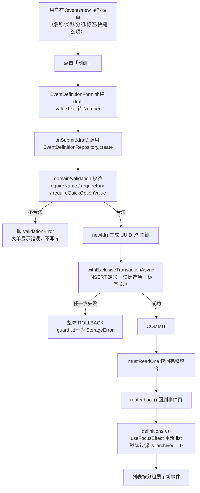

# 08 事件定义：从数据库到表单的完整闭环

> 对应功能：**第二阶段第 1 项——事件定义 / 分组 / 标签 / 快捷选项 / 归档**。
> 本文以仓库真实代码为依据。凡是「没做过」的验证，会明确写出来。

## 1. 本次完成什么

到第一阶段结束时，数据库里只有一张 `app_meta` 表，三个标签页都是占位界面。
这一次，我们给应用补上了「用户能定义自己想记录什么」的能力：

| 能力 | 说明 |
| --- | --- |
| 事件定义 | 新建 / 编辑 / 归档 / 取消归档 / 永久删除 |
| 分组 | 归类事件；删除分组**不删事件定义** |
| 标签 | 给事件打标记（可多选）；删除标签只解除关联 |
| 快捷选项 | 每个事件可配置若干「一键取值」（如「一杯 = 1 杯」） |
| 永久删除 | 需二次确认；级联清理快捷选项与标签关联 |

数据库 schema 从 **v1 升到 v2**：新增 5 张表与 3 个索引。

**本次明确不做**（属于第二阶段后续项）：真正「记录一次事件」（counter / quantity）、
历史记录表、补录与撤销、周期、时间轴与统计、导入导出。也就是说，本次只做「记录什么」，
不做「记录本身」。

## 2. 改了哪些文件

| 文件 | 角色 | 本次新增/修改 |
| --- | --- | --- |
| `src/db/schema.ts` | 迁移清单 | 新增 `MIGRATION_V2_EVENT_DEFINITIONS`（5 表 + 3 索引） |
| `src/domain/validation.ts` | 领域校验 | **新增**：输入类型（`EventGroupInput` / `TagInput` / `QuickOptionInput` / `EventDefinitionDraft`）与校验函数 |
| `src/repositories/eventGroupRepository.ts` | 仓储 | **新增** |
| `src/repositories/tagRepository.ts` | 仓储 | **新增** |
| `src/repositories/eventDefinitionRepository.ts` | 仓储 | **新增**（聚合三张表） |
| `src/components/TextField.tsx` 等 | 通用 UI | **新增** `TextField` / `Chip` / `Header` / `ListRow` |
| `src/features/definitions/labels.ts` | 功能组件 | **新增**：展示文案 |
| `src/features/definitions/EventDefinitionForm.tsx` | 功能组件 | **新增**：新建/编辑共用表单 |
| `src/app/(tabs)/definitions.tsx` | 页面 | 由占位改为真实列表 |
| `src/app/events/new.tsx`、`src/app/events/[id].tsx` | 页面 | **新增** |
| `src/app/groups.tsx`、`src/app/tags.tsx` | 页面 | **新增** |
| `src/app/+not-found.tsx` | 页面 | **新增**：兜底路由 |

测试新增：`domain/__tests__/validation-test.ts`、`repositories/__tests__/eventGroupRepository-test.ts`、
`repositories/__tests__/tagRepository-test.ts`、`repositories/__tests__/eventDefinitionRepository-test.ts`，
并更新了 `db/__tests__/migrations-test.ts` 与 `repositories/__tests__/metaRepository-test.ts` 的版本断言。

## 3. 相关技术概念

### 3.1 SQLite 外键与 `ON DELETE` 策略

**是什么**：SQLite 的外键可以声明「父行被删除时子行怎么办」：`ON DELETE SET NULL`（置空）、
`ON DELETE CASCADE`（跟随删除）、`ON DELETE RESTRICT`（拒绝删除）等。
**为什么本项目需要**：「删除分组」和「删除事件定义」的正确行为**不一样**：

- 分组只是「归类」。删掉它，事件定义应当保留，只是变成「未分组」→ 用 **SET NULL**。
- 事件定义一旦永删，它的快捷选项与标签关联就失去意义 → 用 **CASCADE**。

**用在哪**：`src/db/schema.ts` 的 `MIGRATION_V2_EVENT_DEFINITIONS`。
**不用会怎样**：如果错误地给分组用 CASCADE，删一个分组会连带删掉里面所有事件定义——
这直接违反「归档/删除配置不得静默销毁数据」的领域规则。

> 提醒：SQLite 的 `foreign_keys` **默认是关闭的**，本项目在 `client.ts` 里显式打开。
> 测试用的 `node:sqlite` 默认开启，所以外键行为能在单元测试里真实被验证。

### 3.2 迁移「只追加、不改旧」

**是什么**：已经发布过的迁移（v1）一个字都不能改，新结构一律以**新版本**追加。
**为什么**：老用户设备上 v1 已经执行过，`user_version` 记着 1；只有「追加 v2」才能让升级者只跑 v2，
新装者按 1→2 顺序跑。**用在哪**：`schema.ts` 里 `MIGRATIONS = [v1, v2]`。
**不用会怎样**：改 v1 的 SQL，老用户永远不会重跑它，于是「代码以为建了、设备上却没有」，
产生只在部分设备出现的诡异 bug。

### 3.3 聚合根与多表写入的事务

**是什么**：对调用方而言，「一个事件定义」是一个整体，但它落在 3 张表里
（`event_definitions` + `quick_options` + `event_definition_tags`）。
**为什么需要**：创建/更新必须「要么全成功、要么全回滚」，否则会出现「定义写了、快捷选项没写」的半成品。
**用在哪**：`EventDefinitionRepository.create/update` 用 `withExclusiveTransactionAsync` 包住多表写入。
**不用会怎样**：中途报错会留下残缺数据，用户看到的事件与配置不一致，且无法自愈。

### 3.4 批量读取避免 N+1

**是什么**：列表有 N 个定义，如果每个都单独查一次快捷选项，就是 N+1 次查询。
**用在哪**：`EventDefinitionRepository.hydrate` 先用一条 `IN (?, ?, ...)` 查出所有定义，
再用同样方式**一次性**查出所有快捷选项和标签关联，在内存里按 `definition_id` 分组。
**不用会怎样**：本地库数据量小时看不出问题，但列表一长就明显变慢。

### 3.5 表单受控输入（`TextInput` + `useState`）

**是什么**：`TextInput` 的 `value` 来自 React state，`onChangeText` 把新值写回 state——
值永远由 React 控制，叫「受控组件」。
**为什么**：状态集中在一处，提交时能一次性校验、能禁用按钮、能回填编辑。
**用在哪**：`src/components/TextField.tsx` 与 `src/features/definitions/EventDefinitionForm.tsx`。
**不用会怎样**：用非受控写法（只读 `ref` 取值）会难以做「保存中禁用」「编辑回填」「即时校验」。

### 3.6 expo-router 的动态路由与 typed routes

**是什么**：文件名即路由。`events/[id].tsx` 匹配 `/events/任意值`，值通过 `useLocalSearchParams` 读取。
`app.json` 里开了 `experiments.typedRoutes`，路由字面量会被类型检查。
**用在哪**：`src/app/events/[id].tsx`，以及列表里的 `router.push({ pathname: '/events/[id]', params: { id } })`。
**不用会怎样**：手写路由表容易漏；typed routes 则能在编译期抓出「跳到了不存在的路径」。

### 3.7 编译期类型 ≠ 运行时校验

**是什么**：`EventDefinitionDraft` 只是编译期的形状声明，运行时收到什么它不保证。
**用在哪**：`src/domain/validation.ts` 的 `requireName / requireKind / requireQuickOptionValue`；
读库时 `EventDefinitionRepository` 还会把 `kind` 再过一次 `isEventDefinitionKind`。
**不用会怎样**：用户把名字清空、或导入一份脏 JSON，非空/类型约束会被绕过，脏数据直接落库。

## 4. 关键代码逐段解释

### 4.1 v2 迁移（节选）

```ts
`CREATE TABLE event_definitions (
   id          TEXT    PRIMARY KEY NOT NULL,
   name        TEXT    NOT NULL,
   kind        TEXT    NOT NULL CHECK (kind IN ('counter', 'quantity')),
   unit        TEXT,
   group_id    TEXT    REFERENCES event_groups(id) ON DELETE SET NULL,
   ...
   is_archived INTEGER NOT NULL DEFAULT 0 CHECK (is_archived IN (0, 1)),
   ...)`
```

- `CHECK (kind IN (...))`：把「类型只能是 counter / quantity」这条规则**下沉到数据库**，
  即使上层漏校验，脏值也写不进去。
- `group_id ... ON DELETE SET NULL`：删分组保定义（见 3.1）。
- `is_archived ... CHECK (is_archived IN (0, 1))`：SQLite 没有真正的布尔类型，用 0/1，并约束取值。

### 4.2 校验与规整（`domain/validation.ts`）

```ts
export function requireQuickOptionValue(kind, value, field = '快捷选项取值'): number {
  if (typeof value !== 'number' || !Number.isFinite(value)) throw new ValidationError(`${field}必须是有限数字`);
  if (value <= 0) throw new ValidationError(`${field}必须大于 0`);
  if (kind === 'counter' && !Number.isInteger(value)) throw new ValidationError(`${field}在计数型事件下必须是整数`);
  return value;
}
```

- 规则是**领域知识**（「计数型的增量是整数」），所以放在领域层，而不是散落在表单里。
- 表单提交前不重复写一套判断——它调用仓储，仓储调用这里，出错统一是 `ValidationError`。

### 4.3 创建定义：一次事务写三张表（节选）

```ts
return guard('创建事件定义', async () => {
  await this.db.withExclusiveTransactionAsync(async (txn) => {
    await txn.runAsync(`INSERT INTO event_definitions (...) VALUES (...)`);
    await insertQuickOptions(txn, id, quickOptions);
    await insertTags(txn, id, tagIds);
  });
  return this.mustReadOne(id);
});
```

- `newId()`（UUID v7）在**领域层**生成，不靠数据库自增——将来导入/合并时可带着 id 走。
- 事务内所有写入用 `txn`，保证原子性；提交后再读回，返回给调用方的是**完整聚合**。
- 更新是**整体替换**：先删本定义的 `quick_options` 与 `event_definition_tags`，再按草稿重建。

### 4.4 归档与永久删除

```ts
async setArchived(id, archived, now) {
  return guard('归档事件定义', async () => {
    const result = await this.db.runAsync(
      `UPDATE event_definitions SET is_archived = ?, updated_at = ? WHERE id = ?`,
      archived ? 1 : 0, now, id);
    if (result.changes === 0) throw new NotFoundError(`事件定义不存在：${id}`);
  });
}
```

- 归档是 **UPDATE**，不删行；列表默认 `WHERE is_archived = 0` 过滤。
- `result.changes === 0` 表示目标不存在 → 抛 `NotFoundError`，而不是静默成功。
- 永久删除由 `remove` 执行 `DELETE`，快捷选项与标签关联由外键 CASCADE 清理；
  界面用 `Alert.alert` 做**二次确认**（`events/[id].tsx`）。

### 4.5 表单（`features/definitions/EventDefinitionForm.tsx`）

```ts
const [options, setOptions] = useState<QuickOptionRow[]>(
  [...(initial?.quickOptions ?? [])]
    .sort((a, b) => a.sortOrder - b.sortOrder)
    .map((option) => ({ id: option.id, label: option.label, valueText: String(option.value), unit: option.unit ?? '' })),
);
```

- 快捷选项的取值在表单里先用**字符串**暂存（`valueText`），提交时才 `Number(...)`——
  否则用户删空输入框会立刻变成 `NaN` 而无法编辑。
- 编辑时用 `initial` 回填，新建时为 `null`，同一个组件两种模式。
- 提交调用父级传入的 `onSubmit(draft)`，把「写库 + 跳转」留给路由页，组件保持可复用。

## 5. 一次完整数据流：新建一个事件



关键点：

1. **校验在写库之前**，非法输入根本到不了 SQL。
2. **多表写入是一个事务**，不存在半成品。
3. **展示读的是聚合**：一次 `list` 就把定义连同快捷选项、标签一起取回，界面不写 SQL。

## 6. 如何验证

### 关键命令

```bash
npm test                      # 全部测试
npm test -- src/repositories  # 只跑仓储层
npm run typecheck
npm run lint
npx expo export --platform ios   # 打包验证（不需要模拟器）
```

### 真实跑过的结果

| 命令 | 结果 |
| --- | --- |
| `npm run typecheck` | 通过 |
| `npm run lint` | 通过（0 error / 0 warning） |
| `npm test` | **8 个套件 / 83 个用例通过** |
| `npx expo export --platform ios` | 通过（1242 modules） |

### 测试覆盖了什么

- **迁移**：v2 五张表都建出来；`kind` / `is_archived` 的 `CHECK` 生效；
  「删分组→定义 `group_id` 变 null」「删定义→级联清子表、保留分组与标签」；
  从已含 v1 数据的旧库升级只跑 v2 且旧数据不丢。
- **仓储**：创建/读回、排序、归档过滤、整体替换（旧快捷选项与标签被移除）、
  **中途失败整体回滚**（用一个不存在的标签 id 触发外键错误，断言名字与快捷选项没被改）。
- **领域校验**：空名、非法类型、计数型非整数取值、负数取值等都被拒绝。

### 没覆盖什么（诚实记录）

- **没有组件/界面测试**：`EventDefinitionForm`、各页面的交互没有自动化用例（第一阶段也没有，见 07）。
- **图层没有自动化**：`router.push`、`Alert` 二次确认、`useFocusEffect` 刷新都靠人工点。
- **没有在模拟器/真机上手动走过本次功能**：本次只做了静态检查、单元测试与 iOS 打包。
  因此「点按钮确实能新建」「编辑回填正确」这类结论**尚未被端到端验证**。这一点如实记录。

## 7. 常见问题与排查

### 问题：新增了路由文件，`tsc` 却报「Href 里没有这个路径」

**原因**：开了 `experiments.typedRoutes`，路由类型由 Expo 生成在 `.expo/types/router.d.ts`（已 gitignore）。
新增路由后该文件没更新。
**排查**：运行一次开发服务器（`npm start`）触发重新生成，再 `npm run typecheck`。

### 问题：输入框里填了数字，保存却报「必须是有限数字」

**原因**：`Number('')` 是 `0`，`Number('1.2.3')` 是 `NaN`。
**排查**：确认取值框不为空、且是合法数字；计数型还必须是整数（`requireQuickOptionValue` 会拦）。

### 问题：保存时抛 `STORAGE` 错误

**原因**：很可能是标签外键冲突（标签已被删）或数据库被锁。
**排查**：仓储把底层异常统一收敛为 `StorageError`（`guard`）。先看错误文案里的操作名
（如「更新事件定义失败」），再核对关联的标签是否还存在。

### 问题：删除分组后，事件「不见了」

**原因**：不会——定义仍在，只是 `group_id` 被置空，分类名变成「未分组」。若真看不到，
检查是不是误点了「永久删除」（那是另一个按钮，且有二次确认）。

### 问题：列表很长会不会卡

**原因**：目前列表用 `Screen` 的 `ScrollView` + `map` 渲染。事件定义数量通常不大，够用。
**改进方向**：当单个列表可能上百条时（时间轴），改用 `FlatList` 做虚拟化——那是第二阶段后续项。

## 8. 学习总结与练习

**掌握的核心概念**

- 迁移**只追加**；`PRAGMA user_version` 记录版本；升级只跑未执行的部分。
- 外键 `ON DELETE` 语义选择是**领域规则的实现**（SET NULL vs CASCADE）。
- 聚合根：一张业务概念背后多张表，用**事务**保证一致性，用**批量读**避免 N+1。
- 受控表单：`TextInput` + `useState`；字符串暂存数字，提交时转换。
- expo-router 动态段与 typed routes；二级页面关闭自带头部、自绘 `Header`。
- **类型不校验运行时**：写库前必须过 `validation.ts`，读库后再过一遍守卫。

**建议亲自尝试的小练习**

1. **观察迁移幂等**：跑 `npm test -- src/db`，读「重复执行是幂等的」用例，说出为什么 `applied` 是空数组。
2. **验证外键策略**：在 `eventDefinitionRepository-test.ts` 里加一个用例，断言「删标签后，
   定义行还在、只是 `tagIds` 为空」。跑 `npm test -- src/repositories`。
3. **体会整体替换**：在编辑页给一个事件删掉所有快捷选项并保存，回列表再进编辑，
   确认旧选项确实没了（这就是 `update` 先删后建的语义）。
4. **验证二次确认**：在编辑页点「永久删除」，先点「取消」确认没有删除，再点「永久删除」确认删除后的跳转。

以上练习都不涉及第一阶段已验收代码的结构修改，可以放心做。