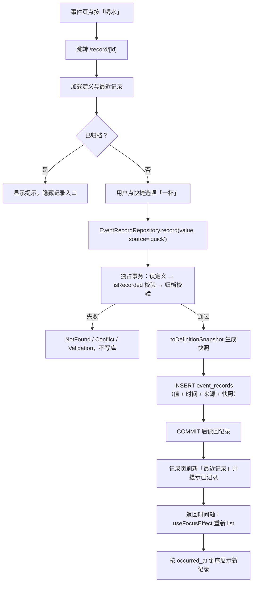

# 09 事件记录：快照、发生时间与时间轴

> 对应功能：**第二阶段第 2 项——counter / quantity 的记录闭环**。
> 本文以仓库真实代码为依据。凡是「没做过」的验证，会明确写出来。
>
> ⚠️ **后来重做过一次**：时间轴的行内交互（右侧的取值 + 【+1】、点行进记录详情、
> 「逐条 / 同类合并」开关）与记录行的 props 都变了；那一次改动的走读见
> [16 时间轴行改版与记录详情](./16-timeline-row-and-detail.md)。
> 本文关于**快照、`occurredAt` / `recordedAt`、时间轴排序**的部分仍然有效。
>
> ⚠️ **v6 起「单位」变「属性」**：`EventRecord.unit` → `attributes: string[]`、
> `snapshot.unit` → `snapshot.attributes`（一条记录可以标多个属性，记录时默认不选），
> 展示时记录自己没标会**回退**用快照里的。定义侧 `EventDefinitionKind` 收敛为
> `'counter' | 'cycle'`（**新建不了 `quantity` 了**，但老记录的 `RecordKind` 仍是 `quantity`）。
> 本文里 `unit` / 数量型的说法请按此理解；走读见
> [08 事件定义](./08-event-definitions.md) 第 9 节。

## 1. 本次完成什么

第 1 项让用户能定义「记录什么」，这一项让用户能真正「记录一次事实」并看到历史：

| 能力 | 说明 |
| --- | --- |
| 记录计数型事件 | 快捷选项一键「+1」，或手动填增量 |
| 记录数量型事件 | 快捷选项一键填入，或手动填数量（可小数） |
| 事件快照 | 记录的那一刻固化定义（名称/单位/分组/标签），之后永不改变 |
| 时间轴 | 所有记录按**事实发生时间**倒序展示 |
| 归档限制 | 已归档的事件不能新增记录（历史不受影响） |
| 软删除列 | `deleted_at` 列已就位，`list` 默认排除；撤销 UI 属后续项 |

数据库 schema 从 **v2 升到 v3**：新增 `event_records` 表与 2 个索引。

**本次明确不做**：补录（把 `occurredAt` 设为过去）、撤销最近操作的 UI、周期、统计、导入导出。
所以 `source` 目前只会出现 `manual` / `quick`，`backfill` 的值域已经预留好。

## 2. 改了哪些文件

| 文件 | 角色 | 本次新增/修改 |
| --- | --- | --- |
| `src/db/schema.ts` | 迁移清单 | 新增 `MIGRATION_V3_EVENT_RECORDS` |
| `src/domain/models.ts` | 领域模型 | 新增 `isRecordSource` 守卫与 `toDefinitionSnapshot`（快照生成） |
| `src/domain/validation.ts` | 领域校验 | 新增 `EventRecordInput`、`requireRecordValue` / `requireRecordSource` / `requireIsoDateTime` / `requireId` |
| `src/repositories/eventRecordRepository.ts` | 仓储 | **新增**：`record()` 生成快照、`list()` 时间轴查询 |
| `src/features/records/format.ts` | 功能组件 | **新增**：记录值/时间/来源展示 |
| `src/app/(tabs)/index.tsx` | 页面 | 由占位改为真实时间轴 |
| `src/app/record/[id].tsx` | 页面 | **新增**：记录一次事件 |
| `src/app/(tabs)/definitions.tsx` | 页面 | 点按行进入记录页 |

测试新增 `repositories/__tests__/eventRecordRepository-test.ts`，并扩充 `domain/__tests__/validation-test.ts`、
`db/__tests__/migrations-test.ts`。

## 3. 相关技术概念

### 3.1 历史快照（snapshot）：把「不可篡改」变成结构

**是什么**：记录事件时，把当时的事件定义（名称、单位、分组、标签）复制一份存进历史记录。
**为什么本项目需要**：领域规则第 1 条是「改定义不影响已产生的历史」。
用户把「喝水」改名成「喝水（含茶）」，三个月前的记录不该跟着改名；甚至删掉定义，历史也得能展示。
**用在哪**：`toDefinitionSnapshot(definition)`（`models.ts`）+ `event_records` 的 `snapshot_*` 列。
**不用会怎样**：用「JOIN 定义表」来省空间，一旦定义被删除，历史记录连名字都查不到——事实被破坏。

### 3.2 `occurredAt` 与 `recordedAt`：两个时间不能混

**是什么**：`occurredAt` 是「事实什么时候发生」，`recordedAt` 是「什么时候录进来」。
**为什么**：补录一条昨天的数据，`occurredAt` 是昨天、`recordedAt` 是现在。
时间轴要按 `occurredAt` 排序，否则补录的记录会跳到顶部，用户觉得「时间轴乱序」。
**用在哪**：`event_records.occurred_at` / `recorded_at`；`EventRecordRepository.list` 的
`ORDER BY occurred_at DESC`。
**不用会怎样**：只留一个时间，补录与统计都会出错，且无法区分「谁什么时候填的」。

### 3.3 「无外键保历史」——一个反直觉但正确的取舍

**是什么**：`event_records.definition_id` **故意不建外键**。
**为什么**：
- 加 `ON DELETE CASCADE`：删定义会连带删光历史——违反「历史不可篡改」。
- 加 `ON DELETE RESTRICT`：有历史就不能删定义——用户被卡死。
- 不加外键：定义可以删，历史靠快照独立存活。

**用在哪**：`MIGRATION_V3_EVENT_RECORDS`（对比 v2 里 `quick_options` 用了 CASCADE）。
**不用会怎样**：无论选哪种外键都会破坏某一条领域规则。这是「外键不是越多越好」的真实案例。

### 3.4 软删除：`deleted_at` + `isVisibleRecord`

**是什么**：删除不真删行，而是写 `deleted_at`；查询默认过滤掉。
**为什么**：为「撤销最近操作」留后路——真删就无法撤销。
**用在哪**：`event_records.deleted_at`；`list()` 里 `WHERE deleted_at IS NULL`（除非 `includeDeleted`）。
**不用会怎样**：一旦需要撤销，就必须改表结构、回填数据，代价大。

### 3.5 事务内「读定义 + 写记录」

**是什么**：记录时先读事件定义（校验 + 生成快照），再写记录，两步放在同一个事务。
**为什么**：如果读取与写入之间定义被改动，快照可能与校验时的定义不一致。
**用在哪**：`EventRecordRepository.record` 的 `withExclusiveTransactionAsync`。
**不用会怎样**：极端情况下出现「按 A 校验、快照却来自 B」的错乱。

## 4. 关键代码逐段解释

### 4.1 v3 迁移（节选）

```ts
`CREATE TABLE event_records (
   id                 TEXT    PRIMARY KEY NOT NULL,
   definition_id      TEXT    NOT NULL,          -- 故意不加 REFERENCES
   kind               TEXT    NOT NULL CHECK (kind IN ('counter', 'quantity')),
   value              REAL    NOT NULL,
   occurred_at        TEXT    NOT NULL,
   recorded_at        TEXT    NOT NULL,
   source             TEXT    NOT NULL CHECK (source IN ('manual', 'quick', 'backfill')),
   deleted_at         TEXT,
   snapshot_name      TEXT    NOT NULL,
   snapshot_tag_ids   TEXT    NOT NULL DEFAULT '[]',
   ...)`
```

- `definition_id` 上没有 `REFERENCES`：见 3.3。
- `snapshot_tag_ids` 存 JSON 数组文本。快照要**自洽**，不想再依赖 `tags` 表（表里的标签可能已被删）。
- `value` 用 `REAL`：数量型要支持小数（0.5 升）。

### 4.2 快照生成（`models.ts`）

```ts
export function toDefinitionSnapshot(definition: EventDefinition): EventDefinitionSnapshot {
  return {
    definitionId: definition.id,
    name: definition.name,
    kind: definition.kind,
    unit: definition.unit,
    groupId: definition.groupId,
    tagIds: [...definition.tagIds],
  };
}
```

- 纯函数，不碰数据库，能被复用与测试。
- `[...definition.tagIds]` 复制数组，避免调用方之后改到定义时影响快照。

### 4.3 记录一次事件（`eventRecordRepository.ts`，节选）

```ts
await this.db.withExclusiveTransactionAsync(async (txn) => {
  const definition = await txn.getFirstAsync<DefinitionRow>(
    'SELECT id, name, kind, unit, group_id, is_archived FROM event_definitions WHERE id = ?', definitionId);
  if (!definition) throw new NotFoundError(`事件定义不存在：${definitionId}`);
  if (definition.is_archived === 1) throw new ConflictError(`事件「${definition.name}」已归档，不能新增记录`);

  const kind = toKind(definition.kind);
  const value = requireRecordValue(kind, input.value);
  const unit = optionalText(input.unit) ?? definition.unit ?? undefined;
  const tagRows = await txn.getAllAsync<TagIdRow>(/* 读标签 */);
  await txn.runAsync(/* INSERT event_records（含快照与 JSON 标签） */);
});
return this.mustReadOne(id);
```

- **归档拦截**用 `ConflictError`（状态冲突），且发生在写库前。
- 取值校验 `requireRecordValue`：计数型必须正整数，数量型必须正数。
- 单位优先级：显式传入 > 定义默认单位。
- 事务提交后 `mustReadOne` 读回，保证返回的是持久化后的真实数据。

### 4.4 时间轴查询（`list`）

```ts
if (!options.includeDeleted) clauses.push('deleted_at IS NULL');
if (options.definitionId !== undefined) { clauses.push('definition_id = ?'); params.push(options.definitionId); }
const where = clauses.length > 0 ? `WHERE ${clauses.join(' AND ')}` : '';
...
`ORDER BY occurred_at DESC, recorded_at DESC, id DESC ${limit}`
```

- 条件**动态拼接**，但值一律走 `?` 参数化（安全边界）。
- 排序用 `occurred_at`（见 3.2）；`id` 是 UUID v7，同刻记录也能稳定排序。
- `limit` 让时间轴不必一次读全表（当前取 100 条）。

### 4.5 记录页与时间轴（界面）

- `/record/[id]`：`useLocalSearchParams` 取定义 id，加载定义与「该事件最近 5 条」；
  快捷选项是 `Chip`，点一下即以 `source: 'quick'` 记录；手动记录收集数量与备注，以 `source: 'manual'`。
- `(tabs)/index.tsx`：用 `useFocusEffect` 每次获得焦点时重读 `list({ limit: 100 })`，
  所以从记录页返回后时间轴立刻更新。

## 5. 一次完整数据流：记录一次喝水



## 6. 如何验证

### 关键命令

```bash
npm test                          # 全部测试
npm test -- src/repositories      # 只跑仓储层
npm run typecheck
npm run lint
npx expo export --platform ios    # 打包验证（不需要模拟器）
```

### 真实跑过的结果

| 命令 | 结果 |
| --- | --- |
| `npm run typecheck` | 通过 |
| `npm run lint` | 通过（0 error / 0 warning） |
| `npm test` | **9 个套件 / 108 个用例通过** |
| `npx expo export --platform ios` | 通过（1245 modules） |

### 测试覆盖了什么

- **迁移**：`event_records` 建表；`kind` / `source` 的 `CHECK`；
  **没有外键**（指向不存在的定义也能写入）；**删定义不删历史**。
- **仓储**：记录计数/数量型并读回；快照正确；`occurredAt` 省略时等于 `recordedAt`；
  按 `occurredAt` 倒序；按定义过滤与 `limit`；**归档拒绝记录且不写入**；
  取值/来源/时间格式校验；**快照不可篡改**（改名换单位后历史不变）；
  记录时固化标签（之后删标签，快照仍留 id）；**永久删除定义后历史仍在**；软删除过滤。
- **领域校验**：`requireRecordValue` / `requireRecordSource` / `requireIsoDateTime` / `requireId`。

### 没覆盖什么（诚实记录）

- **没有组件/界面测试**：记录页的交互、时间轴渲染没有自动化用例。
- **`backfill` 路径未实现**：虽然类型与数据库都允许，但没有 UI 与用例走它（属后续项）。
- **没有在模拟器/真机上手动走过本次功能**：只做了静态检查、单元测试与 iOS 打包。

## 7. 常见问题与排查

### 问题：明明记录了，时间轴却看不到

**原因排查**：时间轴按 `occurred_at` 排序并 `LIMIT 100`；若这条记录的 `occurred_at` 很旧
（未来补录场景），会排在很后面甚至被截断。
**排查**：先确认 `list()` 是否带了 `deleted_at IS NULL`（软删除的记录不展示）。

### 问题：改名后，旧记录还是老名字 / 换了单位旧记录还是老单位

**这不是 bug，是设计**。历史展示的是记录当时的快照（见 3.1）。想改历史数据除外——本应用不支持篡改历史。

### 问题：给归档的事件记录，报 Conflict

**原因**：`isRecordable` 为假。归档只影响「能否继续记录」，历史仍在。
**排查**：先到事件定义页「取消归档」。

### 问题：`CHECK constraint failed: source`

**原因**：`source` 只允许 `manual` / `quick` / `backfill`（见 `RECORD_SOURCES`）。
**排查**：检查调用处传入的来源字符串拼写。

### 问题：数量型记 0.5 报「必须是整数」

**原因**：这条事件被定义成了**计数型**（counter）。
**排查**：到编辑定义页把类型改成「数量」，或确认确实应该记整数次。

## 8. 学习总结与练习

**掌握的核心概念**

- 快照是把「历史不可篡改」这条规则**写进数据结构**的手段。
- `occurredAt`（事实）与 `recordedAt`（录入）分离；排序用事实时间。
- 外键**不是越多越好**：为了保历史，历史表故意不建指向定义的外键。
- 软删除用 `deleted_at` + 过滤，为撤销留后路。
- 动态条件拼接时，**结构可以拼、值必须参数化**。

**建议亲自尝试的小练习**

1. **观察快照**：记录一次「喝水」，然后把它改名并换单位，回到时间轴——旧记录仍是原名原单位。
2. **验证归档限制**：把某事件归档，进它的记录页，确认记录入口消失、提示出现。
3. **验证删定义保历史**：记录几次后永久删除该定义，回到时间轴，确认历史仍在、名称仍可读。
4. **验证排序**：直接改数据库里某条记录的 `occurred_at`（测试库中），确认时间轴顺序随之变化。
   **注意**：只在自己的测试库或内存库里做，不要改真机上的正式数据。

以上练习都不涉及第一阶段已验收代码的结构修改，可以放心做。

## 9. 后续变更（v6 / v7）：快照里的「单位 / 标签」换了名字

本文写的是第 2 项当时的样子（schema v2 → v3，定义上有 `unit` 和全局 `tags`）。后来有两轮改动
动了快照的构成，读代码时别被本文的旧字段名带偏：

- **v6**：定义 / 记录的 `unit` 变成**可多条的属性** `attributes`（`snapshot_unit` →
  `snapshot_attributes`，都是 JSON 数组文本）。所以 3.1 / 4.2 里说的「固化单位」现在指
  固化 `attributes`。见 [08](./08-event-definitions.md) 第 9 节。
- **v7**：全局「标签」退出，记录的 `snapshot_tag_ids` 换成 `snapshot_fields` + `field_values`
  ——记录时固化的是**字段定义**（名字 / 类型 / 候选值）与**字段取值**。
  所以 3.1 / 4.1 / 4.2 里说的「固化标签」现在指固化字段，`toDefinitionSnapshot` 之外
  还多了一步把定义字段折成 `FieldSnapshot`。见 [17 自定义字段](./17-custom-fields.md)。

**没变的核心**：快照的思路（把当时的样子复制一份存进历史、之后永不改）正是从 v3 一路延续到 v7 的，
只是「复制哪些东西」随功能扩了几次。