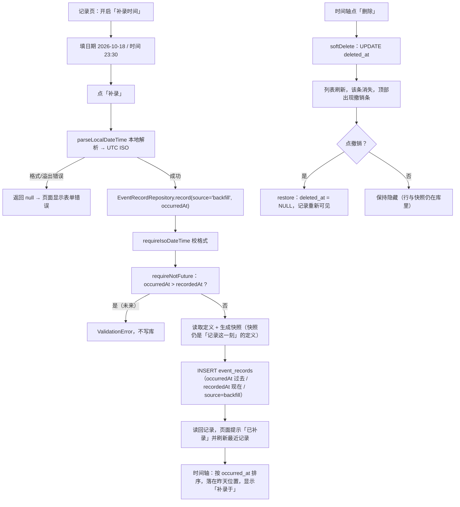

# 10 补录与撤销：本地时间、软删除与幂等

> 对应功能：**第二阶段——补录（backfill）与撤销（undo）**。
> 本文以仓库真实代码为依据。凡是「没做过」的验证，会明确写出来。
> 这一项**没有新增数据库迁移**，schema 仍是 v3 —— 它用的都是第 2 项已经预留好的东西。
>
> ⚠️ **撤销的入口后来搬过家**：时间轴的行内删除与那条「已再记一条 / 已删除…」提示条已经取消，
> 删除 / 修改 / 撤销都移到**记录详情页**（`/records/[id]`）的「更多操作」里；
> 补录的那条规则（`requireNotFuture`）现在也用在「修改这条记录」上。
> 见 [16 时间轴行改版与记录详情](./16-timeline-row-and-detail.md)。
> 本文的**软删除语义、幂等、本地时间 ↔ UTC** 部分仍然有效。

## 1. 本次完成什么

第 2 项让用户能「此刻记录一次事实」。这一项补上两件真实生活里必须有的能力：

| 能力 | 说明 |
| --- | --- |
| 补录 | 记录**过去**发生的事实：填日期与时间，`occurredAt` 是那一刻，`recordedAt` 是现在 |
| 补录来源 | 落库时 `source = 'backfill'`，与手动/快捷区分开 |
| 时间轴标记 | 补录的记录显示「补录于 MM-DD HH:mm」，提示这是事后填的 |
| 撤销 | 删除是**软删除**（只写 `deleted_at`），列表内直接删、顶部给「撤销」入口 |
| 撤销幂等 | 重复删除不覆盖原删除时间、恢复未删除的记录不报错 |

两个约束是这一项新引入的领域规则：

1. **补录只能回到过去**：`occurredAt` 可以早于 `recordedAt`，但不能晚于它（未来还没发生，不构成事实）。
2. **软删除可撤销、幂等**；**永久删除才需要二次确认**（留给后续项）。

**本次明确不做**：永久删除（需二次确认 + 跨表事务）、撤销栈的跨页面持久化、周期、统计、导入导出。

## 2. 改了哪些文件

| 文件 | 角色 | 本次新增/修改 |
| --- | --- | --- |
| `src/domain/validation.ts` | 领域校验 | 新增 `requireNotFuture` |
| `src/repositories/eventRecordRepository.ts` | 仓储 | `record()` 接入「不能是未来」；新增 `softDelete` / `restore` |
| `src/domain/__tests__/models-test.ts` | 测试 | **新增**：`isVisibleRecord` / `isRecordable` / `toDefinitionSnapshot` |
| `src/features/records/datetime.ts` | 功能组件 | **新增**：本地时间 ↔ UTC 的解析/格式化 |
| `src/features/records/format.ts` | 功能组件 | 新增 `describeRecord` / `recordSubtitle` |
| `src/features/records/RecordRow.tsx` | 功能组件 | **新增**：时间轴与记录页共用的记录行 |
| `src/features/records/UndoBar.tsx` | 功能组件 | **新增**：软删除后的撤销条 |
| `src/app/record/[id].tsx` | 页面 | 手动记录加「补录时间」开关；最近记录可删除并撤销 |
| `src/app/(tabs)/index.tsx` | 页面 | 每条记录可删；顶部撤销条；刷新不再整屏 loading |
| `src/components/Button.tsx` | 通用 UI | 新增 `size`（`md`/`sm`），默认尺寸不变 |

## 3. 相关技术概念

### 3.1 本地时间 ↔ UTC ISO-8601

**是什么**：存库的时间戳一律是 UTC（`2026-10-19T00:30:00.000Z`），但用户是按**设备本地时区**填写与阅读的。
**为什么本项目需要**：用户想补录「昨天 23:30」，那是**本地**的 23:30。如果把它当 UTC 存，时间轴会偏几个小时。
**用在哪**：`src/features/records/datetime.ts` 的 `localDateText` / `localTimeText` / `parseLocalDateTime`。
**不用会怎样**：补录的时间系统性偏移（时区差），统计与时间轴全错，而且换时区后更难排查。

关键点：`new Date(year, month - 1, day, hour, minute)` 会按**本地时区**解释，`.toISOString()` 再转成 UTC。
这一进一出就把时区处理干净了。

### 3.2 日期解析与「溢出」：为什么解析后要回读字段

**是什么**：JS 的 `Date` 会**归一化**越界日期，而不是报错 —— `new Date(2026, 1, 31)`（2 月 31 日）会变成 3 月 3 日。
**为什么本项目需要**：用户手输 `2026-02-31` 是明显的输入错误，不能悄悄变成 3 月。
**用在哪**：`parseLocalDateTime` 里解析后回读 `getFullYear / getMonth / getDate` 与输入比对，不一致就返回 `null`。
**不用会怎样**：错误的日期被静默改写，用户以为记的是 2 月底，实际是 3 月初。

对应地，`2024-02-29` 合法（闰年）、`2026-02-29` 不合法（平年），回读法两种都能正确区分。

### 3.3 「不能是未来」为什么用 `Date.parse` 而不是字符串比较

**是什么**：判断 `occurredAt <= recordedAt`。
**为什么不能直接比字符串**：ISO 文本可以带不同时区偏移（`2026-10-19T09:00:00+08:00` 与 `...T01:00:00Z` 是同一时刻），
字符串的字典序**不等于**时间先后。
**用在哪**：`requireNotFuture`（`validation.ts`），`record()` 在写库前调用它。
**不用会怎样**：某些带偏移的输入会被误判成「未来」而拒绝，或更糟——真正的未来时间被放行。

### 3.4 软删除与幂等

**是什么**：删除不真删行，只写 `deleted_at`；查询默认过滤掉（`list()` 里 `deleted_at IS NULL`）。
**为什么**：为了「撤销」——真删就再也撤不回来了。列在第 2 项已经预留。
**用在哪**：`EventRecordRepository.softDelete` / `restore`；`isVisibleRecord`（`models.ts`）判定可见性。
**幂等**是什么：同一个操作执行多次，结果与执行一次相同。为什么这里要幂等：

- **重复删除**不能覆盖第一次的删除时间（否则撤销栈里的时间会漂移，用户看到「刚删的」其实是「很久前删的」）；
- **重复恢复**未删除的记录不能报错（界面重试、连点都会触发）。

实现上用 `UPDATE ... WHERE id = ? AND deleted_at IS NULL`，再在代码里先读一次做判断。

**不用会怎样**：连点两次删除会把 `deleted_at` 刷成当前时间；恢复一个本来就正常的记录会抛错、弹一个没必要的报错框。

### 3.5 乐观撤销 vs `Alert` 二次确认

**是什么**：两种「防误操作」策略。
**为什么本项目两种都用**：

- **软删除用乐观撤销**：先删掉，顶部给「撤销」入口。因为删除可恢复，所以不需要打断用户。
- **永久删除用二次确认**（第 1 项已实现，`Alert.alert`）：删了不可恢复，必须拦一下。

**用在哪**：`features/records/UndoBar.tsx`（撤销条）vs `src/app/events/[id].tsx`（永久删除的 `Alert`）。
**不用会怎样**：若软删除也弹确认框，用户每次删除都要多点一下，体验很重；若永久删除不拦，数据就真没了。

判断标准很简单：**这个操作能不能撤销？** 能 → 乐观 + 撤销；不能 → 二次确认。

## 4. 关键代码逐段解释

### 4.1 「不能是未来」（`validation.ts`）

```ts
export function requireNotFuture(value: string, now: string, field = '发生时间'): string {
  const target = Date.parse(value);
  const reference = Date.parse(now);
  if (!Number.isFinite(target) || !Number.isFinite(reference)) {
    throw new ValidationError(`${field}不是可解析的时间：${value}`);
  }
  if (target > reference) {
    throw new ValidationError(`${field}不能晚于当前时间（补录只能记录已发生的事实）`);
  }
  return value;
}
```

- 先确认两个时间都能解析（`Number.isFinite` 挡住 `NaN`）。
- 相等是**允许**的（`>` 而不是 `>=`）：用户手动记「就是现在」，`occurredAt === recordedAt` 是正常情况。

### 4.2 记录时接入校验（`eventRecordRepository.record`）

```ts
const recordedAt = requireIsoDateTime(now, '录入时间');
const occurredAt = requireNotFuture(
  requireIsoDateTime(input.occurredAt ?? recordedAt, '发生时间'),
  recordedAt,
  '发生时间',
);
```

- 三层校验顺序清晰：**格式**（`requireIsoDateTime`）→ **语义**（`requireNotFuture`）。
- `input.occurredAt ?? recordedAt`：不传就是「现在」，传了就是补录。
- `recordedAt` 先算出来，作为「不能是未来」的参照点，语义是「录入时刻」。

### 4.3 软删除与恢复（`eventRecordRepository`）

```ts
async softDelete(id: string, now: IsoDateTime = new Date().toISOString()): Promise<EventRecord> {
  const targetId = requireId(id, '事件记录 id');
  const deletedAt = requireIsoDateTime(now, '删除时间');
  return guard('删除事件记录', async () => {
    const existing = await this.getById(targetId);
    if (!existing) throw new NotFoundError(`事件记录不存在：${targetId}`);
    if (existing.deletedAt !== undefined) return existing;   // 幂等
    await this.db.runAsync(
      'UPDATE event_records SET deleted_at = ? WHERE id = ? AND deleted_at IS NULL',
      deletedAt, targetId,
    );
    return this.mustReadOne(targetId);
  });
}
```

- **先读再写**：读一次判断「是否已删」，保证幂等。
- `deleted_at IS NULL` 是**第二道保险**：即使两次调用并发，也只有一个能真正写入。
- 返回**读回后的**记录（`mustReadOne`），保证调用方拿到的 `deletedAt` 与库里一致。
- `restore` 是对称的：`UPDATE event_records SET deleted_at = NULL WHERE id = ?`，已可见则直接返回。
- 注意这**不是永久删除**——行、快照、标签全都在，所以能撤销。

### 4.4 本地时间解析（`features/records/datetime.ts`）

```ts
export function parseLocalDateTime(dateText: string, timeText: string): string | null {
  const dateMatch = DATE_PATTERN.exec(dateText.trim());
  const timeMatch = TIME_PATTERN.exec(timeText.trim());
  if (!dateMatch || !timeMatch) return null;
  // ... 取值越界检查 ...
  const date = new Date(year, month - 1, day, hour, minute, 0, 0);  // 按本地时区解释
  if (date.getFullYear() !== year || date.getMonth() !== month - 1 || date.getDate() !== day) {
    return null;  // 溢出（如 2 月 31 日）
  }
  return date.toISOString();  // 转成 UTC
}
```

- **返回 `null` 而不是抛错**：解析失败是「用户输入问题」，由页面转成表单错误提示（见 4.5）。
  领域层的 `ValidationError` 留给仓储；纯解析函数保持纯粹、易测。
- 日期用正则、时间允许 `8:30` 与 `08:30` 两种写法（`\d{1,2}`）。
- `shiftLocalDays` 用日历字段平移（`new Date(y, m, d + days, ...)`）而不是加 86400000 毫秒 —— 跨夏令时那天加毫秒会算错。

### 4.5 记录页的补录表单（`src/app/record/[id].tsx`）

```tsx
const submitManual = () => {
  if (!definition) return;
  if (!backfill) {
    save(Number(manualValue.trim()), undefined, 'manual');
    return;
  }
  const occurredAt = parseLocalDateTime(dateText, timeText);
  if (occurredAt === null) {
    setError('日期或时间格式不正确，日期应形如 2026-10-19，时间应形如 08:30。');
    return;
  }
  save(Number(manualValue.trim()), undefined, 'backfill', occurredAt);
};
```

- 一个 `save` 函数统一处理四件事：**取值** + **单位** + **来源** + **可选的发生时间**。快捷记录调用时同样走它，只是传 `source: 'quick'`。
- 界面只做「本地格式 → ISO」和「解析失败 → 文案」，领域规则（不能是未来）仍然在仓储层兜底。
- 「今天 / 昨天 / 前天」三个 `Chip` 用 `shiftLocalDays` 快速改日期；因为是短日期、时分保留，所以不会出现「未来」的默认值（`localTimeText` 截断到分钟）。

### 4.6 撤销条（`features/records/UndoBar.tsx`）

```tsx
export function UndoBar({ message, onUndo, onDismiss, busy = false }: UndoBarProps) {
  return (
    <Card style={styles.card}>
      <AppText variant="body">{message}</AppText>
      <View style={styles.actions}>
        <Button label={busy ? '撤销中…' : '撤销'} onPress={onUndo} disabled={busy} style={styles.grow} />
        <Button label="知道了" tone="secondary" onPress={onDismiss} disabled={busy} />
      </View>
    </Card>
  );
}
```

- 纯展示组件：不碰数据库，只收 `message` 与两个回调（`onUndo` / `onDismiss`）。
- 「撤销状态」放在页面里（`useState<EventRecord | null>`），没有引入第三方状态库 —— 与 [06](./06-navigation-and-state.md) 3.9 的判断一致：这个状态只在当前页用，`Context + useReducer` 都还不必上。
- 一张 `UndoBar` 同时服务于时间轴与记录页，两处删除都能撤销。

## 5. 一次完整数据流：补录「昨天 23:30 喝水 +1」



## 6. 如何验证

### 关键命令

```bash
npm test                                  # 全部测试
npm test -- src/repositories src/domain   # 仓储 + 领域
npm run typecheck
npm run lint
npx expo export --platform ios            # 打包验证（不需要模拟器）
```

### 真实跑过的结果

| 命令 | 结果 |
| --- | --- |
| `npm run typecheck` | 通过 |
| `npm run lint` | 通过（0 error / 0 warning） |
| `npm test` | **11 个套件 / 137 个用例通过** |
| `npx expo export --platform ios` | 通过（1248 modules） |

### 测试覆盖了什么

- **补录（仓储）**：显式过去时间写入且 `source = 'backfill'`；补录的旧记录按**发生时间**排在时间轴靠后；
  未来时间被拒且**不写库**；边界（`occurredAt === recordedAt`）放行。
- **「不能是未来」（领域）**：过去/当下通过、未来拒绝；带 `+08:00` 偏移时比较的仍是时间先后而非字符串。
- **软删除与恢复（仓储）**：删除后列表消失、`includeDeleted` 与 `getById` 仍可读、快照保留；
  重复删除不覆盖原时间；只影响目标记录；恢复后重新可见；恢复未删除记录幂等；不存在时抛 `NotFoundError`。
- **领域谓词（`models-test.ts`）**：`isVisibleRecord` 的 `=== undefined` 两个分支、`isRecordable`、
  `toDefinitionSnapshot`（标签数组是复制）。
- **本地时间（`datetime-test.ts`）**：本地 → UTC 往返一致、容忍空白、格式/越界/溢出返回 `null`、
  闰年区分、跨月平移、用「现在」生成的默认值不落在未来。

### 没覆盖什么（诚实记录）

- **没有组件/界面测试**：补录表单与撤销条没有自动化用例（项目至今无组件测试）。
- **没有在模拟器/真机上手动走过本次功能**：只做了静态检查、单元测试与 iOS 打包。
- **撤销状态不跨页面**：离开页面后撤销入口消失（记录本身仍是软删除状态，只是没有入口了）；若要跨页面持久化，需要再评估状态放哪。

## 7. 常见问题与排查

### 问题：填了昨天，却被拒绝「不能晚于当前时间」

**原因排查**：`occurredAt` 真的晚于 `recordedAt` 才会被拒。常见来源：

1. 设备时间被改到了过去（`now` 比用户以为的早）；
2. 日期填错（例如把「昨天」写成了明年）；
3. 自己写代码时把参数传反了（`occurredAt` 与 `recordedAt` 位置对调）。

**排查**：先确认设备时间；再打印两个 ISO 字符串，用 `Date.parse` 比一下。

### 问题：填 `2026-02-31` 报「格式不正确」，但这明明是合法格式

**这不是 bug**。格式合法但**日期不存在**，`parseLocalDateTime` 用「回读字段」识别溢出并返回 `null`（见 3.2、4.4）。

### 问题：补录后时间轴位置不对（跑到最上面/最下面）

**原因**：时间轴按 `occurred_at` 排序并 `LIMIT 100`。若补录的时间很旧，它按顺序排在后面，甚至可能被 100 条上限截断。
**排查**：确认你看的是「发生时间」那一列而不是「录入时间」。

### 问题：删除后找不到那条记录了，但统计（将来）还算它

**原因**：软删除的记录被 `list()` 默认排除，也**不应**参与统计。
**排查**：检查查询是否带了 `deleted_at IS NULL`（`list()` 已经带）；统计代码出现时要同样过滤，或直接用 `isVisibleRecord`。

### 问题：点两次删除，第二次报错吗

**不报错**。`softDelete` 是幂等的（见 3.4、4.3），第二次直接返回已有结果，`deletedAt` 保持第一次的时间。

## 8. 学习总结与练习

**掌握的核心概念**

- 存 UTC、填/读本地：跨时区正确性的标准做法。
- `Date` 会静默归一化越界日期 → 解析后**回读字段**校验溢出。
- 比较时间用 `Date.parse` 的毫秒值，不要用 ISO 字符串的字典序。
- **幂等**：重复删除不覆盖原时间、重复恢复不报错——为连点与重试兜底。
- **能不能撤销**决定交互：能撤销 → 乐观删除 + 撤销条；不能 → 二次确认。
- 解析函数返回 `null`、领域校验抛 `ValidationError`：**错误表达方式与层次对应**。

**建议亲自尝试的小练习**

1. **观察时区**：在记录页补录「今天 00:05」，把设备时区改到另一个时区再打开时间轴，
   观察显示的时间如何变化（存储不变、显示随本地时区变）。
2. **验证溢出校验**：分别试 `2026-02-29`（平年，应被拒）与 `2024-02-29`（闰年，应通过）。
3. **验证不能是未来**：把日期改成明天，点「补录」，确认被拒且时间轴没有新增。
4. **验证幂等**：在时间轴连点两次「删除」，确认不报错；再点「撤销」，确认记录回来且只回来一条。
5. **验证软删除保留数据**：删除一条后，把时间轴的 `limit` 逻辑临时改成 `includeDeleted: true`（只在自己的测试库里），
   确认记录与快照都还在。

以上练习都不涉及已验收代码的结构修改，可以放心做。