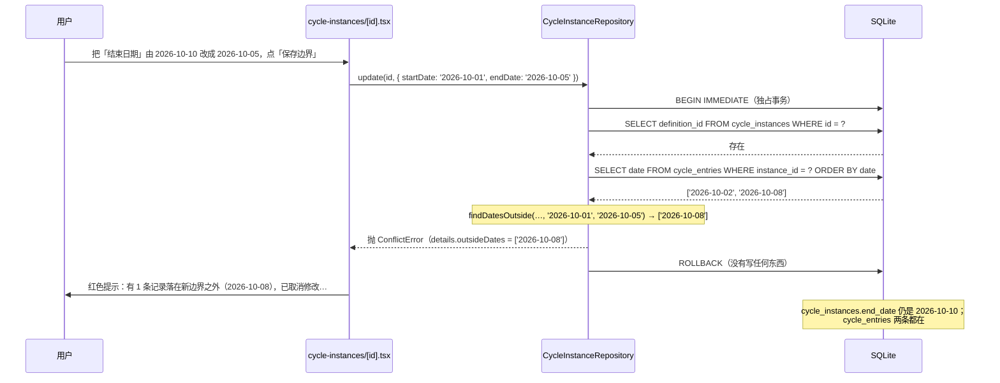

# 11 周期事件：日历日期、区间规则与「不静默删除」

> 对应功能：**第二阶段——周期事件**（周期定义 / 周期实例 / 周期内记录）。
> 本文以仓库真实代码为依据。凡是「没做过」的验证，会明确写出来。
> 这一项**新增了 v4 迁移**（三张表），schema 从 v3 升到 v4。

## 1. 本次完成什么

前面几项解决的是「事件」（喝了一次水、走了一段路）。这一项补上另一类记录：**周期**——
它是一个**区间**，区间里有**每一天的状态**。比如「生理期」这个定义下，有「10-01 ~ 10-05」这一段周期的实例，
实例里 10-02 这天记录「经期 / 头痛 / 有点累」。

| 能力 | 说明 |
| --- | --- |
| 周期定义 | 名称 + 可选的「平均周期长度」「平均经期长度」；平均周期长度只用来**预测**下次开始日 |
| 周期实例 | 一段真实区间：`startDate` ~ `endDate`；`endDate` 为空表示**进行中** |
| 周期内记录 | 某一天的阶段、症状、感受、备注；**一天一条**，重复保存即覆盖 |
| 预测 | 按「最近一段开始日 + 周期长度」给出下次预测；长度优先用**实际观察到的间隔平均**，没有历史才退回配置值，都没有就**不预测**（不猜） |
| 归档 | 归档只表示「不再开新周期」，**已有周期与记录都留着** |
| 永久删除 | 删定义 / 删实例 / 删某天的记录，都有 `Alert` 二次确认 |
| 边界预演 | 改边界时**保存之前**就提示「会有哪几天落到区间外」，不必等报错（第 4.8 节） |

这一项真正的新东西是三条**领域规则**，它们不是「顺手删掉就行」，而是要在代码里站住：

1. **周期边界修改不得静默删除越界记录**——把区间改小、导致某些记录落在区间外时，**拒绝修改并说明原因**，
   绝不偷偷删数据（见第 3.3 节）。
2. **同一定义的周期实例不重叠**——否则「这是第几天」会含糊（见第 3.4 节）。
3. **一天一条**——用 `UNIQUE(instance_id, date)` + UPSERT 从结构上保证（见第 3.5 节）。

**后来补的增强**（本文档已同步，见第 4.2、4.8 节）：

- 预测不再只看配置值：改成「最近若干段实际间隔的平均」，并把**依据**（算出来的 / 按配置推的）显示出来。
- 越界提示提前到保存之前：界面用已加载的记录 + 同一个纯函数实时预演，
  因此删掉了仓储里那个重复的只读查询 `listOutsideEntryDates`（规则只留一份）。

**本次明确不做**：日历式可点选的月视图、按症状统计、周期与事件的统一时间轴。

## 2. 改了哪些文件

| 文件 | 角色 | 本次新增/修改 |
| --- | --- | --- |
| `src/domain/dates.ts` | 领域 | **新增**：纯日历日期运算（`isValidIsoDate` / `addDays` / `daysBetween` / `isDateWithin`） |
| `src/domain/cycles.ts` | 领域 | **新增**：周期规则纯函数（`findDatesOutside` / `findOverlappingInstance` / `instanceLengthDays` / `latestInstance`）；后来补上 `observedCycleLength` / `predictNextCycle`（取代原来的 `predictNextCycleStart`） |
| `src/domain/validation.ts` | 领域 | 新增 `requireIsoDate` / `optionalIsoDate` / `requireDateRange` / `optionalPositiveInteger` / `normalizeTextList` 与三个周期输入类型 |
| `src/db/schema.ts` | 数据库 | **新增 `MIGRATION_V4_CYCLE`**：`cycle_definitions` / `cycle_instances` / `cycle_entries` + 索引 |
| `src/repositories/cycleDefinitionRepository.ts` | 仓储 | **新增**：定义 CRUD + 归档 |
| `src/repositories/cycleInstanceRepository.ts` | 仓储 | **新增**：实例 CRUD；`update` 内的越界检查（本项核心）与重叠检查 |
| `src/repositories/cycleEntryRepository.ts` | 仓储 | **新增**：按 `(instance_id, date)` UPSERT 保存某天记录；日期必须落在区间内 |
| `src/features/common/datetime.ts` | 功能组件 | 从 `features/records/datetime.ts` **移动**过来（周期也要用「今天」） |
| `src/features/cycles/labels.ts` | 功能组件 | **新增**：文案与症状文本解析 |
| `src/features/cycles/CycleDefinitionForm.tsx` | 功能组件 | **新增**：新建 / 编辑周期定义共用表单 |
| `src/app/(tabs)/cycles.tsx` | 页面 | **新增**：周期标签页（定义列表） |
| `src/app/cycles/new.tsx`、`src/app/cycles/[id].tsx` | 页面 | **新增**：新建定义 / 定义详情（周期列表、开始新周期、归档、删除） |
| `src/app/cycle-instances/[id].tsx` | 页面 | **新增**：一段周期 + 每日记录 + 边界调整 + 删除 |
| `src/app/(tabs)/_layout.tsx` | 页面 | 底部由三标签变**四标签**（时间轴 / 事件 / 周期 / 设置） |

## 3. 相关技术概念

### 3.1 「哪一天」和「哪一刻」不是一回事

前两项记录的是**时刻**：`occurredAt` 是 UTC ISO-8601（`2026-10-19T08:30:00.000Z`），
因为「几点几分」只有在时区里才有意义，所以要存成绝对时间。

周期记录的是**日历上的某一天**：`startDate: '2026-10-01'`。它没有时刻、没有时区。
如果硬把它当成时刻存，会出现「北京时间 10-01 的零点」和「UTC 10-01 的零点」这类问题——
同一段周期在不同时区看起来会差一天。

所以 `src/domain/dates.ts` 的约定是：**一律按 UTC 解释，只用日历字段做加减**。

```ts
/** 解析成 UTC 零点的毫秒值；格式不合法或日期不存在时返回 null。 */
function parseIsoDate(value: string): number | null {
  const match = ISO_DATE_PATTERN.exec(value.trim());
  if (!match) {
    return null;
  }
  const year = Number(match[1]);
  // …
  const ms = Date.UTC(year, month - 1, day);
  const date = new Date(ms);
  // JS 会把「2 月 31 日」归一成 3 月，用回读字段挡掉不存在的日期
  if (date.getUTCFullYear() !== year || date.getUTCMonth() !== month - 1 || date.getUTCDate() !== day) {
    return null;
  }
  return ms;
}
```

**为什么本项目需要**：`addDays('2026-12-31', 1)` 必须等于 `'2027-01-01'`，且跨月、跨年、闰年都对。
用 `Date.UTC` 加 `n * 86400000` 毫秒是安全的（UTC 没有夏令时）；如果换成「本地时区」，跨夏令时那天会算错。

**不用会出什么问题**：把「哪一天」当成本地时间处理，用户在东八区晚上 11 点记录，
换到别的时区查看就少一天。日期的加减也会在夏令时切换日出错。

> 「今天是几号」这件事**没放在领域层**——它与设备时区有关，所以留在
> `src/features/common/datetime.ts` 的 `localDateText(new Date())`。两者不要混用。

### 3.2 日期解析：为什么解析后要「回读字段」

`new Date(2026, 1, 31)`（2 月 31 日）不会报错，JS 会悄悄归一成 3 月 3 日。
所以解析完必须**用回读的年 / 月 / 日**和输入比较，不一致就认为非法：

```ts
export function isValidIsoDate(value: string): boolean {
  return parseIsoDate(value) !== null;
}
```

`requireIsoDate` 再把它包成带字段名的中文错误（`validation.ts`）：

```ts
export function requireIsoDate(value: string, field = '日期'): IsoDate {
  const trimmed = value.trim();
  if (!isValidIsoDate(trimmed)) {
    throw new ValidationError(`${field}不是合法的日历日期（应为 YYYY-MM-DD）：${value}`);
  }
  return trimmed;
}
```

这和第 10 篇里 `parseLocalDateTime` 的「回读法」是同一种手法，只是这里没有时间部分。

### 3.3 「不静默删除」：把规则做成一次**会拒绝的校验**

这是本项最重要的一条。场景：一段周期是 `10-01 ~ 10-10`，里面 10-08 有记录。
如果用户把结束日改成 `10-05`，那 10-08 就落在区间外了。

有三种做法，语义完全不同：

| 做法 | 后果 |
| --- | --- |
| 顺手删掉 10-08 那条 | **静默丢数据**——用户不知道发生了什么，且不可恢复 |
| 留着不管 | 数据自相矛盾：一条「属于这段周期」的记录，日期却在周期之外 |
| **拒绝修改并说明原因** | 用户自己决定：是改回边界，还是先处理那条记录 |

本项目选第三种。规则先写成**纯函数**（`src/domain/cycles.ts`），方便单独测试：

```ts
/** 取出若干日期中**落在区间外**的那些（保持输入顺序）。 */
export function findDatesOutside(dates: readonly IsoDate[], startDate: IsoDate, endDate?: IsoDate): IsoDate[] {
  return dates.filter((date) => !isDateWithin(date, startDate, endDate));
}
```

仓储层的 `update` 在读-写之间调用它，有越界就抛 `ConflictError`：

```ts
// src/repositories/cycleInstanceRepository.ts
private async assertNoOutsiders(txn: SqlExecutor, instanceId: string, range: DateRange): Promise<void> {
  const rows = await txn.getAllAsync<DateRow>(
    'SELECT date FROM cycle_entries WHERE instance_id = ? ORDER BY date ASC',
    instanceId,
  );
  const outside = findDatesOutside(
    rows.map((row) => row.date),
    range.startDate,
    range.endDate,
  );
  if (outside.length > 0) {
    throw new ConflictError(
      `有 ${outside.length} 条记录落在新边界之外（${outside.join('、')}），已取消修改。` +
        '请先处理这些记录，或把边界改回包含它们。',
      { details: { outsideDates: outside } },
    );
  }
}
```

注意报错里**列出了具体日期**，并且放进 `details`。界面因此能原样显示原因；测试也能断言
「报错里带着 `outsideDates: ['2026-10-02']`」。

**为什么用 `ConflictError` 而不是 `ValidationError`**：这不是「输入格式不对」，
而是「输入合法，但和现有数据冲突」。错误类型分得清，调用方才能选择不同处理方式。

### 3.4 区间重叠：进行中的区间是「开区间」

同一周期的两段区间不能重叠，否则「第几天」会有两种算法。判定在领域层：

```ts
/** 用于「进行中」区间的开区间上界：`YYYY-MM-DD` 字典序下足够大。 */
const OPEN_ENDED = '9999-12-31';

export function rangesOverlap(a: DateRange, b: DateRange): boolean {
  const aEnd = a.endDate ?? OPEN_ENDED;
  const bEnd = b.endDate ?? OPEN_ENDED;
  return a.startDate <= bEnd && b.startDate <= aEnd;
}
```

`YYYY-MM-DD` 是定长补零的字符串，**字典序与时间先后一致**，所以直接用 `<` / `<=` 比较就够了，
不需要先转成 `Date`。这是本项目里反复使用的一个小技巧。

「进行中」没有结束日，怎么比？把它看成延伸到 `9999-12-31`。这样一段进行中的
周期会挡住它之后的所有区间——语义正好：上一段没结束，就还不该开下一段。

### 3.5 「一天一条」用 UPSERT 表达

`cycle_entries` 上建了唯一索引：

```sql
CREATE UNIQUE INDEX idx_cycle_entries_instance_date ON cycle_entries(instance_id, date);
```

于是「保存某一天的记录」就写成一个 UPSERT，不用先查「这天有没有记录」：

```ts
// src/repositories/cycleEntryRepository.ts
await this.db.runAsync(
  `INSERT INTO cycle_entries (id, instance_id, date, phase, symptoms, feelings, note, created_at, updated_at)
   VALUES (?, ?, ?, ?, ?, ?, ?, ?, ?)
   ON CONFLICT(instance_id, date) DO UPDATE SET
     phase = excluded.phase,
     symptoms = excluded.symptoms,
     feelings = excluded.feelings,
     note = excluded.note,
     updated_at = excluded.updated_at`,
  // …
);
```

**为什么本项目需要**：界面的交互是「点某一天 → 填写 → 保存」。如果保存分成
「新建」和「更新」两条路，页面就要自己判断「这天填过没有」，还容易判断错。
UPSERT 让保存**天然幂等**：同一天保存两次，结果一样（`created_at` 保持第一次的时间）。

`ON CONFLICT` 的目标由唯一索引提供；这也是把「业务约束」交给数据库兜底的一个例子——
就算将来有人从别处写库，也不可能写出同一天两条。第 10 篇的软删除幂等是**代码**保证的，
这里是**结构**保证的。

### 3.6 两个仓储，而不是一个聚合

第 1 项里 `EventDefinitionRepository` 是「一张定义背后三张表」的聚合根。
周期这边**故意拆成两个**：`CycleInstanceRepository`（实例）与 `CycleEntryRepository`（记录）。

原因是最初的领域建模就把它们当成两个独立概念（`CycleInstance.endDate` 的注释写着
「未结束时为空；修改边界不得静默删除已越界的记录」）。拆分后：

- 实例仓储负责**边界**（含越界检查、重叠检查）；
- 记录仓储负责**一天的数据**（含「日期必须在区间内」的校验）。

代价是两个仓储都要读对方的表（实例要读 `cycle_entries` 的日期，记录要读 `cycle_instances` 的区间）。
这是可接受的：仓储层本来就是「唯一能写 SQL 的地方」，跨表读取不需要绕路。

收益是规则落点清晰：**「改边界」的校验不会散落到记录仓储里**。

### 3.7 三层下钻的路由

事件是两层：标签页 → 记录。（`(tabs)/definitions.tsx` → `record/[id].tsx`）
周期是三层：**标签页 → 定义详情 → 实例详情**。

```
(tabs)/cycles.tsx              /cycles             定义列表
cycles/new.tsx                 /cycles/new         新建定义
cycles/[id].tsx                /cycles/[id]        定义详情（该定义的周期列表）
cycle-instances/[id].tsx       /cycle-instances/[id]   一段周期 + 每日记录
```

`/cycles` 同时是「标签页」和「`/cycles/...` 目录」的前缀。expo-router 允许这样做：
`(tabs)/cycles.tsx` 只对应精确路径 `/cycles`，而 `cycles/new.tsx` / `cycles/[id].tsx`
是它下面的子路径，两者不冲突（静态段 `new` 优先于动态段 `[id]`）。

使用 `typedRoutes` 时，**新增路由后 `tsc` 会报「Href 里没有这个路径」**，
因为类型生成在 `.expo/types/router.d.ts`（已 gitignore）。跑一次 `npx expo start --offline`
重新生成即可（见 `HANDOFF.md` 第 2 节）。

## 4. 关键代码逐段解释

### 4.1 区间判定（`src/domain/dates.ts`）

```ts
export function isDateWithin(date: IsoDate, startDate: IsoDate, endDate?: IsoDate): boolean {
  if (date < startDate) {
    return false;
  }
  if (endDate !== undefined && date > endDate) {
    return false;
  }
  return true;
}
```

闭区间（含首尾）：「10-01 ~ 10-05」包含 10-05 那天。
`endDate` 为空只约束下界——这正是「进行中」的语义。

### 4.2 预测：先看实际观察到的间隔，没有依据就不预测

```ts
// 最近 window 个「相邻开始日之差」取平均；少于两段实例就返回 undefined
export function observedCycleLength(
  instances: readonly CycleInstance[],
  window: number = DEFAULT_PREDICTION_WINDOW,   // 默认 3
): ObservedCycleLength | undefined {
  const starts = [...new Set(instances.map((instance) => instance.startDate))].sort();
  if (starts.length < 2) {
    return undefined;
  }
  // 取最后 window 个间隔（starts 已按字典序 = 时间序排序）…
}

export function predictNextCycle(
  instances: readonly CycleInstance[],
  definition: CycleDefinition,
): CyclePrediction | undefined {
  const latest = latestInstance(instances);
  if (!latest) {
    return undefined;
  }

  const observed = observedCycleLength(instances);
  if (observed !== undefined) {
    return { nextStart: addDays(latest.startDate, observed.averageDays), lengthDays: observed.averageDays, basis: 'observed', observedGaps: observed.gaps };
  }

  const configuredLength = definition.averageCycleLengthDays;
  if (configuredLength === undefined) {
    return undefined;
  }
  return { nextStart: addDays(latest.startDate, configuredLength), lengthDays: configuredLength, basis: 'configured', observedGaps: 0 };
}
```

三级优先，且**每一级的依据都能从返回值看出来**：

| 情况 | 用的长度 | `basis` | 界面上怎么说 |
| --- | --- | --- | --- |
| 有两段以上周期 | 最近若干段间隔的平均 | `observed` | 「按最近 3 段间隔的平均 28 天」 |
| 只有一段，但配置了平均长度 | 配置值 | `configured` | 「按定义里配置的平均周期长度 28 天」 |
| 两者都没有 | —— | 返回 `undefined` | 「暂不做预测」 |

两点值得注意：

- **没有配平均周期长度时也返回 `undefined`，而不是猜一个默认值（比如 28 天）**。
  这让「预测」这个词始终有依据（老版本只看配置值，现在只要有历史就能预测）。
- 为什么优先用观察值：配置值是用户手填的**期望**，相邻两次开始日的实际间隔才是这个人的**真实节律**。
  间隔按**日历日**算（`daysBetween`），不受时区与夏令时影响。

### 4.3 创建实例：先校验定义，再校验重叠（`cycleInstanceRepository.create`）

```ts
await this.db.withExclusiveTransactionAsync(async (txn) => {
  const definition = await txn.getFirstAsync<DefinitionRow>(
    'SELECT id, name, is_archived FROM cycle_definitions WHERE id = ?',
    definitionId,
  );
  if (!definition) {
    throw new NotFoundError(`周期定义不存在：${definitionId}`);
  }
  if (definition.is_archived === 1) {
    throw new ConflictError(`周期「${definition.name}」已归档，不能新开周期`);
  }

  await this.assertNoOverlap(txn, definitionId, range);

  await txn.runAsync(`INSERT INTO cycle_instances …`);
});
```

`withExclusiveTransactionAsync` 保证「读一遍现有实例 → 判断不重叠 → 写入」是一个原子动作。
否则两个并发的「开始新周期」可能都读到「还没有实例」，然后双双写入重叠的区间。

### 4.4 更新实例：越界检查排在重叠检查之前

```ts
async update(id, input: CycleInstanceUpdateInput, now = new Date().toISOString()) {
  const range = requireDateRange(input.startDate, input.endDate);
  // …
  await this.db.withExclusiveTransactionAsync(async (txn) => {
    const existing = await txn.getFirstAsync<CycleInstanceRow>('SELECT definition_id FROM cycle_instances WHERE id = ?', targetId);
    if (!existing) {
      throw new NotFoundError(`周期实例不存在：${targetId}`);
    }

    await this.assertNoOutsiders(txn, targetId, range);          // ← 本项核心
    await this.assertNoOverlap(txn, existing.definition_id, range, targetId);

    await txn.runAsync('UPDATE cycle_instances SET start_date = ?, end_date = ?, … WHERE id = ?', …);
  });
  return this.mustReadOne(targetId);
}
```

注意更新接口**不接受 `definitionId`**（类型是 `CycleInstanceUpdateInput`）：
一个周期实例不会「中途换定义」，否则历史含义会变。

`excludeId` 让重叠检查在更新时排除自己——不然「不动边界、只改备注」也会被判成和自己重叠。

### 4.5 记录写入前校验区间（`cycleEntryRepository.save`）

```ts
const instance = await this.db.getFirstAsync<InstanceRangeRow>(
  'SELECT start_date, end_date FROM cycle_instances WHERE id = ?',
  targetId,
);
if (!instance) {
  throw new NotFoundError(`周期实例不存在：${targetId}`);
}
const range = { startDate: instance.start_date, endDate: instance.end_date ?? undefined };
if (!isEntryWithinRange(date, range)) {
  throw new ValidationError(`${date} 不在这个周期的区间内（${range.startDate} ~ ${range.endDate ?? '进行中'}）。`);
}
```

**为什么必须校验**：如果放任用户在区间外写记录，那这些记录之后会被「改边界」的越界检查
当成障碍，数据就自相矛盾了。**在写入口挡住，比在出口补救便宜。**

### 4.6 界面上「保存边界」如何把拒绝的原因显示出来

```tsx
// src/app/cycle-instances/[id].tsx
new CycleInstanceRepository(db)
  .update(instance.id, { startDate: boundaryStart, endDate: boundaryEnd, note: instance.note })
  .then((updated) => {
    setFlash(`边界已更新：${updated.startDate} ~ ${updated.endDate ?? '进行中'}`);
  })
  .catch((cause: unknown) => {
    setError(cause instanceof Error ? cause.message : String(cause));
  });
```

`AppError` 的 `message` 已经是中文、带着越界日期，页面直接显示就行。
用户看到的是：「有 1 条记录落在新边界之外（2026-10-08），已取消修改。请先处理这些记录……」
—— 而不是「操作失败」。

### 4.7 「开始新周期」的默认开始日

```ts
const latest = latestInstance(loadedInstances);
const today = localDateText(new Date());
setNewStart(latest?.endDate ? maxIsoDate(today, addDays(latest.endDate, 1)) : today);
```

取「今天」和「上一段结束后一天」中较晚的那个。这样默认值**永远不会和上一段重叠**
（仓储会拒绝重叠），用户不改也能开成。进行中时按钮直接禁用，并提示先结束上一段。

### 4.8 边界预演：把「会甩出哪些日期」提前到保存之前

第 4.4 节里的越界检查发生在**保存时**：用户把结束日改小、点保存，才被告知「有 1 条记录落在外面」。
更好的做法是**边改边提示**，而且不需要再查一次库——因为这段周期的记录本来就在页面上：

```tsx
// src/app/cycle-instances/[id].tsx
const outsideDates = useMemo(() => {
  const start = boundaryStart.trim();
  const end = boundaryEnd.trim();
  if (!isValidIsoDate(start) || (end !== '' && (!isValidIsoDate(end) || end < start))) {
    return []; // 输入还没填完整：不给结论，免得显示成「全部越界」
  }
  return findDatesOutside(
    entries.map((entry) => entry.date), // 已加载的这条周期的全部记录
    start,
    end === '' ? undefined : end,
  );
}, [entries, boundaryStart, boundaryEnd]);
```

```tsx
{outsideDates.length > 0 ? (
  <AppText variant="body" color={palette.warning}>
    按这个边界，会有 {outsideDates.length} 条记录落在区间外（{outsideDates.join('、')}）：保存会被拒绝，这些记录不会被删除。
  </AppText>
) : null}
```

四个设计点：

1. **规则只有一份**：这里用的是仓储越界检查里的**同一个** `findDatesOutside`，
   所以「界面提示的」与「保存时拒绝的」不可能不一致。
2. **不必再查库**：记录已经在 `entries` 里，本地算即可——没有额外的异步，也就没有
   「结果回来晚了、显示成上一次输入的结论」这类竞态。
   正是因为这个原因，仓储里那个重复的只读查询 `listOutsideEntryDates` **被删掉了**；
   真正把关的仍然是保存时的 `assertNoOutsiders`。
3. **不完整的输入不给结论**：不是合法日期、或结束日早于开始日时一律不提示，
   否则会把「输入还没填好」显示成「全部记录都越界」。
4. **提示不等于校验**：用警告色，文案写明「保存会被拒绝」。

## 5. 一次完整数据流：把结束日提前，但那天有记录



用户随后有三个选择：把边界改回包含 10-08、删掉 10-08 那条记录（二次确认）、或放弃这次修改。

## 6. 如何验证

### 关键命令

```bash
npm run typecheck                        # TypeScript
npm run lint                             # ESLint
npm test                                 # Jest（真实内存 SQLite）
npm run format:check                     # Prettier
npx expo export --platform ios           # 打包（不需要模拟器）
```

### 真实跑过的结果

```bash
npm test    # 21 个套件 / 291 个用例通过（含后来补的预测与边界预演增强）
npx expo export --platform ios   # 通过（js bundle 3.1MB）
```

其中与周期直接相关的用例：

- `src/domain/__tests__/dates-test.ts`：格式、闰年、2 月 31 日、跨月跨年、闭区间、进行中只约束下界。
- `src/domain/__tests__/cycles-test.ts`：`findDatesOutside`、`rangesOverlap`（含进行中）、长度；
  以及 `observedCycleLength`（取最近 N 个间隔、不足两段不猜、乱序不影响结果）与
  `predictNextCycle`（观察值优先于配置值、退回配置值、两者都没有则不预测）。
- `src/features/cycles/__tests__/labels-test.ts`：`describePrediction` 把「算出来的 / 按配置推的 / 不预测」
  三种说法分开；列表副标题里的预测也用实际间隔。
- `src/db/__tests__/migrations-test.ts`：v4 三表存在、两项 `CHECK`、`UNIQUE(instance_id, date)`、
  外键生效、级联删除、「记录与实例独立」；以及从 v1 升级只跑 v2/v3/v4 且旧数据不丢。
- `src/repositories/__tests__/cycleInstanceRepository-test.ts`：定义必须存在且未归档、区间非法、
  重叠拒绝、**缩小边界被拒后「边界没变、记录一条没少」**、`details.outsideDates`、`endInstance`、级联删除。
- `src/repositories/__tests__/cycleEntryRepository-test.ts`：UPSERT 更新同一天（`id` 不变、`created_at` 不变）、
  区间外被拒且不写库、症状去空去重、空数组存成 `'[]'`。

### 测试覆盖了什么

最关键的是**反向断言**：不只验证「越界时抛错」，还验证**数据一条都没少、边界一个字段都没变**：

```ts
await expect(
  instances.update(created.id, { startDate: '2026-10-01', endDate: '2026-10-05' }, T2),
).rejects.toThrow(ConflictError);

// 反向断言：边界没变、记录一条没少
const after = await instances.getById(created.id);
expect(after?.endDate).toBe('2026-10-10');
expect((await entries.listByInstance(created.id)).map((entry) => entry.date)).toEqual([
  '2026-10-02',
  '2026-10-08',
]);
```

只断言「抛了错」是不够的——「抛错之前其实已经删了记录」同样是 bug。

### 没覆盖什么（诚实记录）

- **没有在模拟器 / 真机上手动运行过**。本项与第二阶段其它项一样，只做了静态检查、单元测试与打包验证。
  （后来本机 iOS 模拟器把页面渲染统一走了一遍，但**没有手点过**写入路径，见 `README.md`。）
- **没有组件 / 界面测试**：项目至今没有引入 `@testing-library/react-native`，
  所以「点某一行回填表单」「`Alert` 二次确认」这些交互没有自动化验证。
- **边界预演没有界面测试**：`outsideDates` 的计算用的是被单测覆盖的纯函数 `findDatesOutside`，
  但「输入没填完整时不提示」「提示文案带出了哪些日期」这两件事只能说逻辑上成立，没有断言。
- **没有并发测试**：`withExclusiveTransactionAsync` 的行为在真实设备上与测试环境可能不同。

## 7. 常见问题与排查

### 问题：把结束日提前，界面报「有 N 条记录落在新边界之外」

这不是 bug，是本项要的**行为**。先看报错里列出的日期，决定：

1. 把那几天的记录删掉（在「每日记录」里点删除，会二次确认），再改边界；
2. 或者把边界改回包含它们；
3. 或者干脆另开一段周期。

### 问题：改边界时下面出现一行黄色的「会有 N 条记录落在区间外」

那是**保存前的预演**（第 4.8 节），不是错误：它告诉你「如果就这么保存，会被拒绝」，
并列出具体是哪几天。此时记录还在，什么都不会被删。三种处理方式同上。

### 问题：「开始新周期」按钮是灰的

两种情况：定义**已归档**，或已经有一段**进行中**的周期。
后者需要先在那段周期的详情页点「结束于今天」或填一个结束日再「保存边界」。

### 问题：填了开始日却报「与已有周期重叠」

同一定义的两段区间不能重叠。检查是否和上一段的区间有交集——
注意「上一段还没结束（进行中）」时会挡住它之后的所有日期。

### 问题：想记录某天，却报「不在这个周期的区间内」

要么把那段周期的边界改到包含这天，要么把这天记到正确的周期里。
**不会**允许「属于这段周期、却在这段周期之外」的记录存在。

### 问题：同一天填了两次，会不会有两条记录

不会。`cycle_entries` 上有 `UNIQUE(instance_id, date)`，`save` 用的是 UPSERT：
第二次是**更新**，`created_at` 仍是第一次的时间。界面上「点某一行 → 保存」也是同一条路径。

### 问题：删掉整段周期后，记录去哪了

`cycle_entries` 对 `cycle_instances` 是 `ON DELETE CASCADE`，会一起删掉。
所以界面上的「永久删除这段周期」会先弹二次确认，并告知将删除几条记录。
删**周期定义**同理，会连带删掉它所有的实例与记录。

## 8. 学习总结与练习

本项练习到的能力：

- **把「哪一天」和「哪一刻」分开处理**：`IsoDate` 一律按 UTC 解释，`IsoDate + 时刻` 才关时区。
- **用纯函数承载领域规则**：`findDatesOutside` / `rangesOverlap` 不碰数据库，单独可测。
- **让「预测」有依据可查**：返回值里带上 `basis` / `observedGaps`，界面才能把
  「算出来的」与「按配置推的」分开讲，而不是笼统说「预测」。
- **同一份规则同时喂给「提前提示」和「最终校验」**：界面与仓储共用 `findDatesOutside`，
  提示与拒绝不可能对不上；因为数据已经在手上，也就不需要再有一个只读查询方法。
- **「不许静默丢数据」怎么落地**：把规则做成一次会 `throw` 的校验，并在报错里带上足够的上下文。
- **`ConflictError` 与 `ValidationError` 的区分**：前者是「和现有数据冲突」，后者是「输入本身不合法」。
- **UPSERT + 唯一索引**表达「一天一条」，让保存天然幂等。
- **字典序即时间序**：定长 `YYYY-MM-DD` 字符串可以直接比较，不必转 `Date`。
- **三层下钻路由**与 `typedRoutes` 的重新生成。

可以自己动手的练习：

1. 给 `cycleInstanceRepository` 加一个 `listOngoing(definitionId)`，
   并在周期标签页把「进行中」的那段高亮出来。提示：`end_date IS NULL`。
2. `predictNextCycle` 的 `window` 是参数（默认 3）。把它做成界面上可调的选项
   （例如「按最近 2 / 3 / 6 段」），观察不同窗口下预测怎么变；注意价格：
   窗口越小越贴合最近状态，也越容易被一次异常周期带偏。
3. 边界预演目前只提示「会有哪几天越界」，不提示「会和哪一段周期重叠」（那要另一条规则
   `findOverlappingInstance`，数据是同一份 `definitionInstances`）。试着把它也提前到保存之前。
4. 想一想：如果允许「周期实例换定义」（把一段周期从「生理期」改到另一个定义），
   需要额外校验什么？为什么本项选择**不允许**？