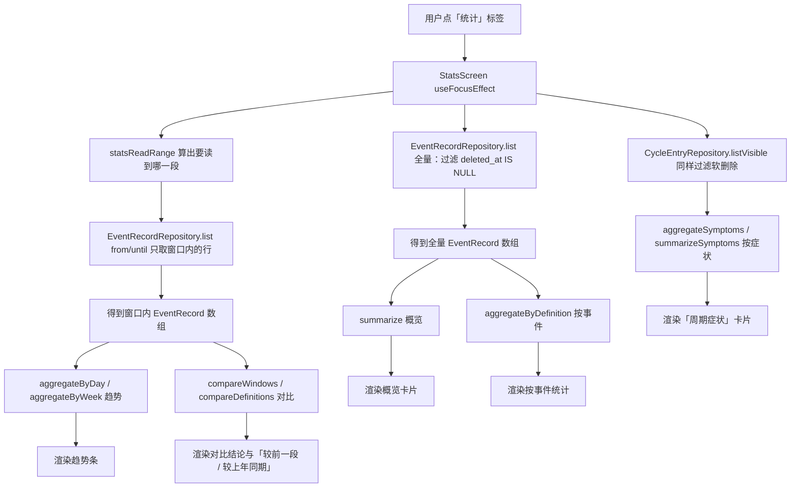

# 12 统计与时间轴虚拟化：从事实数据算、不落汇总表

> ⚠️ **v6 起「单位」变「属性」**：`DefinitionTotal.unit` → `attributeText`，
> 聚合同样是「所有记录的属性列表完全一致才给属性文本，否则 `undefined`」，
> 规则不变、只是把「单位」换成了可多条的「属性」。本文里 `unit` / 「单位不一致」的说法请按此理解；
> 走读见 [08 事件定义](./08-event-definitions.md) 第 9 节。

> 对应功能：**第二阶段（统计）——时间轴与统计**。
> 本文以仓库真实代码为依据。凡是「没做过」的验证，会明确写出来。

## 1. 本次完成什么

到目前为止，用户能记录事实、能补录与撤销、能记录周期，但**看到的只有一条条记录**，
没有一个「汇总视图」。这一项补上统计，并把时间轴为数据变大做准备：

| 能力 | 说明 |
| --- | --- |
| 统计标签页 | 底部标签新增「统计」，含概览 / 趋势 / 按事件统计三块 |
| 概览 | 记录总数、涉及多少个事件、覆盖的最早~最晚一天 |
| 趋势 | 先选「看什么」（活跃事件数 / 全部 / 某个事件），再按**天**（最近 14 天）或**周**（最近 8 周）画条数，空白桶保留 |
| 按事件统计 | 每个事件的记录条数与取值合计，按条数排序 |
| 对比（环比 / 同比） | 与「紧挨着的前一段」或「上年同期（52 周前）」比条数，给出差值与变化率 |
| 只算事实数据 | 统计在打开页面时从记录实时聚合，**不落汇总表**；软删除的记录不计入 |
| 时间轴虚拟化 | 从 `ScrollView` + `map` 换成 `FlatList`，为记录变多做准备 |

数据库 schema **没有变化，仍为 v4**：统计不新建表、不加列，纯从 `event_records` 现算。

**本次明确不做**：导入导出、事件记录的永久删除入口、周期日历月视图（后来做完，见
[11 周期](./11-cycle-tracking.md) 4.10 节）、按症状统计（后来做完，见本文第 3.12、4.8 节）。

**后来补的增强**（本文档已同步，见第 3.9、4.6 节）：

- 加了**环比 / 同比对比**：`recentComparisonWindows` 算出「本期」与「对照期」两个窗口，
  `compareWindows` / `compareDefinitions` 给出差值与变化率。
- 明确了一条纪律：**对照期没有记录时不编造百分比**（除数为 0，变化率返回 `undefined`）。
- 统计页多了「**周期症状**」卡片（第 3.12、4.8 节）：从周期内记录的 `symptoms` 汇总，
  与事件记录是两套事实、两个纯函数聚合器，空状态也因此改判。
- **把时间范围下推给 SQL**（第 3.13 节）：趋势与对比只读窗口内的记录（`list({ from, until })`
  + `statsReadRange`），累计口径的概览与按事件统计仍读全量；聚合规则**没有**搬进 SQL。
- **趋势改成「先选看什么，再画」**（第 3.14 节）：原来把所有事件的条数混成一个数，用户看不懂；
  现在趋势卡片带一行选择器（活跃事件数 / 全部 / 每个事件），默认看「本期记录最多的那个事件」。
  为此 `PeriodTotal` 多了 `definitionCount`（该桶里出现过几个不同事件），并补了 `recordsOfDefinition`
  与文案 `describeActiveComparison`。

## 2. 改了哪些文件

| 文件 | 角色 | 本次新增/修改 |
| --- | --- | --- |
| `src/features/stats/aggregate.ts` | 统计聚合（纯函数） | **新增**：`aggregateByDefinition` / `aggregateByDay` / `aggregateByWeek` / `summarize`；后来补上 `recentComparisonWindows` / `summarizeWindow` / `compareWindows` / `compareDefinitions`，以及窗口长度的唯一来源 `TREND_RANGES` 与「至少要读到哪一段」的 `statsReadRange`（3.13）；再后来给 `PeriodTotal` 补 `definitionCount`、新增 `recordsOfDefinition`（3.14） |
| `src/features/stats/symptoms.ts` | 症状统计（纯函数） | **后来新增**：`aggregateSymptoms` / `summarizeSymptoms`（输入是周期记录，不是事件记录） |
| `src/features/stats/labels.ts` | 展示文案（纯函数） | **后来新增**：对比的说法（`describeComparison` / `describeDefinitionChange` / `formatDelta` / `formatRate`）与症状说法（`formatSymptomRatio` / `describeSymptomSummary` / `describeSymptomTotal`）；再后来补「活跃事件数」的对比说法 `describeActiveComparison`（3.14） |
| `src/features/cycles/SymptomStatsCard.tsx` | 通用卡片 | **后来新增**：症状统计卡片（定义详情页与统计页共用；放 `features/cycles` 是因为数据是周期记录） |
| `src/repositories/eventRecordRepository.ts` | 仓储 | **后来修改**：`list` 支持 `from` / `until`，把时间范围下推给 SQL（3.13） |
| `src/features/stats/__tests__/symptoms-test.ts` | 测试 | **后来新增**：9 个症状统计用例 |
| `src/features/stats/__tests__/aggregate-test.ts` | 测试 | **新增**：14 个用例；后来补 15 个窗口对比用例、4 个 `statsReadRange` 用例与 1 个下推一致性用例；再后来补 `definitionCount` 与 `recordsOfDefinition` 用例 |
| `src/app/(tabs)/stats.tsx` | 页面 | **新增**：统计标签页；后来改为两段读取（全量给累计卡片、`from`/`until` 给趋势与对比），并把一次加载的 `now` 贯穿到底（4.4）；再后来趋势加「先选看什么」的选择器（3.14） |
| `src/app/(tabs)/_layout.tsx` | 导航 | 新增「统计」标签（时间轴 / 统计 / 事件 / 周期 / 设置） |
| `src/components/ListRow.tsx` | 通用 UI | 新增可选 `divider`（默认显示底部分隔线） |
| `src/components/Card.tsx` | 通用 UI | 后来新增可选 `right`（标题右上角操作区，够折叠开关用；见 4.4） |
| `src/features/records/RecordRow.tsx` | 功能组件 | 透传 `divider` |
| `src/app/(tabs)/index.tsx` | 页面（时间轴） | `ScrollView` + `map` → `FlatList`，每行单独成卡 |

> 为什么统计聚合放在 `src/features/` 而不是 `src/domain/`：它要用**设备本地时区**决定
> 「这条记录算哪一天」，而 `src/domain/dates.ts` 的约定是「一律按 UTC、不沾时区」
> （见 `11-cycle-tracking.md` 3.1）。本地时间换算属于界面侧，仓库里统一放在
> `src/features/common/datetime.ts`，所以统计聚合也留在 features 层。

## 3. 相关技术概念

### 3.1 统计从事实数据算，而不是维护汇总表

**是什么**：需要「今天喝了 5 次」时，直接对记录表做聚合，而不是另外存一张
`daily_summary(day, count)` 表。

**为什么本项目需要**：领域规则第 7 条就是「统计从事实数据计算，不落冗余汇总表」。
一旦引入汇总表，就有两份真相：记录删了/撤销了/补录了，汇总表必须同步更新；
漏了任何一条路径，数字就对不上，而且用户无法发现。

**用在哪**：`aggregate.ts` 只接收 `EventRecord[]`，不读也不写数据库。

**不用会怎样**：软删除、撤销、补录这些操作都得额外维护汇总表，复杂度与出错面成倍增加；
反过来，从事实算永远和明细一致。

### 3.2 只统计「可见」记录（软删除过滤）

**是什么**：`deleted_at` 不为空的行视为已删除，不参与统计。

**为什么**：记录删除是**软删除**（可撤销），如果统计把它们算进去，用户删了一条，
数字却不掉，会以为统计坏了。

**用在哪**：仓储 `list()` 默认带 `WHERE deleted_at IS NULL`；聚合里再用
`isVisibleRecord` 兜底（`visibleRecords()`）。

**不用会怎样**：调用方一旦传进 `includeDeleted: true` 的数据，就会重复计数。
兜底一层「防御式过滤」，让纯函数不依赖调用方传得对不对。

### 3.3 「一天」按本地时区，不按 UTC

**是什么**：存储的时间是 UTC ISO-8601（`occurredAt`），但「哪一天」要按**设备本地时区**判断。

**为什么**：用户在本地时间 10-19 晚上 10 点记录，转成 UTC 可能已经是 10-20。
如果按 UTC 分天，这条记录会被算到「明天」，用户看到会觉得日期错位。

**用在哪**：聚合用 `features/common/datetime` 的 `localDateText(new Date(ms))`。
这与 `domain/dates.ts`（一律 UTC 的纯日历运算）分工不同。

**不用会怎样**：时区非 UTC 的用户，晚间/凌晨的记录会落到相邻的一天，日统计错位。

### 3.4 纯函数聚合：可单测、不碰数据库

**是什么**：`aggregate.ts` 里全是「输入数组 → 输出结果」的纯函数，没有 `async`、没有 SQL。

**为什么**：统计逻辑（分桶、求和、单位判定）最容易出错，也最值得测。
纯函数不需要数据库、不需要 mock，直接喂数据断言结果即可，测试又快又稳。

**用在哪**：`aggregateByDefinition` / `aggregateByDay` / `aggregateByWeek` / `summarize`。

**不用会怎样**：把聚合写进 SQL 或页面里，就没法脱离环境单测，规则改动风险高。

### 3.5 不同单位不能相加成一个数

**是什么**：数量型记录允许每条覆盖单位（`1 杯` 与 `500 毫升`）。合计时不能把
`1 + 500 = 501` 当成「501 毫升」展示。

**为什么**：这是真实的数据语义问题——单位不同的量纲相加没有意义，强行给个数字会误导用户。

**用在哪**：`aggregateByDefinition` 里用 `new Set(units).size === 1` 判断「单位是否唯一」，
唯一才给出 `unit`，否则 `unit` 为 `undefined`，界面只显示数值。

**不用会怎样**：用户看到「501」却写着某个单位，是**看似正确、实则错误**的统计。

### 3.6 时间桶：天 / ISO 周（周一起算）

**是什么**：把记录按「某一天」或「某一周」分组。本项目选 **ISO 周**（周一为起点），
桶的日期记成该周的周一。

**为什么**：用户看趋势需要一个「粒度」。周粒度对习惯类记录更能看出规律；
选周一起算而不是周日，是因为与「工作日」直觉一致，也便于后续扩展。

**用在哪**：`localWeekStart()`（`(date.getDay() + 6) % 7` 天回退到周一）。

**不用会怎样**：若不做时间桶，只能一条条看记录，看不出趋势；周起点不统一还会让
跨周边界的记录归属含糊。

### 3.7 浮点误差：`0.1 + 0.2 !== 0.3`

**是什么**：JavaScript 的浮点数相加会出现 `0.30000000000000004` 这种结果。

**为什么**：数量型记录可以是小数，合计时必须把这种噪声压掉，否则界面会出现
一长串尾巴。

**用在哪**：`roundValue()`——`Math.round(value * 10 ** 4) / 10 ** 4`，合计后统一保留 4 位。

**不用会怎样**：`0.1 + 0.2` 会显示成 `0.30000000000000004`。

### 3.8 `FlatList` 虚拟化：为什么、怎么组织

**是什么**：`FlatList` 只渲染屏幕上可见的那几行（虚拟化），`ScrollView` + `map`
会把所有行一次性渲染出来。

**为什么本项目需要**：时间轴现在 `LIMIT 100`，用 `ScrollView` 还行；数据变大后，
一次性渲染上百个复杂行会卡顿。`FlatList` 是 React Native 的标准解法。

**用在哪**：`src/app/(tabs)/index.tsx`。头部提示/撤销条放进 `ListHeaderComponent`，
空状态放进 `ListEmptyComponent`，加载中显示转圈。

**不用会怎样**：记录一多，首屏渲染变慢、滚动掉帧。

> `FlatList` 的行不能直接套一个 `Card`（卡片是「一个容器装多行」）。
> 所以时间轴把**每条记录单独成卡**：外层 `View` 提供卡片背景与圆角，
> 并通过 `ListRow` 新增的 `divider={false}` 去掉行底部的分隔线，避免卡里多出一条线。

### 3.9 环比 / 同比：把「窗口」算清楚，比算差值重要

**是什么**：对比需要两个**闭区间窗口**。本项目不写死月份，而是按「趋势图现在用的粒度」
现算两个窗口（`recentComparisonWindows`）：

| 说法 | `basis` | 对照期是哪一段 |
| --- | --- | --- |
| 较前一段（环比） | `previous` | 紧挨着本期的、**同样长度**的前一段 |
| 较上年同期（同比） | `lastYear` | 本期整体往前挪 **52 周（364 天）** |

**为什么是 364 天而不是 365/366**：364 = 52 × 7，挪过去之后**星期几完全相同**。
按天看时不会出现「今年这 14 天是周一到周日、去年那 14 天是周三到周二」的错位；
按周看时也正好落在 52 周之前。代价是它**不是自然年**（不是「去年 10 月」），
所以界面写的是「上年同期」而不是「去年同期」，并把两个窗口的日期范围显示出来。

**为什么不让用户选月份**：选月份要做自然月算术（月末、闰年），而本项目已有的是
「按天 / 按周」两套粒度与 ISO 周（3.6）。复用同一套口径，**对比结果与趋势图的数字必然对得上**，
这是比「支持任意区间」更值钱的属性。

**不用会怎样**：窗口算错（比如环比写成「上一个自然月」而趋势是「最近 14 天」），
界面就会出现「图中 12 条、对比说 20 条」这种自相矛盾。

### 3.10 敢说「算不出来」：对照期为 0 时不给百分比

**是什么**：`compareWindows` 计算 `recordCountRate = (本期 − 对照) / 对照`；
当 `对照 === 0` 时返回 `undefined`，界面由 `describeComparison` 分三种情况说话：

| 情况 | 文案 |
| --- | --- |
| 对照期有记录 | 「本期 12 条，较前一段 +3 条（+33%）」 |
| 对照期 0 条、本期有 | 「本期 5 条，前一段没有记录，无法算变化率」 |
| 两边都 0 | 「本期与前一段都没有记录」 |

**为什么**：除数为 0。数学上这是「无穷大」，产品上则完全取决于怎么编：
把 0 → 5 说成「+100%」是伪造（真实增幅是无穷倍），说成「+5 条」更准确但会被当成「涨了 5 倍」。
**最不容易误导的做法是明说算不出来**，只给能确定的条数。这与第 3.5 节「单位不一致就不给合计单位」
是同一条纪律：**统计要敢于不给数字**。

**不用会怎样**：新用户的第一次对比必然命中「对照期 0 条」，界面上会出现一个漂亮的百分比，
而它是无意义的——用户会记住一个错误印象。

### 3.11 只比条数，不比取值合计

**是什么**：对比只算 `recordCount`，不算 `totalValue`。

**为什么**：取值合计**没有跨事件的单位**（3.5）。「上周：3 杯 + 1 公里」与「本周：2 杯 + 5 公里」
在数值上不可比，连相加都不该做。条数则是无量纲的，可以跨事件比较。

**用在哪**：`ComparisonSummary` 里只有条数差与条数变化率；`DefinitionChange` 也只有 `currentCount` / `previousCount`。

**不用会怎样**：出现「比上周多 500」这种把毫升和公里加在一起的说法。

### 3.12 周期里的症状是另一套事实，但统计口径要一致

**是什么**：统计页除了事件记录，还汇总**周期内记录**里的症状（`aggregateSymptoms`）：
每个症状出现过多少天、占「记了症状的记录数」的比例。

**为什么另写一份而不是塞进 `aggregate.ts`**：输入根本不同——事件记录带**发生时刻**与取值，
要分桶、要算单位、要做窗口对比；周期记录只有**哪一天** + 一个症状文本数组，
既没有取值也没有单位。硬凑一个接口只会让两边都变复杂。相同的是**纪律**：

1. **只算可见记录**（软删除的不算，`isVisibleEntry` 兜底）——与 3.2 同一条；
2. **敢说算不出来**：一条症状都没记时，比例返回 `undefined`，界面不显示百分比——与 3.10 同一条；
3. **不替使用者做归一**：`头痛` 与 `头疼` 是两种症状，没有词典就不合并，
   界面上如实列出，改名 / 合并交给使用者自己决定。

**用在哪**：周期定义详情页的「症状统计」卡片、统计页的「周期症状」卡片（同一份纯函数 + 同一个展示组件）。

**不用会怎样**：要么把症状硬塞进「事件」模型（一天一条、没有时刻，模型会变扭），
要么在界面上各算一份（两处口径迟早不一致）。

### 3.13 把「时间范围」下推给 SQL，而不是把「聚合」搬进 SQL

**是什么**：趋势与对比只看窗口内的记录，所以用 `list({ from, until })` 让 SQL 直接把范围外的行
滤掉（走已有的 `idx_event_records_occurred_at`）；「至少要读到哪一天」由纯函数 `statsReadRange`
算出来，界面照它去读。

**为什么值得**：统计页原本**一次读全表**，然后让 5 个纯函数各扫一遍——趋势与对比的那 3 遍
（`aggregateByDay` / `compareWindows` / `compareDefinitions`）其实只看窗口，扫全表纯属浪费。
实测（Node 内置 SQLite、2 万条记录、6 个定义）：

| 环节 | 下推前 | 下推后 |
| --- | --- | --- |
| `list()` 全量读 + 映射 | 43ms | 43ms（概览 / 按事件统计仍需要） |
| `summarize` + `aggregateByDefinition`（累计） | 35ms | 35ms |
| `aggregateByDay` + `compareWindows` + `compareDefinitions`（窗口） | **71ms** | **7ms**（只扫窗口内的 3464 条） |
| 合计 | **163ms** | **89ms** |

**为什么不干脆把聚合也搬进 SQL**：那确实能到 ~18ms，但「取最近一条记录的快照名」「所有记录
单位一致才给单位」「条数相同时按名称排序」这些规则现在都集中在纯函数里、各有单测；搬进
`GROUP BY` 之后，同一套规则要在 SQL 里再写一遍（快照并列怎么取、`unit` 的 `NULL` 与 `''` 怎么算、
时间戳带 `+08:00` 偏移时 `MAX(occurred_at)` 不是最大）。**规则只写一遍**比省这 70ms 重要，
所以本次只下推**范围**，聚合仍留在纯函数里。

**两条刻意的设计**：

1. **边界只求超集**：`statsReadRange` 取四种窗口（按天/按周 × 环比/同比）的并集，再按 UTC 零点
   前后各留一天。边界不需要精确，因为「某个时刻属于哪一天」仍由纯函数按**设备本地时区**判定
   （`localDateText`），多读的行会被过滤掉——这样这里不必关心时区偏移与夏令时。
2. **取并集而不是当前那一种**：读一次就够，切换「按天/按周」「较前一段/较上年同期」只是重新算，
   不必再查库。

```ts
const range = statsReadRange(now);   // { from: '2025-08-31T00:00:00.000Z', until: '2026-10-27T00:00:00.000Z' }
await records.list({ from: range.from, until: range.until });
```

这条假设（范围是超集 ⇒ 数字一模一样）有回归用例压着：同一批跨两年的记录，喂全量与只喂
`statsReadRange` 内的记录，`compareWindows` / `compareDefinitions` / `aggregateByDay` /
`aggregateByWeek` 的结果必须 `toEqual`。

### 3.14 趋势「先选看什么」：把不同事件的条数加成一个数没有意义

**是什么**：趋势卡片多了一行选择器——「活跃事件数」/「全部」/ 每个近期出现过的事件。
选中谁就画谁的条数（选「活跃事件数」时画的是不同事件个数）。

**为什么**：原来的趋势只有一种口径，就是把**所有事件混在一起数条数**：
「喝水 3 条 + 跑步 2 条 + 吃药 1 条」画成一根 6 的条。这个 6 既不是某个事件的情况，
也说不清在衡量什么——不同事件的记录**不可相加**（同 3.5「不同单位不能相加成一个数」，
只是那里是同一事件内的不同属性，这里是不同事件之间）。用户看到的第一反应是「我不懂它在表达什么」。

**怎么改**，两种口径都保留，让用户自己选：

- **某个事件**：`recordsOfDefinition(recentRecords, id)` 先过滤，再交给原来的
  `aggregateByDay` / `aggregateByWeek`。这就是用户说的「过去一周喝水事件每天有多少」。
- **活跃事件数**：`PeriodTotal.definitionCount`——该桶里出现过几个**不同**事件。
  「今天记了 2 个事件」是一个说得清、跨事件也成立的指标，衡量的是**覆盖 / 坚持度**
  （「一共定义了 X 个事件，每天完成了几个」）。同一天同一事件记多条只算一个。
- **全部**：保留原来的总条数，但它现在只是一个**显式选项**，不再是唯一口径。

为此 `Bucket` 里多存一个 `definitionIds: Set<string>`（去重靠它），`aggregateByDay` /
`aggregateByWeek` 的一切分桶规则**没变**——只多了统计不同事件数这一步，空桶仍返回
`definitionCount: 0`。

**默认看谁**：本期记录最多的那个事件（`compareDefinitions` 已按本期条数排序）。
本期没有记录就退到近来记录最多的事件，再没有才退到「活跃事件数」。默认值只在用户
手动选过之前生效，选过之后切「按天/按周」不会把选择抢走。

**对比文案也跟着换口径**：选事件时用 `describeDefinitionChange`（该事件本期 vs 对照期），
选「全部」时用 `describeComparison`（条数），选「活跃事件数」时用新增的
`describeActiveComparison`（本期/对照期各有几个事件）——单位是「个事件」，不能套用「条」的说法。

## 4. 关键代码逐段解释

### 4.1 可见性与分桶（`src/features/stats/aggregate.ts`）

```ts
function visibleRecords(records: readonly EventRecord[]): EventRecord[] {
  return records.filter(isVisibleRecord);
}

function bucketBy(
  records: readonly EventRecord[],
  keyOf: (occurredAtMs: number) => IsoDate,
): Map<IsoDate, Bucket> {
  const buckets = new Map<IsoDate, Bucket>();
  for (const record of visibleRecords(records)) {
    const ms = occurredAtMs(record);
    if (ms === null) {
      continue; // 无法解析的时间跳过，不让整屏崩掉
    }
    const key = keyOf(ms);
    const bucket = buckets.get(key);
    if (bucket) {
      bucket.recordCount += 1;
      bucket.totalValue += record.value;
      bucket.definitionIds.add(record.definitionId); // 去重后就是「活跃事件数」
    } else {
      buckets.set(key, {
        recordCount: 1,
        totalValue: record.value,
        definitionIds: new Set([record.definitionId]),
      });
    }
  }
  return buckets;
}
```

`bucketBy` 把「怎么分桶」抽成参数 `keyOf`：按天传本地日期，按周传周一。
两个聚合函数因此共用同一段累加逻辑。

### 4.2 按定义聚合（`aggregateByDefinition`）

```ts
const units = new Set(bucket.map((record) => record.unit ?? ''));
const unit = units.size === 1 ? latest.unit : undefined;
```

- 展示名与单位取「**最近一条记录**的快照」。因为定义改名不改历史，同一个 `definitionId`
  的历史记录可能有不同的快照名，用最新的名字代表它。
- `units.size === 1` 才给单位：单位不一致（或「有单位/无单位」混用）时不做合并计量。

返回前按条数从多到少排序，界面直接顺序渲染：

```ts
return totals.sort(
  (a, b) =>
    b.recordCount - a.recordCount ||
    a.name.localeCompare(b.name) ||
    a.definitionId.localeCompare(b.definitionId),
);
```

### 4.3 按天 / 按周（`aggregateByDay` / `aggregateByWeek`）

```ts
export function aggregateByDay(records, rangeDays, now = new Date().toISOString()) {
  assertRange(rangeDays);
  const reference = parseReference(now);
  const buckets = bucketBy(records, (ms) => localDateText(new Date(ms)));

  const totals: PeriodTotal[] = [];
  for (let offset = rangeDays - 1; offset >= 0; offset -= 1) {
    const date = localDateText(shiftLocalDays(reference, -offset));
    totals.push(toPeriodTotal(date, buckets.get(date))); // 空桶也 push，条数为 0
  }
  return totals;
}
```

要点：

- **空桶保留**：没有记录的一天也返回 `recordCount: 0`，界面才能画出连续趋势。
- **从早到晚**：`offset` 从大到小，输出按时间升序。
- **每个桶多带一个 `definitionCount`**：该桶里出现过几个不同事件（去重靠 `Bucket.definitionIds`），
  给「活跃事件数」口径用（3.14）；空桶为 0。
- 按周只多一步：`bucketBy` 的 key 变成 `localWeekStart(...)`，遍历用
  `addDays(currentWeekStart, -7 * offset)`（`addDays` 是 `domain/dates.ts` 的纯日历加法）。
- `assertRange` / `parseReference` 对非法输入抛 `ValidationError`，而不是算出垃圾。

### 4.4 界面：统计标签页（`src/app/(tabs)/stats.tsx`）

页面自己不做聚合，只负责「读数据 → 调纯函数 → 渲染」。数据分**两段**读：累计口径要全量，
窗口口径按 `statsReadRange` 下推给 SQL（见 3.13）：

```tsx
const loadedAt = new Date().toISOString();          // 读库、窗口、分桶共用同一个 now
const range = statsReadRange(loadedAt);
const recordRepository = new EventRecordRepository(db);
Promise.all([
  recordRepository.list(),                          // 全量：概览 / 按事件统计（累计口径）
  recordRepository.list({ from: range.from, until: range.until }), // 窗口：趋势 / 对比
  new CycleEntryRepository(db).listVisible(),
]);
```

```tsx
const summary = useMemo(() => summarize(records), [records]);
const definitions = useMemo(() => aggregateByDefinition(records), [records]);

// 对比窗口与趋势窗口共用同一个 TREND_RANGES，所以「趋势」与「对比」说的是同一段时间
const windows = useMemo(
  () => recentComparisonWindows(mode, TREND_RANGES[mode], basis, now),
  [mode, basis, now],
);
const comparison = useMemo(() => compareWindows(recentRecords, windows), [recentRecords, windows]);

// 趋势选择器：predicate 决定「看谁」，`trendSelection` 未手动选过时用默认值（3.14）
const recentDefinitions = useMemo(() => aggregateByDefinition(recentRecords), [recentRecords]);
const defaultTrend = useMemo(() => {
  const top = definitionChanges.find((change) => change.currentCount > 0) ?? recentDefinitions[0];
  return top ? { kind: 'definition', definitionId: top.definitionId } : { kind: 'active' };
}, [definitionChanges, recentDefinitions]);
const trendSelection = trend ?? defaultTrend;

const trendPeriods = useMemo(() => {
  const source =
    trendSelection.kind === 'definition'
      ? recordsOfDefinition(recentRecords, trendSelection.definitionId)
      : recentRecords;
  return mode === 'day'
    ? aggregateByDay(source, TREND_RANGES.day, now)
    : aggregateByWeek(source, TREND_RANGES.week, now);
}, [recentRecords, trendSelection, mode, now]);
```

把 `now` 一起存进 state 是为了**一个 `now` 贯穿一次加载**：否则读库时算的是「最近 14 天」、
分桶时可能已经跨零点算成 15 天，出现「读了却没摆出来」的桶。

趋势条用 `flex` 表达比例，避免依赖字符串百分比宽度。`valueOf` 让同一段渲染既能画条数、
也能画活跃事件数（3.14）：

```tsx
<View style={styles.barTrack}>
  <View style={[styles.barFill, { flex: valueOf(period) }]} />
  <View style={{ flex: max - valueOf(period) }} />
</View>
```

值为 0 时前一段 `flex: 0`，长度为 0；最长的一段占满轨道。

**低频选择折进右上角**：「按天/按周」与「较前一段/较上年同期」用得少，平铺在卡片里
占地方。现在它们收进标题右上角的 `Pressable`，折叠时只显示当前选择（如「按天 · 较前一段」），
点「展开」才出现两行 Chip。为此给通用 `Card` 加了可选的 `right`（与标题同一行右对齐）——
折叠态也会显示当前口径，不必展开就知道在看什么。总开关是页面里的 `optionsOpen` 一个布尔。

### 4.5 时间轴换个容器（`src/app/(tabs)/index.tsx`）

```tsx
<FlatList
  data={records}
  keyExtractor={(item) => item.id}
  renderItem={({ item }) => (
    <View style={styles.itemCard}>
      <RecordRow record={item} divider={false} onDelete={() => remove(item)} deleting={deletingId === item.id} />
    </View>
  )}
  ListHeaderComponent={/* 错误提示 / 撤销条 / 条数说明 */}
  ListEmptyComponent={loading ? <ActivityIndicator /> : <EmptyState ... />}
  contentContainerStyle={styles.content}
/>
```

读取、软删除、撤销这些逻辑**一行没改**，只换了承载列表的组件与外观。

### 4.6 窗口与对比（`recentComparisonWindows` / `compareWindows`）

```ts
export function recentComparisonWindows(unit, length, basis = 'previous', now = new Date().toISOString()) {
  assertRange(length);
  const reference = parseReference(now);

  let current: StatsWindow;
  if (unit === 'day') {
    const endDate = localDateText(reference);
    current = { startDate: addDays(endDate, -(length - 1)), endDate };
  } else {
    const currentWeekStart = localWeekStart(reference);
    current = { startDate: addDays(currentWeekStart, -7 * (length - 1)), endDate: addDays(currentWeekStart, 6) };
  }

  const span = daysBetween(current.startDate, current.endDate) + 1;
  const shift = basis === 'lastYear' ? YEAR_ALIGN_DAYS : span;   // 364 天 = 52 周
  return { current, previous: { startDate: addDays(current.startDate, -shift), endDate: addDays(current.endDate, -shift) } };
}
```

三个细节：

- **窗口长度与趋势图共用同一个 `RANGES`**，所以「趋势」里的 14 根柱子和对比说的是同一段时间。
- 按周时本期的 `endDate` 是**今天所在周的周日**，可能还没到——与趋势图的「本周」口径一致
  （那一周的桶本来也只统计已发生的记录）。
- `addDays` / `daysBetween` 来自 `domain/dates.ts`（纯日历、不沾时区），
  而窗口的端点由 `localDateText` 按**设备本地时区**算出——两者分工同 3.3。

对比本身很短：

```ts
export function compareWindows(records, windows): ComparisonSummary {
  const current = summarizeWindow(records, windows.current);
  const previous = summarizeWindow(records, windows.previous);
  const recordCountDelta = current.recordCount - previous.recordCount;

  return {
    current,
    previous,
    recordCountDelta,
    recordCountRate: previous.recordCount === 0 ? undefined : roundValue(recordCountDelta / previous.recordCount),
    definitionDelta: current.definitionCount - previous.definitionCount,
  };
}
```

`summarizeWindow` 与趋势分桶共用同一套可见性/本地日期判断（`visibleRecords` + `occurredAtMs` +
`localDateText`，闭区间用 `YYYY-MM-DD` 的字典序比较即时间序）。

### 4.7 逐个事件的对比（`compareDefinitions`）

```ts
const each = (window: StatsWindow, side: 'current' | 'previous') => { … };
each(windows.current, 'current');
each(windows.previous, 'previous');
```

- 两个窗口**互不重叠**，所以同一条记录只会落进一侧，计数不会重复；
- `latest` 取两个窗口里最新的那一条，用它（最新的）快照名与类型代表这个事件；
- 排序为「本期条数降序 → 变化幅度（`|delta|`）降序 → 名称」：先看现在最多的，再看动得最明显的；
- 两个窗口都没出现过的定义**不进结果**，界面据此不给它加对比文案。

界面把它转成 `Map<definitionId, DefinitionChange>`，在「按事件统计」每行查一次：

```tsx
const change = changeById.get(total.definitionId);
const subtitle = [`${eventKindLabel(total.kind)} · ${total.recordCount} 条`, changeText]
  .filter((part): part is string => Boolean(part))
  .join(' · ');
```

注意此处两个数字的**口径不同**：`total.recordCount` 是**累计**（该事件有史以来），
而行内的对比是**窗口内**的。卡片副标题里写明了这一点
（「累计 N 个事件，按条数排序；行内变化是上面窗口的对比」）。

### 4.8 按症状统计（`src/features/stats/symptoms.ts`）

```ts
export function aggregateSymptoms(entries: readonly CycleEntry[]): SymptomTotal[] {
  const counts = new Map<string, number>();
  let withSymptomsCount = 0;

  for (const entry of entries) {
    if (!isVisibleEntry(entry)) continue;          // 软删除不算
    const unique = uniqueSymptoms(entry);          // 去空、去首尾空白、当天去重
    if (unique.length === 0) continue;
    withSymptomsCount += 1;                        // 只给「记了症状的记录」进分母
    for (const symptom of unique) counts.set(symptom, (counts.get(symptom) ?? 0) + 1);
  }

  return [...counts.entries()]
    .map(([symptom, dayCount]) => ({
      symptom,
      dayCount,
      ratio: withSymptomsCount === 0 ? undefined : dayCount / withSymptomsCount,
    }))
    .sort((a, b) => b.dayCount - a.dayCount || a.symptom.localeCompare(b.symptom));
}
```

三点值得留意：

- **分母是 `withSymptomsCount`，不是 `entries.length`**。把「没记症状的天」算进分母，
  「头痛 3 天」会被稀释成看起来很罕见——那句话的意思应该是「在这 3 天里有头痛」。
- **一条都没记时 `ratio` 是 `undefined`**，不是 0；文案函数 `formatSymptomRatio` 据此返回 `undefined`，
  界面就不显示百分比（与 3.10 同一条纪律）。
- **排序是「条数降序 → 名称」**：`localeCompare` 让同样的输入产生同样的顺序，便于断言与阅读。

`summarizeSymptoms` 与它共用同一套「可见 + 当天去重」的口径，给出
`entryCount` / `withSymptomsCount` / `distinctSymptoms`，界面上是卡片副标题那一行
（「5 条记录，其中 3 条记了症状，共 2 种」）——**先讲底数，再讲比例**，否则百分比会被误读成
「占全部记录」。

数据从哪来：`CycleEntryRepository.listVisible(definitionId?)`——
不传定义是全部（统计页），传定义是这个周期定义下的记录（定义详情页）。
**导出用的 `listAll` 仍带软删除**，两者在仓储注释里写明差别。

## 5. 一次完整数据流：记录几次后打开统计



关键点：**没有任何写库**。仓储只做「过滤软删除 + 按范围滤行 + 读出事实记录」，
聚合与对比全在纯函数里（对比窗口由 `recentComparisonWindows` 现算，长度与趋势图共用同一个
`TREND_RANGES`；「至少要读到哪一段」由 `statsReadRange` 从同一份窗口定义算出来，见 3.13）。
事件记录与周期记录是**两套事实、两个聚合器**：前者按时刻分桶、算单位与窗口对比，
后者只有「哪一天」+ 症状数组，汇总成「哪些症状常见」。
两者共用同一条纪律：只算可见记录、算不出来就不给数字。

## 6. 如何验证

### 关键命令

```bash
npm test                              # 全部测试
npm test -- src/features/stats        # 只跑统计聚合
npm run typecheck
npm run lint
npm run format:check
npx expo export --platform ios        # 打包验证（不需要模拟器）
```

### 真实跑过的结果

| 命令 | 结果 |
| --- | --- |
| `npm run typecheck` | 通过 |
| `npm run lint` | 通过（0 error / 0 warning） |
| `npm test` | **24 个套件 / 388 个用例通过**（统计相关含后来补的 28 个对比用例、9 个症状用例、7 个窗口下推用例） |
| `npm run format:check` | 通过 |
| `npx expo export --platform ios` | 通过（js bundle 3.1MB） |

### 测试覆盖了什么

- **按定义聚合**：条数与取值合计；展示名取最近快照；单位不一致时不给单位但仍合计；
  排除软删除；按条数排序；`0.1 + 0.2` 记成 `0.3`。
- **按天**：按本地日历日分桶、保留空天、从早到晚；范围外不进桶；排除软删除；
  跳过无法解析的时间；范围非正整数抛 `ValidationError`。
- **按周**：ISO 周（周一为起点），桶日期是周一。
- **概览**：记录总数、事件数、日期范围；排除软删除；无记录时不给日期范围。
- **对比窗口**：按天/按周的环比窗口；同比往前挪 52 周后**星期几相同**（用 `getDay()` 断言）；
  范围非正整数与非法参考时间都抛 `ValidationError`。
- **窗口汇总**：只算闭区间内的可见记录（区间外的、软删除的都不算）。
- **整体对比**：条数差与变化率；对照期为 0 时变化率为 `undefined`；
  负增长（-0.6667）与浮点四舍五入；两个窗口之外的记录不参与。
- **逐事件对比**：本期/对照期条数与差值、名字取窗口内最新快照、排序规则、
  两个窗口都没出现过的定义不进结果、排除软删除。
- **对比文案**（`labels-test.ts`）：`+3` / `-3` / `±0` 与百分比格式；
  三种措辞（有记录给百分比、对照期为空说「无法算变化率」、两边都空明说）；
  以及症状文案 `33%` / `1 天 · 100%` 与「先讲底数」的那一行。
- **按症状**（`symptoms-test.ts`）：条数从多到少、同条数按名称排；**比例分母是「记了症状的记录数」**
  （没记症状的天不进分母）；同一天重复写同一个症状只算一次；去空去空白；
  不做同义归一（`头痛` / `头疼` 分开）；排除软删除；没有任何症状时返回空数组而不是除以 0；
  `summarizeSymptoms` 的 `entryCount` / `withSymptomsCount` / `distinctSymptoms`。
- **窗口下推**（`aggregate-test.ts`）：`statsReadRange` 覆盖四种窗口的并集（断言具体边界）、
  对每种窗口都满足「不早于窗口起点、不晚于窗口终点」、大约读到一年出头；
  以及一致性回归——同一批跨两年的记录，喂全量与只喂范围之内的记录，趋势与对比的结果必须相同。
  仓储那边另外覆盖 `list({ from, until })` 的半开区间语义、只给一侧、与 `includeDeleted` /
  `definitionId` / `limit` 叠加、非法时间戳抛错。

> 测试用**本地时间字段**构造 `Date` 再转 ISO（见 `makeRecord` 的 `at` 参数），
> 因此无论测试机在哪个时区，断言里的日期都成立——测试不依赖运行环境时区。

### 没覆盖什么（诚实记录）

- **没有组件/界面测试**：统计页、趋势条、时间轴 `FlatList` 的渲染没有自动化用例。
  对比新增的两个 `Chip`（较前一段 / 较上年同期）与那句对比文案也**没有界面测试**——
  文案逻辑由 `labels-test.ts` 覆盖，但「点一下真的会切」只能靠人看。
- **没有在模拟器/真机上手动走过「统计」这项功能本身**：与前几项一致，只做静态检查、单元测试与打包。
  （后来用 Maestro 补了「对比 Chip 切换」`06` 与「月视图保存后症状统计更新」`08`，
  见 [15 端到端](./15-maestro-e2e.md)。）
- **症状统计没有时间窗口**：`aggregateSymptoms` 只吃「一组记录」，界面给的是全量
  （定义页按定义、统计页按全部），没有「最近 N 段 / 某个区间」的口径。
- **压测只在测试环境做过一次**：3.13 节那张表是 Node 内置 SQLite + 2 万条合成记录的实测，
  不是真机、也没有用真实使用数据；`FlatList` 的收益仍是原理上的（时间轴只取 100 条，
  没到需要压测的量级）。
- **「累计」那一半没有下推**：概览与按事件统计仍要读全量，见 3.13 与 `HANDOFF` 技术债。

## 7. 常见问题与排查

### 问题：删了一条记录，统计数字没变

**原因**：统计页在 `useFocusEffect` 里重新读；如果你停在统计页不切走，它不会自动刷新。
**排查**：切到别的标签再回来，会重新聚合。

### 问题：晚上记的数据算到了第二天

**基本不会**：分天用设备本地时区（`localDateText`）。若确实错位，检查记录页补录时
填的日期，或设备时区是否被改过。

### 问题：按事件统计里某个数量型没有单位

**这不是 bug**：该事件的记录**单位不一致**（例如既有「杯」又有「毫升」），
合并计量没有意义，所以只显示数值（见 3.5）。

### 问题：趋势到底在算什么，看不懂

**设计已改**（见 3.14）：趋势先选「看什么」。默认是「本期记录最多的那个事件」，
卡片副标题会写明「<事件名> · 最近 14 天每天的条数」；想看整体就选「活跃事件数」
（每天有几个不同事件被记录过）或「全部」（所有事件合起来的条数）。
原来只把所有事件混成一个数的做法已不再是唯一口径。

### 问题：趋势里有一整排空的桶

**设计如此**：空白桶保留是为了让趋势连续，`0` 表示那天/那周没有记录。
如果换了事件还是整排是空的，多半是选了一个近期没记录的事件——换回默认或选「活跃事件数」即可。

### 问题：`ValidationError: 统计范围必须是正整数`

**原因**：传给 `aggregateByDay` / `aggregateByWeek`（或 `recentComparisonWindows`）的范围不是正整数。
**排查**：检查调用处的 `RANGES` 常量。

### 问题：对比里显示「前一段没有记录，无法算变化率」

**不是 bug**：对照期确实是 0 条，百分比算不出来（除数为 0），所以只给了本期条数（见 3.10）。
切到「较上年同期」或换「按周」再试，若对照期有记录就会显示差值。

### 问题：同比为什么不是「去年 10 月」

**设计如此**：同比是**往前挪 52 周**，好处是星期几完全对齐（见 3.9）。
界面写的是「上年同期」而不是「去年同期」，并且会把对照窗口的起止日期显示出来——
不靠一个模糊的年月说法。

### 问题：「按周」对比时本周还没过完，岂不是一定偏低

**是**：本周（以及本 14 天窗口里的今天）本来就可能还没走完。所以：

- 对比窗口与趋势图**同长同口径**，数字能对上；
- 界面把「本期 / 对照窗口」的日期范围都显示出来；
- 真要严谨地比「完整的周」，可以切「按周」并只看已结束的那几周。

本项目没有做「按已过天数折算」的预测式对比——那属于外推，不是事实统计（领域规则第 7 条）。

### 问题：某个事件在「按事件统计」里的条数比对比文案里的多

**不是矛盾**：行里的数字是**累计**条数（有史以来），对比文案是**窗口内**的对比（见 4.7）。
卡片副标题已经写明这一点。

### 问题：只用周期、几乎不记事件，统计页会不会是空的

**不会**：空状态只在「事件记录与周期记录**都**为空」时才显示。
只要周期里记过症状，底部就有「周期症状」卡片（只列前 5 种，剩下的在周期定义页看）。

### 问题：「周期症状」里的百分比加起来不是 100%

**正常**：同一天可以记多个症状，所以每个症状各自算「出现在几天」，
百分比之和自然可能超过 100%（一个人一天可以又头痛又乏力）。
分母是「记了症状的记录数」，不是全部周期记录数（见 3.12）。

### 问题：统计页会不会把几万条记录都读进内存

**不会全读**：趋势与对比只读「一年出头」那一段（`statsReadRange`，见 3.13），
累计口径的「概览」与「按事件统计」才需要全量。所以记录攒到几万条时，统计页仍然是
「一次全量 + 一次窗口」，而不是「全量读好几遍」。

### 问题：为什么趋势图只看最近两周 / 两个月

**设计如此**：窗口长度（`TREND_RANGES`）是趋势与对比共用的，切换粒度只换单位、不换长度，
所以「趋势」和「对比」说的永远是同一段时间（3.9、4.7）。要看更早的，去时间轴或事件页翻。

## 8. 学习总结与练习

**掌握的核心概念**

- 「**从事实数据算**」比维护汇总表更不容易出错，代价是查询时要聚合。
- 纯函数 + 显式分桶函数（`keyOf`）能把「按天/按周」的差异收敛成一处。
- 「一天」是**本地时区**概念，与「纯日历日期运算（UTC）」是两回事。
- 统计要**敢于不给数字**：单位不一致就不合并，好过给一个误导性的合计；
  对照期为 0 时就不给百分比，好过给一个编出来的增长率（3.10）。
- 对比的难点在**窗口对齐**，不在减法：把「跟谁比、比多长」定义清楚，
  结果才能和趋势图对得上（3.9）；「52 周」比「一个自然年」更适合按周的粒度。
- 口径要写在界面上：累计与窗口内是两个数字，混在一起用户就会以为统计错了（4.7）。
- **两套事实、两个聚合器、同一条纪律**：周期症状既不该硬塞进事件模型，也不该在界面上各算一份；
  写第二份聚合器时，把「只算可见记录」「算不出来就不给数字」这些纪律**照抄一遍**（3.12）。
- 百分比要先说清分母：`ratio` 的分母与它的说明文字必须一起来，否则「3 天」会被读成「很少见」。
- **先测量，再决定优化哪儿**：统计页看着「全是聚合」，压测之后才知道浪费在「窗口函数扫全表」，
  而不是在聚合本身（3.13）。没有数字的优化，很容易把规则从纯函数搬进 SQL 换个说法叫「加速」。
- **下推范围 ≠ 下推规则**：范围只要**是超集**就安全（多读的行会被纯函数筛掉），
  规则一旦搬进 SQL 就得再写一遍——前者便宜且可逆，后者贵且容易漂。
- `FlatList` 的虚拟化把「容器」和「行」的职责分开，`ListHeaderComponent` /
  `ListEmptyComponent` 负责原本 `ScrollView` 里塞在上下两端的部分。

**建议亲自尝试的小练习**

1. **对比粒度**：同一个事件记几天，统计页在「按天 / 按周」间切换，观察桶的数量与归并。
2. **验证软删除**：在时间轴删一条记录（先别撤销），切到统计页——条数应减少；再撤销，恢复。
3. **验证单位**：给数量型事件记录两次、单位分别填「杯」「毫升」，看统计里单位消失、数值仍在。
4. **验证快照名**：把某事件改名，再记一次；统计里该事件的展示名会用最近一次的快照名。
5. **验证「不给百分比」**：清掉对照期的记录（或把窗口调小到一段没有记录的时间），
   确认对比那句话变成「无法算变化率」，而不是出现 `+100%`。
6. **验证同比对齐**：把「按天」窗口切到「较上年同期」，看对照窗口的起止日期——
   相隔正好 364 天，星期几与本期相同。
7. **验证症状口径**：在周期里记两天（一天记「头痛」，一天记「头痛、乏力」），
   看定义页「症状统计」——`头痛 2 天 · 100%`、`乏力 1 天 · 50%`；再去掉一天的症状再记一次，
   观察分母（「记了症状的记录数」）跟着变，而不是总记录数。
8. **只记周期不记事件**：想象一个只用周期功能的使用者——统计页应仍能看到「周期症状」卡片；
   想清楚为什么空状态要改成「两套数据都为空」才显示（提示：`hasData` / `hasCycleData`）。
9. **自己压一次**：临时造 2 万条记录（一条 `WITH RECURSIVE` 的 INSERT 就够），
   分别给 `list()` 与 `list({ from, until })` 计时，再看 `EXPLAIN QUERY PLAN` 是不是
   `SEARCH ... USING INDEX idx_event_records_occurred_at`——顺手验证 3.13 那张表。

以上练习都不改动已验收代码的结构，可以放心做。