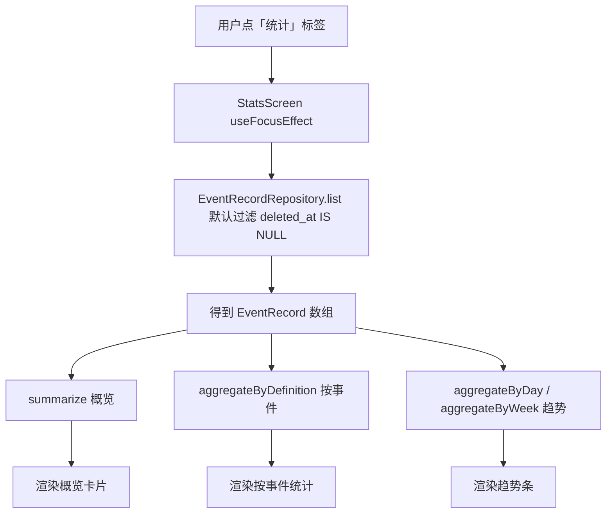

# 12 统计与时间轴虚拟化：从事实数据算、不落汇总表

> 对应功能：**第二阶段（统计）——时间轴与统计**。
> 本文以仓库真实代码为依据。凡是「没做过」的验证，会明确写出来。

## 1. 本次完成什么

到目前为止，用户能记录事实、能补录与撤销、能记录周期，但**看到的只有一条条记录**，
没有一个「汇总视图」。这一项补上统计，并把时间轴为数据变大做准备：

| 能力 | 说明 |
| --- | --- |
| 统计标签页 | 底部标签新增「统计」，含概览 / 趋势 / 按事件统计三块 |
| 概览 | 记录总数、涉及多少个事件、覆盖的最早~最晚一天 |
| 趋势 | 按**天**（最近 14 天）或**周**（最近 8 周）看记录条数，空白桶保留 |
| 按事件统计 | 每个事件的记录条数与取值合计，按条数排序 |
| 只算事实数据 | 统计在打开页面时从记录实时聚合，**不落汇总表**；软删除的记录不计入 |
| 时间轴虚拟化 | 从 `ScrollView` + `map` 换成 `FlatList`，为记录变多做准备 |

数据库 schema **没有变化，仍为 v4**：统计不新建表、不加列，纯从 `event_records` 现算。

**本次明确不做**：导入导出、事件记录的永久删除入口、周期日历月视图、按症状统计。

## 2. 改了哪些文件

| 文件 | 角色 | 本次新增/修改 |
| --- | --- | --- |
| `src/features/stats/aggregate.ts` | 统计聚合（纯函数） | **新增**：`aggregateByDefinition` / `aggregateByDay` / `aggregateByWeek` / `summarize` |
| `src/features/stats/__tests__/aggregate-test.ts` | 测试 | **新增**：14 个用例 |
| `src/app/(tabs)/stats.tsx` | 页面 | **新增**：统计标签页 |
| `src/app/(tabs)/_layout.tsx` | 导航 | 新增「统计」标签（时间轴 / 统计 / 事件 / 周期 / 设置） |
| `src/components/ListRow.tsx` | 通用 UI | 新增可选 `divider`（默认显示底部分隔线） |
| `src/features/records/RecordRow.tsx` | 功能组件 | 透传 `divider` |
| `src/app/(tabs)/index.tsx` | 页面（时间轴） | `ScrollView` + `map` → `FlatList`，每行单独成卡 |

> 为什么统计聚合放在 `src/features/` 而不是 `src/domain/`：它要用**设备本地时区**决定
> 「这条记录算哪一天」，而 `src/domain/dates.ts` 的约定是「一律按 UTC、不沾时区」
> （见 `11-cycle-tracking.md` 3.1）。本地时间换算属于界面侧，仓库里统一放在
> `src/features/common/datetime.ts`，所以统计聚合也留在 features 层。

## 3. 相关技术概念

### 3.1 统计从事实数据算，而不是维护汇总表

**是什么**：需要「今天喝了 5 次」时，直接对记录表做聚合，而不是另外存一张
`daily_summary(day, count)` 表。

**为什么本项目需要**：领域规则第 7 条就是「统计从事实数据计算，不落冗余汇总表」。
一旦引入汇总表，就有两份真相：记录删了/撤销了/补录了，汇总表必须同步更新；
漏了任何一条路径，数字就对不上，而且用户无法发现。

**用在哪**：`aggregate.ts` 只接收 `EventRecord[]`，不读也不写数据库。

**不用会怎样**：软删除、撤销、补录这些操作都得额外维护汇总表，复杂度与出错面成倍增加；
反过来，从事实算永远和明细一致。

### 3.2 只统计「可见」记录（软删除过滤）

**是什么**：`deleted_at` 不为空的行视为已删除，不参与统计。

**为什么**：记录删除是**软删除**（可撤销），如果统计把它们算进去，用户删了一条，
数字却不掉，会以为统计坏了。

**用在哪**：仓储 `list()` 默认带 `WHERE deleted_at IS NULL`；聚合里再用
`isVisibleRecord` 兜底（`visibleRecords()`）。

**不用会怎样**：调用方一旦传进 `includeDeleted: true` 的数据，就会重复计数。
兜底一层「防御式过滤」，让纯函数不依赖调用方传得对不对。

### 3.3 「一天」按本地时区，不按 UTC

**是什么**：存储的时间是 UTC ISO-8601（`occurredAt`），但「哪一天」要按**设备本地时区**判断。

**为什么**：用户在本地时间 10-19 晚上 10 点记录，转成 UTC 可能已经是 10-20。
如果按 UTC 分天，这条记录会被算到「明天」，用户看到会觉得日期错位。

**用在哪**：聚合用 `features/common/datetime` 的 `localDateText(new Date(ms))`。
这与 `domain/dates.ts`（一律 UTC 的纯日历运算）分工不同。

**不用会怎样**：时区非 UTC 的用户，晚间/凌晨的记录会落到相邻的一天，日统计错位。

### 3.4 纯函数聚合：可单测、不碰数据库

**是什么**：`aggregate.ts` 里全是「输入数组 → 输出结果」的纯函数，没有 `async`、没有 SQL。

**为什么**：统计逻辑（分桶、求和、单位判定）最容易出错，也最值得测。
纯函数不需要数据库、不需要 mock，直接喂数据断言结果即可，测试又快又稳。

**用在哪**：`aggregateByDefinition` / `aggregateByDay` / `aggregateByWeek` / `summarize`。

**不用会怎样**：把聚合写进 SQL 或页面里，就没法脱离环境单测，规则改动风险高。

### 3.5 不同单位不能相加成一个数

**是什么**：数量型记录允许每条覆盖单位（`1 杯` 与 `500 毫升`）。合计时不能把
`1 + 500 = 501` 当成「501 毫升」展示。

**为什么**：这是真实的数据语义问题——单位不同的量纲相加没有意义，强行给个数字会误导用户。

**用在哪**：`aggregateByDefinition` 里用 `new Set(units).size === 1` 判断「单位是否唯一」，
唯一才给出 `unit`，否则 `unit` 为 `undefined`，界面只显示数值。

**不用会怎样**：用户看到「501」却写着某个单位，是**看似正确、实则错误**的统计。

### 3.6 时间桶：天 / ISO 周（周一起算）

**是什么**：把记录按「某一天」或「某一周」分组。本项目选 **ISO 周**（周一为起点），
桶的日期记成该周的周一。

**为什么**：用户看趋势需要一个「粒度」。周粒度对习惯类记录更能看出规律；
选周一起算而不是周日，是因为与「工作日」直觉一致，也便于后续扩展。

**用在哪**：`localWeekStart()`（`(date.getDay() + 6) % 7` 天回退到周一）。

**不用会怎样**：若不做时间桶，只能一条条看记录，看不出趋势；周起点不统一还会让
跨周边界的记录归属含糊。

### 3.7 浮点误差：`0.1 + 0.2 !== 0.3`

**是什么**：JavaScript 的浮点数相加会出现 `0.30000000000000004` 这种结果。

**为什么**：数量型记录可以是小数，合计时必须把这种噪声压掉，否则界面会出现
一长串尾巴。

**用在哪**：`roundValue()`——`Math.round(value * 10 ** 4) / 10 ** 4`，合计后统一保留 4 位。

**不用会怎样**：`0.1 + 0.2` 会显示成 `0.30000000000000004`。

### 3.8 `FlatList` 虚拟化：为什么、怎么组织

**是什么**：`FlatList` 只渲染屏幕上可见的那几行（虚拟化），`ScrollView` + `map`
会把所有行一次性渲染出来。

**为什么本项目需要**：时间轴现在 `LIMIT 100`，用 `ScrollView` 还行；数据变大后，
一次性渲染上百个复杂行会卡顿。`FlatList` 是 React Native 的标准解法。

**用在哪**：`src/app/(tabs)/index.tsx`。头部提示/撤销条放进 `ListHeaderComponent`，
空状态放进 `ListEmptyComponent`，加载中显示转圈。

**不用会怎样**：记录一多，首屏渲染变慢、滚动掉帧。

> `FlatList` 的行不能直接套一个 `Card`（卡片是「一个容器装多行」）。
> 所以时间轴把**每条记录单独成卡**：外层 `View` 提供卡片背景与圆角，
> 并通过 `ListRow` 新增的 `divider={false}` 去掉行底部的分隔线，避免卡里多出一条线。

## 4. 关键代码逐段解释

### 4.1 可见性与分桶（`src/features/stats/aggregate.ts`）

```ts
function visibleRecords(records: readonly EventRecord[]): EventRecord[] {
  return records.filter(isVisibleRecord);
}

function bucketBy(
  records: readonly EventRecord[],
  keyOf: (occurredAtMs: number) => IsoDate,
): Map<IsoDate, Bucket> {
  const buckets = new Map<IsoDate, Bucket>();
  for (const record of visibleRecords(records)) {
    const ms = occurredAtMs(record);
    if (ms === null) {
      continue; // 无法解析的时间跳过，不让整屏崩掉
    }
    const key = keyOf(ms);
    const bucket = buckets.get(key);
    if (bucket) {
      bucket.recordCount += 1;
      bucket.totalValue += record.value;
    } else {
      buckets.set(key, { recordCount: 1, totalValue: record.value });
    }
  }
  return buckets;
}
```

`bucketBy` 把「怎么分桶」抽成参数 `keyOf`：按天传本地日期，按周传周一。
两个聚合函数因此共用同一段累加逻辑。

### 4.2 按定义聚合（`aggregateByDefinition`）

```ts
const units = new Set(bucket.map((record) => record.unit ?? ''));
const unit = units.size === 1 ? latest.unit : undefined;
```

- 展示名与单位取「**最近一条记录**的快照」。因为定义改名不改历史，同一个 `definitionId`
  的历史记录可能有不同的快照名，用最新的名字代表它。
- `units.size === 1` 才给单位：单位不一致（或「有单位/无单位」混用）时不做合并计量。

返回前按条数从多到少排序，界面直接顺序渲染：

```ts
return totals.sort(
  (a, b) =>
    b.recordCount - a.recordCount ||
    a.name.localeCompare(b.name) ||
    a.definitionId.localeCompare(b.definitionId),
);
```

### 4.3 按天 / 按周（`aggregateByDay` / `aggregateByWeek`）

```ts
export function aggregateByDay(records, rangeDays, now = new Date().toISOString()) {
  assertRange(rangeDays);
  const reference = parseReference(now);
  const buckets = bucketBy(records, (ms) => localDateText(new Date(ms)));

  const totals: PeriodTotal[] = [];
  for (let offset = rangeDays - 1; offset >= 0; offset -= 1) {
    const date = localDateText(shiftLocalDays(reference, -offset));
    totals.push(toPeriodTotal(date, buckets.get(date))); // 空桶也 push，条数为 0
  }
  return totals;
}
```

要点：

- **空桶保留**：没有记录的一天也返回 `recordCount: 0`，界面才能画出连续趋势。
- **从早到晚**：`offset` 从大到小，输出按时间升序。
- 按周只多一步：`bucketBy` 的 key 变成 `localWeekStart(...)`，遍历用
  `addDays(currentWeekStart, -7 * offset)`（`addDays` 是 `domain/dates.ts` 的纯日历加法）。
- `assertRange` / `parseReference` 对非法输入抛 `ValidationError`，而不是算出垃圾。

### 4.4 界面：统计标签页（`src/app/(tabs)/stats.tsx`）

页面自己不做聚合，只负责「读数据 → 调纯函数 → 渲染」：

```tsx
const summary = useMemo(() => summarize(records), [records]);
const definitions = useMemo(() => aggregateByDefinition(records), [records]);
const periods = useMemo(
  () => (mode === 'day' ? aggregateByDay(records, RANGES.day) : aggregateByWeek(records, RANGES.week)),
  [records, mode],
);
```

趋势条用 `flex` 表达比例，避免依赖字符串百分比宽度：

```tsx
<View style={styles.barTrack}>
  <View style={[styles.barFill, { flex: period.recordCount }]} />
  <View style={{ flex: max - period.recordCount }} />
</View>
```

记录数为 0 时前一段 `flex: 0`，长度为 0；最长的一段占满轨道。

### 4.5 时间轴换个容器（`src/app/(tabs)/index.tsx`）

```tsx
<FlatList
  data={records}
  keyExtractor={(item) => item.id}
  renderItem={({ item }) => (
    <View style={styles.itemCard}>
      <RecordRow record={item} divider={false} onDelete={() => remove(item)} deleting={deletingId === item.id} />
    </View>
  )}
  ListHeaderComponent={/* 错误提示 / 撤销条 / 条数说明 */}
  ListEmptyComponent={loading ? <ActivityIndicator /> : <EmptyState ... />}
  contentContainerStyle={styles.content}
/>
```

读取、软删除、撤销这些逻辑**一行没改**，只换了承载列表的组件与外观。

## 5. 一次完整数据流：记录几次后打开统计



关键点：**没有任何写库**。仓储只做「过滤软删除 + 读出事实记录」，聚合全在纯函数里。

## 6. 如何验证

### 关键命令

```bash
npm test                              # 全部测试
npm test -- src/features/stats        # 只跑统计聚合
npm run typecheck
npm run lint
npm run format:check
npx expo export --platform ios        # 打包验证（不需要模拟器）
```

### 真实跑过的结果

| 命令 | 结果 |
| --- | --- |
| `npm run typecheck` | 通过 |
| `npm run lint` | 通过（0 error / 0 warning） |
| `npm test` | **17 个套件 / 223 个用例通过** |
| `npm run format:check` | 通过 |
| `npx expo export --platform ios` | 通过（1261 modules，js bundle 2.9MB） |

### 测试覆盖了什么

- **按定义聚合**：条数与取值合计；展示名取最近快照；单位不一致时不给单位但仍合计；
  排除软删除；按条数排序；`0.1 + 0.2` 记成 `0.3`。
- **按天**：按本地日历日分桶、保留空天、从早到晚；范围外不进桶；排除软删除；
  跳过无法解析的时间；范围非正整数抛 `ValidationError`。
- **按周**：ISO 周（周一为起点），桶日期是周一。
- **概览**：记录总数、事件数、日期范围；排除软删除；无记录时不给日期范围。

> 测试用**本地时间字段**构造 `Date` 再转 ISO（见 `makeRecord` 的 `at` 参数），
> 因此无论测试机在哪个时区，断言里的日期都成立——测试不依赖运行环境时区。

### 没覆盖什么（诚实记录）

- **没有组件/界面测试**：统计页、趋势条、时间轴 `FlatList` 的渲染没有自动化用例。
- **没有在模拟器/真机上手动走过本次功能**：与前几项一致，只做静态检查、单元测试与打包。
- **没有大数据量压测**：`FlatList` 的收益是原理上的，尚未用上千条记录实测。

## 7. 常见问题与排查

### 问题：删了一条记录，统计数字没变

**原因**：统计页在 `useFocusEffect` 里重新读；如果你停在统计页不切走，它不会自动刷新。
**排查**：切到别的标签再回来，会重新聚合。

### 问题：晚上记的数据算到了第二天

**基本不会**：分天用设备本地时区（`localDateText`）。若确实错位，检查记录页补录时
填的日期，或设备时区是否被改过。

### 问题：按事件统计里某个数量型没有单位

**这不是 bug**：该事件的记录**单位不一致**（例如既有「杯」又有「毫升」），
合并计量没有意义，所以只显示数值（见 3.5）。

### 问题：趋势里有一整排空的桶

**设计如此**：空白桶保留是为了让趋势连续，`0` 表示那天/那周没有记录。

### 问题：`ValidationError: 统计范围必须是正整数`

**原因**：传给 `aggregateByDay` / `aggregateByWeek` 的范围不是正整数。
**排查**：检查调用处的 `RANGES` 常量。

## 8. 学习总结与练习

**掌握的核心概念**

- 「**从事实数据算**」比维护汇总表更不容易出错，代价是查询时要聚合。
- 纯函数 + 显式分桶函数（`keyOf`）能把「按天/按周」的差异收敛成一处。
- 「一天」是**本地时区**概念，与「纯日历日期运算（UTC）」是两回事。
- 统计要**敢于不给数字**：单位不一致就不合并，好过给一个误导性的合计。
- `FlatList` 的虚拟化把「容器」和「行」的职责分开，`ListHeaderComponent` /
  `ListEmptyComponent` 负责原本 `ScrollView` 里塞在上下两端的部分。

**建议亲自尝试的小练习**

1. **对比粒度**：同一个事件记几天，统计页在「按天 / 按周」间切换，观察桶的数量与归并。
2. **验证软删除**：在时间轴删一条记录（先别撤销），切到统计页——条数应减少；再撤销，恢复。
3. **验证单位**：给数量型事件记录两次、单位分别填「杯」「毫升」，看统计里单位消失、数值仍在。
4. **验证快照名**：把某事件改名，再记一次；统计里该事件的展示名会用最近一次的快照名。

以上练习都不改动已验收代码的结构，可以放心做。