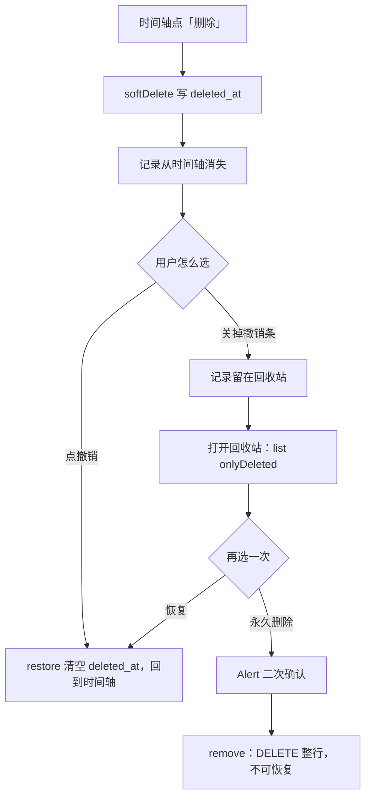

# 13 回收站与永久删除：把「删除」分成两级

> 对应功能：**第二阶段（永久删除一致性）——事件记录的回收站与真删**；
> 后来由 **v5 迁移**扩到**周期内记录**（第 6 节）。
> 本文以仓库真实代码为依据。凡是「没做过」的验证，会明确写出来。

## 1. 本次完成什么

在 [10 补录与撤销](./10-backfill-and-undo.md) 里，删除记录是**软删除**：写一个
`deleted_at`，记录从时间轴消失，并给一次「撤销」的机会。但撤销条一关，记录就既看不见、
又删不掉——这是当时记录在案的技术债。这一项把它补齐：

| 能力 | 说明 |
| --- | --- |
| 回收站页 | 新增 `src/app/records/deleted.tsx`，列出所有软删除的记录（按删除时间倒序） |
| 恢复 | 一键 `restore`，记录重新回到时间轴 |
| 永久删除 | `Alert` 二次确认后 `DELETE` 该行，**不可撤销** |
| 仓储方法 | `EventRecordRepository.remove(id)`（真删）与 `list({ onlyDeleted: true })` |
| 闭环 | 「软删除 → 撤销 → 永久删除」每一步都有明确入口，不留无主数据 |

数据库 schema **这次没有变化，当时是 v4**：真删就是删 `event_records` 里已有的行。

**当时明确不做**：周期记录（`cycle_entries`）的回收站——它本来就是真删，模型里没有
`deleted_at`。这部分后来由 v5 迁移补齐，见下面的第 6 节。

## 2. 改了哪些文件

| 文件 | 角色 | 本次新增/修改 |
| --- | --- | --- |
| `src/repositories/eventRecordRepository.ts` | 仓储 | 新增 `remove()`；`list()` 增加 `onlyDeleted` 与对应的删除时间倒序 |
| `src/app/records/deleted.tsx` | 页面 | **新增**：回收站（恢复 / 永久删除） |
| `src/app/(tabs)/index.tsx` | 页面（时间轴） | 头部加入「回收站」入口 |
| `src/repositories/__tests__/eventRecordRepository-test.ts` | 测试 | 新增 5 个用例 |

## 3. 相关技术概念

### 3.1 删除分成两级：软删除 vs 真删

**是什么**：
- **软删除**（`softDelete`）：只写 `deleted_at`，行还在，可以 `restore`。适合「刚刚点错了」。
- **真删**（`remove`）：`DELETE` 掉整行，读不回、也恢复不了。适合「我确定不要了」。

**为什么本项目需要**：领域规则是「删除历史用软删除，以便撤销最近操作」，
但同时也要求「永久删除必须二次确认」。一句话里其实有两级删除，必须分别提供入口，
否则要么留一堆看不见的数据，要么用户一点就永久丢失。

**用在哪**：`softDelete` / `restore` / `remove` 三个方法；时间轴的撤销条与回收站的按钮。

**不用会怎样**：只有软删除 → 数据永远删不掉；只有真删 → 误触无法挽回。

### 3.2 为什么要一个「回收站」，而不是直接在时间轴真删

**是什么**：软删除的记录不消失，而是集中到回收站页。

**为什么**：撤销条只在**当次**有效（离开页面就没了，见 [10](./10-backfill-and-undo.md)）。
如果软删除后没有第二个入口，那些记录就成了「看不见又删不掉」的孤儿。
回收站把「待决定」的记录显式暴露出来，用户随时可以恢复或清理。

**用在哪**：`list({ onlyDeleted: true })`——查询反过来，**只**取 `deleted_at IS NOT NULL` 的行。

**不用会怎样**：软删除会变成「只增不减」的垃圾堆。

### 3.3 单条 `DELETE` 本身就是原子的

**是什么**：`event_records` 没有子表，删一条记录就是一条 `DELETE` 语句。

**为什么**：多表写入才需要显式事务（见 [11](./11-cycle-tracking.md) 的周期定义删除）。
这里没有「删了一半」的可能，所以不加 `withExclusiveTransactionAsync`，避免过度设计。

**用在哪**：`EventRecordRepository.remove`。

**不用会怎样**：为原子操作套事务不会错，但会误导读者以为这里有多步写入。

### 3.4 `Alert` 二次确认：破坏性操作的护栏

**是什么**：真删前弹系统确认框，只读地说明「删什么、为什么不可撤销」。

**为什么**：真删不可逆，必须让用户明确知道后果。这是界面层的责任，
仓储层只负责「删掉」这件事本身。

**用在哪**：`deleted.tsx` 的 `confirmRemove`（与 [08](./08-event-definitions.md) 删定义、
[11](./11-cycle-tracking.md) 删周期同一套写法）。

**不用会怎样**：一次误触就永久丢数据。

## 4. 关键代码逐段解释

### 4.1 `list` 支持「只列已删除」（`eventRecordRepository.ts`）

```ts
if (options.onlyDeleted) {
  clauses.push('deleted_at IS NOT NULL');
} else if (!options.includeDeleted) {
  clauses.push('deleted_at IS NULL');
}

const orderBy = options.onlyDeleted
  ? 'deleted_at DESC, occurred_at DESC, id DESC'
  : 'occurred_at DESC, recorded_at DESC, id DESC';
```

- `onlyDeleted` 优先于 `includeDeleted`（互斥，写了注释说明）。
- 回收站按 **删除时间** 倒序，更符合「最近删的排最前」的直觉；时间轴仍按 **发生时间** 倒序。

### 4.2 真删（`remove`）

```ts
async remove(id: string): Promise<void> {
  const targetId = requireId(id, '事件记录 id');
  return guard('永久删除事件记录', async () => {
    const result = await this.db.runAsync('DELETE FROM event_records WHERE id = ?', targetId);
    if (result.changes === 0) {
      throw new NotFoundError(`事件记录不存在：${targetId}`);
    }
  });
}
```

`result.changes === 0` 说明没有命中任何行 → 抛 `NotFoundError`，而不是静默成功。
这样「删一个不存在的东西」不会被当成成功（与其它仓储的 `remove` 一致）。

### 4.3 回收站页面（`src/app/records/deleted.tsx`）

```tsx
const restore = (record: EventRecord) => {
  new EventRecordRepository(db).restore(record.id).then(() => load());
};

const confirmRemove = (id: string, message: string, action: () => Promise<unknown>) => {
  Alert.alert('彻底删除记录', message, [
    { text: '取消', style: 'cancel' },
    { text: '彻底删除', style: 'destructive', onPress: () => run(id, action) },
  ]);
};
```

每行有两个按钮：**恢复**（次要色）与**永久删除**（危险色）。恢复走 `restore`，
永久删除先 `Alert` 再 `remove`；两者完成后都 `load()` 重新拉取列表。

弹窗的确认按钮叫「彻底删除」、列表里的按钮叫「永久删除」——**故意不同名**。
两处同名时，读屏只会读出「永久删除」两个按钮、自动化也分不出点的是哪一个；
换一个与正文「将被彻底删除」对得上的措辞，两边都能分清（第 6.6 节有实测的踩坑经过）。

## 5. 一次完整数据流：删除一条记录，再从回收站真删



关键点：软删除与真删是两个方法、两个入口，**没有一步会静默改变另一条记录的命运**。

## 6. v5：把周期内记录也纳入回收站

上面那套「软删除 → 撤销 → 永久删除」原先只覆盖事件记录；周期里每天的记录
（`cycle_entries`）删掉就没了，只能靠 `Alert` 二次确认兜着。这一节是把它补齐的过程，
也是**一次「给已有表加软删除」**的完整样本。

### 6.1 为什么是追加 v5，而不是改 v4

```ts
export const MIGRATION_V5_CYCLE_ENTRY_SOFT_DELETE: Migration = {
  version: 5,
  name: 'cycle_entry_soft_delete',
  statements: [`ALTER TABLE cycle_entries ADD COLUMN deleted_at TEXT;`],
};
```

- **已发布的迁移是历史**：v4 可能已经在别人的库上跑过，改它等于让两份历史分叉。
  追加一个 v5，`PRAGMA user_version` 会把「跑到哪了」记在库里。
- `ALTER TABLE … ADD COLUMN` 是 SQLite 支持的**增量**操作：旧行自动是 `NULL`，
  语义天然就是「未删除」，**不需要回填**，也不会重写数据。
- 不加 `deleted_at` 索引：回收站一次只列出软删除的行（数量很小），
  按实例查记录走的仍是已有的 `idx_cycle_entries_instance_date`。
- 真实升级在模拟器上验过：使用者的库从 `user_version 4` 升到 `5`，
  15 条事件记录 / 4 条周期记录 / 1 条软删一条没少，`PRAGMA foreign_key_check` 干净。

### 6.2 仓储：`softDelete` / `restore` / `listDeleted`

`CycleEntryRepository` 现在是三个方法、两种删除：

| 方法 | 行为 |
| --- | --- |
| `softDelete(id, now)` | 写 `deleted_at`；**幂等**（重复删除保留第一次的时间）；返回记录本身 |
| `restore(id)` | 清 `deleted_at`；已恢复的再恢复一次也是幂等 |
| `remove(id)` | `DELETE` 整行，不可撤销（界面二次确认） |
| `listDeleted()` | 回收站查询：`deleted_at IS NOT NULL`，JOIN 实例与定义，按删除时间倒序 |

`listDeleted()` 返回的不是裸的 `CycleEntry`，而是：

```ts
export interface DeletedCycleEntry {
  entry: CycleEntry;
  definitionName: string;      // 「生理期」
  instanceStartDate: IsoDate;  // 2026-10-01
  instanceEndDate?: IsoDate;   // 或 undefined（进行中）
}
```

**为什么带上下文**：周期记录本身只有一个日期，光看它说不清「这是哪个周期的哪一天」。
回收站里一行要能自证来历，所以把所属实例与定义名一起 JOIN 出来——而不是让界面为了显示
一行副标题再去查两次库。

### 6.3 保存即「复活」

`save()` 是按 `(instance_id, date)` 的 UPSERT。它多了一句：

```sql
ON CONFLICT(instance_id, date) DO UPDATE SET
  …,
  deleted_at = NULL
```

**为什么**：不这样做就会出现「提示保存成功、列表里却没有」——那天还是软删除状态，
`listByInstance` 把它过滤掉了。要么拒绝保存并提示，要么复活；后者更符合直觉
（用户刚刚明确地填了内容并点了保存）。

### 6.4 两个容易互相矛盾的地方，怎么解开

**（1）恢复也要重新过「日期在实例区间内」。**
软删除期间这条记录**不挡边界**（见下一条），所以「软删除 → 把结束日提前」是允许的，
此时回收站里那条就落在区间外了。直接恢复会造出一条「属于这个周期、却在这个周期之外」的记录，
与「周期记录的日期必须落在实例区间内」这条规则冲突。所以 `restore` 会重新查一次实例区间，不在里面就抛 `ValidationError`
并说明原因（先把边界改回来，或彻底删除它）。

**（2）边界校验只看未软删除的记录。**

```sql
SELECT date FROM cycle_entries WHERE instance_id = ? AND deleted_at IS NULL ORDER BY date ASC
```

已经躺在回收站里的那几天不该阻止用户缩小边界——否则会出现「被一条看不见的记录卡住」，
而且界面上根本看不出是为什么。代价就是上一条那个「恢复可能被拒」，用明确的报错兜住。

**（3）备份：软删除的周期记录允许落在区间外。**
导出会把软删除的周期记录一起带走（备份必须无损），于是上面那种「软删 + 缩边界」的状态
会出现在文件里。如果导入时的引用完整性检查照旧要求「日期必须在区间内」，
**App 自己导出的备份会被自己拒绝**。所以那条校验对 `deletedAt !== undefined` 的行放行——
这是「校验要跟着领域规则一起更新」的一个具体例子，不更新就会自相矛盾。

**（4）`deletedAt` 不进 `formatVersion` 的版本号。**
备份里的 `deletedAt` 是**可选字段**：v5 之前导出的备份没有它，解析成 `undefined`
（= 未删除），新旧互认。缺失的字段按「没有」处理、写错的字段一律拒绝——与
[14 备份与恢复](./14-backup-and-restore.md) 讲的备份契约一致。导入合并时它跟 `updatedAt` 一起走「较新者胜」，两边都删则取更早的时间
（与事件记录的软删除标记同一套幂等语义）。

### 6.5 界面：一个回收站，两个区

回收站现在列两种记录，共用「恢复 / 永久删除」两个动作：

| 区 | 数据源 | 一行的副标题 |
| --- | --- | --- |
| 已删除的记录 | `EventRecordRepository.list({ onlyDeleted: true })` | 发生时间 · 来源 · 删除时间 |
| 已删除的周期记录 | `CycleEntryRepository.listDeleted()` | 所属周期 · 区间 · 删除时间 |

周期页的「删除」跟着改成**软删除**（不再弹确认，先删再给「撤销」提示条，
与时间轴一致）；撤销条上写明这种情况去哪找回：「可在「时间轴 → 回收站」找回」。

### 6.6 踩坑记录：行内按钮被整行「吃掉」、同名按钮点不准

这两个坑都是写端到端流程（[15](./15-maestro-e2e.md)）时撞出来的，而且都不是测试自己的问题：

1. **`ListRow` 整行可点时，行内按钮会被合并进整行那一个无障碍元素。**
   周期实例页的每日记录行，视图树里只有一个元素：`2026-10-22, （无内容）, 删除`——
   「删除」既不是一个独立元素（自动化点不到），读屏用户也**永远聚焦不到**它。
   修法是让「文字区」自己当无障碍按钮（`accessible` + `accessibilityRole="button"`），
   整行不做无障碍元素：点击区不变（仍能点整行进编辑），行内按钮各归各。
2. **弹窗的确认按钮和列表按钮同名时，谁都分不清。**
   回收站有了两个区之后，列表里有两个「永久删除」，弹窗里还有一个同名的确认按钮；
   用「在正文下方」这种相对定位会命中被弹窗挡住的那个列表按钮（第一次跑就是这么挂的）。
   改成让**文案本身不重名**：弹窗按钮叫「彻底删除」。

> 这两条的共同点是：**界面上说不清、读屏读不出，自动化也一定点不准**。
> 端到端流程在这里不只是「验证」，它把无障碍问题一起暴露出来了。

### 6.7 这一项的验证

| 命令 / 检查 | 结果 |
| --- | --- |
| `npm test` | **22 个套件 / 338 个用例通过**（本次新增 19 个） |
| `npm run typecheck` / `lint` / `format:check` | 通过 |
| 模拟器真实升级 | `user_version 4 → 5`，旧数据一条没少，`PRAGMA foreign_key_check` 干净 |
| Maestro `07` | 软删除 → 撤销 → 回收站恢复 → 彻底删除（含原生二次确认），**8/8 流程通过**（3m11s） |
| 跑完读库 | 使用者 15 条记录 / 4 条周期记录一条没少；回收站无 `Maestro*` 残留 |

用例覆盖到的边界：迁移 v5（含从 v4 旧库升级）、软删除幂等、恢复幂等、
「保存即复活」、恢复被区间拒绝（且失败后仍是软删除状态）、`listDeleted` 的顺序与上下文、
软删除的记录不挡边界、备份往返与合并（含旧备份缺 `deletedAt`、软删记录在区间外被放行）。

## 7. 如何验证

### 关键命令

```bash
npm test -- src/repositories/__tests__/eventRecordRepository-test.ts
npm run verify
```

### 真实跑过的结果

| 命令 | 结果 |
| --- | --- |
| `npm run typecheck` | 通过 |
| `npm run lint` | 通过（0 error / 0 warning） |
| `npm test` | **17 个套件 / 228 个用例通过** |
| `npm run format:check` | 通过 |

### 测试覆盖了什么

- **回收站查询**：`onlyDeleted` 只返回软删除的记录，且按删除时间倒序；普通 `list()` 不含它们。
- **真删**：`remove` 后 `getById` 返回 `null`，`includeDeleted` / `onlyDeleted` 都查不到。
- **只影响目标**：真删一条，另一条仍在。
- **状态转换无漏洞**：软删除 → 撤销 → 再永久删除，全程可走通。
- **边界**：真删不存在的记录抛 `NotFoundError`。

### 没覆盖什么（诚实记录）

- **没有组件/界面测试**：回收站页的按钮与 `Alert` 交互没有自动化用例
  （只有 Maestro 端到端流程 `03` / `07` 覆盖主路径）。
- **回收站的周期区没有「只看这一段周期」的筛选**：`listDeleted()` 返回全部软删除的周期记录；
  数量很小，所以先不做。
- **恢复被拒只在错误条里可见**：回收站里点「恢复」被区间规则拒绝时，页面顶部显示一行红字，
  没有「跳到那一段周期去改边界」的一键入口（手动去周期页改）。

## 8. 常见问题与排查

### 问题：删了记录，时间轴上看不到了，去哪找？

**答**：时间轴头部的「回收站」按钮。软删除的记录都在那里。

### 问题：回收站里点「恢复」，时间轴没有立刻出现

**答**：恢复后回收站会重新拉取，该行随即消失；切回时间轴（`useFocusEffect`）也会重新读一次。

### 问题：误点了「永久删除」

**答**：无法恢复——这是设计。真删前有 `Alert` 二次确认，请以确认框为准。

### 问题：回收站是空的，但我觉得删过东西

**答**：如果你当时点了「撤销」，记录已经回到时间轴，不在回收站；或者该记录是被**永久删除**了。

### 问题：回收站里点「恢复」，说「已经不在所属周期的区间内」

**答**：那条周期记录被软删除之后，这段周期的边界又被缩小了（软删除的记录不挡边界）。
先回周期页把边界改回包含这一天，或者直接「永久删除」它。界面不会为了让你恢复而
悄悄把边界改回去，也不会造出一条落在区间外的记录。

## 9. 学习总结与练习

**掌握的核心概念**

- 同一个「删除」动作，在需求里常常其实是**两级**：可撤销的软删除 + 不可逆的真删。
- 「只查已删除」不过是把 `WHERE deleted_at IS NULL` 换成 `IS NOT NULL`，并把排序键换成删除时间。
- 破坏性操作的正确姿势：仓储负责原子地删，界面负责 `Alert` 二次确认。
- 不是所有写操作都需要显式事务——**没有多步写入**时单条语句就够。
- 给**已有表**补软删除的正确姿势：**追加**一个 `ALTER TABLE ADD COLUMN` 迁移，
  旧行天然是「未删除」；改已发布的迁移 = 让历史分叉。
- 加软删除会牵动一串规则（写入/恢复的区间校验、边界校验、备份完整性、UPSERT 的复活语义）——
  **每一条都要跟着更新**，否则就会自相矛盾（第 6.4 节那四条）。

**建议亲自尝试的小练习**

1. **走一遍闭环**：时间轴删一条 → 不撤销 → 进回收站 → 先「恢复」看它回到时间轴 → 再删一次 → 「永久删除」。
2. **观察排序**：连续删除几条，确认回收站按删除时间从新到旧排列。
3. **复现「软删 + 缩边界」**：周期里记两天 → 删掉较晚的那天 → 把结束日提到它之前（应当能保存成功）
   → 回回收站点「恢复」→ 应被拒绝并说明原因 → 把边界改回来 → 再恢复，这次成功。
4. **观察复活**：把某天的记录软删除，然后用同一个日期再保存一次——它会带着新内容回到列表里。

以上练习都不改动已验收代码的结构，可以放心做。