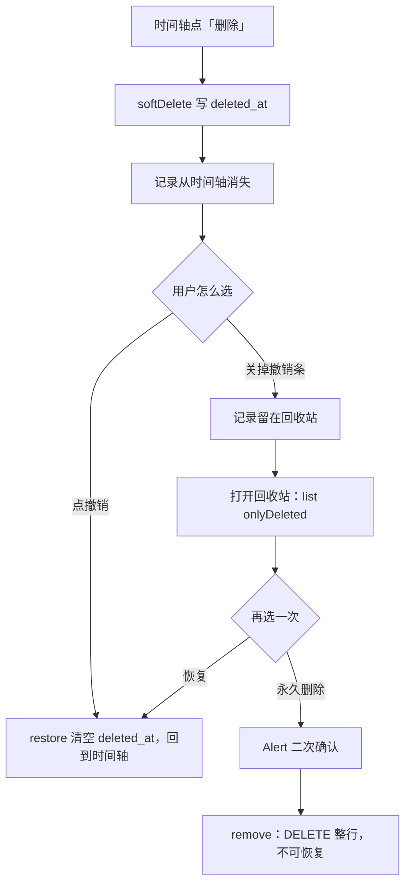

# 13 回收站与永久删除：把「删除」分成两级

> 对应功能：**第二阶段（永久删除一致性）——事件记录的回收站与真删**。
> 本文以仓库真实代码为依据。凡是「没做过」的验证，会明确写出来。

## 1. 本次完成什么

在 [10 补录与撤销](./10-backfill-and-undo.md) 里，删除记录是**软删除**：写一个
`deleted_at`，记录从时间轴消失，并给一次「撤销」的机会。但撤销条一关，记录就既看不见、
又删不掉——这是当时记录在案的技术债。这一项把它补齐：

| 能力 | 说明 |
| --- | --- |
| 回收站页 | 新增 `src/app/records/deleted.tsx`，列出所有软删除的记录（按删除时间倒序） |
| 恢复 | 一键 `restore`，记录重新回到时间轴 |
| 永久删除 | `Alert` 二次确认后 `DELETE` 该行，**不可撤销** |
| 仓储方法 | `EventRecordRepository.remove(id)`（真删）与 `list({ onlyDeleted: true })` |
| 闭环 | 「软删除 → 撤销 → 永久删除」每一步都有明确入口，不留无主数据 |

数据库 schema **没有变化，仍为 v4**：真删就是删 `event_records` 里已有的行。

**本次明确不做**：周期记录（`cycle_entries`）的真删回收站——它本来就是真删，模型里没有
`deleted_at`（见 [10](./10-backfill-and-undo.md) 与 `HANDOFF` 技术债）。

## 2. 改了哪些文件

| 文件 | 角色 | 本次新增/修改 |
| --- | --- | --- |
| `src/repositories/eventRecordRepository.ts` | 仓储 | 新增 `remove()`；`list()` 增加 `onlyDeleted` 与对应的删除时间倒序 |
| `src/app/records/deleted.tsx` | 页面 | **新增**：回收站（恢复 / 永久删除） |
| `src/app/(tabs)/index.tsx` | 页面（时间轴） | 头部加入「回收站」入口 |
| `src/repositories/__tests__/eventRecordRepository-test.ts` | 测试 | 新增 5 个用例 |

## 3. 相关技术概念

### 3.1 删除分成两级：软删除 vs 真删

**是什么**：
- **软删除**（`softDelete`）：只写 `deleted_at`，行还在，可以 `restore`。适合「刚刚点错了」。
- **真删**（`remove`）：`DELETE` 掉整行，读不回、也恢复不了。适合「我确定不要了」。

**为什么本项目需要**：领域规则是「删除历史用软删除，以便撤销最近操作」，
但同时也要求「永久删除必须二次确认」。一句话里其实有两级删除，必须分别提供入口，
否则要么留一堆看不见的数据，要么用户一点就永久丢失。

**用在哪**：`softDelete` / `restore` / `remove` 三个方法；时间轴的撤销条与回收站的按钮。

**不用会怎样**：只有软删除 → 数据永远删不掉；只有真删 → 误触无法挽回。

### 3.2 为什么要一个「回收站」，而不是直接在时间轴真删

**是什么**：软删除的记录不消失，而是集中到回收站页。

**为什么**：撤销条只在**当次**有效（离开页面就没了，见 [10](./10-backfill-and-undo.md)）。
如果软删除后没有第二个入口，那些记录就成了「看不见又删不掉」的孤儿。
回收站把「待决定」的记录显式暴露出来，用户随时可以恢复或清理。

**用在哪**：`list({ onlyDeleted: true })`——查询反过来，**只**取 `deleted_at IS NOT NULL` 的行。

**不用会怎样**：软删除会变成「只增不减」的垃圾堆。

### 3.3 单条 `DELETE` 本身就是原子的

**是什么**：`event_records` 没有子表，删一条记录就是一条 `DELETE` 语句。

**为什么**：多表写入才需要显式事务（见 [11](./11-cycle-tracking.md) 的周期定义删除）。
这里没有「删了一半」的可能，所以不加 `withExclusiveTransactionAsync`，避免过度设计。

**用在哪**：`EventRecordRepository.remove`。

**不用会怎样**：为原子操作套事务不会错，但会误导读者以为这里有多步写入。

### 3.4 `Alert` 二次确认：破坏性操作的护栏

**是什么**：真删前弹系统确认框，只读地说明「删什么、为什么不可撤销」。

**为什么**：真删不可逆，必须让用户明确知道后果。这是界面层的责任，
仓储层只负责「删掉」这件事本身。

**用在哪**：`deleted.tsx` 的 `confirmRemove`（与 [08](./08-event-definitions.md) 删定义、
[11](./11-cycle-tracking.md) 删周期同一套写法）。

**不用会怎样**：一次误触就永久丢数据。

## 4. 关键代码逐段解释

### 4.1 `list` 支持「只列已删除」（`eventRecordRepository.ts`）

```ts
if (options.onlyDeleted) {
  clauses.push('deleted_at IS NOT NULL');
} else if (!options.includeDeleted) {
  clauses.push('deleted_at IS NULL');
}

const orderBy = options.onlyDeleted
  ? 'deleted_at DESC, occurred_at DESC, id DESC'
  : 'occurred_at DESC, recorded_at DESC, id DESC';
```

- `onlyDeleted` 优先于 `includeDeleted`（互斥，写了注释说明）。
- 回收站按 **删除时间** 倒序，更符合「最近删的排最前」的直觉；时间轴仍按 **发生时间** 倒序。

### 4.2 真删（`remove`）

```ts
async remove(id: string): Promise<void> {
  const targetId = requireId(id, '事件记录 id');
  return guard('永久删除事件记录', async () => {
    const result = await this.db.runAsync('DELETE FROM event_records WHERE id = ?', targetId);
    if (result.changes === 0) {
      throw new NotFoundError(`事件记录不存在：${targetId}`);
    }
  });
}
```

`result.changes === 0` 说明没有命中任何行 → 抛 `NotFoundError`，而不是静默成功。
这样「删一个不存在的东西」不会被当成成功（与其它仓储的 `remove` 一致）。

### 4.3 回收站页面（`src/app/records/deleted.tsx`）

```tsx
const restore = (record: EventRecord) => {
  new EventRecordRepository(db).restore(record.id).then(() => load());
};

const confirmRemove = (record: EventRecord) => {
  Alert.alert('永久删除记录', `「${record.snapshot.name}」的记录将被彻底删除，无法恢复。此操作不可撤销。`, [
    { text: '取消', style: 'cancel' },
    { text: '永久删除', style: 'destructive', onPress: () => remove(record) },
  ]);
};
```

每行有两个按钮：**恢复**（次要色）与**永久删除**（危险色）。恢复走 `restore`，
永久删除先 `Alert` 再 `remove`；两者完成后都 `load()` 重新拉取列表。

## 5. 一次完整数据流：删除一条记录，再从回收站真删



关键点：软删除与真删是两个方法、两个入口，**没有一步会静默改变另一条记录的命运**。

## 6. 如何验证

### 关键命令

```bash
npm test -- src/repositories/__tests__/eventRecordRepository-test.ts
npm run verify
```

### 真实跑过的结果

| 命令 | 结果 |
| --- | --- |
| `npm run typecheck` | 通过 |
| `npm run lint` | 通过（0 error / 0 warning） |
| `npm test` | **17 个套件 / 228 个用例通过** |
| `npm run format:check` | 通过 |

### 测试覆盖了什么

- **回收站查询**：`onlyDeleted` 只返回软删除的记录，且按删除时间倒序；普通 `list()` 不含它们。
- **真删**：`remove` 后 `getById` 返回 `null`，`includeDeleted` / `onlyDeleted` 都查不到。
- **只影响目标**：真删一条，另一条仍在。
- **状态转换无漏洞**：软删除 → 撤销 → 再永久删除，全程可走通。
- **边界**：真删不存在的记录抛 `NotFoundError`。

### 没覆盖什么（诚实记录）

- **没有组件/界面测试**：回收站页的按钮与 `Alert` 交互没有自动化用例。
- **周期记录的真删回收站未做**：`cycle_entries` 仍是「删了就没」。

## 7. 常见问题与排查

### 问题：删了记录，时间轴上看不到了，去哪找？

**答**：时间轴头部的「回收站」按钮。软删除的记录都在那里。

### 问题：回收站里点「恢复」，时间轴没有立刻出现

**答**：恢复后回收站会重新拉取，该行随即消失；切回时间轴（`useFocusEffect`）也会重新读一次。

### 问题：误点了「永久删除」

**答**：无法恢复——这是设计。真删前有 `Alert` 二次确认，请以确认框为准。

### 问题：回收站是空的，但我觉得删过东西

**答**：如果你当时点了「撤销」，记录已经回到时间轴，不在回收站；或者该记录是被**永久删除**了。

## 8. 学习总结与练习

**掌握的核心概念**

- 同一个「删除」动作，在需求里常常其实是**两级**：可撤销的软删除 + 不可逆的真删。
- 「只查已删除」不过是把 `WHERE deleted_at IS NULL` 换成 `IS NOT NULL`，并把排序键换成删除时间。
- 破坏性操作的正确姿势：仓储负责原子地删，界面负责 `Alert` 二次确认。
- 不是所有写操作都需要显式事务——**没有多步写入**时单条语句就够。

**建议亲自尝试的小练习**

1. **走一遍闭环**：时间轴删一条 → 不撤销 → 进回收站 → 先「恢复」看它回到时间轴 → 再删一次 → 「永久删除」。
2. **观察排序**：连续删除几条，确认回收站按删除时间从新到旧排列。
3. **对比周期**：删一条周期内记录，确认它是**直接真删**（没有回收站入口）——这正是本次没做的那部分。

以上练习都不改动已验收代码的结构，可以放心做。