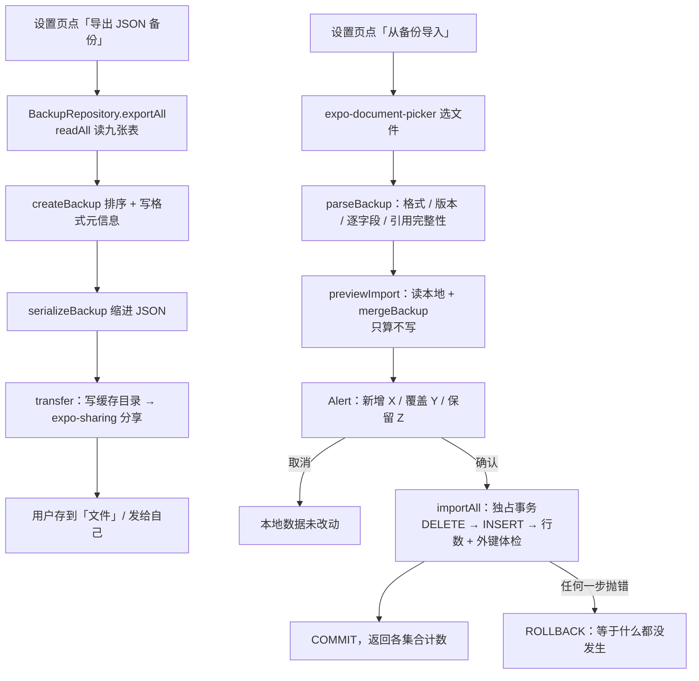

# 14 备份与恢复（导入导出）：显式格式契约、严格解析与「取并集」的合并

> ⚠️ **v6 起备份格式升到 `formatVersion = 2`**：集合从 7 个变成 6 个（**没有 `cycleDefinitions`**，
> 周期定义并进了 `eventDefinitions`，周期实例 / 每日记录的外键改指它），定义 / 记录的
> `unit` → `attributes`（JSON 数组文本）、快捷选项 `label` / `unit` → `attribute`。
> **v1 备份仍然能导**：legacy 根下的 `cycleDefinitions` 会被折成 `kind = 'cycle'` 的定义
> （`cycleMode` 兜底 `manual`）、定义里的 `quantity` → `counter`、`unit` 作为 `attributes` 的兜底；
> **v2 备份里出现 `quantity` 定义会被拒**。本文的格式表请按此理解（走读见
> [08 事件定义](./08-event-definitions.md) 第 9 节）。

> 对应功能：**第二阶段（导入导出）——JSON 备份 / CSV 表格导出、按 id 合并的导入**。
> 本文以仓库真实代码为依据。凡是「没做过」的验证，会明确写出来。

## 1. 本次完成什么

在此之前，数据只存在设备本地的 `lifetrack.db` 里：没有账号、没有云同步，**换手机或重装应用就等于
丢掉全部历史**。这一项补上「把数据带出去、再带回来」的能力：

| 能力 | 说明 |
| --- | --- |
| 导出 JSON 备份 | 七张业务表（**v6 起为六张：无 `cycleDefinitions`**；含**归档的定义**与**软删除的记录**）打包成一个带格式声明的 JSON 文件 |
| 导出 CSV 表格 | 只要事件记录的表格视图，方便用 Excel / Numbers 打开核对数字（**只导出、不导入**） |
| 导入（合并） | 选一个 JSON 备份，**并进**本地数据；本地独有的数据一条都不会被删 |
| 冲突合并 | 同 id 的一对数据按「较新的 `updatedAt` 胜出」决定谁留下 |
| 事务一致性 | 导入在一个独占事务里整体重写：清空 → 写回 → 事务内体检 → 提交；任何一步失败**整体回滚** |
| 预演 | 导入前先只读算一遍「将新增 / 覆盖 / 保留」多少条，`Alert` 里摆给用户看，确认后才写库 |
| 界面入口 | 设置页新增「备份与恢复」卡片（导出 JSON / 导出 CSV / 从备份导入） |

数据库 schema **没有变化（这项改动不引入迁移）**：导出只是读已有表，导入只是重写已有行。

**格式与数据的一对约定**（重要，后面反复用到）：

| 数字 | 含义 | 谁决定 |
| --- | --- | --- |
| `formatVersion`（当前 1） | **备份文件结构**的版本：字段怎么摆 | 领域层 `BACKUP_FORMAT_VERSION` |
| `schemaVersion`（备份时是当前的 schema 版本，如今 6） | 导出那一刻**数据库 schema** 的版本 | `LATEST_SCHEMA_VERSION`，由调用方传入 |

两者不是一回事：领域层不依赖数据库（见 [03](./03-typescript-domain-model.md) 与
[04](./04-sqlite-and-repository.md) 的职责边界），所以 `schemaVersion` 是**参数**，
由仓储层在调用 `createBackup` 时填进去。

**本次明确不做**：

- 不做云备份 / 多端同步 / 账号体系（仍是本地优先，导出的文件交给用户自己保管）。
- 不做 CSV 导入：CSV 没有主键与快照，无法无损往返（见 3.4）。
- 不导出 `app_meta`（安装时间、启动次数）：那是**本机诊断信息**，不属于用户数据（见 3.6）。
- 不做自动定时备份。

## 2. 改了哪些文件

| 文件 | 角色 | 本次新增/修改 |
| --- | --- | --- |
| `src/domain/backup.ts` | 领域层 | **新增**：格式契约、逐字段解析、引用完整性、合并规则、稳定排序、文件名 |
| `src/repositories/backupRepository.ts` | 仓储 | **新增**：`exportAll` / `importAll` / `previewImport` / `readAll` |
| `src/features/backup/csv.ts` | 功能层 | **新增**：记录 CSV（RFC 4180 转义 + BOM，纯函数） |
| `src/features/backup/transfer.ts` | 功能层 | **新增**：唯一碰文件系统 / 系统选择器的地方（写、分享、选文件） |
| `src/app/(tabs)/settings.tsx` | 页面 | 新增「备份与恢复」卡片与预演确认框 |
| `src/repositories/cycleEntryRepository.ts` | 仓储 | 新增 `listAll()`（导出需要跨实例遍历全部每日记录） |
| `src/domain/index.ts`、`src/repositories/index.ts` | 出口 | 导出新模块 |
| `package.json` | 依赖 | 新增 `expo-file-system` / `expo-sharing` / `expo-document-picker` |
| `src/domain/__tests__/backup-test.ts` | 测试 | **新增** 28 个用例 |
| `src/features/backup/__tests__/csv-test.ts` | 测试 | **新增** 7 个用例 |
| `src/repositories/__tests__/backupRepository-test.ts` | 测试 | **新增** 13 个用例 |
| `src/repositories/__tests__/cycleEntryRepository-test.ts` | 测试 | 新增 `listAll` 用例 |

后来「导入导出收尾」那一次（补手测）又动了三处，一并记在这里：

| 文件 | 角色 | 收尾时的改动 |
| --- | --- | --- |
| `src/domain/id.ts` | 领域层 | **改**：`assertUuidV7` → `assertEntityId`——导入认 id 的**形状**、不认**版本**（见 3.9） |
| `src/domain/backup.ts` | 领域层 | 改：每个 id 字段的包装改用 `assertEntityId` |
| `.maestro/import/09a|09b-*.yaml` | 端到端 | **新增**：选文件导入的手工两段式（跑法与坑见 `.maestro/README.md`） |

## 3. 相关技术概念

### 3.1 外部数据必须「严格解析」，不能信类型

**是什么**：备份文件是**外部输入**——它可能被手改过、可能是别的应用的 JSON、可能来自更新版本的应用。
TypeScript 的类型在运行时**不做任何校验**（见 [03](./03-typescript-domain-model.md)），
`parseBackup` 把 `JSON.parse` 的结果当成 `unknown`，逐字段过守卫函数，不合法就抛
`ImportError` 并带上**路径**。

**为什么本项目需要**：导入会**重写全部业务表**（v6 起六张）。如果解析阶段宽松，脏数据会一路写进数据库，
变成「以后每次读都出问题」的隐性损坏。宁可拒绝，也不要存下去。

**用在哪**：`src/domain/backup.ts` 的 `parseBackup` → `parseBackupRoot` → `parseGroup` /
`parseTag` / `parseDefinition` / `parseRecord` / `parseCycleInstance` / `parseCycleEntry`，
以及属性列表专用的 `parseAttributes`（v1 的 `unit` 作为兜底；v1 还有 `parseLegacyCycleDefinition`
把老的 `cycleDefinitions` 折成周期型定义）。

**不用会怎样**：一个手改错的 `value`（比如把 `1` 写成 `"1"`）会静默入库，统计里出现 `NaN`。

错误信息里的路径长这样：

```
data.eventRecords[3].value：必须是 > 0 的数
data.cycleInstances[0].definitionId：指向不存在的周期定义：0199…
```

**宽容与严格的边界**（写代码时要做选择的那条线）：

- **宽容**：整个集合缺失时按**空数组**处理（`parseArray(value ?? [])`）——为的是将来能导入
  「更早版本导出的、还没有周期表」的备份。
- **严格**：集合存在、但里面某一条写错了，直接拒绝；**不猜、不补默认值**。

同一个 `parseBackup` 还顺带复用了领域里已有的规则（见 3.2）。

### 3.2 复用 `validation.ts`：规则只有一份

**是什么**：`parseRecord` 校验「补录不能晚于录入时间」时，调用的就是记录接口用的那个
`requireNotFuture`；校验取值范围用的是 `requireRecordValue`。

**为什么**：领域规则必须**只有一处定义**。如果导入自己写一套「value > 0」，将来规则改了
（比如允许 0 表示「今天没发生」），就会漏掉导入这条路径。

**用在哪**：`check(path, () => requireXxx(...))`——把 `validation.ts` 抛出的 `ValidationError`
统一转成带路径的 `ImportError`，让上层只需要处理一种错误类型（对应 [03](./03-typescript-domain-model.md) 的 `AppError`）。

**不用会怎样**：同一件事有两套规则，两边慢慢走偏；上层还要分别处理两种异常。

### 3.3 引用完整性：写库之前先查「指向存在吗」

**是什么**：导入前检查 `eventDefinitions.groupId` 在不在 `eventGroups` 里、`cycleEntries.instanceId`
在不在 `cycleInstances` 里、周期记录的日期在不在实例区间内、同 id 有没有重复、同实例同一天有没有重复。

**为什么**：数据库有外键约束（`foreign_keys = ON`，见 [04](./04-sqlite-and-repository.md)），
但这些约束只会在**写到那一行时**报错，错误信息说不清是哪一条、也无法回滚得更「干净」。
更关键的是**周期记录日期必须在区间内**这条规则**没有** SQL 约束保护（见 [11](./11-cycle-tracking.md)）：
只有仓储的 `save()` 会校验，而导入是直接 `INSERT`，绕过它就会造出「属于这个周期却在这个周期之外」
的自相矛盾数据——之后修改边界时又会被 `assertNoOutsiders` 拦住。

**用在哪**：`assertBackupIntegrity(data)`，由 `parseBackup`（解析后）和
`BackupRepository.planImport`（写库前）各调用一次。

**不用会怎样**：可能写进一份「外键断裂」的数据库；或者下次改周期边界时突然被拒绝，用户一头雾水。

**唯一的例外**：事件记录的 `definitionId` **故意不校验**。v3 的 `event_records` 本来就没有外键
（见 [09](./09-event-recording.md)：删定义不删历史），历史可以指向一个已经被永久删除的定义，
靠记录里的**快照**自证。

### 3.4 合并 = 取并集，永不删本地；CSV 为什么只能导出

**是什么**：`mergeBackup(current, incoming)` 返回 `本地 ∪ 备份`，并按集合统计
`added`（备份新增）/ `updated`（备份覆盖）/ `kept`（沿用本地）。

规则分两类：

| 数据 | 有没有 `updatedAt` | 冲突时怎么办 |
| --- | --- | --- |
| 分组 / 标签 / 事件定义 / 周期定义 / 周期实例 / 周期内记录 | 有 | 新的赢；完全相同时**保留本地、不重写** |
| 事件记录 | **没有**（历史不可篡改） | 只合并**软删除标记**：备份标了删除而本地没有 → 采用删除；两边都删 → 取更早的删除时间；其余保留本地 |

**为什么本项目需要**：

- 「导入」如果实现成「清空 + 覆盖」，用户拿一份**旧**备份就能悄悄删掉新数据——这是最危险的失败模式。
  取并集则不可能丢本地数据。
- 事件记录是一条条**事实**，内容写入后不会变（见 [09](./09-event-recording.md)），
  所以它没有 `updatedAt` 可比较；唯一会变的是「软删除」这个状态，合并规则也只针对它。
  「本地已删除、备份里还没删」时**不复活**——否则用户删掉的东西会被旧备份翻出来。

**用在哪**：`mergeBackup`（纯函数，不碰数据库）；`byUpdatedAt` 用 `Date.parse` 比较而不是字符串比较
（ISO-8601 带不同时区偏移时，字符串比较会错，见 [10](./10-backfill-and-undo.md)）。

**不用会怎样**：要么丢数据，要么把删掉的记录翻出来。

**CSV 为什么只导出**：CSV 只有「一行一行的值」，没有主键、没有快照、没有类型信息；
拿它当输入就只能靠「事件名匹配」，一旦重名或改名就对不上。所以 CSV 的定位是
**给人看的快照**（用表格软件做透视），真正的备份/恢复一律走 JSON。

### 3.5 事务内「体检」：行数 + `PRAGMA foreign_key_check`

**是什么**：导入的写入过程是：

```
BEGIN（独占事务）
  DELETE 全部九张表（子表在前）
  INSERT 合并结果（父表在前）
  SELECT COUNT(*) 逐表核对行数
  PRAGMA foreign_key_check（外键体检）
COMMIT
```

**为什么**：

- 多表写入必须在一个事务里，否则「清空了但没写回」这种半成品会被留在库里
  （对应领域规则「导入失败不留半截数据」，错误码 `IMPORT`）。
  事务的机制见 [04](./04-sqlite-and-repository.md)。
- 写完再数一遍行数，能抓住「某张子表没写全」这类错误（例如某个定义的快捷选项少了）。
- `PRAGMA foreign_key_check` 是 SQLite 自带的**外键体检**：返回所有违反外键的行。
  行数对、引用也对，才允许提交。

**用在哪**：`BackupRepository.importAll` → `clearAll` / `writeAll` / `assertConsistent`。

**不用会怎样**：库里可能留下「行数不对」或「引用断裂」的数据，而用户看到的是「导入成功」。

两个实现细节值得注意：

- `PRAGMA foreign_key_check` 用 `try/catch` 包着：个别引擎不认这条 PRAGMA 时**跳过这一项**，
  不因此让导入失败（外键本身还有 `foreign_keys = ON` 兜底）。
- 这个文件里**不调用其它仓储的写方法**——它们各自也会开事务，嵌套事务会直接失败。

### 3.6 「读到内存 → 合并 → 整体重写」这个形状

**是什么**：导入的流程是 `readAll()` → `mergeBackup()` → 一个事务里重写全部九张表。

**为什么**：合并规则是**纯函数**，输入是两份 `BackupData`、输出是一份。这样一来
「合并」可以脱离数据库单测（本次 28 个领域用例里有 7 个专测合并），
仓储层只剩下「把算好的结果写回去」这一件事。

**代价（如实记录）**：`readAll()` 在事务**外**执行，理论上「读」与「写」之间有一小段窗口。
本项目是单用户、单连接、无并发写入者的本地应用，这个窗口不构成问题；
若将来出现后台写入，需要把读取也挪进事务（或加乐观校验）。

**为什么 `app_meta` 不参与**：安装时间与启动次数是**这台设备**的元信息，
合并两份备份时「哪台设备的安装时间算数」没有意义，所以既不导出也不导入。

### 3.7 稳定排序：让两次导出可以 diff

**是什么**：`sortBackupData` 给每个集合各自定死排序键（分组按 `sortOrder`、标签按名称、
记录按 `occurredAt` 正序…），导出与合并结果都过它。

**为什么**：如果不排序，导出的 JSON 顺序取决于数据库的返回顺序，同一份数据两次导出会不一样，
既不能 `diff`，也让「导入前后是否一致」这类测试变得脆弱。

**用在哪**：`createBackup` 与 `mergeBackup` 的出口。

**不用会怎样**：同 id 冲突「完全相同就保留本地」的判断没法验证——顺序一直在变。

### 3.8 原生模块的选择：三个都在 Expo Go 内置

**是什么**：

| 需求 | 模块 | SDK 58 是否在 Expo Go 内置 |
| --- | --- | --- |
| 写文件 / 读文件 | `expo-file-system`（新 API：`File` / `Paths`） | 是 |
| 把文件交给系统分享面板 | `expo-sharing` | 是 |
| 让用户选一个文件 | `expo-document-picker` | 是 |

**为什么**：仓库硬约定是「新增原生依赖前先确认 Expo Go 是否内置」（见 `HANDOFF` 第 7 节）：
内置才能继续用 Expo Go 开发，否则必须切到 development build。这三个都内置，所以不需要。

**用在哪**：`src/features/backup/transfer.ts`（**唯一**碰文件系统与系统选择器的文件）。
导出的文件写在**缓存目录**（`Paths.cache`）——它只是中转，最终去处由用户在分享面板里决定。

**不用会怎样**：换手机时数据只能丢；或者为了备份功能被迫引入 development build。

两个细节：`copyToCacheDirectory: true` 是 iOS 上的必需项（否则拿到的临时 URL 立刻失效），
文件类型过滤**故意放宽**（从某些云盘选来的 `.json` 会被标成 `application/octet-stream`，
严格过滤会让文件变灰选不中），把「选错了」交给 `parseBackup` 用明确文案拒绝。

### 3.9 导入边界：认 id 的**形状**，不认它的**版本**

**是什么**：导入时校验 id 用的是 `assertEntityId`（`src/domain/id.ts`）——只要求它是
UUID 的**形状**（8-4-4-4-12 的小写十六进制）。而**生成**新 id 用的仍是 `uuidv7`。

**为什么**：这是两种不同的规则，容易被混成一条。

| | 管的是 | 规则该有多严 |
| --- | --- | --- |
| `uuidv7`（生成） | **往后怎么写**：主键本身按时间有序，B-Tree 写入集中（见 [03](./03-typescript-domain-model.md)） | 必须 v7 |
| `assertEntityId`（导入） | **已有的数据能不能进来**：库里的 id 是**既有事实** | 只挡结构垃圾，不挡版本 |

本项目早期版本用的是 **v4**，那些行还在库里（使用者的 15 条记录、分组、周期全是 v4），
也照样出现在每一次导出的备份里。导入端如果只认 v7，**「自己导出的备份被自己拒绝」**
就是一条真会踩到的死路；而且它只在「拿一个**真的老库**的备份去导」时才暴露——
单元测试的 fixture id 全是照 v7 形状造的，比真实数据「干净」，测不出来。

**用在哪**：`ENTITY_ID_PATTERN` / `assertEntityId`（`src/domain/id.ts`），
`src/domain/backup.ts` 里每个 id 字段都过 `entityId()` 这个包装（把错误转成带路径的 `ImportError`）。

**不用会怎样**：老用户的备份永远导不回来。反过来，如果为了「宽容」把校验整条去掉，
手改坏 / 截断 / 类型错的 id 会直接写进主键，变成以后每次读都出问题的隐性损坏。
「挡垃圾」与「收自家历史」是**两条不同的线**，要分开画。

**边界**：大小写仍然严格——`550E8400-…` 与 `550e8400-…` 是**两个** id，库里一律小写，
大写一律拒绝（否则同一行会以两个 id 各存一份）。

## 4. 关键代码逐段解释

### 4.1 格式契约（`src/domain/backup.ts`）

```ts
export const BACKUP_FORMAT = 'lifetrack-backup';
export const BACKUP_FORMAT_VERSION = 1;

export interface BackupFile {
  format: string;
  formatVersion: number;
  schemaVersion: number;
  exportedAt: IsoDateTime;
  appVersion?: string;
  data: BackupData;
}
```

`format` 是「这是不是本应用的文件」的标识；`formatVersion` 才是结构版本。
导入时两者分先后检查：**先认格式，再认版本，最后才解析数据**——一句清楚的报错胜过
把别人的 JSON 当备份解析出的一堆字段错误。

### 4.2 解析的错误收敛（`check` + `fail`）

```ts
function fail(path: string, message: string): never {
  throw new ImportError(`${path}：${message}`);
}

function check<T>(path: string, run: () => T): T {
  try {
    return run();
  } catch (error) {
    if (error instanceof ValidationError) {
      fail(path, error.message);
    }
    throw error;
  }
}
```

`assertUuidV7` / `requireName` / `requireNotFuture` 这些是 `domain/validation.ts` 与
`domain/id.ts` 里现成的守卫，抛的是 `ValidationError`；`check` 把它换成带路径的
`ImportError`。于是**解析阶段只抛一种错误**，界面只需要把它 `message` 显示出来。

### 4.3 事件记录的快照自洽校验

```ts
if (snapshot.definitionId !== definitionId) {
  fail(`${path}.snapshot.definitionId`, `必须与 definitionId（${definitionId}）一致`);
}
if (snapshot.kind !== kind) {
  fail(`${path}.snapshot.kind`, `必须与 kind（${kind}）一致`);
}
```

记录表里标签只有一份（`snapshot_tag_ids`），读取时 `record.tagIds` 与 `snapshot.tagIds` 同源，
所以两边不一致只可能是文件被改坏了——直接拒绝，而不是猜哪边对。

### 4.4 合并的核心（`mergeCollection`）

```ts
for (const item of incoming) {
  const local = byId.get(item.id);
  if (!local) {
    byId.set(item.id, item);
    added += 1;
    continue;
  }
  if (preferIncoming(local, item)) {
    byId.set(item.id, item);
    updated += 1;
  }
}
return { items: [...byId.values()], counts: { added, updated, kept: current.length - updated } };
```

- 起点是**本地全部数据**（`byId` 先装 `current`），所以本地独有的条目天然保留；
- `incoming` 只做「新增」或「覆盖」两件事；
- `kept = current.length - updated`，即「沿用本地」的条数（本地独有 + 本地较新 + 完全相同），
  这样界面可以说清「新增 X、覆盖 Y、保留 Z」，三个数之和就是结果规模。

事件记录的比较函数单独写：

```ts
function preferIncomingRecord(local: EventRecord, incoming: EventRecord): boolean {
  if (local.deletedAt === undefined && incoming.deletedAt !== undefined) {
    return true; // 备份里标了删除，本地还没删 → 采用删除
  }
  if (local.deletedAt !== undefined && incoming.deletedAt !== undefined) {
    return incomingTime < localTime; // 两边都删了 → 取更早的，删除时间不漂移
  }
  return false; // 本地已删除 / 完全一样 → 保留本地
}
```

### 4.5 导入的事务与体检（`src/repositories/backupRepository.ts`）

```ts
async importAll(file: BackupFile): Promise<ImportSummary> {
  return guard('导入备份', async () => {
    const { data, summary } = await this.planImport(file); // 校验版本 + 完整性 + 读本地 + 合并

    await this.db.withExclusiveTransactionAsync(async (txn) => {
      await this.clearAll(txn);   // DELETE 九张表（子表在前）
      await this.writeAll(txn, data); // INSERT 合并结果（父表在前）
      await assertConsistent(txn, data); // 行数 + PRAGMA foreign_key_check
    });

    return summary;
  });
}
```

`planImport` 被 `importAll` 与 `previewImport` 共用：**预演和真导入走的是同一条校验路径**，
区别只在「要不要写库」。所以预演说「没问题」，真导入就不会因为校验失败而中途炸掉。

### 4.6 记录 CSV（`src/features/backup/csv.ts`）

```ts
export function escapeCsvField(value: string): string {
  if (/[",\r\n]/.test(value)) {
    return `"${value.replace(/"/g, '""')}"`;
  }
  return value;
}

export const RECORDS_CSV_HEADERS = [
  '发生时间', '录入时间', '来源', '事件', '类型', '取值', '属性',
  '分组', '标签', '备注', '状态', '删除时间', '记录ID',
] as const;
```

> ⚠️ v6 起第 7 列是「**属性**」（原来是「单位」），多个属性用 ` | ` 连接
> （`LIST_SEPARATOR`，见 `src/features/backup/csv.ts`）。

- **RFC 4180**：含逗号 / 引号 / 换行的字段加引号，内部引号翻倍；行尾用 `\r\n`；
  文本开头加 BOM（`\uFEFF`），否则 Excel 打开中文会乱码。
- **取值列保留原始数字**（不补「+」），这样表格软件能直接求和；
  计数/数量、来源、状态用中文词，标签与分组优先解析成名称，**解析不到就退回 id**（不丢信息）。
- 表头用中文是**有意为之**：JSON 给程序看，CSV 给人看。

### 4.7 界面：预演 → 确认 → 导入（`src/app/(tabs)/settings.tsx`）

```ts
const summary = await backup.previewImport(picked.file);
const confirmed = await confirmImport(picked.name, picked.file, summary);
if (!confirmed) {
  setBackupMessage('已取消导入，本地数据未改动');
  return;
}
const applied = await backup.importAll(picked.file);
setBackupMessage(`导入完成：${describeSummary(applied)}`);
```

确认框里写的不是「确定要导入吗？」，而是**具体会发生什么**：文件名、备份时间、备份里的条数，
以及「新增 X / 覆盖 Y / 保留本地 Z」。破坏性操作要说清后果（与 [13](./13-permanent-delete-and-trash.md) 的
`Alert` 二次确认同一思路）。

## 5. 一次完整数据流：导出、改数据、再导入



关键点：**「读」与「算」都不改库**，改库只发生在最后一个事务里；事务里的任何失败都会整体回滚。

## 6. 如何验证

### 关键命令

```bash
npm test -- src/domain/__tests__/backup-test.ts
npm test -- src/repositories/__tests__/backupRepository-test.ts
npm run verify
npx expo export --platform ios   # 新增了原生模块，打包要重新验一次
```

### 真实跑过的结果

**功能落地那一次**（下表是当时的快照）：

| 命令 | 结果 |
| --- | --- |
| `npm run typecheck` | 通过 |
| `npm run lint` | 通过（0 error / 0 warning） |
| `npm test` | **20 个套件 / 277 个用例通过**（其中 49 个是本次新增） |
| `npm run format:check` | 通过 |
| `npx expo export --platform ios` | 通过（js bundle 3.1MB） |
| `npx expo-doctor` | 19/20：8 个**旧依赖**有 patch 版本漂移（与本次无关）；本次新增的 3 个模块版本与 SDK 58 期望一致 |

**导入导出收尾那一次**（补上「选文件导入」的手测，并修掉它撞出来的 id 边界问题）：

| 命令 / 动作 | 结果 |
| --- | --- |
| `npm run verify` | 通过：**24 个套件 / 390 个用例**（typecheck + lint + test，本次 +2） |
| `npm run format:check` | 通过 |
| `maestro test .maestro/flows` | **9/9 通过**（4m49s）。改的是领域层校验，界面文案逐字未变 |
| `maestro test .maestro/import/09a-export-marker.yaml` | 通过：造标记（定义 `Maestro导入` + 记一次）→ 导出带标记的备份 |
| 宿主 `cp` 备份进模拟器「我的 iPhone」 | 见 `.maestro/README.md`（模拟器里「保存到『文件』」不落盘，所以素材由宿主拷） |
| `maestro test .maestro/import/09b-import-merge.yaml` | 通过：永久删除本地那条 → 选文件导入 → 确认框写「**新增 1 条、覆盖 0 条、保留本地 31 条**」→ 时间轴里那条回来了，**id 与文件里逐字相同**（`01a162e7-…`） |
| 跑完读模拟器 `lifetrack.db` 核对 | 收尾后回到使用者基线：15 条记录（1 条软删 `喝水` 10-18）、4 个定义、周期 1+2+4；`PRAGMA foreign_key_check` 为空、无孤儿子表行 |

**这次手测抓到的东西**（单元测试测不出来的那类）：选中自家备份后，界面报
`失败：data.eventGroups[0].id 不是合法的 UUID v7：9d28cb67-…`——**App 自己导出的备份被自己拒绝**。
根因与修法见 3.9；修完必须**再手测一次**才算真验过（数字对不上就是没修好）。

### 测试覆盖了什么

**领域层（`backup-test.ts`）**

- 元信息：`format` / `formatVersion` / `schemaVersion` / `exportedAt` / `appVersion`；非法 `schemaVersion` 被拒。
- 排序稳定：同一份数据输入顺序不同，序列化结果逐字节相同；`sortBackupData` 不修改入参。
- 解析拒绝清单：不是 JSON、格式不对、`formatVersion` 过高、`schemaVersion` 非法、
  名称空白、`kind` / `source` / `value` 非法、id 不是 UUID（形状不对 / 大写）、时间格式错、
  **补录晚于录入**、快照不自洽、引用不存在、id 重复、同实例同日重复、
  **周期记录日期越出实例区间**。
- **id 的版本不是拒绝理由**：分组 / 定义 / 记录全都换成 v4 的 id 之后，
  `parseBackup` + `assertBackupIntegrity` 照旧通过（这就是 3.9 那条回归；见 `backup-test.ts`）。
- 宽容项：整个集合缺失按空处理；缺失的引用**按 id 兜底**（事件记录指向已删除的定义不算错）。
- 归一化：名称去空白、标签去重。
- 合并：新增/保留、`updatedAt` 较新者胜、完全相同时不重写、记录的三种删除状态合并、`totals` 汇总。
- 文件名：`lifetrack-backup-2026-10-22.json` / `lifetrack-records-2026-10-22.csv`。

**仓储层（`backupRepository-test.ts`，跑在真实内存 SQLite 上）**

- 空库导出的内容为空但格式齐全；归档定义与软删除记录**都在**；两次导出完全一致。
- 导出 → 序列化 → 解析 → 导入新库：`sortBackupData(readAll())` 与备份数据**完全相等**（无损往返）。
- 重复导入同一份备份：第二次「新增 0 / 覆盖 0 / 保留 9」（**幂等**）。
- 导入是合并：导出后本地新记的一条，导入旧备份后**仍在**。
- 冲突：本地较新时保留本地；备份较新时覆盖，且计数为 `updated: 1`。
- 预演不写库：`previewImport` 之后数据一字未改。
- 失败回滚（三种）：备份 `schemaVersion` 更高、引用断裂、写入阶段撞主键（两个定义共用同一快捷选项 id）——
  都抛错，且库内容与失败前**逐字段相同**、`transactionDepth()` 归零。
- `app_meta` 不受导入影响。

**CSV（`csv-test.ts`）**：BOM + CRLF + 中文表头；13 列逐列断言；计数/数量与来源文案；
软删除状态与删除时间；标签/分组名称解析与**退回 id**；含逗号 / 引号 / 换行的转义。

### 没覆盖什么（诚实记录）

- **「文件真的能存下来、能被选回来」只在 iOS 模拟器上手测过一段**：`04` 走到系统分享面板，
  导入那一段是 `.maestro/import/` 的手工两段式。模拟器里「保存到『文件』」**不落盘**
  （没登 iCloud 账号，「我的 iPhone」是唯一可写位置，实测点完按钮三个容器都是空的），
  所以素材是宿主 `cp` 进「我的 iPhone」的——**跨 App 那一步没有端到端闭环**，真机未验证。
- **Android 未跑**：`expo-sharing` / `expo-document-picker` 在 Android 上的行为没有验证过。
- **没有大文件压力测试**：几万条记录的导出 / 导入没有测过体积与耗时。
- **`readAll` 与事务之间有窗口**（见 3.6）：单用户场景下不构成问题，但没有并发测试。

## 7. 常见问题与排查

### 问题：导入时报「不是 LifeTrack 备份文件」

**答**：`format` 字段不匹配。确认选的是 LifeTrack 导出的 `.json`，而不是 CSV 或别的 JSON。

### 问题：导入时报「备份来自更新版本的应用…请先升级 LifeTrack」

**答**：备份的 `schemaVersion` 比当前应用支持的更高。升级应用后再导入——**不要**去手改备份里的版本号，
那会让字段布局对不上。反向（旧备份导入新版应用）是允许的。

### 问题：导入报了一串 `/data/…` 路径

**答**：这是设计。路径指明「哪个集合的第几条的哪个字段」不合法，例如
`data.cycleEntries[0].date：2026-10-09 不在周期实例的区间内（2026-10-01 ~ 2026-10-05）`。
库里什么都没改，修好备份再导。

### 问题：导入报「data.eventGroups[0].id 不是合法的 id（UUID）」

**答**：那个 id 的**形状**不是 UUID——被截断、多了字符、写成了大写，或者根本不是 id。
修好备份里的那一处再导。注意**版本不是问题**：库里早期写的是 v4、新写的才是 v7，导入两边都收
（见 3.9）。所以看到这条报错，说明它是真写坏了，而不是「太老」。

### 问题：库里的 id 有的是 v4、有的是 v7，会出问题吗？

**答**：不会，而且这是**预期**的。v7 是「往后怎么写」的策略（主键本身按时间有序）；
早期版本写下的 v4 是既有事实，行照旧能读、能写、能导出。排序靠的是业务时间字段
（`occurred_at` / `created_at`），不是主键。反过来，**不要**为了「统一成 v7」去改历史 id：
快照、外键引用、备份文件里的 id 是同一套，改一个就得改一串，收益为零而风险很大。

### 问题：导入之后本地数据变少了？

**答**：不会。合并是取并集，本地独有的数据一定保留；界面提示里的「保留本地 Z 条」就是它。
如果确实发现少了，先看错误提示、再看是否点错了文件——失败时事务整体回滚，不会留下半截数据。

### 问题：我删掉的记录，导入旧备份后又出现了

**答**：不会。软删除状态会**合并**：备份里「未删除」不会把本地「已删除」的记录复活（见 3.4）。
如果记录真的回到时间轴，说明它当时是被 `restore` 撤销过（不是删除状态）。

### 问题：CSV 里「分组 / 标签」列出现一串 id

**答**：说明该 id 在导出时的分组/标签表里找不到（比如定义已被删除、而快照里还留着 id）。
退回 id 是**有意**的：宁可给你一个可追查的 id，也不要静默留空。

### 问题：导出的文件在哪？会不会占空间

**答**：写在应用的**缓存目录**里，通过系统分享面板由你决定最终去处（存到「文件」、发给别人等）。
同名文件会被覆盖（`overwrite: true`），不会越堆越多；缓存目录本身也可能被系统回收。

## 8. 学习总结与练习

**掌握的核心概念**

- 交换格式要有**显式契约**：标识 + 结构版本 + 数据版本，三者分开检查。
- 外部输入与内部数据是两码事：前者必须**逐字段严格解析**，错误带路径，宁可拒绝不要猜。
- 「导入」最安全的语义是**取并集**，不是「清空覆盖」；冲突需要一条**能写清楚**的规则。
- 规则只有一份：解析复用领域校验，合并写成**纯函数**，仓储只负责落库。
- 多表重写放一个事务里，并在**事务内**做体检（行数 + 外键），失败就是「等于没发生」。
- 导出前固定排序，文件才能被 `diff`，测试也才稳定。
- 新加原生能力前先看 Expo Go 是否内置——`expo-file-system` / `expo-sharing` / `expo-document-picker` 都内置，
  所以这次没有被迫切到 development build。
- **校验的宽严要按边界挑**：「生成」要严（v7 才能让主键有序），「导入既有数据」要收
  （库里有 v4，只认 v7 就成了「自己拒自己」）。同一条规则在不同边界上可以是两种严度。
- **测试数据比真实数据干净**：fixture 的 id 都照新格式造，所以「老 id 能不能进来」这类
  回归只有拿**真的老库**跑一次才会露出来——这就是端到端手测的价值。
- 破坏性操作的确认框要说清**会发生什么**（新增 / 覆盖 / 保留各多少），而不是「确定吗」。

**建议亲自尝试的小练习**

1. **导出 → 手改坏 → 导入**：把导出的 JSON 里某个 `value` 改成 `"1"`、或把某个
   `eventDefinitions[0].attributes` 改成不合法的东西再导入（v1 备份里还可以试删 `cycleDefinitions`），
   再试着导入，观察错误里的路径，确认数据库没被改动。
2. **验证幂等**：同一份备份连导两次，看第二次的提示是不是「新增 0 条」。
3. **验证合并**：导出 → 在应用里再记一条 → 导入刚才的备份，确认那条新记录还在。
4. **看排序**：导出两次（中间不做任何修改），对两个文件做 `diff`——应当完全相同。
5. **看 CSV 转义**：建一个名字里带逗号的事件（例如「喝茶,加糖」），用它记一条，导出 CSV，
   用表格软件打开，确认列没有错位。
6. **把 id 换成 v4 再导**：手改备份里某个 `id`（连同引用它的地方）成 `550e8400-e29b-41d4-a716-…`，
   导入应当照常成功——这就是 3.9 那条边界；再把某处 id 改成大写，应当被明确拒绝。

以上练习都不改动已验收代码的结构，可以放心做。