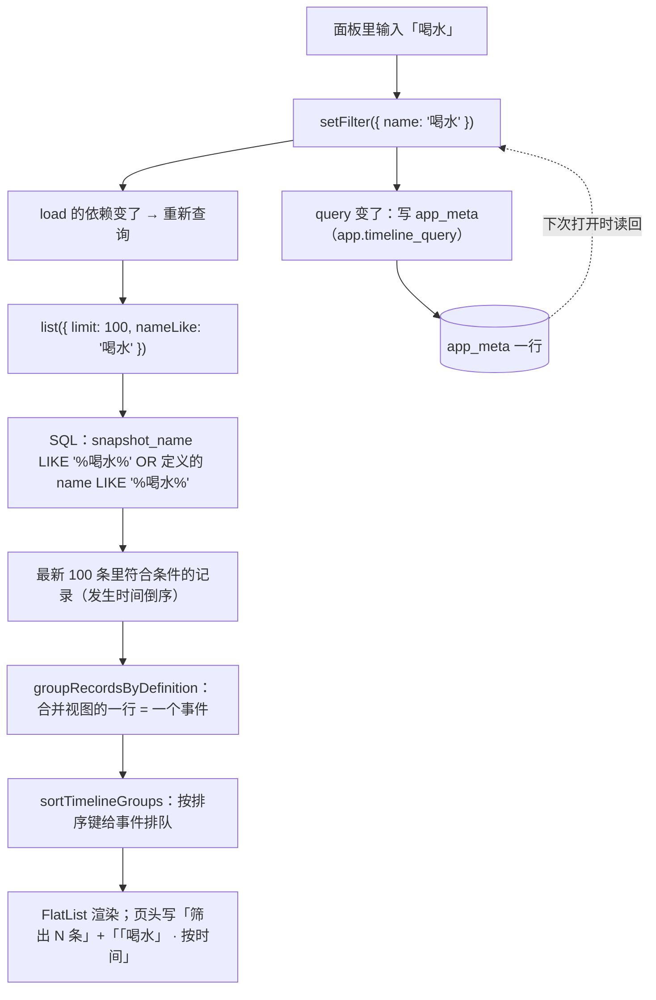

# 19 时间轴的筛选与排序：下推 SQL、事件级排序、把偏好存成一段 JSON

时间轴到了几十上百条之后，「我想只看某个事件」和「我想换个顺序看」就变成刚需。本轮给时间轴页头
加了一颗**「筛选」**按钮：点开是一张「筛选与排序」面板——**事件名（关键字）/ 类型 / 来源 / 分组**
四组筛选 + **按时间 / 按名称 / 按次数 / 按最近修改**四种排序；改一下立刻生效，并且**记住**。

这一篇讲三件不太显然的事：**筛选为什么必须下推到 SQL**、**排序键为什么是「事件级」的**、
**状态为什么可以塞进 `app_meta` 的一段 JSON**。

## 1. 本次完成什么

| 做了什么 | 落在哪里 |
| --- | --- |
| 仓储 `list()` 新增四个筛选条件 | `src/repositories/eventRecordRepository.ts` |
| 筛选 / 排序的类型、默认值、`app_meta` 读写、摘要文案 | `src/features/records/timelineQuery.ts` |
| 排序纯函数（合并视图与逐条视图各一个） | `src/features/records/timelineSort.ts` |
| 就地面板（四组胶囊 + 一个输入框） | `src/features/records/TimelineQueryPanel.tsx` |
| 页面接线：变更即重查、写回 `app_meta`、已删分组自愈 | `src/app/(tabs)/index.tsx` |
| 偏好键 | `src/db/schema.ts`（`app.timeline_query`，**零迁移**） |

界面上的样子：

```
时间轴页头
  最近 42 条，合并为 12 个事件（最多 100 条）      [筛选] [回收站]
  计数 · 快捷 · 按次数                             [清空筛选]        ← 只在「不是默认」时出现
  ┌ 筛选与排序 ─────────────────────────────┐
  │ 事件名   [写下关键字          ]           │
  │ 类型     全部 | 计数 | 数量（历史）        │
  │ 来源     全部 | 手动 | 快捷 | 补录         │
  │ 分组     全部 | 未分组 | 健康 | 工作       │   ← 一个分组都没有时这组不出现
  │ 排序     按时间 | 按名称 | 按次数 | 按最近修改 │
  └──────────────────────────────────────┘
```

## 2. 改了哪些文件

| 文件 | 改动 |
| --- | --- |
| `src/repositories/eventRecordRepository.ts` | `ListRecordsOptions` 加 `nameLike` / `kind` / `source` / `groupId`（全部下推 SQL）；LIKE 元字符转义 |
| `src/repositories/__tests__/eventRecordRepository-test.ts` | 8 条新用例：名字两头认、转义、类型（含造一行历史 `quantity`）、来源、分组（含换组 / 已删定义回落 / 未分组）、与 `limit` 的组合、非法值守卫 |
| `src/features/records/timelineQuery.ts` | **新增**：`TimelineFilter` / `TimelineQuery` / 排序键与文案 / `parseTimelineQuery` / `formatTimelineQuery` / `isFilterActive` / `describeTimelineQuery` / `selectedGroupName` / `toRecordFilterOptions` |
| `src/features/records/timelineSort.ts` | **新增**：`sortTimelineGroups` / `sortTimelineRecords`（纯函数） |
| `src/features/records/TimelineQueryPanel.tsx` | **新增**：面板组件 |
| `src/features/records/__tests__/timelineQuery-test.ts` | **新增**：15 条用例（解析宽容、互逆、摘要、映射） |
| `src/features/records/__tests__/timelineSort-test.ts` | **新增**：11 条用例（四种键 × 两种视图、改名、兜底确定名次、不改原数组） |
| `src/db/schema.ts` | `META_KEYS.timelineQuery` |
| `src/app/(tabs)/index.tsx` | 加载分组的读、筛选下的查询、排序后的 items、页头摘要与面板、空状态分支 |

## 3. 相关技术概念

### 3.1 筛选为什么要**下推到 SQL**

时间轴只读**最近 100 条**（`RECENT_LIMIT`）。如果先读 100 条、再在内存里 `filter`，
筛「喝水」出来的就只是「全库最近 100 条里碰巧是喝水的那几条」——你明明有 300 条喝水记录，
界面却可能只显示 2 条，甚至一条都没有。**这种「少给」是最难被发现的 bug**：用户会以为数据丢了。

所以四个筛选条件全部拼进 `WHERE`：

```ts
new EventRecordRepository(db).list({ limit: RECENT_LIMIT, ...toRecordFilterOptions(filter) });
```

于是「最多 100 条」说的是**符合筛选的最近 100 条**。页头的文案也跟着改成「**筛出** N 条」，
和「最近 N 条」分开讲。

> 同一个理由，统计页的趋势早就把时间范围下推给了 SQL（`list({ from, until })`，见 `12-statistics.md` 3.13 节）。
> 这是本仓库第二次为「别让窗口截断真相」改查询边界。

### 3.2 「筛事件名」到底筛哪个名字

记录里存的是**记录当时的名称**（快照，永不更新，见 `README` 领域规则 2）；而事件定义可以改名。
于是「按名字筛」有两套可能的语义，各自都有死胡同：

| 只认快照名 | 只认定义现在的名字 |
| --- | --- |
| 把「喝水」改名成「饮水」之后，输入「饮水」**搜不到自己** | 老记录的行上还写着「喝水」，输入「喝水」却**一条都不出来** |

两个都糟。所以仓储层**两头都认**（任一命中即算）：

```sql
(snapshot_name LIKE ? ESCAPE '\' OR definition_id IN (SELECT id FROM event_definitions WHERE name LIKE ? ESCAPE '\'))
```

**分组筛选**同理：优先看「事件现在属于哪个分组」（这才是「按分组筛」的直觉——把事件挪出分组，
它名下的历史也跟着走），只有定义**已被永久删除**的历史（子查询里找不到它）才回落到
「记录当时属于哪个分组」，免得那段历史凭空消失。

### 3.3 `undefined` 与 `null`：为什么「不限」和「未分组」分得开

`groupId` 一个字段要表达三种意思，这里刻意用了两个不同的空值：

```ts
groupId?: string | null; // undefined = 不限；null = 未分组；字符串 = 那个分组
```

- 传 `undefined`（或干脆不传）→ 这一条 `WHERE` 根本不出现；
- 传 `null` → SQL 里是 `group_id IS NULL`（**`IS` 而不是 `=`**：只有 `IS` 才认得出 NULL）；
- 传 id → `group_id IS 'grp-…'`（SQLite 的 `IS` 对非 NULL 值等价于 `=`，顺带把两种写法统一了）。

代价是读写都要小心：JSON 里没有 `undefined`，所以存进 `app_meta` 时把三种意思折成
`'all'` / `'none'` / 分组 id（见 3.6）。**如果偷懒把「未分组」也写成 `null`，
读回来就分不清「不限」和「未分组」了**——这是本轮最容易踩、又最容易被测试漏掉的坑，
所以 `timelineQuery-test` 里专门有一条用例钉住它。

### 3.4 `%` 与 `_` 是 LIKE 的通配符

`LIKE` 里 `%` 表示任意内容、`_` 表示任意一个字符。用户搜「完成 100%」时，他想要的是**字面量**，
不是「100 + 任意内容」。所以关键字要先转义，并显式声明转义符：

```ts
function escapeLikePattern(value: string): string {
  return value.replace(/[\\%_]/g, (char) => `\\${char}`);
}
// 拼 SQL：LIKE ? ESCAPE '\'
```

配套的用例：库里同时有「完成 100%」和「完成 100」，搜 `100%` 只能出来前者。

### 3.5 排序键为什么是「事件级」的，且必须**先分组再排序**

四种排序键说的都是**一个事件**的属性：

- **按时间**：最近一次发生（默认，也就是读库本来的顺序）；
- **按名称**：**行上显示的那个名字**（该事件最近一条记录的记录时名称）；
- **按次数**：这次载入的条数——和合并行上的「共 N 次」是同一个数；
- **按最近修改**：**录入时间**（`recorded_at`）。补录的旧事发生时间很早、却是刚记的，
  按这一项就排在前面。（这是用户明确选的定义：**不是**「最近一次发生」——那与「按时间」重复。）

因为键是事件级的，**必须先合并成组、再给组排队**：`RecordGroupRow` 上的「最近一次」与【+1】
都取「组里第一条」，而组里第一条是「最近发生的那条」这个前提来自**发生时间倒序**。
如果先按名字/次数重排记录再分组，组里第一条就不是最近的那条了——「最近一次」和【+1】会跟着错。

所以页面里是两步，顺序不能换：

```ts
// ① 按发生时间倒序合并（组里第一条 = 最近一次）
// ② 再按排序键给**事件**排队
const recordGroups = useMemo(
  () => sortTimelineGroups(groupRecordsByDefinition(records), query.sort),
  [records, query.sort],
);
```

逐条视图（`sortTimelineRecords`）用的是同一套事件键：**同一个事件的记录仍然连在一起**
（名次相同），组内仍是发生时间倒序——「按次数」在逐条视图里就是「用得多的排前面，
它那几条聚在一起」。

### 3.6 偏好存一段 JSON：可以，但解析要**宽容**

筛选 + 排序是**纯展示偏好**：只影响怎么读，不影响库里存了什么，所以按老规矩进 `app_meta`
（`app.timeline_query`），**零迁移**（与 `app.timeline_view` 同一个理由，见 `16-timeline-row-and-detail.md` 3.3 节）。

值是**一段 JSON**（`app_meta` 的 value 是 TEXT，存结构化数据只能这样）：

```json
{"name":"喝水","kind":"quantity","source":"quick","group":"none","sort":"count"}
```

三条约定：

1. **`parseTimelineQuery` 永远不抛错**。不是 JSON、不是对象、字段类型不对、排序键不认识……
   一律回落到默认值。`app_meta` 是纯文本表，哪天被手改坏了，也不该让时间轴打不开。
2. **逐项回落，不是整段丢弃**。例如 `sort` 写着一个不认识的词，只把它换成默认「按时间」，
   名字关键字照旧生效。
3. **`formatTimelineQuery` 与 `parseTimelineQuery` 严格互逆**（有往返用例钉住）。

## 4. 关键代码逐段解释

### 4.1 仓储：四个条件怎么拼 SQL

```ts
if (options.nameLike !== undefined && options.nameLike.trim() !== '') {
  const pattern = `%${escapeLikePattern(options.nameLike.trim())}%`;
  clauses.push(
    `(snapshot_name LIKE ? ESCAPE '\\' OR definition_id IN (SELECT id FROM event_definitions WHERE name LIKE ? ESCAPE '\\'))`,
  );
  params.push(pattern, pattern);
}
if (options.kind !== undefined) {
  if (!isRecordKind(options.kind)) throw new ValidationError(`筛选的记录类型不合法：${String(options.kind)}`);
  clauses.push('kind = ?');
  params.push(options.kind);
}
if (options.groupId !== undefined) {
  clauses.push(
    `(definition_id IN (SELECT id FROM event_definitions WHERE group_id IS ?)
       OR (definition_id NOT IN (SELECT id FROM event_definitions) AND snapshot_group_id IS ?))`,
  );
  params.push(options.groupId, options.groupId);
}
```

读懂这几行要记住三件事：

- **类型 / 来源是记录自己那一列**（`kind` / `source`），直接等值筛。读回来的 `kind` 仍会过
  `toRecordKind` 守卫——筛的时候先用 `isRecordKind` 挡一次，非法值宁可报错也不猜；
- **名字与分组要看「定义现在」**，所以用子查询去 `event_definitions` 里找；
  `definition_id NOT IN (…)` 就是「定义已经被永久删除」的那些行（`event_records` **故意没有外键**，
  历史独立于定义，见 `README` 领域规则 1）；
- **筛选只收窄「看什么」**：这些条件一个字节都不会写库。

### 4.2 `timelineQuery.ts`：类型、默认值、摘要

```ts
export interface TimelineFilter {
  name: string;              // 空串 = 不限
  kind?: RecordKind;         // undefined = 不限
  source?: RecordSource;
  groupId?: string | null;   // undefined = 不限，null = 未分组
}
export type TimelineSortKey = 'time' | 'name' | 'count' | 'recorded';
export const DEFAULT_TIMELINE_QUERY: TimelineQuery = { filter: { name: '' }, sort: 'time' };
```

`describeTimelineQuery(query, groupName)` 负责一句话说清「现在在看什么」——
页头那行摘要与（将来的）折叠开关共用它，避免两处各写一遍文案；
没筛任何东西时它也说「**全部 · 按时间**」：这句话要回答「现在在看什么」，
空着反而让人分不清是「全看」还是「还没加载出来」。

`toRecordFilterOptions(filter)` 把界面用的 `name` 映射成仓储的 `nameLike`，
并把「只有空白」的关键字折成 `undefined`（空条件不进 SQL）。

### 4.3 `timelineSort.ts`：算键 → 排名 → 兜底

```ts
function eventSortKeys(records) { /* 每个定义：名字、条数、最近发生、最近录入 */ }
function compareSortKeys(a, b, sort) {
  switch (sort) {
    case 'name':     return a.name.localeCompare(b.name);            // 升序
    case 'count':    return b.count - a.count;                       // 降序
    case 'recorded': return b.latestRecordedAt.localeCompare(a.latestRecordedAt);
    case 'time':
    default:         return b.latestOccurredAt.localeCompare(a.latestOccurredAt);
  }
}
```

两个细节值得单独说：

- **入参必须是发生时间倒序**（`list()` 的默认顺序）：`eventSortKeys` 把每个定义**第一次出现**
  的那条记录当成它的「最近一次」，靠的就是这个前提。合并视图那边把各组的记录**摊平**再算，
  也成立——同一个定义只可能出现在一个分组里，而组内本来就是倒序的。
- **名次相等时也要有确定结果**：`compareSortKeys` 之后补两个兜底（最近发生时间倒序、定义 id 升序）。
  JS 的 `Array.prototype.sort` 是稳定的，但没有兜底的话，「两个事件同名同次数」的先后
  会随数据库返回顺序漂移——排序结果不该是随机的。

### 4.4 `TimelineQueryPanel`：四组「不限 + 选一个」

每组都是「**不限 + 选一个**」：点「全部」= 取消这一项。为什么不给多选？四组条件组合起来够用，
而多选要多讲一套「怎么多选、怎么取消选中」——面板是要在一屏里看完的。

```tsx
const setFilter = (patch: Partial<TimelineFilter>) => onChange({ ...query, filter: { ...filter, ...patch } });
...
<Chip label="全部" selected={filter.kind === undefined} onPress={() => setFilter({ kind: undefined })} />
{RECORD_KINDS.map((kind) => (
  <Chip key={kind} label={recordKindLabel(kind)} selected={filter.kind === kind} onPress={() => setFilter({ kind })} />
))}
```

「分组」那一组只在**真的有分组**时出现（一个分组都没有时，「全部」与「未分组」是同一件事）。
「**未分组**」是一颗**筛选项**，不是往列表空位上填的占位词——它与「列表不写未分组」
（`README` 领域规则 5 / 20）不矛盾：那里说的是**行上的信息**，这里是**筛选条件**。

### 4.5 页面接线：筛选变了就重查；**读一次、改了就写**

```ts
const load = useCallback((showSpinner: boolean) => { /* list({ limit, ...筛选 }) */ }, [db, filter]);

// 回到这一页要重读；`load` 跟着筛选变，所以改了筛选也会立刻重查
useFocusEffect(useCallback(() => load(true), [load]));

// 挂载时读一次：这一页没有别的写入者，重新聚焦时读回来的只会是自己刚写进去的值
useEffect(() => { /* get(META_KEYS.timelineQuery) → setQuery(parseTimelineQuery(stored)) */ }, [db]);

// 改了就写回
useEffect(() => {
  if (!hydrated.current) return;   // 等第一次读完再写，免得把默认值盖掉存着的偏好
  new MetaRepository(db).set(META_KEYS.timelineQuery, formatTimelineQuery(query)).catch(() => undefined);
}, [db, query]);
```

两个判断都在注释里写清了：

- **为什么这里不像「显示方式」那样聚焦重读**：显示方式的开关住在「设置」页，作用在时间轴，
  所以必须重读；筛选与排序的开关**就在这一页**，自己是唯一的写入者，挂载时读一次就够。
- **`hydrated` 这个 ref 是必需的**：读是异步的，如果不挡一下，那个「写」的 effect
  会在读到之前先把**默认值**写进去，用户的偏好就被自己的默认值覆盖了。

### 4.6 已删分组的自愈

存着的分组筛选可能指向一个**已经被删掉的分组**（分组在「事件」页里随时能删）。那会筛出空列表——
看着就像「记录不见了」。所以读到分组后顺手检查一次：

```ts
setQuery((current) => {
  const groupId = current.filter.groupId;
  if (typeof groupId !== 'string' || loadedGroups.some((group) => group.id === groupId)) {
    return current;   // 没筛分组 / 分组还在：原样返回同一个对象，React 会跳过重渲染
  }
  return { ...current, filter: { ...current.filter, groupId: undefined } };
});
```

**只放下「分组」这一项**，其余筛选与排序照旧——这是「这一项已经不存在了」而不是「用户改主意了」。

## 5. 一次完整数据流：输入关键字「喝水」



## 6. 如何验证

**单元测试**（`npm test`）：

- `src/repositories/__tests__/eventRecordRepository-test.ts`：名字两头认（改名前后都能搜到）、
  `%` / `_` 不当通配符、类型（含直接造一行历史 `quantity`）、来源、分组（换组跟着走 / 已删定义回落 /
  「未分组」）、筛选与 `limit` 的组合（`limit` 说的是「符合条件的最近 N 条」）、非法值抛 `ValidationError`。
- `src/features/records/__tests__/timelineQuery-test.ts`：没存过 / 坏数据回落到默认、
  「不限」与「未分组」分得开、写出去再读回来是同一套、逐项回落、摘要文案、分组名解析、映射到仓储参数。
- `src/features/records/__tests__/timelineSort-test.ts`：四种键在合并视图与逐条视图下的顺序、
  「按名称」用的是最近一条记录的名字（不是更早那条快照里的旧名字）、键值全相同时的确定名次、
  不改动原数组。

**手工检查清单**（真机或模拟器）：

1. 点「筛选」→ 面板展开；再点一次收起，页头摘要行还在（说明状态没丢）。
2. 输入一半名字：列表随着输入变少；页头写「筛出 N 条」。
3. 点「来源 → 补录」：只剩补录的那些；点「全部」回到全量。
4. 点「分组 → 未分组」：只剩没有分组的事件的记录。
5. 点「排序 → 按次数」：用得多的排前面；切「逐条」看，同一事件的记录是连在一起的。
6. 杀掉 App 再打开：筛选与排序**还在**（`app_meta`）。
7. 点「清空筛选」：回到「全部」，排序若也不是默认，再点一次「还原排序」。
8. 在「事件」页删掉当前筛的那个分组，回时间轴：不再筛出空列表（自愈成「全部」）。

**端到端**：`.maestro/flows/11-timeline-filter-and-sort.yaml`（面板、摘要、跨重启记得住、还原默认）。
⚠️ 本机**没有重跑** Maestro（见 `HANDOFF.md` 第 8 节）。

## 7. 常见问题与排查

### 问题：筛「喝水」只出来几条，甚至一条都没有

先看页头写的是「**筛出** N 条」还是「最近 N 条」。「筛出」说明 WHERE 已经生效；数量少的原因通常是：

1. **「最多 100 条」的窗口**：筛的是「符合条件的最近 100 条」，更早的记录不在这一次的窗口里
   （这是时间轴的老限制，见 `HANDOFF.md` 第 10 节）。要看得更早，去「事件」页看那个事件的记录页。
2. **名字是两头的**：老记录的快照名与事件现在的名字任一命中都会出来，
   所以搜到「你以为已经改掉的老名字」是**正常**的。

### 问题：改名之后，用新名字搜不到老记录？

不应该。仓储里名字是「快照名 **OR** 定义现在的名字」两头认（3.2 节），
并且有一条单测专门盖这个场景。真搜不到，先确认筛的**不是**类型 / 来源 / 分组里的某一项
（摘要行会把它们都写出来，一行一行对着看）。

### 问题：「按次数」的次数和我想的不一样

「次数」= **这次载入的条数**，也就是合并行上「共 N 次」那个数。所以它同样受「最多 100 条」
窗口的影响：一个非常活跃的事件被窗口截掉一半记录，次数也就少一半。这不是 bug，
但**如果以后做分页 / 无限滚动，这一项要重新想**（记在 `HANDOFF.md` 技术债里）。

### 问题：「按时间」和「按最近修改」什么时候不一样？

只有**发生过补录**时才不一样：补录的记录「发生时间很早、录入时间很晚」。
「按时间」看的是事情什么时候发生，所以那条补录沉在下面；「按最近修改」看的是你什么时候记的，
它就在前面。想「最近动过的先看」就用后者。

### 问题：打开 App 发现时间轴「只剩几条」

因为筛选**记住了**（`app_meta`）。页头会写「筛出 N 条」与摘要（如「补录 · 按时间」），
点一次「清空筛选」就回到全量。这是有意为之的取舍：宁可让你看到「现在被筛住了」，
也不要每次都忘掉你刚设好的条件。

### 问题：在「事件」页删掉了分组，时间轴一直空着

不会一直空：读到分组后发现筛的那个 id 不在了，会自动放下这一项（4.6 节）。
如果**正巧**看到那一瞬的空列表（补录前的一帧），再点一次「清空筛选」也一样。

## 8. 学习总结与练习

**这一轮的三条经验：**

1. **「在内存里筛」和「在库里筛」不是等价的**——只要列表有窗口（`LIMIT`），
   内存里筛就会静默少给数据。判断标准很简单：**这句话会不会让用户以为数据丢了**。
2. **空值的语义要显式设计**：`undefined` 与 `null` 在这里不是风格问题，
   而是「不限」与「未分组」两个不同的意思；一旦折进 JSON 还得再设计一次（`'all'` / `'none'`）。
3. **排序键先问「这个键属于谁」**：键是事件级的，就必须先分组再排序，
   否则「组里第一条 = 最近一次」这个前提会被排序悄悄破坏。

**练习：**

1. 给它加一个**第五种排序「按取值」**（计数型按最近一次的取值倒序）。想一想：
   历史 `quantity`（数量）与计数型的取值能不能一起排？`compareSortKeys` 里怎么写出兜底？
   （提示：`eventSortKeys` 要多存一个 `latestValue`；两条 `timelineSort-test` 用例就能钉住。）
2. 把「类型」「来源」两组改成**多选**。需要动哪几层？
   （提示：`TimelineFilter` 的字段变成数组、`toRecordFilterOptions` 传数组、
   仓储里 `kind IN (…)` 的占位符要按个数拼——这一层的「空数组 = 不限」也要想清楚。）
3. 现在「最多 100 条」的窗口在筛选生效时**仍然存在**。如果要做「加载更多」，
   排序（尤其是「按次数」）该怎么定义？把结论写进 `HANDOFF.md` 的技术债条目里再动手。