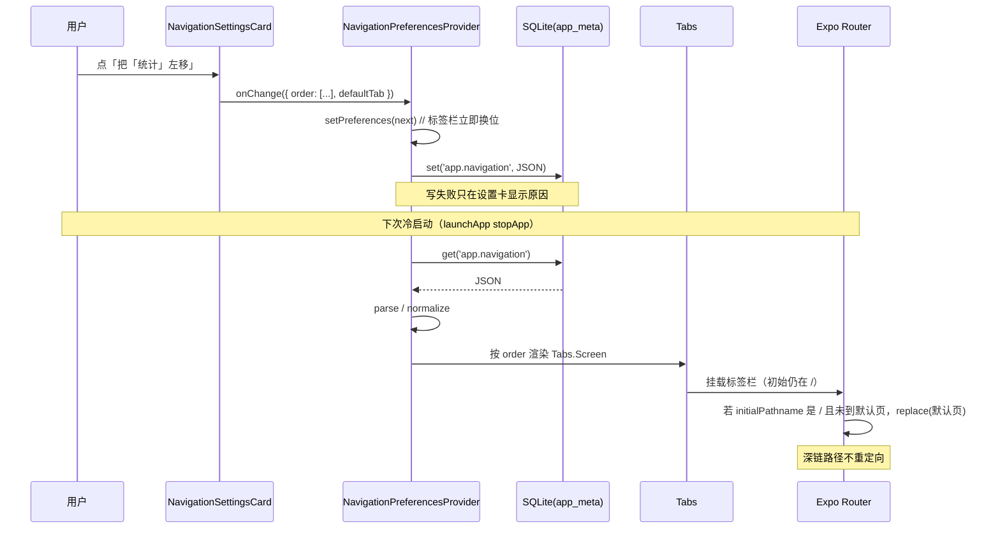

# 21 自定义底部导航顺序与默认页

> 本文讲两件相关的小功能：让用户把四个底部标签**换顺序**，以及选择**每次冷启动先打开哪一页**。
> 两者都是纯展示偏好，不改任何业务数据，所以仍然存在 `app_meta` 里，**没有新增迁移**。

## 1. 本次完成什么

- 「设置」页新增一张「底部导航」卡：
  - 四个标签按当前顺序列出，每行有「左移 / 右移」；
  - 下方用胶囊选「默认打开」哪一页；
  - 顺序改完**立即**反映到标签栏；默认页**下次冷启动**生效。
- 默认顺序仍是：时间轴 → 统计 → 事件 → 设置；默认页是时间轴。
- 偏好存 `app_meta` 的一个键 `app.navigation`，值为一段 JSON：
  ```json
  { "order": ["index", "stats", "definitions", "settings"], "defaultTab": "index" }
  ```
- 读到坏数据 / 未知路由 / 重复项时自动收拾，**永远不会少一个标签**。
- 冷启动时如果初始路径是 `/`，才按默认页跳转；深链（例如直接打开某条记录详情）不抢路。
- 新增流程 `14` 真手点验证「换顺序 → 冷启动落在默认页 → 还原」，并补了纯函数单测与组件测试。

## 2. 改了哪些文件

| 文件 | 作用 |
| --- | --- |
| `src/db/schema.ts` | `META_KEYS.navigation = 'app.navigation'` |
| `src/features/navigation/navigationPreferences.ts` | 路由名 / 中文名 / 路径、默认值、归一化、解析、序列化、移动一格 |
| `src/features/navigation/NavigationPreferencesProvider.tsx` | 启动读一次，改的时候先改内存再写库 |
| `src/features/navigation/NavigationSettingsCard.tsx` | 「底部导航」设置卡的 UI（只收 props、不碰库） |
| `src/app/(tabs)/_layout.tsx` | 按偏好渲染 `Tabs.Screen`；冷启动按默认页做一次重定向 |
| `src/app/(tabs)/settings.tsx` | 挂上 `NavigationSettingsCard` |
| `src/components/Chip.tsx` | 新增可选 `accessibilityLabel`（默认页胶囊需要可区分的读屏名字） |
| `src/features/navigation/__tests__/` | 纯函数单测 + 设置卡组件测试 |
| `.maestro/flows/14-tab-order-and-default.yaml` | 冷启动默认页与标签换位的端到端回归 |

## 3. 相关技术概念

### 3.1 `app_meta` 与零迁移

`app_meta` 是一张只有 `key TEXT PRIMARY KEY, value TEXT` 的键值表。它从 v1 就存在，用来放
「不属于业务事实、但需要跨重启记住」的东西：

- 启动次数、安装时间；
- 时间轴显示方式（`app.timeline_view`）；
- 时间轴筛选与排序（`app.timeline_query`）；
- 周期预测窗口（`app.prediction_window`）；
- 以及这次的导航偏好（`app.navigation`）。

因为表结构不变，这次功能**不需要迁移，也不动 `user_version`**。这是刻意的选择：
导航顺序不参与统计、不需要被外键引用，也不该在备份导入时被当成业务数据合并。

### 3.2 Expo Router 的标签顺序从哪来

`Tabs` 的四个页面不是写死的配置数组，而是四个 `Tabs.Screen` 子元素：

```tsx
<Tabs>
  <Tabs.Screen name="index" options={...} />
  <Tabs.Screen name="stats" options={...} />
  <Tabs.Screen name="definitions" options={...} />
  <Tabs.Screen name="settings" options={...} />
</Tabs>
```

React Navigation 按子元素顺序建路由，标签栏也按这个顺序画。所以只要把数组 `map` 成
`Tabs.Screen`，并把 `key` 设成稳定的路由名，顺序就能由偏好控制：

```tsx
{preferences.order.map((route) => (
  <Tabs.Screen key={route} name={route} options={...} />
))}
```

**路由名不变**，变的只是它们在标签栏里的位置。因此 `/stats`、`/definitions` 这些路径、
深链、页面内的 `router.push('/stats')` 全都不受影响。

### 3.3 为什么不用 `initialRouteName`

直觉上，默认页应该写成 `<Tabs initialRouteName="stats">`。但 Expo Router 的 `Tabs` 类型里
**没有这个 prop**：它的初始路由来自 layout 文件导出的静态 `unstable_settings`，而静态对象在
模块加载时就定了，读不到异步的 SQLite 偏好。

所以这里的策略是：

1. 先按用户偏好正常挂载标签栏；
2. 等偏好读完后，若这是**冷启动且初始路径是 `/`**，用 `router.replace(默认页路径)` 切一次；
3. 切换完成前盖一层与背景同色的加载层，避免先闪一下时间轴。

这不是「每次进入时间轴就跳走」：重定向只在一个组件生命周期里执行一次，而且只在初始路径是
`/` 时执行。用户之后手动点回时间轴，不会再被弹开。

### 3.4 冷启动 vs 从后台回来

`router.replace` 只在 JS 重新加载时执行。App 被切到后台再回来时，JS 没有重新启动，
当前页面保持不变——这是移动端的常见预期：用户去分享一个文件、回个消息，不应该回来就被
弹到另一页。所以设置卡的副标题写的是「默认页**下次启动**生效」，不是「每次回到前台」。

### 3.5 归一化：坏数据也要能启动

偏好是用户可改、也可能来自旧版本的。读取时不能假设它一定完整：

- 不认识的字符串（例如旧版本删掉的路由）→ 丢掉；
- 重复的路由 → 只留第一次；
- 少了的已知路由 → 按默认顺序补在末尾；
- 默认页认不出来 → 回到时间轴。

这样即使 JSON 被手工改坏，标签栏也不会只剩两个标签。

## 4. 关键代码逐段解释

### 4.1 偏好形状与纯函数

`src/features/navigation/navigationPreferences.ts`：

```ts
export const TAB_ROUTES = ['index', 'stats', 'definitions', 'settings'] as const;
export type TabRoute = (typeof TAB_ROUTES)[number];

export interface NavigationPreferences {
  order: TabRoute[];
  defaultTab: TabRoute;
}
```

`normalizeTabOrder` 先按用户存的顺序收集合法项，再把 `TAB_ROUTES` 里缺的补上：

```ts
export function normalizeTabOrder(value: unknown): TabRoute[] {
  const seen = new Set<TabRoute>();
  if (Array.isArray(value)) {
    for (const item of value) {
      if (isTabRoute(item)) {
        seen.add(item);
      }
    }
  }
  for (const route of TAB_ROUTES) {
    seen.add(route);
  }
  return [...seen];
}
```

`Set` 保留插入顺序，所以「用户顺序在前、缺的按默认顺序在后」自然成立。例如存的是
`['stats', 'stats', 'nope', 'index']`，结果是：

```text
['stats', 'index', 'definitions', 'settings']
```

`moveTab` 只交换相邻两项，越界时返回一份新数组（不改入参）：

```ts
export function moveTab(order, route, offset: -1 | 1): TabRoute[] {
  const index = order.indexOf(route);
  const target = index + offset;
  const next = [...order];
  if (index < 0 || target < 0 || target >= next.length) {
    return next;
  }
  const [moved] = next.splice(index, 1);
  if (moved !== undefined) {
    next.splice(target, 0, moved);
  }
  return next;
}
```

### 4.2 解析与序列化

`parseNavigationPreferences` 对缺失、空串、坏 JSON 一视同仁，都返回**新造的默认值**：

```ts
if (!value) return fallback;
try {
  parsed = JSON.parse(value);
} catch {
  return fallback;
}
```

随后：

```ts
const order = normalizeTabOrder(stored.order);
const defaultTab = isTabRoute(stored.defaultTab) ? stored.defaultTab : DEFAULT_TAB_ROUTE;
return { order, defaultTab };
```

写入就是严格的逆向：

```ts
JSON.stringify({ order: preferences.order, defaultTab: preferences.defaultTab })
```

单测里专门做了「写入再读出完全一致」的往返检查，避免以后改字段名时两边漂移。

### 4.3 Provider：读一次，改的时候先改界面

`NavigationPreferencesProvider` 用 `useReadyDatabase()` 拿到已就绪的连接，挂载时读一次：

```tsx
new MetaRepository(db)
  .get(META_KEYS.navigation)
  .then((stored) => setPreferences(parseNavigationPreferences(stored)))
  .finally(() => setLoading(false));
```

设置卡改顺序时：

```tsx
const update = useCallback((next) => {
  setPreferences(next);          // 本地立即生效：标签栏马上换位
  setError(null);
  new MetaRepository(db)
    .set(META_KEYS.navigation, serializeNavigationPreferences(next))
    .catch((cause) => setError(...)); // 写失败只在设置页提示，不阻断浏览
}, [db]);
```

这是一个刻意的不对称：读取失败用默认值继续工作；写入失败保留界面上的新顺序，但把原因显示在
卡片底部。和项目里其他偏好（时间轴显示方式、预测窗口）的处理一致。

### 4.4 标签栏：顺序来自 Context

`src/app/(tabs)/_layout.tsx` 把 Provider 放在 `Tabs` 外面，让标签栏和设置页共享同一份状态：

```tsx
export default function TabsLayout() {
  return (
    <NavigationPreferencesProvider>
      <TabsNavigator />
    </NavigationPreferencesProvider>
  );
}
```

`TabsNavigator` 在偏好读完之前只画一个转圈；读完后渲染 `TabNavigator`：

```tsx
{preferences.order.map((route) => (
  <Tabs.Screen
    key={route}
    name={route}
    options={{
      title: TAB_ROUTE_LABELS[route],
      tabBarIcon: ({ size, focused }) => (
        <Ionicons name={iconName(TAB_META[route].icon, focused)} ... />
      ),
    }}
  />
))}
```

`key` 用路由名而不是数组下标：换顺序时 React 认为还是那四个屏幕，只是位置变了，
当前激活的「设置」页不会被卸载重建。

### 4.5 默认页：只重定向一次

`TabNavigator` 只在偏好加载完成后挂载，因此它可以用 `useState` 的惰性初始值把两个「启动瞬间」
的值钉住：

```tsx
const [initialPathname] = useState(pathname);
const [launchTarget] = useState(() => TAB_ROUTE_HREFS[preferences.defaultTab]);
```

- `initialPathname` 是用户进入 App 时的路径：`/` 代表正常冷启动，`/records/...` 代表深链。
- `launchTarget` 是**这次启动**的默认页。之后用户在设置里再改默认页，不会改变 `launchTarget`，
  所以不会把当前页盖住或立刻跳走。

重定向本身只做一次：

```tsx
useEffect(() => {
  if (appliedDefault.current) return;
  appliedDefault.current = true;
  if (initialPathname === '/' && pathname !== launchTarget) {
    router.replace(launchTarget);
  }
}, [initialPathname, launchTarget, pathname, router]);
```

深链不抢路：如果 `initialPathname !== '/'`，即使默认页是设置，也不会把用户从记录详情拽走。

### 4.6 为什么还要盖一层

`router.replace` 发生在第一次渲染之后：标签栏已经挂载，时间轴可能已经画了一帧。为了不闪，
只要「初始路径是 `/`」且「当前还没到默认页」，就显示一层与背景同色的 loading：

```tsx
const covering =
  !redirectExpired && initialPathname === '/' && pathname !== launchTarget;
```

`redirectExpired` 是一个 2 秒兜底：极端情况下导航没有落地，也不能让用户一直看着转圈。
正常路径下 `pathname` 到达默认页后，条件是 `false`，加载层自然消失，不需要额外的「隐藏」状态。

### 4.7 设置卡：可见文字 + 无障碍名字

`NavigationSettingsCard` 是一个纯展示组件，只收 `preferences`、`error`、`onChange`：

```tsx
<Button
  label="左移"
  size="sm"
  tone="secondary"
  disabled={index === 0}
  accessibilityLabel={`把「${TAB_ROUTE_LABELS[route]}」左移`}
  onPress={() => onChange({ ...preferences, order: moveTab(order, route, -1) })}
/>
```

一屏有四行「左移 / 右移」，可见文字必然重名。无障碍名字带上标签名后：

- 读屏能说清移动的是哪一行；
- Maestro 可以精确点 `把「统计」左移`，不需要用半平面的 `rightOf` / `below` 猜。

默认页胶囊同理：

```tsx
<Chip
  label={TAB_ROUTE_LABELS[route]}
  selected={defaultTab === route}
  accessibilityLabel={`默认打开「${TAB_ROUTE_LABELS[route]}」`}
  onPress={() => onChange({ ...preferences, defaultTab: route })}
/>
```

`Chip` 因此新增了可选的 `accessibilityLabel`；可见文字保持「时间轴 / 统计 / …」不变。

## 5. 一次完整的数据流



## 6. 如何验证

### 6.1 单元测试与组件测试

```bash
npx jest src/features/navigation
npm run verify
```

- `navigationPreferences-test.ts`：
  - 坏值 / 空值回退默认；
  - 未知项、重复项、缺项归一化；
  - 默认页认不出来回到时间轴；
  - 序列化往返；
  - 左右移动与边界。
- `navigationSettingsCard-test.tsx`：
  - 首尾方向按钮禁用；
  - 移动按钮交回完整的新顺序；
  - 默认页胶囊交回新的 `defaultTab`；
  - 错误信息只作为提示，不影响操作。

### 6.2 端到端

```bash
export JAVA_HOME=/opt/homebrew/opt/openjdk@17
export DEVELOPER_DIR=/Applications/Xcode.app/Contents/Developer
~/.maestro/bin/maestro test .maestro/flows/14-tab-order-and-default.yaml
```

流程做了两次真正的冷启动（`launchApp: stopApp: true`）：

1. 设置 → 把统计左移一格 → 标签无障碍名从 `tab, 2 of 4` 变成 `1 of 4`；
2. 默认页选「事件」→ 冷启动 → 直接看到「+ 新建事件」，且统计仍在第一位；
3. 还原顺序、默认页回时间轴 → 再冷启动 → 回到时间轴。

### 6.3 完整回归

```bash
maestro test .maestro/flows
npx expo export --platform ios
```

改动标签栏会影响每条流程的启动，所以这个功能不能只跑新流程。

## 7. 常见问题排查

### 默认页没有生效

按顺序检查：

1. 是不是**冷启动**？从后台切回来不会重新执行 `router.replace`。
2. 进入时是不是 `/`？从深链打开其他页面会尊重深链。
3. `app_meta` 里有没有 `app.navigation`？可以在设置页的「app_meta 表内容」里看。
4. 设置卡的副标题已经写明「下次启动生效」；当前会话不会立刻跳页。

### 标签顺序乱了 / 少了一个

`normalizeTabOrder` 会丢掉未知项、去重、补缺。如果仍然是乱的，先确认存的是不是
`{ order: [...], defaultTab: '...' }` 这个形状；旧版本或手工改坏的 JSON 会回退默认。

### 启动时白屏或一直转圈

正常路径只转很短一下。若超过 2 秒，兜底会把加载层收掉；这时应该检查 Metro / 数据库是否报错，
而不是加载层本身。

### 设置页的导出按钮找不到了

新增了一张卡，设置页变长。流程 `04` 因此把「关掉分享面板后」的断言改成**再滚一次**
到导出按钮，而不是假设它还在原位。这是界面变长导致的流程漂移，不是导出功能坏了。

## 8. 学习总结与练习

这轮最值得记住的三件事：

1. **「顺序」是 UI 配置，不是数据库结构**：能存键值表就不要加列 / 加表。
2. **动态 `initialRouteName` 不存在时，用「一次重定向」而不是伪造静态配置**：先挂载、
   再 `replace`、最后用一次性的状态和初始路径把范围锁死。
3. **可访问性名字是界面的一部分**：它既服务读屏，也让端到端能精确点到「哪一行」。

可以自己试着改一改：

- 把移动按钮从「左移 / 右移」换成上/下箭头，看看无障碍名字要不要跟着改；
- 增加「恢复默认顺序」按钮（提示：调用 `defaultNavigationPreferences()` 再 `onChange`）；
- 想想如果以后加第五个标签，`normalizeTabOrder` 会怎么处理老用户存下的四标签偏好。